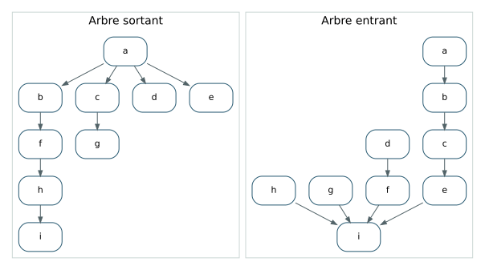
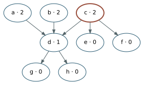

# X-ENS MP · Informatique A 2015 · Corrigé brut

*Corrigé rédigé par IA, non officiel. Signalez toute erreur.*

**Rédaction** · GPT-6.2 Astra Ultra · vitesse non renseignée · 25 novembre 2026

**Révision** · GPT-6.2 Astra Ultra · vitesse non renseignée · 26 novembre 2026

Les tâches ont une durée unitaire et les dépendances sont orientées du prédécesseur vers le successeur. Les fonctions utilisent les opérations de la bibliothèque Caml du sujet. Les parties I et V ne comportent pas de questions.

## II · Graphes de tâches acycliques

### Question 1 · Un chemin impose des dates strictement croissantes

Soit $u_0=u\to u_1\to\cdots\to u_k=v$, $k\ge1$. Pour chaque arc, $\sigma(u_{i+1})\ge\sigma(u_i)+1$. En additionnant, $\sigma(v)\ge\sigma(u)+k>\sigma(u)$. Un cycle imposerait $\sigma(u)>\sigma(u)$. Tout graphe ordonnançable est donc acyclique.

### Question 2 · Existence d’une racine et d’une feuille

Le graphe est fini et non vide. S’il n’avait aucune racine, on pourrait suivre indéfiniment des prédécesseurs depuis n’importe quelle tâche. Un sommet se répéterait, donnant un cycle orienté dans le sens direct des dépendances. C’est impossible. En suivant des successeurs, le même argument prouve l’existence d’une feuille. Ces deux rôles peuvent être tenus par une même tâche isolée.

### Question 3 · Compter les tâches et les racines

Une racine a exactement zéro prédécesseur. Le premier résultat est la longueur du tableau, le second le nombre d’entrées vérifiant ce test. On utilise ici les signatures à graphe explicite de la table 2.

```ocaml
let count_tasks g = vect_length (get_tasks g);;

let count_roots g =
  let tasks = get_tasks g and n = ref 0 in
  for i = 0 to vect_length tasks - 1 do
    if vect_length (get_predecessors tasks.(i) g) = 0 then incr n
  done;
  !n;;
```

### Question 4 · Construire le tableau des racines

À chaque étape, les cases d’indices strictement inférieurs à $j$ contiennent les racines déjà rencontrées. Le compteur ne dépasse jamais la taille calculée. La valeur spéciale sert uniquement à l’allocation initiale et aucune opération de consultation ne lui est appliquée.

```ocaml
let make_root_array g =
  let tasks = get_tasks g in
  let roots = make_vect (count_roots g) empty_task and j = ref 0 in
  for i = 0 to vect_length tasks - 1 do
    let t = tasks.(i) in
    if vect_length (get_predecessors t g) = 0 then begin
      roots.(!j) <- t;
      incr j
    end
  done;
  roots;;
```

## III · Ordonnancement par hauteur

### Question 5 · Tester les étiquettes des prédécesseurs

La fonction auxiliaire `tous` s’arrête au premier échec et renvoie vrai sur le tableau vide. Dans le contexte du graphe `g`, la liaison locale `let check_tags_predecessors = check_tags_predecessors_dans g in ...` a exactement le type `task -> bool` demandé. La table 2 donne deux arguments à `get_predecessors`, alors que l’exemple de parcours du sujet ne passe que la tâche. L’application partielle explicite le choix du graphe sans exiger un accès global implicite.

```ocaml
let tous pred tab =
  let i = ref 0 in
  while !i < vect_length tab && pred tab.(!i) do incr i done;
  !i = vect_length tab;;

let check_tags_predecessors_dans g t =
  tous has_tag (get_predecessors t g);;
```

### Question 6 · Étiqueter par vagues depuis les racines

L’entrée de l’algorithme 1 est un graphe sans étiquettes initiales. Au premier tour, seules les racines satisfont le test. Le premier balayage stocke les tâches à traiter, le second écrit le même numéro sur toutes. Ainsi une tâche nouvellement étiquetée ne peut débloquer un successeur dans le même tour. Le tableau de travail n’est lu que dans son préfixe rempli. Si aucun progrès n’est possible, la version ci-dessous signale l’échec au lieu de répéter indéfiniment la même vague.

```ocaml
let etiqueter voisins g =
  let ts = get_tasks g in
  let restants = ref (vect_length ts) and niveau = ref 0 in
  let prochains = make_vect (vect_length ts) empty_task in
  while !restants > 0 do
    let k = ref 0 in
    for i = 0 to vect_length ts - 1 do
      let t = ts.(i) in
      if not (has_tag t) && tous has_tag (voisins t g) then begin
        prochains.(!k) <- t;
        incr k
      end
    done;
    if !k = 0 then failwith "cycle ou etiquettes initiales inconsistantes";
    for j = 0 to !k - 1 do set_tag !niveau prochains.(j) done;
    restants := !restants - !k;
    incr niveau
  done;;

let label_height g = etiqueter get_predecessors g;;
```

### Question 7 · Existence d’un chemin critique amont

En remontant de $u$ par les prédécesseurs, on atteint nécessairement une racine. La chaîne inversée est un chemin vers $u$, éventuellement de longueur nulle. Dans un graphe acyclique, un chemin ne revisite pas une tâche. Avec $n$ tâches il a donc au plus $n-1$ arcs. L’ensemble non vide des longueurs admet un maximum, qui est réalisé par un chemin critique amont.

### Question 8 · Numéro de vague et hauteur

Si $h(u)$ est la longueur maximale amont, $h(u)=0$ pour une racine et, sinon,

$$
h(u)=1+\max_{v\to u}h(v).
$$

En effet, un plus long chemin vers $u$ se termine par un prédécesseur et réciproquement tout chemin vers un prédécesseur se prolonge. Par induction sur $h(u)$, toutes les racines sont étiquetées au tour 0. Si $h(u)=k>0$, les prédécesseurs ont hauteur au plus $k-1$ et l’un a exactement $k-1$. Par hypothèse ils sont tous marqués avant le tour $k$, mais le dernier ne l’était pas avant le tour $k-1$. La mise à jour simultanée attribue donc exactement $k$ à $u$. Cela établit les deux sens.

### Question 9 · Terminaison et cycle

Dans un graphe acyclique, la plus grande hauteur est finie et 8 montre que toutes les tâches sont étiquetées au plus tard à ce tour. Dans un cycle, aucune de ses tâches ne peut être la première étiquetée, car elle exigerait l’étiquette de sa devancière sur ce même cycle. Par exemple avec la racine isolée $a$ et le cycle $b\to c\to b$, seule $a$ est marquée. L’algorithme 1 tel qu’énoncé répète ensuite des tours vides. Le programme de 6 détecte ce blocage et termine par une exception.

### Question 10 · Date minimale d’une tâche de hauteur donnée

Un chemin critique jusqu’à $u$ contient $k$ arcs, donc $k$ prédécesseurs qui doivent s’exécuter successivement. Si la première tâche du graphe démarre à $t_0$, la première de ce chemin démarre au plus tôt à $t_0$. Par 1, $\sigma(u)\ge t_0+k$ pour tout nombre de processeurs. La fin de $u$ ne peut précéder $t_0+k+1$.

### Question 11 · Imprimer un niveau par lots de taille p

Le nombre de niveaux est au plus $n$. L’insertion en parcourant le tableau à rebours préserve l’ordre du tableau à hauteur égale. La fonction locale revient à zéro après chaque lot complet et termine la ligne d’un éventuel lot incomplet avant de passer au prochain niveau.

```ocaml
let schedule_height g p =
  if p <= 0 then invalid_arg "nombre de processeurs";
  let ts = get_tasks g in
  let niveaux = make_vect (vect_length ts) [] in
  for i = vect_length ts - 1 downto 0 do
    let t = ts.(i) in
    let k = get_tag t in
    niveaux.(k) <- t :: niveaux.(k)
  done;
  print_string "Begin"; print_newline ();
  for k = 0 to vect_length niveaux - 1 do
    let rec imprimer utilises = function
      | [] -> if utilises <> 0 then print_newline ()
      | t :: suite ->
          if utilises <> 0 then print_string " ";
          print_string (get_name t);
          if utilises + 1 = p then begin
            print_newline (); imprimer 0 suite
          end else imprimer (utilises + 1) suite
    in imprimer 0 niveaux.(k)
  done;
  print_string "End"; print_newline ();;
```

### Question 12 · Complexité du programme par hauteur

Le tableau de listes a $n$ cases. Chaque tâche est lue, classée et imprimée une fois. Les insertions en tête sont en temps constant. Il y a au plus $n$ lignes de lots. Pour $p\ge1$, le temps est $\Theta(n)$ et la mémoire auxiliaire $O(n)$, selon les opérations élémentaires du sujet. Si l’on facture les caractères imprimés, ajouter la longueur totale des noms à cette estimation.

### Question 13 · Optimalité à un processeur

Chaque tâche prend une unité et un processeur ne traite qu’une tâche par unité, donc toute durée est au moins $n$. Si la hauteur maximale est $H$, un chemin critique vers une tâche de hauteur $H$ passe par des tâches de chacune des hauteurs $0,1,\ldots,H$ (récurrence de la question 8). Aucun niveau intermédiaire n’est vide. Avec $p=1$ l’algorithme imprime exactement une tâche à chaque instant et les hauteurs augmentent strictement le long des arcs. L’ordonnancement est réalisable, dure $n$ et atteint cette borne.

### Question 14 · Deux contre-exemples au classement par hauteur

L’algorithme 1 attribue les hauteurs. Pour obtenir les créneaux demandés, on applique ensuite l’algorithme 2, comme le précise le jury. Dans les tableaux, un groupe entre parenthèses occupe un même créneau. Les tâches d’un même niveau sont départagées par ordre alphabétique.

| Figure | Niveaux de hauteur successifs | Ordonnancement par hauteur, $p=2$ |
|---|---|---|
| 4a, arbre sortant | $a$ / $bcde$ / $fg$ / $h$ / $i$ | $(a),(b,c),(d,e),(f,g),(h),(i)$ |
| 4b, arbre entrant | $adgh$ / $bf$ / $c$ / $e$ / $i$ | $(a,d),(g,h),(b,f),(c),(e),(i)$ |

Les deux durées valent 6. Dans 4a, $(a),(b,c),(d,f),(e,h),(g,i)$ est réalisable en 5. Dans 4b, $(a,d),(b,f),(c,g),(e,h),(i)$ l’est également en 5. Dans les deux cas, neuf tâches sur deux processeurs exigent au moins cinq créneaux.



## IV · Ordonnancement de Hu

### Question 15 · Étiqueter par profondeur

Exécuter le même algorithme sur le graphe dont on a renversé les arcs. Les feuilles reçoivent 0, puis une tâche reçoit un plus le maximum des étiquettes de ses successeurs. Dans le programme de 6, seule la fonction de voisinage change. Comme pour la hauteur, les étiquettes doivent être initialement vierges.

```ocaml
let label_depth g = etiqueter get_successors g;;
```

### Question 16 · Date de fin imposée par une profondeur

Une tâche $u$ de profondeur $h$ commence à l’instant $t$, puis il reste $h$ tâches successives sur un chemin critique aval. Sa feuille commence au plus tôt à $t+h$ et finit au plus tôt à $t+h+1$. Le graphe entier ne peut donc finir avant cet instant, quel que soit $p$.

### Question 17 · Appliquer Hu aux deux arbres

Pour 4a, les profondeurs de $a,b,c,d,e,f,g,h,i$ sont respectivement $4,3,1,0,0,2,0,1,0$. Pour 4b, elles valent $4,3,2,2,1,1,1,1,0$. En départageant par ordre alphabétique, on obtient

| Créneau | Fig. 4a | Fig. 4b |
|---:|---|---|
| 1 | $a$ | $a,d$ |
| 2 | $b,c$ | $b,f$ |
| 3 | $d,f$ | $c,g$ |
| 4 | $e,h$ | $e,h$ |
| 5 | $g,i$ | $i$ |

Dans 4b, à l’instant 2, $b$ est prioritaire et les candidats à la seconde place sont $f,g,h$. Le premier alphabétiquement est $f$. La prise de $g$ au lieu de $f$ à ce créneau serait aussi permise par Hu avec un autre départage. Dans les deux figures, la durée est 5.

### Question 18 · Disponibilité d’une tâche

L’ensemble des prédécesseurs doit être entièrement dans l’état `Done`. La réponse vaut vrai sur une racine. Dans le contexte de `g`, `let is_ready = is_ready_dans g in ...` a le type `task -> bool` du sujet. Le test seul pourrait redevenir vrai pour une tâche déjà exécutée, d’où le test de son propre état en question 19.

```ocaml
let is_ready_dans g t =
  tous (fun u -> get_state u = Done) (get_predecessors t g);;
```

### Question 19 · Ordonnancement de Hu

L’ordre des profondeurs est fixe. À chaque tour, balayer les tâches non terminées selon cet ordre et prendre au plus $p$ tâches prêtes. Leurs prédécesseurs doivent être terminés **avant** le début du lot. C’est pourquoi tous les passages à l’état `Done` ont lieu après la sélection. On suppose les états initialement `Init`. Une tâche prête non retenue reste admissible au prochain tour.

```ocaml
let schedule_Hu g p =
  if p <= 0 then invalid_arg "nombre de processeurs";
  let ordre = sort_tasks_by_decreasing_tags (get_tasks g) in
  let n = vect_length ordre in
  let lot = make_vect (min n p) empty_task and restants = ref n in
  print_string "Begin"; print_newline ();
  while !restants > 0 do
    let i = ref 0 and k = ref 0 in
    while !i < n && !k < vect_length lot do
      let t = ordre.(!i) in
      if get_state t <> Done && is_ready_dans g t then begin
        lot.(!k) <- t;
        incr k
      end;
      incr i
    done;
    if !k = 0 then failwith "aucune tache executable";
    for j = 0 to !k - 1 do
      let t = lot.(j) in
      if j > 0 then print_string " ";
      print_string (get_name t);
      set_state Done t
    done;
    print_newline ();
    restants := !restants - !k
  done;
  print_string "End"; print_newline ();;
```

### Question 20 · Complexité du programme de Hu

Posons $m=|D|$ et $C$ le nombre de créneaux. Le tri initial coûte $O(n\log n)$. Dans un tour complet, chaque tâche est visitée au plus une fois, et les tests de disponibilité parcourent au plus $m$ entrées de tableaux de prédécesseurs en tout. Les lots imprimés contiennent au total $n$ tâches. La borne est donc $O(n\log n+C(n+m))$, soit $O(n^3)$ puisque $C\le n$ et $m\le n(n-1)/2$. Le programme n’effectue aucun tri par créneau. L’espace de travail, hors graphe et stockage interne du tri, est $O(n)$.

### Question 21 · Pourquoi le nombre de tâches prêtes décroît

Notons $B_t\subseteq R_t$ le lot exécuté et $N_t$ les tâches devenues prêtes grâce à ce lot. Chaque $v\in N_t$ a au moins un prédécesseur dans $B_t$, faute de quoi elle aurait été prête avant ce tour. Choisissons-en un. Deux tâches distinctes de $N_t$ ne peuvent partager le prédécesseur choisi, car dans un arbre entrant chaque tâche possède au plus un successeur. On obtient donc une injection de $N_t$ dans $B_t$. Comme $R_{t+1}=(R_t\setminus B_t)\cup N_t$, il vient $|R_{t+1}|\le|R_t|$. Le même raisonnement vaut pour une forêt entrante.

### Question 22 · Un départage défavorable sur le graphe général

Dans la figure 6, $a,b,c$ ont profondeur 2. Si le tri les présente dans l’ordre $a,b,c$, Hu peut produire $(a,b),(c),(d,e),(f,g),(h)$ en cinq créneaux. Au deuxième créneau, $d$ attend encore $c$, et $e,f$ aussi. En choisissant $c,a$ au premier tour, on peut en revanche exécuter $(a,c),(b,e),(d,f),(g,h)$ en quatre créneaux. Cet ordonnancement est valide et atteint la borne des huit tâches sur deux processeurs. Un départage permis à Hu peut donc être sous-optimal.



### Question 23 · Optimalité de Hu pour chaque nombre de processeurs

Numérotons les créneaux depuis 1 et notons $U_j=\{u:\operatorname{depth}(u)\ge j\}$, $n_j=|U_j|$. Dans tout ordonnancement de durée $C^*$, une tâche de $U_j$ doit finir au plus tard à la fin du créneau $C^*-j$, car il lui reste $j$ successeurs à exécuter en série. On a la borne

$$
C^*\ge j+\left\lceil n_j/p\right\rceil\qquad(n_j>0).
$$


Soit $C_j$ le dernier créneau de Hu contenant une tâche de $U_j$. Tous les prédécesseurs d’une tâche de $U_j$ appartiennent à $U_j$. De plus Hu donne priorité à toutes ces tâches sur celles hors de $U_j$. Sa restriction aux tâches de $U_j$ se comporte donc comme un ordonnancement sans attente volontaire de la forêt entrante induite.

Si tous les créneaux strictement antérieurs à $C_j$ contiennent $p$ tâches de $U_j$, alors $C_j=\lceil n_j/p\rceil$. Sinon, à un certain créneau $s<C_j$, moins de $p$ tâches de $U_j$ sont prêtes. Par 21, ce nombre ne peut plus augmenter. Dès $s$, **toutes** les tâches prêtes de $U_j$ sont exécutées immédiatement. Une tâche exécutée en $C_j$ n’était donc pas prête en $C_j-1$. Elle a au moins un prédécesseur en ce créneau, qui appartient à $U_{j+1}$. Par ailleurs, toute tâche de $U_{j+1}$ a au moins un successeur dans $U_j$, donc finit au plus tard en $C_j-1$. Cela prouve $C_{j+1}=C_j-1$ dans le second cas.

Partir de $C_0$, la durée produite par Hu, et appliquer cette alternative. Comme la profondeur est bornée, on atteint un $j$ où le premier cas se produit. Les égalités successives donnent $C_0=j+C_j=j+\lceil n_j/p\rceil$. Cette valeur est une borne inférieure universelle par la première inégalité. Hu l’atteint, pour tout $p\ge1$ et tout départage des tâches de même profondeur.
