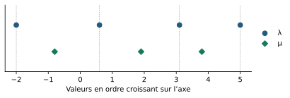
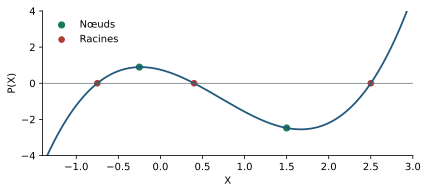
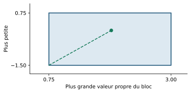
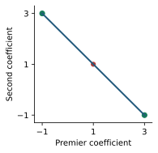
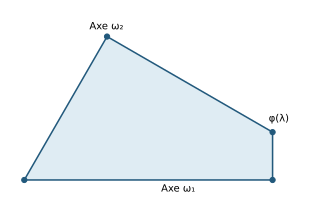
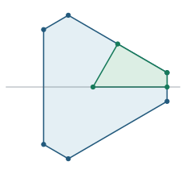

# X-ENS MP — Mathématiques A 2015 · Corrigé guidé

*Corrigé rédigé par IA, non officiel. Signalez toute erreur.*

**Rédaction** · modèle exact non renseigné (famille GPT-6) · effort non renseigné · vitesse non renseignée

**Révision** · modèle exact non renseigné (famille GPT-6) · effort non renseigné · vitesse non renseignée

**Révision (tour 2)** · GPT-6.2 Astra Ultra · vitesse non renseignée

**Révision (tour 3)** · GPT-6.2 Astra Ultra · vitesse non renseignée · 26 novembre 2026

## Présentation du sujet

Les 16 numéros de l’épreuve de quatre heures comportent 33 questions et sous-questions. Le problème relie l’entrelacement des valeurs propres d’un bloc principal aux diagonales réalisables sur une orbite orthogonale et en donne une description géométrique en dimension trois. [Sujet officiel](https://banques-ecoles.fr/cms/wp-content/uploads/2015/09/15_mp_sujet_mathsA_xlcr.pdf) · [Rapport du jury reproduit par Bibmath](https://www.bibmath.net/pbs/x/xmp_2015_1_rapport.pdf)

## Préliminaires — Conjugaison et enlacement

Les matrices symétriques et orthogonales sont réelles. L’introduction du sujet imprimé emploie le mot « complexes » pour décrire $M_{r,n}(\mathbb R)$. La notation et le théorème spectral invoqué à la question 2 imposent le corps réel. Sur $\mathbb C$, la matrice symétrique $\bigl(\begin{smallmatrix}1&i\\i&-1\end{smallmatrix}\bigr)$ est non nulle et de carré nul. Elle a les mêmes valeurs propres que la matrice nulle, et ne lui est pourtant pas semblable. On dit que deux listes décroissantes sont enlacées si $\lambda_j\geq\mu_j\geq\lambda_{j+1}$ pour chaque indice ; l’enlacement est strict si les deux inégalités le sont.

### Question 1a

> [!INDICATION]
> Une matrice orthogonale possède un inverse explicite.

> [!INDICATION]
> Vérifiez la propriété pour l’identité, l’inverse et le produit.

#### Solution

L’identité est orthogonale. Si $U^{\mathsf T}U=I_n$, une matrice carrée ayant un inverse à gauche est inversible, et $U^{-1}=U^{\mathsf T}$. Alors $UU^{\mathsf T}=I_n$ prouve que l’inverse est également orthogonal. Enfin $(UV)^{\mathsf T}(UV)=V^{\mathsf T}U^{\mathsf T}UV=I_n$ pour deux matrices orthogonales. Ces propriétés donnent un sous-groupe de $\mathrm{GL}_n(\mathbb R)$.

### Question 1b

> [!INDICATION]
> Exprimez le groupe comme l’image réciproque d’un singleton.

> [!INDICATION]
> La longueur un de chaque colonne donne la bornitude qui manque.

#### Solution

L’application $U\mapsto U^{\mathsf T}U$ est continue. L’image réciproque du singleton fermé $\{I_n\}$ est donc fermée. En outre chaque colonne d’une matrice orthogonale a norme euclidienne un, ce qui borne toutes les entrées en valeur absolue par un. La partie est fermée bornée en dimension finie réelle, donc compacte.

### Question 2

> [!INDICATION]
> Quelle base le théorème spectral fournit-il pour chaque matrice ?

> [!INDICATION]
> Ordonnez les deux bases propres suivant les mêmes valeurs propres.

#### Solution

Les matrices semblables ont le même polynôme caractéristique. Réciproquement, pour des matrices symétriques réelles, le théorème spectral fournit des bases orthonormées propres. Si les polynômes caractéristiques sont égaux, les deux listes de valeurs propres ordonnées, avec multiplicité, sont les mêmes. Écrivons $M=PDP^{\mathsf T},\ N=QDQ^{\mathsf T}$ avec une diagonale commune. Alors $U=QP^{\mathsf T}$ est orthogonale et $N=UMU^{-1}$.

### Question 3

> [!INDICATION]
> Interprétez les indices d’insertion en comptant les valeurs au-dessus d’un même seuil.

> [!INDICATION]
> Dans la chaîne alternée, identifiez la famille dont provient le dernier terme avant les deux insertions.

#### Solution

Les indices $i$ et $j$ comptent respectivement les $\lambda$ et les $\mu$ supérieurs ou égaux à $x$. Pour chaque $\mu_h\geq x$, on a $\lambda_h\geq\mu_h\geq x$, donc $j\leq i$. Réciproquement chaque $\lambda_{h+1}\geq x$ force $\mu_h\geq x$, donc $i-1\leq j$.

L’ancienne chaîne s’écrit $\lambda_1\geq\mu_1\geq\lambda_2\geq\cdots\geq\mu_n\geq\lambda_{n+1}$. Si $i=j$, son préfixe de termes supérieurs ou égaux à $x$ finit par un $\mu$ ou est vide. Insérons ensuite les deux copies de $x$ dans l’ordre « liste $\lambda$, liste $\mu$ ». Si $i=j+1$, le préfixe finit par un $\lambda$ et les copies s’insèrent dans l’ordre inverse. Dans les deux cas l’ordre décroissant et l’alternance sont conservés, y compris aux extrémités. C’est l’enlacement demandé.

## I — Polynômes aux racines enlacées

Les réels $\mu_1>\cdots>\mu_n$ sont distincts. On pose $Q_0=\prod_j(X-\mu_j)$ et $P_j=Q_0/(X-\mu_j)$.

### Question 4a

> [!INDICATION]
> Évaluez une relation linéaire aux racines du polynôme de référence.

> [!INDICATION]
> À chaque évaluation, un seul des polynômes de degré inférieur fournit un terme non nul.

#### Solution

Dans une relation $a_0Q_0+\sum_j a_jP_j=0$, évaluons en $\mu_i$. Tous les termes disparaissent sauf $a_iP_i(\mu_i)$, et $P_i(\mu_i)=\prod_{k\ne i}(\mu_i-\mu_k)\ne0$. Ainsi tous les $a_i$ pour $i\geq1$ sont nuls, puis $a_0=0$. Ces $n+1$ polynômes libres de degré au plus $n$ forment une base.

### Question 4b

> [!INDICATION]
> Écrivez la valeur comme un produit de différences.

> [!INDICATION]
> Combien d’indices correspondent à des racines plus grandes que celle évaluée ?

#### Solution

Dans $P_j(\mu_j)=\prod_{k\ne j}(\mu_j-\mu_k)$, les $j-1$ facteurs correspondant aux $k<j$ sont strictement négatifs. Tous les autres sont strictement positifs. D’où $(-1)^{j-1}P_j(\mu_j)>0$.

### Question 5a

> [!INDICATION]
> Les polynômes unitaires de même degré ont une différence de degré plus petit.

> [!INDICATION]
> Utilisez la base de la question précédente sur une différence convenable.

#### Solution

Les termes dominants de $P$ et de $XQ_0$, tous deux unitaires de degré $n+1$, se compensent dans $XQ_0-P$. Ce polynôme appartient à $\mathbb R_n[X]$. Sa décomposition unique dans la base de 4a est $aQ_0+\sum_j\alpha_jP_j$, ce qui est exactement la formule demandée.

### Question 5b

> [!INDICATION]
> Quelles sont les valeurs du polynôme aux nœuds ?

> [!INDICATION]
> Complétez l’alternance des signes par les signes aux deux infinis et comptez les intervalles.

#### Solution

L’évaluation en $\mu_j$ donne $P(\mu_j)=-\alpha_jP_j(\mu_j)$, de signe $(-1)^j$ puisque $\alpha_j>0$. Pour $X$ assez grand et positif, $P(X)>0$ et, pour $X$ assez grand en valeur absolue et négatif, son signe est $(-1)^{n+1}$. Le théorème des valeurs intermédiaires donne une racine dans chaque intervalle entre deux $\mu$ consécutifs, ainsi que dans les deux intervalles extérieurs. Cela donne $n+1$ racines distinctes. Elles épuisent le degré, sont toutes simples et s’enlacent strictement avec les $\mu_j$.

### Question 5c

> [!INDICATION]
> Comptez les signes dans la factorisation du polynôme aux nœuds intermédiaires.

> [!INDICATION]
> L’évaluation de la décomposition isole chaque coefficient.

#### Solution

Entre $\lambda_j$ et $\lambda_{j+1}$, la factorisation $P(X)=\prod_h(X-\lambda_h)$ montre que $P(\mu_j)$ a le signe $(-1)^j$. Or $\alpha_j=-P(\mu_j)/P_j(\mu_j)$ et le dénominateur a le signe $(-1)^{j-1}$ par 4b. Le quotient muni de son signe moins est strictement positif.

Pour les questions 6 et 7, $Q_1=\prod_j(X-\mu_j)^{m_j}$ avec $m_j\geq1$, et désormais $P_j=Q_1/(X-\mu_j)$.

### Question 6

> [!INDICATION]
> Étudiez la multiplicité d’une seule racine à la fois.

> [!INDICATION]
> Factorisez avant de dériver pour vérifier l’ordre d’annulation exact.

#### Solution

Pour chaque $k$ écrivons $Q_1=(X-\mu_k)^{m_k}R$ avec $R(\mu_k)\ne0$. Alors $Q'_1=(X-\mu_k)^{m_k-1}[m_kR+(X-\mu_k)R']$, et le crochet est non nul en $\mu_k$. Dans le pgcd, le facteur $X-\mu_k$ a donc exposant $m_k-1$. Comme tous les facteurs de $Q_1$ sont ainsi pris en compte, le pgcd unitaire vaut $\prod_k(X-\mu_k)^{m_k-1}$.

### Question 7a

> [!INDICATION]
> Retirez le facteur commun forcé par les multiplicités.

> [!INDICATION]
> Évaluez ensuite le quotient aux nœuds simples pour savoir lesquels apportent un facteur supplémentaire.

#### Solution

Posons $G=\prod_j(X-\mu_j)^{m_j-1}$ et $Q_0=\prod_j(X-\mu_j)$. Le quotient $P/G$ est $(X-a)Q_0-\sum_j\alpha_j Q_0/(X-\mu_j)$. En $\mu_i$ il vaut $-\alpha_i\prod_{j\ne i}(\mu_i-\mu_j)$, nul exactement lorsque $\alpha_i=0$. Le quotient $Q_1/G=Q_0$ étant à racines simples, $P\wedge Q_1=G\prod_{i:\alpha_i=0}(X-\mu_i)$.

### Question 7b

> [!INDICATION]
> Isolez les indices dont le coefficient est strictement positif.

> [!INDICATION]
> Après retrait du pgcd, reconnaissez le polynôme de la question 5 ou un facteur linéaire.

#### Solution

Retirons de $P$ le facteur commun de 7a, dont toutes les racines sont réelles. En posant $I=\{j:\alpha_j>0\}$ et $Q_I=\prod_{j\in I}(X-\mu_j)$, le facteur restant vaut
$$(X-a)Q_I-\sum_{j\in I}\alpha_j\,\frac{Q_I}{X-\mu_j}.$$
Si $I$ est non vide, 5b lui donne uniquement des racines réelles. Si $I$ est vide, le facteur restant est $X-a$, lui aussi à racine réelle. Ainsi toutes les racines de $P$ sont réelles.

## II — Blocs principaux des matrices symétriques

On note $B_{\leq n}$ le bloc principal correspondant aux $n$ premières lignes et colonnes. Le spectre ordonné comprend toutes les valeurs propres avec leurs multiplicités.

### Question 8

> [!INDICATION]
> Multipliez les deux matrices triangulaires par blocs proposées.

> [!INDICATION]
> Identifiez d’abord le bloc supérieur droit, puis le dernier bloc diagonal.

#### Solution

La multiplication des deux blocs proposés redonne en haut à droite $AU$ et en bas à droite $CU+V$. Prenons $U=A^{-1}B$ et $V=D-CA^{-1}B$. Les deux facteurs sont triangulaires par blocs et leurs déterminants valent respectivement $\det A$ et $\det V$. Donc $\det M=(\det A)\det(D-CA^{-1}B)$.

### Question 9a

> [!INDICATION]
> Diagonalisez uniquement le bloc principal.

> [!INDICATION]
> Prolongez le changement de base orthogonal par l’identité sur la dernière coordonnée.

#### Solution

Par le théorème spectral, il existe $P\in O_n(\mathbb R)$ avec $P^{\mathsf T}AP=\Delta(\mu_1,\ldots,\mu_n)$. Posons $U=\operatorname{diag}(P,1)$ et $z=P^{\mathsf T}y$. Le produit $U^{\mathsf T}MU$ a pour bloc supérieur gauche la diagonale demandée, pour colonne de bord $z$, pour ligne de bord $z^{\mathsf T}$ et pour dernier coefficient $a$.

### Question 9b

> [!INDICATION]
> Calculez le déterminant du polynôme matriciel après le changement de base de 9a.

> [!INDICATION]
> Le bloc principal diagonal s’inverse dans le corps des fractions rationnelles.

#### Solution

Dans $\mathbb R(X)$ le bloc $X I_n-\Delta(\mu)$ est inversible d’inverse diagonale $1/(X-\mu_j)$. Appliquons 8 à $XI_{n+1}-U^{\mathsf T}MU$. Il vient
$$\chi_M=Q_0\left(X-a-\sum_{j=1}^n\frac{z_j^2}{X-\mu_j}\right),\qquad Q_0=\prod_{j=1}^n(X-\mu_j).$$
C’est l’identité polynomiale demandée avec $\alpha_j=z_j^2\geq0$.

### Question 9c

> [!INDICATION]
> Il peut y avoir plusieurs occurrences de la même valeur propre.

> [!INDICATION]
> Additionnez leurs coefficients avant d’appliquer l’énoncé admis en 7b.

#### Solution

Regroupons dans la formule de 9b les termes ayant la même valeur $\mu_j$. Le nouveau coefficient est la somme des $z_j^2$ correspondants, donc reste positif ou nul, et la multiplicité dans $Q_0$ est celle de cette valeur propre de $A$. Le résultat d’enlacement admis après 7b s’applique à ces valeurs distinctes et à leurs multiplicités. Les racines de $\chi_M$ et $\chi_A$, rangées avec répétition, sont donc enlacées.

### Question 10

> [!INDICATION]
> Dans une suite convergente de matrices, comment borner simultanément toutes les valeurs propres ?

> [!INDICATION]
> Passez à la limite dans le polynôme caractéristique d’une sous-suite de spectres ordonnés, puis utilisez la compacité du groupe.

#### Solution

Montrons que le spectre ordonné est continu sur les matrices symétriques réelles. Si $B_k\to B$, toutes les valeurs propres de $B_k$ restent bornées car la somme de leurs carrés est $\operatorname{tr}(B_k^2)$, qui converge. À partir de toute sous-suite de spectres ordonnés, extrayons donc une sous-suite convergeant vers $(\eta_1,\ldots,\eta_n)$ encore décroissante. Les coefficients des polynômes caractéristiques convergent, étant polynomiaux en les entrées. La limite de leurs factorisations donne $\chi_B=\prod_j(X-\eta_j)$, donc le seul point d’adhérence possible est $\operatorname{Sp}(B)$. Cette suite bornée converge ainsi vers le spectre ordonné de $B$. Maintenant $U\mapsto(UMU^{\mathsf T})_{\leq n}$ est continue. Son spectre a donc pour ensemble de valeurs l’image continue de $O_{n+1}(\mathbb R)$ compact, ce qui prouve la compacité de $C_M$.

### Question 11a

> [!INDICATION]
> Construisez une matrice bordée dont le bloc principal a déjà le bon spectre.

> [!INDICATION]
> Les coefficients strictement positifs de 5c sont des carrés de coordonnées de bord.

#### Solution

Pour le $n$-uplet strictement enlacé fixé, prenons $Q_0=\prod_j(X-\mu_j)$ et $P=\chi_M$. Par 5a et 5c, la décomposition donne un réel $a$ et des $\alpha_j>0$. Formons la matrice symétrique bordée de bloc $\Delta(\mu)$, de dernière colonne $(\sqrt{\alpha_1},\ldots,\sqrt{\alpha_n},a)^{\mathsf T}$. Le calcul de 9b donne exactement $P$ comme polynôme caractéristique. Par 2, cette matrice est orthogonalement semblable à $M$. Le spectre du bloc principal est le $n$-uplet voulu, donc il appartient à $C_M$. Prenons $\lambda=(3,1,-2)$ et $\mu=(2,0)$. La trace impose $a=0$. Pour obtenir $P=(X-3)(X-1)(X+2)$, on calcule $\alpha_j=-P(\mu_j)/Q_0'(\mu_j)$, soit $2$ puis $3$. D’où la matrice
$$\begin{pmatrix}2&0&\sqrt2\\0&0&\sqrt3\\\sqrt2&\sqrt3&0\end{pmatrix}.$$
Son polynôme caractéristique est bien $X^3-2X^2-5X+6$, et son bloc principal a le spectre choisi.

### Question 11b

> [!INDICATION]
> La nécessité vient de l’enlacement déjà démontré.

> [!INDICATION]
> Approchez chaque coordonnée située à une extrémité par un point intérieur de son intervalle.

#### Solution

Tout élément de $C_M$ satisfait l’enlacement par 9c. Réciproquement, prenons $\lambda_j\geq\mu_j\geq\lambda_{j+1}$. Pour $0<t\leq1$, remplaçons chaque $\mu_j$ par $(1-t)\mu_j+t(\lambda_j+\lambda_{j+1})/2$. Les $\lambda$ étant distincts, ces nombres sont strictement à l’intérieur de leurs intervalles respectifs, donc strictement enlacés. Ils appartiennent à $C_M$ par 11a et tendent vers les $\mu_j$ quand $t\to0$. La compacité de 10 rend $C_M$ fermé, d’où la réciproque.

## III — Diagonales réalisables

Pour une matrice symétrique réelle $M$, l’ensemble $D_M$ contient toutes les diagonales des matrices $UMU^{\mathsf T}$ pour $U$ orthogonale.

### Question 12

> [!INDICATION]
> Réduisez d’abord la matrice à sa diagonale.

> [!INDICATION]
> Le premier coefficient diagonal de la conjuguée est une combinaison convexe des deux valeurs propres.

#### Solution

Par 2, remplaçons $M$ par sa diagonale spectrale sans changer son orbite. La première ligne d’une matrice orthogonale en dimension deux est un vecteur unitaire $(c,s)$. Le premier coefficient diagonal de la conjuguée est $c^2\lambda_1+s^2\lambda_2$, le second est imposé par la trace et vaut $s^2\lambda_1+c^2\lambda_2$. Tous les $c^2\in[0,1]$ sont atteints par les rotations. Les couples décrivent exactement le segment annoncé, réduit à un point si les deux valeurs propres coïncident.

### Question 13a

> [!INDICATION]
> Quel invariant donne la somme de toute la diagonale ?

> [!INDICATION]
> Comparez-le avec la somme de toutes les valeurs propres.

#### Solution

Si $s=n$, les deux membres valent $\operatorname{tr}M$. Il y a donc égalité.

### Question 13b

> [!INDICATION]
> La somme tronquée est la trace d’un bloc principal.

> [!INDICATION]
> Comparez terme à terme les valeurs propres de ce bloc à celles de la matrice entière.

#### Solution

Le bloc principal $A=M_{\leq n-1}$ a pour trace $\sum_{i<n}m_{ii}=\sum_{i<n}\mu_i$ si $\mu_i$ sont ses valeurs propres ordonnées. Par 9c, $\mu_i\leq\lambda_i$ pour tout $i<n$. La somme donne l’inégalité voulue pour $s=n-1$.

### Question 13c

> [!INDICATION]
> Faites la récurrence en retirant la dernière ligne et la dernière colonne.

> [!INDICATION]
> Pour une somme partielle, composez l’inégalité de l’hypothèse et l’enlacement.

#### Solution

En taille un, c’est 13a. Supposons la propriété démontrée en taille $n-1$. Pour $s<n$, appliquons-la au bloc principal de 13b. Il vient $\sum_{i\leq s}m_{ii}\leq\sum_{i\leq s}\mu_i\leq\sum_{i\leq s}\lambda_i$, la seconde inégalité venant de l’enlacement. Pour $s=n$, 13a donne l’égalité, d’où la récurrence.

## IV — L’hexagone des diagonales en dimension trois

Les vecteurs unitaires $\omega_1=(1,0)$ et $\omega_2=(1/2,\sqrt3/2)$ forment la base oblique $\mathcal C$. Le plan $H$ est défini par $m_1+m_2+m_3=0$, et $H^+$ est son secteur $m_1\geq m_2\geq m_3$.

### Question 14a

> [!INDICATION]
> Écrivez la formule d’une réflexion d’axe unitaire.

> [!INDICATION]
> Calculez ses images des deux vecteurs de la base oblique.

#### Solution

Les deux vecteurs $\omega_1,\omega_2$ sont unitaires et leur produit scalaire vaut $1/2$. La réflexion d’axe $\mathbb R\omega_1$ vérifie $s_1v=2\langle v,\omega_1\rangle\omega_1-v$. Ainsi $s_1\omega_1=\omega_1$ et $s_1\omega_2=\omega_1-\omega_2$. Ses colonnes dans $\mathcal C$ donnent la matrice $\left(\begin{smallmatrix}1&1\\0&-1\end{smallmatrix}\right)$.

### Question 14b

> [!INDICATION]
> Échangez le rôle des deux directions unitaires.

> [!INDICATION]
> Les colonnes sont les images exprimées dans la base demandée.

#### Solution

De même $s_2\omega_1=\omega_2-\omega_1$ et $s_2\omega_2=\omega_2$. Sa matrice est donc $\left(\begin{smallmatrix}-1&0\\1&1\end{smallmatrix}\right)$ dans $\mathcal C$.

On étudie $\varphi(m_1,m_2,m_3)=(m_1-m_2)\omega_1+(m_2-m_3)\omega_2$. Pour un spectre $\widehat\lambda$ de somme nulle, $Q_{\widehat\lambda}$ est l’ensemble des $m\in H^+$ tels que $m_1\leq\lambda_1$ et $m_1+m_2\leq\lambda_1+\lambda_2$.

### Question 15a

> [!INDICATION]
> Notez les deux différences de coordonnées et utilisez la somme nulle.

> [!INDICATION]
> Résolvez les trois équations, puis traduisez les deux inégalités d’ordre.

#### Solution

Pour $\varphi(m)=a\omega_1+b\omega_2$, on a $a=m_1-m_2$ et $b=m_2-m_3$. Ces formules sont linéaires et, compte tenu de $m_1+m_2+m_3=0$, elles s’inversent en
$$(m_1,m_2,m_3)=\tfrac13(2a+b,b-a,-a-2b).$$
C’est donc un isomorphisme. L’image de $H^+$ est le cône des $a\omega_1+b\omega_2$ avec $a,b\geq0$, secteur fermé d’angle $\pi/3$.

### Question 15b

> [!INDICATION]
> Utilisez les deux matrices de la question 14 sur les différences.

> [!INDICATION]
> Lisez les nouvelles différences comme les composantes de la permutation annoncée.

#### Solution

Dans la base $\mathcal C$, $s_1$ transforme $(a,b)$ en $(a+b,-b)=(m_1-m_3,m_3-m_2)$, les coordonnées de $\varphi(m_1,m_3,m_2)$. De même $s_2$ donne $(-a,a+b)=(m_2-m_1,m_1-m_3)$, les coordonnées de $\varphi(m_2,m_1,m_3)$.

### Question 15c

> [!INDICATION]
> Exprimez les deux majorations dans les coordonnées de la base oblique.

> [!INDICATION]
> Coupez les deux axes par les contraintes, puis cherchez l’intersection des deux frontières non axiales.

#### Solution

Dans les coordonnées $(a,b)$ de $\mathcal C$, les contraintes se transcrivent en
$$a,b\geq0,\qquad 2a+b\leq3\lambda_1,\qquad a+2b\leq-3\lambda_3,$$
car $m_1+m_2\leq\lambda_1+\lambda_2$ équivaut à $m_3\geq\lambda_3$. Sur l’axe $b=0$, la première des deux bornes obliques est la plus restrictive puisque $\lambda_2>\lambda_3$. Sur $a=0$, c’est la seconde puisque $\lambda_1>\lambda_2$. Leur intersection est $\varphi(\lambda)$, dont les deux coordonnées sont strictement positives. On obtient les quatre sommets suivants dans l’ordre :
$$0,\quad \tfrac32\lambda_1\omega_1,\quad (\lambda_1-\lambda_2)\omega_1+(\lambda_2-\lambda_3)\omega_2,\quad -\tfrac32\lambda_3\omega_2.$$

### Question 16a

> [!INDICATION]
> Une permutation de la base est un changement orthogonal.

> [!INDICATION]
> Regardez son effet sur le couple d’indices de chaque entrée diagonale.

#### Solution

La conjugaison par une matrice de permutation permute simultanément les lignes et les colonnes, donc les coefficients diagonaux. Une telle matrice est orthogonale, et son inverse réalise la permutation inverse. L’orbite étant stable sous ces deux conjugaisons, les deux propriétés d’appartenance sont équivalentes.

### Question 16b

> [!INDICATION]
> Appliquez les deux premières sommes partielles de la question 13.

> [!INDICATION]
> Ajoutez la conservation de la trace.

#### Solution

Pour une diagonale décroissante réalisable, l’inégalité 13 pour $s=1,2$ donne $m_1\leq\lambda_1$ et $m_1+m_2\leq\lambda_1+\lambda_2$. La trace reste nulle, donc cette diagonale appartient à $Q_{\widehat\lambda}$.

### Question 16c

> [!INDICATION]
> Faites tourner uniquement le plan des deux coordonnées à échanger.

> [!INDICATION]
> Le premier coefficient prend les deux valeurs voulues aux extrémités d’un quart de tour et la somme des deux reste fixe.

#### Solution

Prenons dans l’orbite une matrice de diagonale $(m_1,m_2,m_3)$. Conjuguons-la par $\operatorname{diag}(R_\theta,1)$ avec $R_\theta$ une rotation plane. Le troisième coefficient est fixe et les deux autres sont ceux de la conjugaison du bloc principal par $R_\theta$. Leur somme est constante. Si $b$ est l’entrée hors diagonale du bloc, avec $c=\cos\theta$ et $s=\sin\theta$, la première ligne $(c,-s)$ de la rotation donne le premier coefficient $c^2m_1+s^2m_2-2csb$. Celui-ci varie continûment, vaut $m_1$ en $\theta=0$ et $m_2$ en $\theta=\pi/2$. Par valeurs intermédiaires, tout le segment joignant les deux diagonales est réalisable. Le même raisonnement avec $\operatorname{diag}(1,R_\theta)$ interchange les deux dernières composantes.

### Question 16d

> [!INDICATION]
> Pour une cible ordonnée, choisissez deux valeurs propres consécutives entre lesquelles se trouve son premier coefficient.

> [!INDICATION]
> Une fois ce coefficient obtenu, vérifiez que les deux valeurs restantes encadrent le deuxième coefficient cible.

#### Solution

La diagonale $\lambda$ elle-même appartient à $D_M$ par le théorème spectral. Par 16a et 16c, on peut permuter ses composantes et remplacer deux composantes quelconques par n’importe quel couple du segment qui les échange. Fixons $m\in Q_{\widehat\lambda}$. Puisque $0\leq m_1\leq\lambda_1$ et $\lambda_3\leq0$, il existe $j\in\{1,2\}$ tel que $\lambda_j\geq m_1\geq\lambda_{j+1}$. Mélangeons ces deux valeurs pour obtenir $m_1$ et $w=\lambda_j+\lambda_{j+1}-m_1$. Permutons pour conserver $m_1$ en première position.

Si $j=1$, les deux valeurs restantes sont $w\geq m_2$ par la seconde inégalité de $Q_{\widehat\lambda}$ et $\lambda_3\leq m_3$. Si $j=2$, elles sont $\lambda_1\geq m_2$ et $w=m_2+m_3-\lambda_1\leq m_3$. Dans les deux cas, $m_2$ appartient à l’intervalle entre les deux valeurs restantes. Un dernier mélange en positions deux et trois donne $m_2$ en deuxième position, puis $m_3$ en troisième par conservation de la somme. Ceci donne $m\in D_M$, même en présence d’égalités.

### Question 16e

> [!INDICATION]
> Après permutation, les contraintes du secteur ordonné deviennent des bornes sur chaque coordonnée.

> [!INDICATION]
> Dans la section d’un cube par le plan de trace nulle, cherchez les couples de contraintes simultanément saturées.

#### Solution

Les questions 16a, 16b et 16d donnent, après permutation, $D_M=\{m\in H:\lambda_3\leq m_i\leq\lambda_1\ \forall i\}$. C’est la section du cube $[\lambda_3,\lambda_1]^3$ par le plan de trace nulle. Un sommet de cette section doit saturer au moins deux bornes sur des coordonnées distinctes, puisqu’une seule borne laisse une direction de déplacement dans le plan. Deux bornes supérieures sont impossibles car $-2\lambda_1<\lambda_3$, et deux bornes inférieures car $-2\lambda_3>\lambda_1$. Ces inégalités traduisent la stricte séparation des valeurs propres et la trace nulle. Ainsi un sommet a pour coordonnées $\lambda_1$, $\lambda_3$ et la troisième valeur imposée $-\lambda_1-\lambda_3=\lambda_2$. Les six permutations distinctes ont effectivement deux contraintes actives indépendantes, ce sont donc les six sommets. La section a un intérieur relatif (elle contient zéro strictement) et son image par l’isomorphisme $\varphi$ est un hexagone. Ses sommets sont les six vecteurs
$$(\lambda_{\sigma(1)}-\lambda_{\sigma(2)})\omega_1+(\lambda_{\sigma(2)}-\lambda_{\sigma(3)})\omega_2,\qquad \sigma\in\mathfrak S_3.$$
Posons $a=\lambda_1-\lambda_2$ et $b=\lambda_2-\lambda_3$. Le sommet $a\omega_1+b\omega_2$ a pour voisins ses images par les deux réflexions de 14. Les distances aux axes étant $b\sin(\pi/3)$ et $a\sin(\pi/3)$, les côtés ont alternativement pour longueurs $\sqrt3\,b$ et $\sqrt3\,a$. L’hexagone est régulier exactement lorsque $a=b$, donc lorsque $\lambda_2=0$ sous l’hypothèse de trace nulle. Sur la figure, les écarts valent $4$ et $1$.

## Bilan

Les signes des polynômes aux nœuds permettent de construire des matrices dont le bloc principal possède un spectre prescrit. Changer de base par une rotation dans un plan permet ensuite de mélanger deux coefficients diagonaux. En dimension trois, deux de ces mélanges suffisent à parcourir l’hexagone des diagonales.
