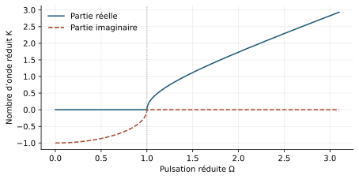
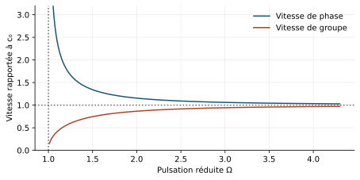
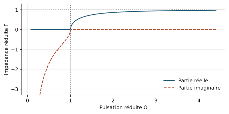
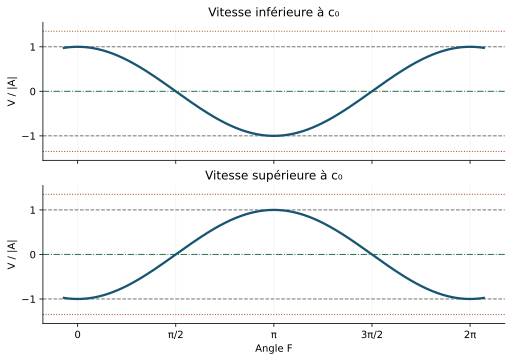
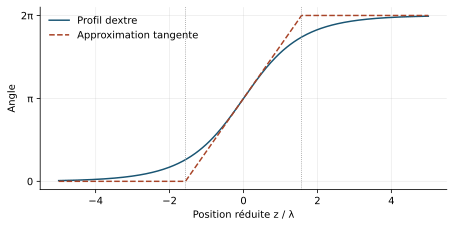
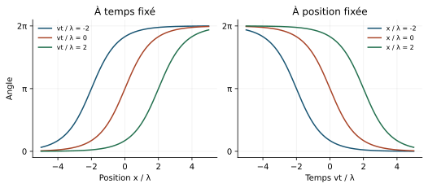
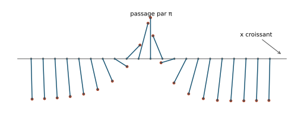
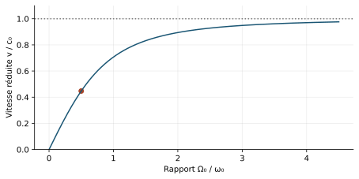

# X-ENS MP 2015 — Physique · Corrigé brut

*Corrigé rédigé par IA, non officiel. Signalez toute erreur.*

**Lecture du rapport du jury** · GPT-6.2 Astra Ultra · vitesse non renseignée

**Rédaction** · GPT-6.2 Astra Ultra · vitesse non renseignée

## Propagation d’ondes le long d’une chaîne de pendules couplés

## I.1 — Deux pendules et leurs modes propres

### Question 1 — Échelle de temps des pertes

Une oscillation libre permet de mesurer la durée sur laquelle l’amplitude décroît sensiblement. Si cette durée dépasse largement la durée de l’expérience, l’air et les pertes internes du câble ont un effet négligeable sur le mouvement observé. Pour suivre plusieurs oscillations sans amortissement visible, il faut donc que beaucoup de périodes tiennent dans le temps d’amortissement. Ce critère peut être vérifié en comparant des maxima successifs.

### Question 2 — Moments appliqués aux deux pendules

Notons $J=ml^2$ le moment d’inertie autour du câble. Pour le premier pendule, le poids exerce le moment $-mgl\sin\theta_1\simeq-mgl\theta_1$. Le tronçon fixe à gauche exerce $-C\theta_1$ et le tronçon central $C(\theta_2-\theta_1)$. En projetant le théorème du moment cinétique sur l’axe et en échangeant ensuite les indices, on trouve
$$
\ddot\theta_1+(\omega_g^2+2\omega_C^2)\theta_1-\omega_C^2\theta_2=0,\qquad
\ddot\theta_2+(\omega_g^2+2\omega_C^2)\theta_2-\omega_C^2\theta_1=0 .
$$
Ici $\omega_g=\sqrt{g/l}$ est la pulsation d’un pendule libre et $\omega_C=\sqrt{C/J}$ celle d’une inertie $J$ rappelée par un seul tronçon en l’absence de pesanteur.

### Question 3 — Coordonnées symétrique et antisymétrique

**a)** La somme et la différence des deux équations donnent respectivement
$$
\ddot\theta_++(\omega_g^2+\omega_C^2)\theta_+=0,\qquad
\ddot\theta_-+(\omega_g^2+3\omega_C^2)\theta_-=0 .
$$
**b)** Chaque équation devient celle d’un oscillateur harmonique indépendant. Une fois les deux solutions déterminées par les conditions initiales, on reconstruit $\theta_1=(\theta_++\theta_-)/2$ et $\theta_2=(\theta_+-\theta_-)/2$.

### Question 4 — Modes propres

**a)** Pour $\theta_-=0$, les deux angles restent égaux. Les pendules passent ensemble par les mêmes positions. Pour $\theta_+=0$, ils prennent à chaque instant des angles opposés de même amplitude.

**b)** Les pulsations respectives sont $\omega_{1,1}=\sqrt{\omega_g^2+\omega_C^2}$ et $\omega_{1,-1}=\sqrt{\omega_g^2+3\omega_C^2}$. **c)** Dans chaque mode $\theta_2(t)=\pm\theta_1(t)$, donc les deux pendules partagent la même dépendance harmonique et la même pulsation.

**d)** Prenons le mode antisymétrique. À $\theta_1=\theta$, la torsion relative du tronçon central vaut $2\theta$ en valeur algébrique mesurée du second pendule vers le premier. Les moments de rappel du câble sur le premier sont $-2C\theta$ et $-C\theta$. Avec le poids, $J\ddot\theta=-(3C+mgl)\theta$, ce qui redonne $\omega_{1,-1}$.

### Question 5 — Raideur d’une portion de câble

Un même couple transmis le long d’un câble uniforme provoque une torsion qui s’additionne d’un tronçon au suivant. Deux tronçons identiques en série ont ainsi une raideur $C/2$. On en déduit $C\propto1/a$. Le couple a pour dimension une force multipliée par une longueur, le radian étant sans dimension. Comme $G$ a la dimension d’une force par unité de surface, $Ca/G$ a la dimension d’une longueur à la puissance quatre. Le seul autre paramètre de longueur est $R$, d’où $C=\beta GR^4/a$ avec un facteur géométrique sans dimension $\beta$. L’analyse des unités seule permettrait une fonction arbitraire de $R/a$ avant d’utiliser l’addition des torsions.

## I.2 — Chaîne de pendules et limite continue

### Question 6 — Bilan d’un pendule intérieur

Les voisins fournissent les moments $C(\theta_{n-1}-\theta_n)$ et $C(\theta_{n+1}-\theta_n)$. En ajoutant le poids,
$$
J\ddot\theta_n=C(\theta_{n+1}-2\theta_n+\theta_{n-1})-mgl\,\theta_n .
$$
Un état où tous les angles sont égaux annule les deux moments de torsion, comme attendu.

### Question 7 — Équation de la limite continue

À $x=na$, $\theta(x\pm a)=\theta\pm a\theta_x+\tfrac12a^2\theta_{xx}+\cdots$ à temps fixé. La différence seconde vaut $a^2\theta_{xx}$ à l’ordre retenu. Le bilan précédent devient
$$
\theta_{tt}-c_0^2\theta_{xx}+\omega_0^2\theta=0,\qquad
c_0=a\sqrt{C/J},\quad \omega_0=\sqrt{g/l}.
$$
$c_0$ est la célérité des ondes de torsion quand le rappel gravitationnel est absent. $\omega_0$ est la pulsation d’un mouvement uniforme de toute la chaîne et, comme le montrera la dispersion, la pulsation de coupure.

### Question 8 — Domaine de validité spatial

Pour que le développement de chaque voisin soit utilisable au deuxième ordre, le terme suivant doit être petit sur la longueur $a$. Une condition suffisante sur les échelles de variation est $a|\theta_{xxx}|/3\ll|\theta_{xx}|$, en comparant les amplitudes caractéristiques des dérivées sur la zone étudiée. Pour la différence centrée elle-même, les termes impairs s’annulent. La première correction y est $a^4\theta_{xxxx}/12$ devant $a^2\theta_{xx}$, d’où le contrôle direct $a^2|\theta_{xxxx}|/12\ll|\theta_{xx}|$. Ces rapports s’entendent sur une échelle représentative, car une dérivée peut s’annuler isolément. Physiquement, la longueur caractéristique de variation doit dépasser largement une maille.

### Question 9 — Paramètres répartis

Les relations $m=\mu a$ et $C=\kappa/a$ donnent $c_0^2=a^2 C/(ml^2)=\kappa/(\mu l^2)$. Ainsi $c_0=\sqrt{\kappa/(\mu l^2)}$. La quantité $\mu l^2$ est l’inertie de rotation par unité de longueur.

### Question 10 — Invariance par changement de pas

À rayon et matériau inchangés, la question 5 donne $\kappa=Ca=\beta GR^4$ indépendamment de $a$. Si l’on modifie les masses pour maintenir $\mu=m/a$ et si $l$ reste fixé, l’inertie et la raideur réparties restent les mêmes. La célérité $c_0$ est donc inchangée, même si le domaine des longueurs d’onde correctement discrétisées dépend du nouveau pas.

### Question 11 — Valeur de la célérité

En unités SI, $m=2\times10^{-2}\,\mathrm{kg}$, $l=10^{-1}\,\mathrm m$ et $a=10^{-2}\,\mathrm m$. Alors $C/J=20/(2\times10^{-4})=10^5\,\mathrm{s^{-2}}$ et $c_0=a\sqrt{C/J}=\sqrt{10}\,\mathrm{m\,s^{-1}}$, soit **$3\,\mathrm{m\,s^{-1}}$** à un chiffre significatif.

### Question 12 — Échelle d’une onde harmonique

Chaque dérivée spatiale multiplie l’amplitude par $-jk$. Les critères de Taylor deviennent, à un facteur numérique près, $|k|a\ll1$. Pour $k$ réel cela signifie que la phase change peu entre voisins, soit $a\ll1/|k|=\lambda_{\rm onde}/(2\pi)$. Pour un nombre d’onde imaginaire pur, c’est la longueur de décroissance qui doit contenir beaucoup de pas.

### Question 13 — Relation de dispersion et branche physique

**a)** La substitution dans l’équation continue donne $-\omega^2+c_0^2k^2+\omega_0^2=0$. Avec les variables du sujet, $K^2=\Omega^2-1$.

**b)** Choisissons la chaîne dans $x>0$ et la convention $\exp[j(\omega t-kx)]$. Pour $\Omega>1$, la branche partant vers la droite a $K=\sqrt{\Omega^2-1}$ réel. Pour $0\leq\Omega<1$, le choix borné quand $x\to+\infty$ donne $K=-j\sqrt{1-\Omega^2}$. Les deux parties s’annulent au seuil. Sous la coupure, la partie imaginaire part de $-1$ avec une tangente horizontale. Au-dessus, la partie réelle tend vers l’asymptote $K=\Omega$. La seconde racine porte les signes opposés.

### Question 14 — Vitesses de phase et de groupe

**a)** Sur la branche propagative vers $+x$,
$$
V_\phi=\frac{\omega/k}{c_0}=\frac{\Omega}{\sqrt{\Omega^2-1}},
\qquad V_G=\frac{1}{c_0}\frac{d\omega}{dk}=\frac{\sqrt{\Omega^2-1}}{\Omega}.
$$
**b)** Leur produit vaut un. Lorsque $\Omega\to1^+$, la vitesse de phase diverge et la vitesse de groupe tend vers zéro. Quand $\Omega$ augmente, la première décroît, la seconde croît et toutes deux tendent vers un. La dispersion se manifeste dans leur différence. Une vitesse de phase élevée près du seuil ne décrit pas la vitesse de transport d’un paquet.

### Question 15 — Réponse d’une chaîne infinie

Pour $0\leq\Omega<1$, le mouvement imposé à l’entrée décroît comme $\exp[-x\omega_0\sqrt{1-\Omega^2}/c_0]$. Les pendules oscillent en phase pour une pulsation non nulle, avec une amplitude décroissante. À $\Omega=0$ on obtient une déformation statique. Au seuil $k=0$, la solution harmonique spatiale bornée est uniforme, de longueur de décroissance ou d’onde infinie. Pour $\Omega>1$, une onde progressive emporte l’énergie le long de la chaîne et sa phase se décale d’un pendule au suivant. Ces résultats utilisent la limite continue de la question 12.

## I.3 — Impédance et analogie électrique

### Question 16 — Impédance d’un tronçon de câble

Le câble sans inertie équilibre à chaque instant le moment extérieur par son rappel. On a $M=C\theta$ pour l’extrémité entraînée. En régime harmonique, $\dot\theta=j\omega\theta$, donc $Z_{\rm câble}=C/(j\omega)$. Le couple est proportionnel à la torsion emmagasinée.

### Question 17 — Impédance d’un pendule

Sous moment extérieur, $J\ddot\theta+mgl\,\theta=M$. En divisant par la vitesse angulaire complexe, il vient
$$
Z_{\rm pendule}=j\omega J+\frac{mgl}{j\omega}.
$$
Les contributions de l’inertie et de la pesanteur s’annulent à la pulsation propre $\omega_0$ du pendule linéarisé.

### Question 18 — Quadripôle équivalent

**a)** Prenons le moment pour analogue de la tension et la vitesse angulaire pour analogue du courant. Le couple transmis d’un tronçon au suivant diminue du couple appliqué au pendule. Cette chute de tension électrique est donc produite par une impédance **série** $Z_{\rm pendule}$. À une section du câble, la différence des vitesses des deux extrémités satisfait $M=Z_{\rm câble}(\dot\theta_{\rm gauche}-\dot\theta_{\rm droite})$. Par la loi des nœuds, le courant de dérivation est justement la différence entre courants amont et aval. Il faut donc une impédance **en dérivation** $Z_{\rm câble}$. L’ensemble est la cellule **(a)** de la figure 3.

**b)** La bobine série $L_1$ représente $J=ml^2$. Le condensateur série $C_1$ représente la souplesse gravitationnelle $1/(mgl)$. Le condensateur de dérivation $C_2$ représente la souplesse de torsion $1/C$. Ce sont les équivalences formelles dans la convention d’analogie retenue.

### Question 19 — Comparaison avec une ligne coaxiale

Une ligne coaxiale ordinaire de faibles pertes comporte une inductance série répartie et une capacité répartie entre les conducteurs. Sa liaison série est conductrice en continu. Dans le modèle des pendules, la pesanteur ajoute un condensateur en série et provoque une coupure basse. Le coaxial de travaux pratiques seul ne donne donc pas cette cellule complète. Si le rappel gravitationnel disparaît, le terme d’impédance série $mgl/(j\omega)$ s’annule et on retrouve les deux termes répartis usuels.

### Question 20 — Couple transmis à travers une section

Si l’angle augmente vers la droite, la portion gauche exerce sur la droite un couple de rappel négatif. Pour un tronçon, $M\simeq-Ca\,\partial_x\theta=-\kappa\theta_x$. Sur une onde unique $\theta_x=-jk\theta$ et $\dot\theta=j\omega\theta$, d’où $Z_{\rm méca}=\kappa k/\omega$. Le signe dépend du sens de l’action et de la branche choisie.

### Question 21 — Impédance caractéristique réduite

Comme $\kappa=\mu l^2c_0^2$, on obtient $Z_{\rm méca}=\mu l^2 c_0 K/\Omega$. La branche appropriée à une source en $x=0$ et à une chaîne en $x>0$ est
$$
\Gamma(\Omega)=
\begin{cases}
-j\sqrt{\Omega^{-2}-1},&0<\Omega<1,\\
0,&\Omega=1,\\
\sqrt{1-\Omega^{-2}},&\Omega>1 .
\end{cases}
$$
Alors $Z_{\rm méca}=+\mu l^2c_0\Gamma$ pour cette branche. L’autre racine de la dispersion donne le signe opposé. Le facteur d’onde commun au couple et à la vitesse se simplifie à toute abscisse.

### Question 22 — Dimension de la fonction réduite

$[Z]=[\mathrm{N\,m\,s}]=\mathrm{kg\,m^2\,s^{-1}}$ en comptant le radian comme sans dimension. Le produit $\mu l^2c_0$ possède la même dimension. Il en résulte $[\Gamma]=1$, comme le confirme son expression en fonction de $\Omega$.

### Question 23 — Parties réelle et imaginaire

Pour la branche de la question 21, $\operatorname{Re}\Gamma$ est nulle jusqu’à $\Omega=1$ puis croît de zéro vers un. $\operatorname{Im}\Gamma$ est négative sous la coupure, diverge comme $-1/\Omega$ à basse fréquence et rejoint zéro au seuil. Elle est identiquement nulle dans la bande de propagation. Les variations qui rejoignent ou quittent le seuil ont une tangente verticale du côté non nul.

### Question 24 — Interprétation et vitesse de groupe

Pour $\Omega>1$, $\Gamma=\sqrt{1-\Omega^{-2}}=V_G$. On peut retrouver cette identité en dérivant $\omega^2=\omega_0^2+c_0^2k^2$, qui donne $d\omega/dk=c_0^2 k/\omega$. À haute fréquence dans le modèle continu, le rappel gravitationnel devient faible devant l’inertie, $V_G\to1$ et $Z_{\rm méca}\to\mu l^2 c_0$. À basse fréquence l’impédance purement réactive traduit la déformation localisée par le rappel. À pas fixé, l’asymptote continue vaut comme approximation tant que $|k|a\ll1$.

### Question 25 — Une puissance transportée

Pour une vitesse angulaire de valeur crête $|\dot\theta|$, la puissance moyenne injectée est $\langle M\dot\theta\rangle=\tfrac12\operatorname{Re}Z_{\rm méca}\,|\dot\theta|^2$. Au-dessus de la coupure elle est positive. Un paquet parti de la source transporte l’énergie cinétique, gravitationnelle et élastique vers des pendules toujours plus éloignés. Sur une chaîne infinie aucune réflexion d’extrémité ne la ramène à la source. Au seuil exact, $Z=0$ et la puissance progressive moyenne s’annule.

### Question 26 — Énergie d’un champ évanescent

Sous la coupure, $Z$ est imaginaire pur. Le couple et la vitesse sont en quadrature, donc la puissance moyenne sur une période est nulle. L’opérateur donne puis reprend l’énergie stockée dans la déformation et le mouvement limités au voisinage de l’entrée. Au seuil, l’impédance et le flux moyen tendent vers zéro. Cela rejoint la réponse évanescente puis uniforme décrite à la question 15.

## II.1 — Du profil progressif au diagramme d’énergie

### Question 27 — Intégrale première de l’équation non linéaire

Pour $z=x-vt$, on a $\theta_{tt}=v^2F''(z)$ et $\theta_{xx}=F''(z)$. Ainsi $(c_0^2-v^2)F''=\omega_0^2\sin F$. Pour $v^2\ne c_0^2$, on pose $A=\omega_0^2/(c_0^2-v^2)$ et on multiplie $F''=A\sin F$ par $F'$. Cela donne
$$
\frac{d}{dz}\left[\frac12(F')^2+A\cos F\right]=0,\qquad
\frac12(F')^2+A\cos F=B.
$$
Au cas singulier $v^2=c_0^2$, l’équation initiale impose $\sin F=0$ et n’autorise pas de front continu reliant deux plateaux.

### Question 28 — Point fictif et énergie conservée

**a)** L’équation $F''=-dV_{\rm eff}/dF$ a la forme de la loi de Newton pour une masse unité en dimension un, avec $V_{\rm eff}(F)=A\cos F$. La position fictive est $F$ et le temps fictif est l’abscisse réduite $z$. Une oscillation en ce temps représente donc d’abord une périodicité spatiale du profil.

**b)** $B$ est l’énergie mécanique conservée du point fictif, somme de son terme cinétique $(F')^2/2$ et du potentiel. Comme $z$ est une longueur, $A$ et $B$ ont la dimension $\mathrm{m^{-2}}$. L’énergie physique de la chaîne sera calculée séparément.

### Question 29 — Niveaux d’énergie et mouvements admissibles

**a)** Pour $|v|<c_0$, $A>0$. Les maxima sont aux angles $2n\pi$ et les minima aux angles $(2n+1)\pi$. Pour $|v|>c_0$, $A<0$ et les rôles s’inversent.

**b)** Sur chaque courbe, la condition cinétique $F'^2/2=B-V_{\rm eff}\geq0$ limite les valeurs de $F$. Si $B<-|A|$, aucun mouvement n’est possible. Au minimum $B=-|A|$, seul l’équilibre au fond d’un puits est permis. Entre $-|A|$ et $|A|$, le point oscille entre deux points de rebroussement. À $B=|A|$, il existe l’équilibre au sommet et des trajectoires séparatrices reliant asymptotiquement deux sommets voisins. Au-dessus de $|A|$, le signe de $F'$ est conservé et le point franchit les barrières successives.

### Question 30 — Lecture des deux puits

**a)** Pour $A>0$ et $B\to A^-$, le point fictif oscille encore dans le puits centré sur $\pi$, mais les points de rebroussement s’approchent de $0$ et $2\pi$. La vitesse $|F'|=\sqrt{2(B-A\cos F)}$ est maximale au fond. Le point passe de plus en plus longtemps près de chacun des sommets et franchit rapidement la zone centrale. Sa période en $z$ diverge à la séparatrice.

**b)** Pour $A<0$ et $A<B<-A$, le fond se trouve en $F=0$ modulo $2\pi$. Dans le temps fictif, $F$ oscille périodiquement autour de ce fond avec deux rebroussements. La chaîne porte une oscillation angulaire progressive, périodique en espace. Un pendule fixé en $x$ voit le même profil périodique défiler en temps, de période égale à la période spatiale divisée par $|v|$.

**c)** Avec $B\to A^+$, l’amplitude autour de zéro devient petite et $\sin F\simeq F$. On retrouve le cas linéaire harmonique de la première partie. Une vitesse de phase $|v|>c_0$ y est possible.

## II.2 — Forme, vitesse et chiralité du soliton

### Question 31 — Profil et largeur du front

**a)** La fonction $F_d(z)=4\arctan(e^{z/\lambda})$ augmente de $0$ à $2\pi$ et $F_d(0)=\pi$. Comme $F_d(-z)=2\pi-F_d(z)$, la courbe est symétrique par rapport au point $(0,\pi)$.

**b)** La dérivation donne $F'_d(z)=2/[\lambda\cosh(z/\lambda)]$, positive et de limite nulle aux deux infinis. **c)** La tangente centrale $F=\pi+2z/\lambda$ rencontre $0$ et $2\pi$ aux abscisses $-\pi\lambda/2$ et $\pi\lambda/2$. La convention de largeur demandée donne donc $\Lambda=\pi\lambda$.

**d)** Avec $\omega_0=10\,\mathrm{s^{-1}}$ et $c_0=\sqrt{10}\,\mathrm{m\,s^{-1}}$, on trouve $\lambda_0=c_0/\omega_0\simeq0{,}3\,\mathrm m$. C’est la longueur du profil immobile selon la convention $\lambda$, différente de sa largeur tangentielle $\Lambda$.

### Question 32 — Photographies et signaux temporels

**a)** À temps fixé, la courbe croissante se translate sans se déformer. Son centre est en $x=vt$. Pour $t_1<t_2<t_3$ et $v>0$, les trois centres sont ordonnés de gauche à droite.

**b)** Pour un pendule fixé en $x_i$, $\theta_i(t)=F_d(x_i-vt)$ décroît de $2\pi$ vers $0$. Il passe par $\pi$ à $t_i=x_i/v$. Si $x_1<x_2<x_3$, le même basculement est observé d’abord en $x_1$, ensuite en $x_2$, puis en $x_3$. Son retard entre deux positions séparées de $\Delta x$ est $\Delta x/v$.

### Question 33 — Forme instantanée de la chaîne

À une date donnée, les tiges très loin de part et d’autre pendent vers le bas, car $0$ et $2\pi$ correspondent à la même orientation. En parcourant le câble vers les $x$ croissants, la tige tourne progressivement dans le sens des angles positifs. Elle passe à l’horizontale pour $\theta=\pi/2$, vers le haut pour $\theta=\pi$, puis à l’horizontale de l’autre côté pour $\theta=3\pi/2$. Ce tour complet est concentré sur quelques longueurs $\lambda$.

### Question 34 — Chiralité du profil

**a)** Dans le trièdre direct de la figure 2, l’angle augmente de $\vec e_y$ vers $\vec e_z$ quand on parcourt le câble vers $+x$. Le pouce de la main droite orienté selon $+x$, les doigts suivent cette rotation. Le profil $F_d$ est donc dextre.

**b)** On inverse la variation spatiale et on conserve le déplacement du centre vers $+x$. Pour $v>0$, on prend $\theta_s(x,t)=F_s(x-vt)$ avec $F_s(z)=4\arctan(e^{-z/\lambda})=2\pi-F_d(z)$. La réflexion $F\mapsto2\pi-F$ conserve l’équation non linéaire. La chiralité se lit sur $\partial_x\theta$, le sens de propagation sur le mouvement du centre.

### Question 35 — Exploitation des deux diagrammes

**a)** Chacune des courbes de la figure 4 descend lorsque $x$ augmente. La translation verticale ajoutée à une même courbe ne modifie pas cette pente. Les deux solitons sont donc senestres.

**b)** Suivons le milieu de chaque transition de la première à la huitième courbe, soit sept intervalles de $0{,}12\,\mathrm s$. Dans (a), le centre se déplace d’environ $1{,}6$ à $4{,}0\,\mathrm m$, soit $v\simeq2{,}8\,\mathrm{m\,s^{-1}}$ avant arrondi. Dans (b), il passe environ de $1{,}7$ à $2{,}4\,\mathrm m$, soit $v\simeq0{,}8\,\mathrm{m\,s^{-1}}$. Les deux déplacements vont vers $+x$. À la précision demandée les vitesses sont **$3$ et $0{,}8\,\mathrm{m\,s^{-1}}$**.

**c)** Sur une seule courbe, prolongeons la tangente au milieu jusqu’aux deux niveaux horizontaux. L’écart horizontal des intersections vaut approximativement $\Lambda_a\simeq0{,}2\,\mathrm m$ et $\Lambda_b\simeq1\,\mathrm m$. La question 31 donne $\lambda_a=\Lambda_a/\pi\simeq0{,}07\,\mathrm m$ et $\lambda_b=\Lambda_b/\pi\simeq0{,}3\,\mathrm m$. Le front le plus rapide est également le plus étroit.

## II.3 — Excitation et bilan d’énergie

### Question 36 — Excitation symétrique au centre

**a)** Les deux demi-chaînes sont identiques et reliées au même pendule entraîné. La perturbation lancée depuis $x=0$ atteint des points de plus en plus éloignés de part et d’autre. La symétrie $x\mapsto-x$ impose deux fronts en miroir.

**b)** L’angle imposé au centre croît de zéro à $2\pi$. Puisque $\partial_t\theta=-vF'$, un front qui part à droite ($v>0$) doit avoir $F'<0$. Il est senestre. Le front qui part à gauche ($v<0$) a $F'>0$ et est dextre. Ainsi, à une même date, la région ayant accompli son tour complet s’étend de part et d’autre du centre.

### Question 37 — Rapidité imposée et vitesse du soliton

**a)** À droite, le profil est $4\arctan[\exp((vt-x)/\lambda)]$. À l’origine, il coïncide avec la commande dès que $v/\lambda=\Omega_0$. Avec $u=v/c_0$ et $\lambda=(c_0/\omega_0)\sqrt{1-u^2}$,
$$
\frac{\Omega_0}{\omega_0}=\frac{u}{\sqrt{1-u^2}},\qquad
u=\frac{\Omega_0/\omega_0}{\sqrt{1+(\Omega_0/\omega_0)^2}}.
$$
La courbe a une pente unité à l’origine et se rapproche de $1$ par valeurs inférieures.

**b)** Pour $\Omega_0/\omega_0=0{,}5$, on a $u=1/\sqrt5$. Avec la valeur non arrondie de $c_0$, $v=\sqrt2\,\mathrm{m\,s^{-1}}$, soit environ **$1\,\mathrm{m\,s^{-1}}$** à un chiffre significatif.

### Question 38 — Énergie d’un soliton dans une demi-chaîne

La torsion, la vitesse des tiges et la différence d’énergie de pesanteur par rapport au repos sont négligeables sur les plateaux. En particulier, $F'$ décroît exponentiellement et les angles tendent vers la verticale basse modulo $2\pi$. Si le centre est éloigné du bord de plusieurs largeurs caractéristiques, presque toute l’énergie que l’on intégrerait sur la droite entière se trouve déjà dans la demi-chaîne. On peut alors utiliser la relation (10) avec les paramètres de ce milieu. Lorsque le front recouvre l’interface, ce remplacement perd sa justification.

### Question 39 — Front devant un saut de masse

Les courbes plus hautes correspondent aux dates plus tardives. Dans (c), le centre de la transition arrive de la gauche et s’approche de $x=0$, puis ses positions successives repartent vers la gauche. Le soliton incident de basse vitesse est **réfléchi**. Dans (d), le centre franchit $x=0$ et continue à avancer dans la partie lourde. Les déplacements entre dates successives y sont plus petits, donc le soliton **transmis ralentit**. La partie lourde a à la fois une énergie de repos plus élevée et une vitesse limite plus petite.

### Question 40 — Seuil énergétique de transmission

**a)** L’énergie minimale d’un soliton dans le côté lourd est celle du profil immobile, $E_{0+}=8\sqrt{\mu_+g\kappa l}$. Une transmission avec une vitesse finale non nulle exige une énergie incidente supérieure à ce seuil dans le modèle de bilan retenu.

**b)** À la limite, $E_{0-}/\sqrt{1-v_c^2/c_{0-}^2}=E_{0+}$. Or $E_{0-}^2/E_{0+}^2=\mu_-/\mu_+$ et $c_{0-}^2=\kappa/(\mu_-l^2)$. On trouve
$$
v_c=\sqrt{\frac{\kappa}{l^2}\left(\frac1{\mu_-}-\frac1{\mu_+}\right)} .
$$
Ce seuil est inférieur à $c_{0-}$ et s’annule pour deux milieux identiques. La conclusion de transmission repose sur le bilan entre solitons isolés, en négligeant l’énergie éventuellement abandonnée à d’autres excitations à la jonction.

### Question 41 — Transmission sans changement de vitesse

Il faut avoir $E_-(v)=E_+(v)$ pour tout $v$. En considérant d’abord $v=0$ on doit égaler les énergies de repos, puis la dépendance en $v$ impose $c_{0-}=c_{0+}$. Ces deux conditions suffisent dans le modèle énergétique. Posons $r=\kappa_+/\kappa_-$ et $s=l_+/l_-$. Avec $\mu_+/\mu_-=8$, les deux conditions s’écrivent $8rs=1$ et $r/(8s^2)=1$. Ainsi $64s^3=1$, soit **$l_+/l_-=1/4$** et **$\kappa_+/\kappa_-=1/2$**. Cette adaptation égalise la loi énergie–vitesse de part et d’autre. Elle ne quantifie pas un éventuel rayonnement transitoire à une transition réelle.

### Question 42 — Équation d’une chaîne inhomogène

Dans un intervalle $[x,x+dx]$, le couple transmis par la gauche est $-\kappa(x)\theta_x(x)$ et celui exercé par la droite est $+\kappa(x+dx)\theta_x(x+dx)$. Leur résultante vaut $\partial_x(\kappa\theta_x)\,dx$. Le moment du poids vaut $-\mu gl\sin\theta\,dx$ et l’inertie vaut $\mu l^2\,dx$. Le bilan local donne
$$
\mu(x)l(x)^2\,\theta_{tt}
=\partial_x\!\left[\kappa(x)\theta_x\right]-\mu(x)g\,l(x)\sin\theta .
$$
Le terme supplémentaire $\kappa'(x)\theta_x$ conserve l’effet des deux couples voisins lorsque la raideur varie. À paramètres constants, on retrouve l’équation du sujet.

## II.4 — Analogies physiques

### Question 43 — Analogie relativiste

Avec $\gamma_s=(1-v^2/c_0^2)^{-1/2}$, on a $E=\gamma_s E_0$ et $\lambda=\lambda_0/\gamma_s$. Ces lois rappellent l’énergie totale et la contraction longitudinale en relativité restreinte, $c_0$ tenant ici le rôle de vitesse limite de l’onde solitaire. Il s’agit d’une propriété de l’équation d’onde de cette chaîne. Les masses des pendules, elles, se meuvent dans le cadre de la mécanique classique.

### Question 44 — Autres ondes solitaires

Dans un canal peu profond, une élévation isolée de la surface peut parcourir une longue distance en gardant pratiquement la même forme. La non-linéarité modifie la vitesse locale selon la hauteur d’eau, tandis que la dispersion tend à élargir la perturbation. Leurs effets peuvent s’équilibrer. Un autre exemple est une impulsion solitaire dans une fibre optique non linéaire, dont le confinement est temporel dans le repère qui accompagne la propagation.

### Question 45 — Coaxial et fibre optique

Dans son régime usuel, un câble coaxial de travaux pratiques est une ligne essentiellement linéaire. Une impulsion peut y conserver approximativement sa forme sur une certaine distance si la dispersion et les pertes sont faibles. Cette propagation s’explique par superposition et ne fournit pas le soliton non linéaire étudié ici.

Dans une fibre optique, l’indice peut dépendre de l’intensité par effet Kerr. L’automodulation de phase qui en résulte peut compenser la dispersion de vitesse de groupe. Dans le régime approprié, par exemple celui de dispersion anormale pour une impulsion brillante avec non-linéarité focalisante, il existe des solitons temporels. Les pertes limitent la distance de propagation sans modification sensible.
