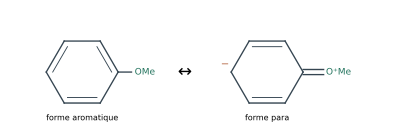
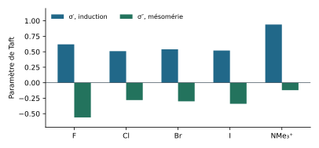
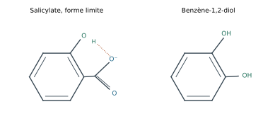
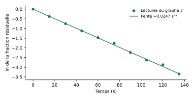
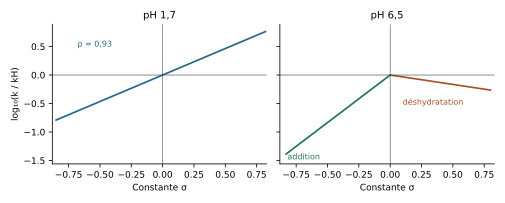
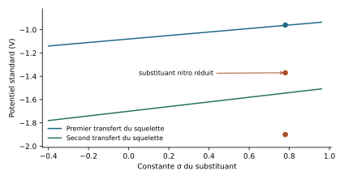
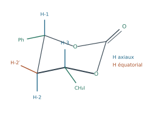

# X–ENS — PC, Chimie A 2015 · Corrigé brut

*Corrigé rédigé par IA, non officiel.*

**Rédaction (tour 1)** · GPT-6.2 Astra Ultra · vitesse non renseignée

Sur 78 questions imprimées, 42 sont entièrement corrigées, trois le sont en partie et 33 restent hors couverture. Le problème 1 couvre les questions 1 à 22 et 25 à 40. Le problème 2 couvre les questions 2, 13, 14 et 38. Les réponses partielles portent sur la configuration de la lysine (P2.3), le nombre d’oxydation local du carbone (P2.7) et l’interprétation indépendante du spectre de l’énone (P2.28). Chaque autre question est indiquée à sa place. La rédaction suit les dix-neuf pages du sujet et les commentaires correspondants du jury.

## Problème 1 · I. Acidité des acides benzoïques

### Question P1.1 — Induction et mésomérie

L’**effet inductif** est la polarisation transmise par les liaisons $\sigma$, qui s’atténue en général avec la distance. L’**effet mésomère** traduit la délocalisation d’électrons d’un système $\pi$ ou d’un doublet dans un ensemble d’orbitales conjuguées. Dans un aryle, $\mathrm{-CH_3}$ est donneur $+I$ et n’a pas de doublet participant à une mésomérie classique. $\mathrm{-OCH_3}$ est $-I$ mais $+M$ : un doublet de O peut fournir une liaison $\pi$ vers le carbone ipso, avec O⁺ et une charge négative en ortho ou para dans les formes limites. $\mathrm{-NO_2}$ est $-I,-M$ : le cycle fournit de la densité vers le groupement, avec des formes quinoïdes portant une charge positive en ortho ou para et une charge négative supplémentaire sur O. Les effets mésomères ne se transmettent pas de la même façon à un site méta.

### Question P1.2 — Comparaison des hydrolyses d’esters

Les esters sont comparés en milieu éthanol–eau basique, à même température (25 °C), même composition du milieu et mêmes conditions de concentration de la base. Les $K_a$ de référence sont mesurés dans l’eau. Posons $\mathrm{Ar}=p\text{-}\mathrm{CH_3CO{-}C_6H_4}$. Le bilan cinétique de l’ester est $\mathrm{ArCO_2Et+OH^-\to ArCO_2^-+EtOH}$. L’équilibre de référence est $\mathrm{ArCO_2H+H_2O\rightleftharpoons ArCO_2^-+H_3O^+}$. L’acétyle attire les électrons par induction et conjugaison. Le point se situe sur la tendance méta/para, à droite et au-dessus de H. Dans la famille méta de la figure 1, **m-NO₂** correspond à la vitesse la plus élevée.

### Question P1.3 — Familles de substituants du graphe

Pour méta et para, $\log k$ augmente globalement avec $\log K_a$ suivant une même relation proche d’une droite. Les groupes fortement attracteurs, comme nitro, se trouvent en haut à droite. Les donneurs, comme le méthyle ou le méthoxy en para, déplacent les points vers le bas à gauche. Les halogènes combinent induction attractive et mésomérie donneuse, différemment selon la position. Pour méthoxy, le passage de méta à para accentue la donation. Les dérivés ortho s’écartent du tracé commun, l’encombrement et les interactions de proximité affectant différemment acidité et hydrolyse.

### Question P1.4 — Constante du méthoxy

On peut suivre le titrage de chaque acide de référence par pH-métrie dans les mêmes conditions, repérer le volume d’équivalence, puis lire $pK_a$ à demi-équivalence pour des activités suffisamment proches des concentrations. On calcule $\sigma=pK_a(H)-pK_a(i\!-\!R)$. Ainsi **$\sigma(p\text{-OMe})=4{,}22-4{,}49=-0{,}27$**, contre $+0{,}12$ en méta. En para, la donation mésomère de O déplace de la densité vers le carbone lié au carboxyle, déstabilisant relativement la base conjuguée ou stabilisant relativement l’acide. En méta, ce relais direct manque et l’effet inductif attracteur favorise l’ionisation.

### Question P1.5 — Le substituant ammonium

Les constantes très voisines, 0,88 et 0,82, sont compatibles avec une influence surtout **inductive et électrostatique attractive**. L’azote chargé a quatre liaisons et un octet complet. Il n’a pas de doublet à conjuguer avec le cycle. La faible différence méta–para demeure dans les valeurs empiriques.

### Question P1.6 — Sens des paramètres de Taft

$\sigma'$ représente principalement la composante inductive ou de champ et $\sigma''$ la composante mésomère. Dans l’écriture du sujet, la première contribue de la même façon en méta et para, tandis que le facteur **$\alpha<1$** pondère la transmission en méta de la seconde. Ainsi OMe peut changer de signe selon la position alors que l’ammonium présente des valeurs voisines.

### Question P1.7 — Calcul des paramètres et halogènes

Avec $\alpha=1/2$, **$\sigma''=2(\sigma_p-\sigma_m)$ et $\sigma'=2\sigma_m-\sigma_p$**. Pour $\mathrm{NMe_3^+}$, on obtient $(\sigma',\sigma'')=(0{,}94,-0{,}12)$, composante inductive largement dominante. Dans l’ordre F, Cl, Br, I, les couples sont **$(0{,}62,-0{,}56)$, $(0{,}51,-0{,}28)$, $(0{,}54,-0{,}30)$, $(0{,}52,-0{,}34)$**. Tous sont attracteurs par induction et donneurs par conjugaison. Le fluor se distingue par son électronégativité et le bon recouvrement des orbitales 2p avec celles du carbone. Les valeurs de Cl à I ne forment pas une suite strictement monotone.

### Question P1.8 — Choix d’un groupe et identification inverse

Dans le tableau quantitatif, le plus grand $\sigma$ est **1,91 pour le diazonio en para**. Avec $\sigma_m=1{,}76$, on trouve $\sigma'=1{,}61$, supérieur à 0,62 pour F. La charge positive renforce l’attraction de champ et par induction. Pour l’inconnu, $\sigma'=2(0{,}60)-0{,}72=0{,}48$ et $\sigma''=2(0{,}72-0{,}60)=0{,}24$. Il attire donc par les deux voies. L’éthyle et SMe sont écartés et l’effet inductif recherché est plus fort que celui d’un carbonyle apparenté à l’acétyle du tableau. Le meilleur choix parmi les quatre est **$\mathrm{-SO_2Me}$**.

### Question P1.9 — Légende des axes de Taft

L’abscisse est **$\sigma''$**, la composante mésomère, et l’ordonnée **$\sigma'$**, la composante inductive. À gauche se trouvent les donneurs mésomères comme OMe ou $\mathrm{NMe_2}$, à droite les accepteurs comme NO₂. Au-dessus de l’axe horizontal dominent les attractions inductives, au-dessous les donations inductives. L’hydrogène définit l’origine. Les valeurs faibles près des axes sont sensibles à l’arrondi et à la nature empirique de la décomposition.

## Problème 1 · II. Corrélations entre acidités

### Question P1.10 — Corrélation des acidités des phénols

La figure 4 regroupe des phénols substitués en **méta ou para**. Sur l’ensemble représenté, $R^2=0{,}983$ indique une très bonne corrélation, avec une dispersion résiduelle. L’équation est **$\log_{10}[K'_a(i\!-\!R)/K'_a(H)]=\rho\,\sigma(i\!-\!R)$**, avec $\rho=2{,}2$. Pour R = H, le rapport vaut 1 et $\sigma=0$.

### Question P1.11 — Sens physique de la pente

$\rho$ mesure la **sensibilité relative** de la réaction testée aux substituants. Par définition, $\rho=1$ pour l’ionisation des acides benzoïques de référence. La charge du phénolate peut se délocaliser sur le noyau, notamment aux positions ortho et para. Le substituant modifie donc fortement sa stabilité par rapport au phénol. La charge négative du benzoate est surtout partagée entre les deux oxygènes du carboxylate. Ici, à $\sigma$ fixé, la variation de $\log K_a$ du phénol vaut environ 2,2 fois celle de référence. Les acidités absolues se comparent séparément.

### Question P1.12 — Trichlorophénol

Dans le 3,4,5-trichlorophénol, les positions sont deux méta et une para. En supposant les effets additifs et la pente transférable, $\sum\sigma=2(0{,}37)+0{,}23=0{,}97$. Alors **$pK'_a=9{,}95-2{,}2(0{,}97)=7{,}82$**. L’écart d’environ 0,07 avec 7,75 est petit pour ce modèle empirique. Une moyenne des trois constantes ne représenterait pas l’effet cumulé.

### Question P1.13 — Effet ortho et liaison intramoléculaire

Les points atypiques correspondent à la famille **ortho**. Pour $o$-OH, l’acide benzoïque de référence porte OH voisin de CO₂H (acide salicylique), et le phénol correspondant est le benzène-1,2-diol. Une liaison hydrogène intramoléculaire, particulièrement favorable avec le carboxylate, et les effets de voisinage changent la différence d’acidité. Le point est vers **$(-1{,}25\,;\,-0{,}5)$** sur les axes de la figure 3. Le carboxylate est relativement plus favorisé et les deux variations ne suivent plus la même pente que les familles méta/para.

### Question P1.14 — Deux accepteurs para

Pour $p$-CO₂Et, le point expérimental est $(0{,}45\,;\,9{,}95-8{,}37)=(0{,}45\,;\,1{,}58)$, au-dessus de 0,99 prévu. Pour $p$-NO₂, il est $(0{,}78\,;\,2{,}79)$, au-dessus de 1,72 prévu. Dans le para-nitrophénolate, une délocalisation quinoïde transmet directement la charge vers les oxygènes du groupe nitro, ce qui stabilise davantage la base conjuguée. On peut adopter des **constantes $\sigma^-$** adaptées au développement d’une charge négative en conjugaison directe, ou introduire un terme de résonance spécifique. Une seule pente universelle ne décrit pas ces points.

### Question P1.15 — Acidités très faibles dans le DMSO

Ces hydrocarbures très faiblement acides et peu solubles dans l’eau s’étudient dans un solvant aprotique comme le DMSO, qui permet un autre domaine d’équilibres acido-basiques. Si BH désigne le composé B de la figure et $\mathrm{CH_3S(O)CH_2^-}$ la base conjuguée du DMSO, l’équilibre d’échange est $\mathrm{BH+CH_3S(O)CH_2^-\rightleftharpoons B^-+CH_3S(O)CH_3}$. Une charge du carbanion benzylique se délocalise vers les noyaux aryles. Les groupes nitro en para stabilisent les formes portant l’excès de densité. Les $pK_a$ décroissent dans l’ordre **30,8, 16,8, 14,4, 12,7**. La tendance est celle d’une pente positive pour $\log K_a$. Les décréments successifs 14,0, 2,4 et 1,7 montrent les limites d’une addition à effet constant par substituant.

## Problème 1 · III. Cinétique et effets électroniques

### Question P1.16 — Polarisation et nucléophilie

Le carbone du carbonyle de l’aldéhyde est **électrophile**. Dans $\mathrm{H_2N-NH-C(O)-NH_2}$, le doublet de l’azote terminal hydrazinique, à gauche, est le plus disponible. Les doublets des azotes directement liés au carbonyle sont engagés dans des formes amide avec N partiellement positif et O partiellement négatif. La nucléophilie relative suit cette différence de disponibilité.

### Question P1.17 — Pseudo-ordre de la mesure

Pour l’aldéhyde B, le partenaire S et l’ordre partiel $n$, $v=k[B]^n[S]$. L’excès initial de S est d’un facteur 1 000. Sa variation relative reste donc au plus de l’ordre du millième pour la stœchiométrie 1:1. Ainsi **$v=k_{\rm obs}[B]^n$**, avec $k_{\rm obs}=k[S]_0$. L’unité de $k_{\rm obs}$ dépend de $n$.

### Question P1.18 — Absorbance et avancement

Beer–Lambert donne $A=\ell(\varepsilon_B[B]+\varepsilon_P[P])$ et $[B]+[P]=[B]_0$. Comme $A_0=\ell\varepsilon_B[B]_0$ et $A_\infty=\ell\varepsilon_P[B]_0$, **$A(t)=A_0+(A_\infty-A_0)[P](t)/[B]_0$**. On en déduit également $[B](t)/[B]_0=(A_\infty-A(t))/(A_\infty-A_0)$.

### Question P1.19 — Prévision pour l’ordre zéro

Pour $n=0$, $[P]=k_{\rm obs}t$ jusqu’à consommation du réactif limitant. L’absorbance est alors **$A(t)=A_0+(A_\infty-A_0)k_{\rm obs}t/[B]_0$**. La droite cesse à $t=[B]_0/k_{\rm obs}$, puis le signal atteint $A_\infty$.

### Question P1.20 — Ordre cinétique et pente

La figure 7 représente $\ln([B](t)/[B]_0)$, d’après P1.18. Son alignement, à la différence des figures 6 et 8, vérifie $\ln([B]/[B]_0)=-k_{\rm obs}t$ et donc **$n=1$**. À 60 s, l’ordonnée est environ $-1{,}47$, et vers 135 s environ $-3{,}35$. On lit **$k_{\rm obs}(p\text{-CN})\simeq2{,}5\times10^{-2}\ \mathrm{s^{-1}}$**.

### Question P1.21 — Effet électronique dans la cinétique

La droite de la figure 9 donne **$\rho=+0{,}93$**, avec $R^2=0{,}986$. Un $\sigma$ positif accroît la vitesse. La stabilisation par les substituants attracteurs est compatible avec le développement d’un **excès de densité électronique**, notamment sur l’oxygène lors de l’addition au carbonyle. Il s’agit d’une évolution relative entre substrat et état de transition.

### Question P1.22 — Deux méthoxy en méta

$\sigma_{\rm di}=2(0{,}12)=0{,}24$. Pour $p$-CN, le tableau de Taft donne $\sigma_p=0{,}46+0{,}20=0{,}66$. Le logarithme du rapport $k_{\rm obs}(\mathrm{di})/k_{\rm obs}(p\text{-CN})$ vaut $0{,}93(0{,}24-0{,}66)\simeq-0{,}39$. Donc **$k_{\rm obs}(\mathrm{di})\simeq0{,}40(0{,}025)=1{,}0\times10^{-2}\ \mathrm{s^{-1}}$**. La mesure moyenne $8{,}5\times10^{-3}\ \mathrm{s^{-1}}$ est voisine. L’additivité et la lecture graphique expliquent qu’une égalité exacte ne soit pas attendue.

*Question P1.23 hors couverture.*

*Question P1.24 hors couverture.*

### Question P1.25 — Étape qui détermine la vitesse à pH 1,7

Sous l’hypothèse d’échanges protoniques rapides, la pente positive de la figure 9 désigne **l’addition nucléophile au carbonyle** comme étape cinétiquement déterminante dans cette série. Un substituant attracteur accroît l’électrophilie du carbonyle et favorise le développement de densité négative sur O. Une limitation par une déshydratation à caractère cationique conduirait à la sensibilité opposée.

### Question P1.26 — Changement de régime à pH 6,5

La figure 10 présente deux tendances. Pour $\sigma<0$, la pente positive et plus marquée correspond à une **addition limitante** sur un carbonyle enrichi par les substituants donneurs. Pour $\sigma>0$, l’addition est favorisée et c’est la **perte d’eau**, qui conduit à un état de transition à caractère cationique, qui devient déterminante. L’attraction électronique gêne cette seconde étape et la pente devient légèrement négative. La courbure reflète la variation de l’étape contrôlant la vitesse.

### Question P1.27 — Loi de vitesse de deux étapes couplées

Notons $U,V,W$ les intermédiaires numérotés 4, 5 et 6. Avec les constantes définies vers la droite du schéma, $[V]=K[U]$ et $[W]=K'[H^+][V]$. Posons $C=KK'[H^+]$. Pour un flux initial sans retour appréciable du produit final, le bilan quasi stationnaire du réservoir $U+V+W$ donne $k_1[B][S]\simeq k_{-1}[U]+k_2[W]=(k_{-1}+Ck_2)[U]$. La vitesse est $v=k_2[W]$, d’où **$v=k[B][S]$ avec $k=k_1Ck_2/(k_{-1}+Ck_2)$**. L’acidité est fixée et les interconversions internes sont rapides devant l’évolution des concentrations macroscopiques.

### Question P1.28 — Origine mathématique de la courbure

Écrivons $k_j(R)=k_j(H)10^{\rho_j\sigma}$ et $f=k_{-1}(H)/[k_{-1}(H)+Ck_2(H)]$. Pour $C$ supposé commun dans la série, **$\log[k(R)/k(H)]=(\rho_1+\rho_2)\sigma-\log[f10^{\rho_{-1}\sigma}+(1-f)10^{\rho_2\sigma}]$**. La dernière partie est le logarithme d’une somme. En général il ne s’agit donc pas d’une droite. Si $Ck_2$ domine, la pente tend vers $\rho_1$. Si $k_{-1}$ domine, elle tend vers $\rho_1+\rho_2-\rho_{-1}$.

## Problème 1 · IV. Médiateurs rédox

### Question P1.29 — Effets électroniques et vibrations

Au premier ordre, $\tilde
u=(2\pi c)^{-1}\sqrt{k_{\rm liaison}/\mu}$. Pour des atomes identiques, un changement de constante de force modifie le nombre d’onde. Un groupement électroactif peut modifier la distribution électronique par induction et, sur un système conjugué, par mésomérie. Une conjugaison qui diminue l’ordre effectif de C=O abaisse généralement sa fréquence. Par exemple, le carbonyle d’une cétone conjuguée absorbe plus bas que celui d’une cétone saturée comparable.

### Question P1.30 — Attribution des deux bandes IR

La bande qui varie le plus, **1 650 à 1 685 cm⁻¹**, appartient au **carbonyle** conjugué au noyau substitué. Un X donneur augmente la contribution des formes à densité sur O et abaisse la fréquence. La bande plus faiblement variable, **1 638 à 1 643 cm⁻¹**, est attribuée au mode du **motif pyridinium** (dénommé ammonium N⁺–CH₃ par le sujet). Il s’agit d’une vibration caractéristique de l’ensemble conjugué, sans l’assimiler à l’étirement isolé d’une simple liaison N–CH₃.

### Question P1.31 — Hammett pour un transfert d’électron

Pour l’étape $j=1,2$, $\log[K_j(X)/K_j(H)]=\rho'_j\sigma(X)$. À une référence électronique commune, $RT\ln[K_j(X)/K_j(H)]=F(E^\circ_j(X)-E^\circ_j(H))$ pour un électron. Donc **$E^\circ_j(X)=E^\circ_j(H)+0{,}060\,\rho'_j\sigma(X)$** en volts à 298 K. Chaque étape possède sa sensibilité propre $\rho'_j$.

### Question P1.32 — Radical-anion de la benzophénone

Une écriture du cétyle est **$\mathrm{Ph_2C^{\bullet}-O^-}$**, avec trois doublets sur O. Une autre écriture limite est $\mathrm{Ph_2C^--O^\bullet}$, moins favorable pour la répartition de la charge. Le centre radicalaire benzylique se conjugue avec les deux phényles. Le doublet $\pi$ d’un noyau et l’électron célibataire permettent des formes à liaison exocyclique et radical en ortho ou para. La charge et la densité de spin ne sont pas obligatoirement maximales sur le même atome.

### Question P1.33 — Réduction du N-méthylpyridinium

Dans une forme de Kekulé, une liaison $\mathrm{N^+=C}$ devient simple. N possède alors ses deux liaisons au cycle, une liaison au méthyle et un doublet. Le carbone voisin peut porter l’électron célibataire. Une forme explicite suit le cycle **N(Me)–C2•–C3=C4–C5=C6–N**, avec le même N au début et à la fermeture. Le déplacement des liaisons $\pi$ conduit notamment à un radical en C4 ou en C6. Le radical est neutre et sa densité de spin se répartit sur le cycle.

### Question P1.34 — Deux sites possibles de première réduction

L’électron peut produire un motif **cétyle** $\mathrm{Py^+-C^\bullet(O^-)-Ar_X}$, le pyridinium restant cationique, ou un motif **pyridinyle** $\mathrm{Py^\bullet-C(O)-Ar_X}$, le carbonyle demeurant intact. Ici $\mathrm{Py}$ désigne le noyau N-méthylpyridine lié en position 4 et $\mathrm{Ar_X}$ le phényle substitué. Les références sont $-1{,}37$ V pour le pyridinium et $-1{,}78$ V pour la benzophénone. La première réduction est attendue sur le **pyridinium**, plus facile à réduire. Le radical neutre obtenu peut être écrit avec la densité de spin en position 4.

### Question P1.35 — Sensibilité des deux réductions

Les pentes $0{,}15$ et $0{,}20$ V donnent **$\rho'_1=2{,}5$ et $\rho'_2\simeq3{,}33$**. Les deux nombres positifs signifient qu’un substituant attracteur facilite les deux réductions. La différence $\rho'_2-\rho'_1\simeq+0{,}83$ traduit la sensibilité plus forte de la seconde. Le second électron affecte davantage le motif carbonylé lié au noyau portant X.

### Question P1.36 — Première réduction du dérivé nitro

Le premier potentiel, proche de **$-0{,}96$ V**, suit la droite $-1{,}08+0{,}15\sigma$ pour $\sigma(p\text{-NO₂})=0{,}78$. Le premier électron forme donc encore le **radical pyridinyle neutre** décrit en P1.34. Le motif $\mathrm{Ar-NO_2}$ est conservé à cette étape.

### Question P1.37 — Effet d’un substituant lui-même rédox

Le groupe nitro peut à son tour capter un électron, comme le suggère le potentiel de référence de $-1{,}54$ V par rapport au carbonyle de benzophénone à $-1{,}78$ V. L’anion $[8\!-\!\mathrm{NO_2}]^-$ se représente formellement par **un radical pyridinyle et un radical-anion nitro**, $\mathrm{Py^\bullet-C(O)-Ar-NO_2^{\bullet-}}$. Il peut donc avoir un caractère biradical malgré son nombre total pair d’électrons. Les voltammes seuls ne déterminent pas le couplage des spins. Au troisième électron, le système pyridinyle–carbonyle accède à la forme quinoïde de deuxième réduction du squelette, avec O⁻, alors que le motif nitro porte déjà sa réduction monoélectronique. La charge totale est $-2$ et il reste un électron célibataire dans cette représentation.

### Question P1.38 — Les deux potentiels hors corrélation

On lit environ **$-1{,}37$ V** pour le transfert entre radical et anion, et **$-1{,}90$ V** pour celui entre anion et dianion. La première valeur supplémentaire correspond à la réduction du substituant nitro. Le transfert suivant affecte le squelette en présence d’un substituant déjà réduit. Ces étapes ne sont donc pas décrites par la droite des molécules dont X demeure inchangé.

### Question P1.39 — Substituant effectif réduit

Le dianion peut être noté $[8\!-\!Z]^-$ pour le squelette au stade de sa seconde réduction, avec **$Z=\mathrm{NO_2^{\bullet-}}$** portant la seconde charge négative. La droite du second transfert est $E^\circ_2=-1{,}70+0{,}20\sigma(Z)$. En y reportant $-1{,}90$ V, **$\sigma(Z)\simeq-1{,}0$**. Le signe est cohérent avec une forte donation électronique du substituant réduit, à l’opposé du nitro neutre, et sa valeur est même plus négative que $\sigma_p(\mathrm{NMe_2})=-0{,}83$. Il s’agit d’une extrapolation à partir d’une lecture graphique.

### Question P1.40 — Domaine d’emploi de la relation

On définit $\sigma$ par un équilibre de référence, puis on examine dans une famille comparable la relation entre $\log(K/K_H)$ ou $\log(k/k_H)$ et $\sigma$. La pente indique le signe et la sensibilité de l’effet électronique. Une corrélation calibrée permet une estimation pour un substituant voisin. Les écarts peuvent signaler une interaction ortho, une conjugaison directe inhabituelle, un changement d’étape déterminante ou un substituant rédox actif. Le modèle relie ainsi des mesures à des hypothèses physiques vérifiables.

## Problème 2 · I. Équilibres et configuration de la lysine

*Question P2.1 hors couverture.*

### Question P2.2 — Équilibre d’une condensation et séparation de phases

La formation d’une imine à partir d’un aldéhyde et d’une amine produit de l’eau. Soustraire l’eau de la phase réactionnelle diminue le quotient de réaction et favorise thermodynamiquement la condensation. Le phénomène physique exploité est l’entraînement hétéroazéotropique de l’eau avec une phase organique, puis la séparation de deux phases liquides après condensation. C’est l’intérêt du séparateur mentionné dans le sujet.

### Question P2.3 — Configuration absolue de la lysine naturelle

**Partie traitée : configuration en C2.** L’ordre de priorité est $\mathrm{NH_2}>\mathrm{CO_2H}>\mathrm{(CH_2)_4NH_2}>\mathrm H$. Au premier niveau, N précède C. Les deux carbones sont départagés par O,O,O contre C,H,H. Une fois H dirigé vers l’arrière, le sens sur le dessin donne **$S$** pour la lysine naturelle. La structure de l’intermédiaire enzymatique demandée dans la suite de P2.3 reste hors couverture.

*Question P2.4 hors couverture.*

*Question P2.5 hors couverture.*

*Question P2.6 hors couverture.*

### Question P2.7 — Variation locale du nombre d’oxydation

**Partie traitée : bilan d’oxydation local.** Pour un carbone $\mathrm{R-CH_2NH_2}$, les deux liaisons à H comptent pour $-2$, celle à N pour $+1$ et celle à C pour zéro. Le carbone est au degré $-I$. Dans $\mathrm{R-CHO}$, les deux liaisons à O comptent pour $+2$ et celle à H pour $-1$, soit $+I$. La hausse de deux unités correspond à une oxydation à deux électrons. La discussion de la sélectivité de la voie biologique reste hors couverture.

*Question P2.8 hors couverture.*

*Question P2.9 hors couverture.*

*Question P2.10 hors couverture.*

*Question P2.11 hors couverture.*

## Problème 2 · II. Analyse spectroscopique

*Question P2.12 hors couverture.*

### Question P2.13 — Attribution du proton benzylique

Le proton H-1 est le **doublet de doublets à 5,49 ppm**. Son carbone porte O et Ph et ce proton est ainsi particulièrement déblindé. Il se couple aux deux voisins sur C2. La grande constante $11{,}9$ Hz exige une relation trans-diaxiale avec l’un des deux, la petite $2{,}9$ Hz correspond à l’autre. **H-1 est axial et le phényle équatorial** dans la chaise B.

### Question P2.14 — Protons de la chaise et second substituant

Les signaux à **2,04 ppm (H-2 axial)** et **2,65 ppm (H-2′ équatorial)** partagent le couplage géminal de 14,3 Hz. H-2 présente deux grands couplages voisins d’environ 11,7 Hz, avec H-1 et H-3, qui sont donc tous deux axiaux. H-2′ présente avec eux deux petits couplages proches de 2,9 Hz. **H-3, axial, est le multiplet à 4,65 ppm** et le groupe iodométhyle est **équatorial** en C3. H-1 et H-3 sont du même côté, H-2 est axial de l’autre côté et H-2′ se trouve du côté de H-1 et H-3.

*Question P2.15 hors couverture.*

*Question P2.16 hors couverture.*

*Question P2.17 hors couverture.*

*Question P2.18 hors couverture.*

*Question P2.19 hors couverture.*

*Question P2.20 hors couverture.*

*Question P2.21 hors couverture.*

*Question P2.22 hors couverture.*

*Question P2.23 hors couverture.*

## Problème 2 · III. Données structurales

*Question P2.24 hors couverture.*

*Question P2.25 hors couverture.*

*Question P2.26 hors couverture.*

*Question P2.27 hors couverture.*

### Question P2.28 — Lecture indépendante du spectre de l’énone

**Partie traitée : données RMN et fonctions.** $\mathrm{C_{12}H_{16}O_3}$ a cinq insaturations. Le multiplet à 6,61 ppm (1 H) indique une double liaison comprenant un seul proton vinylique. Le singulet à 2,28 ppm (3 H) appuie la présence d’un méthyle acétyle $\mathrm{CH_3CO-}$. Les quatre H entre 4,00 et 3,77 ppm sont compatibles avec les deux $\mathrm{OCH_2}$ du cétal cyclique. L’ensemble appuie une énone portant le groupe acétyle et un cétal conservé. La connectivité complète de l’intermédiaire de synthèse et son mécanisme de formation restent hors couverture.

*Question P2.29 hors couverture.*

*Question P2.30 hors couverture.*

*Question P2.31 hors couverture.*

*Question P2.32 hors couverture.*

*Question P2.33 hors couverture.*

*Question P2.34 hors couverture.*

*Question P2.35 hors couverture.*

*Question P2.36 hors couverture.*

*Question P2.37 hors couverture.*

### Question P2.38 — Enrichissement optique et régiosélectivité

Dans la séquence présentée, aucun excès énantiomérique du produit de départ déterminant ni aucune résolution ou induction énantiosélective démontrée ne fixe une seule série absolue. Le rapport 95/5 précédemment indiqué est un **rapport de régioisomères**. La stéréosélectivité relative au cours des étapes suivantes peut être bonne pour chacun des deux parcours énantiomères. Le produit attendu dans le raisonnement du sujet est donc **la fawcettimine racémique**.
