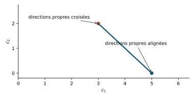

# X–ENS–ESPCI · PC · Mathématiques 2015 · Corrigé brut

*Corrigé rédigé par IA, non officiel. Signalez toute erreur.*

**Rédaction** · GPT-6.2 Astra Ultra · vitesse non renseignée

**Révision** · GPT-6.2 Astra Ultra · vitesse non renseignée

Les valeurs propres des matrices symétriques sont répétées avec multiplicité et rangées dans l’ordre décroissant. Le principe du minimax permet de les comparer sous une perturbation et de décrire exactement les spectres possibles d’une somme en dimension deux.

## I. Spectre ordonné, minimax et régularité

### Question 1a

Les matrices symétriques forment le noyau de l’application linéaire $M\mapsto M-M^t$. Les $n$ entrées diagonales et les $n(n-1)/2$ entrées strictement au-dessus de la diagonale se choisissent librement et déterminent la matrice. La dimension est $n(n+1)/2$. Le théorème spectral donne $n$ valeurs propres réelles comptées avec multiplicité, qui admettent un unique rangement décroissant.

### Question 1b

Pour $n=1$, l’application est l’identité et elle est linéaire. Pour $n\ge2$, prenons $M=\operatorname{diag}(1,0,\ldots,0)$. La première coordonnée de $s^\downarrow(-M)$ vaut zéro alors que celle de $-s^\downarrow(M)$ vaut $-1$. L’homogénéité échoue.

### Question 1c

Les mêmes vecteurs propres portent les valeurs opposées. Dans l’ordre décroissant, $s^\downarrow(-M)=(-m_n,-m_{n-1},\ldots,-m_1)$.

### Question 1d

Le déterminant de $tI-M$ est $(t-\lambda)(t-\mu)-h^2$. Ses deux racines ordonnées sont
$$
m_\pm=\tfrac12(\lambda+\mu\pm\sqrt{(\lambda-\mu)^2+4h^2}).
$$
Ainsi $s^\downarrow(M)=(m_+,m_-)$, y compris lorsque le radical s’annule.

### Question 2a

Le théorème spectral donne des vecteurs orthonormés $v_i$ avec $Mv_i=m_i v_i$. L’application $v_iv_i^t$ projette sur $\mathbb Rv_i$. L’opérateur $\sum_i m_iv_i v_i^t$ envoie donc $v_j$ sur $m_jv_j$, comme $M$, pour chaque vecteur d’une base. Ils sont égaux.

### Question 2b

Pour $x=\sum_i \xi_i v_i$ unitaire, $x^tMx=\sum_i m_i\xi_i^2\le m_1$ car $\sum_i\xi_i^2=1$. Le supremum $m_1$ est atteint par $x=v_1$.

### Question 2c

Dans $V_j$, la moyenne porte sur $m_1,\ldots,m_j$ et est au moins $m_j$. Dans $W_j$, elle porte sur $m_j,\ldots,m_n$ et est au plus $m_j$. Le vecteur $v_j$ appartient aux deux sphères et y réalise la valeur $m_j$. D’où l’infimum et le supremum demandés.

### Question 3a

On a $\dim(U\cap V)=\dim U+\dim V-\dim(U+V)\ge\dim U+\dim V-n>0$. L’intersection contient un vecteur non nul.

### Question 3b

Comme $\dim W_j=n-j+1$, la somme avec $\dim V=j$ vaut $n+1$. Par 3a, il existe $x\in V\cap W_j$ de norme un. Par 2c, $x^tMx\le m_j$. L’infimum sur la sphère de $V$ est au plus cette valeur.

### Question 3c

Le supremum des infimums sur les espaces de dimension $j$ est au plus $m_j$ par 3b. Pour $V=V_j$, 2c donne exactement $m_j$. La borne supérieure est donc $m_j$ et elle est atteinte.

### Question 4a

Le spectre de $M-L$ est positif ou nul, donc $x^t(M-L)x\ge0$ pour tout $x$ par la décomposition spectrale. Sur tout sous-espace de dimension $j$, on peut prendre l’infimum des formes sur la sphère en gardant l’ordre, puis le supremum sur les sous-espaces. La question 3c donne $\ell_j\le m_j$ pour chaque $j$.

### Question 4b

Pour tout $x$, $x^tMx\le\|x\|\,\|Mx\|\le\|M\|\,\|x\|^2$. La forme associée à $\|M\|I-M$ est donc positive ou nulle. En la testant sur chacun de ses vecteurs propres unitaires, on obtient des valeurs propres positives ou nulles.

### Question 4c

Posons $r=\|L-M\|$. Par 4b appliquée à $\pm(L-M)$, les formes quadratiques vérifient $M-rI\le L\le M+rI$. Leurs spectres sont ordonnés par 4a, et les translations scalaires translatent chaque valeur propre sans changer l’ordre. D’où $m_j-r\le\ell_j\le m_j+r$ pour tout $j$, donc $\max_j|\ell_j-m_j|\le r$.

### Question 4d

Avec la norme infinie sur l’espace d’arrivée, 4c signifie que $s^\downarrow$ est 1-lipschitzienne pour la norme subordonnée au départ. Elle est donc continue, et l’équivalence des normes en dimension finie donne également la continuité pour les autres normes usuelles.

### Question 5a

Si $n\ge2$, prenons $r=\tfrac12\min_{i<n}(m_i-m_{i+1})>0$. Pour $\|L-M\|<r$, 4c donne $\ell_i>m_i-r\ge m_{i+1}+r>\ell_{i+1}$. Le spectre reste simple sur cette boule, donc l’ensemble est ouvert. Si $n=1$, tout rayon convient puisqu’une matrice de taille un a toujours un spectre simple.

### Question 5b

Sur les matrices de taille deux à spectre simple, $(\lambda-\mu)^2+4h^2>0$, donc la formule de 1d pour $m_+$ est de classe $C^1$ (même lisse). Près d’une matrice scalaire $\lambda I$, en gardant la diagonale et en faisant varier $h$, elle devient $\lambda+|h|$, non dérivable en zéro. La première composante n’est donc pas $C^1$ sur tout $S_2$.

## II. Inégalités pour la somme de deux matrices

### Question 6a

La somme des valeurs propres comptées avec multiplicité vaut la trace. Donc $\sum_i c_i=\operatorname{Tr}(A+B)=\sum_i a_i+\sum_i b_i$.

### Question 6b

Pour tout $x$ unitaire, $x^tCx=x^tAx+x^tBx\le a_1+b_1$ par 2b. Prendre le supremum donne $c_1\le a_1+b_1$.

### Question 6c

La question 6b appliquée à $-C=(-A)+(-B)$ donne $-c_n\le-a_n-b_n$ d’après 1c. Autrement dit $a_n+b_n\le c_n$.

### Question 7a

Grassmann donne $\dim(U\cap V)\ge\dim U+\dim V-n$, puis $\dim(U\cap V\cap W)\ge\dim U+\dim V+\dim W-2n>0$.

### Question 7b

Prenons les espaces propres cumulés des indices $j,\ldots,n$ de $A$, des indices $k,\ldots,n$ de $B$ et des indices $1,\ldots,j+k-1$ de $C$. La somme de leurs dimensions vaut $2n+1$, donc ils ont un vecteur unitaire commun $x$. Par 2c, $c_{j+k-1}\le x^tCx\le a_j+b_k$. Pour la seconde inégalité, appliquer cette première borne à $A=C+(-B)$ aux indices $j$ et $1$. On obtient $a_j\le c_j-b_n$, donc $a_j+b_n\le c_j$.

Pour la première borne, les trois dimensions sont $n-j+1$, $n-k+1$ et $j+k-1$. Le total vaut $2n+1$ dès que $j+k-1\le n$. Le vecteur commun repère à la fois une borne supérieure pour chacune des formes de $A,B$ et une borne inférieure pour celle de $C$.

### Question 8a

On a $a_{11}=e_1^t A e_1\le a_1$ par 2b, puisque $e_1$ est unitaire.

### Question 8b

Comme $s_i\le s_j$ pour $i>j$ et $\sum_{i>j}t_i=\sum_{i\le j}(1-t_i)$,
$$
\sum_{i\le j}s_i-f(t)=\sum_{i\le j}s_i(1-t_i)-\sum_{i>j}s_it_i
\ge\sum_{i\le j}(s_i-s_j)(1-t_i)\ge0.
$$
Le choix $t_i=1$ pour $i\le j$, zéro sinon, appartient à $D_{j,k}$ et réalise la borne. Le supremum vaut donc $\sum_{i=1}^j s_i$.

### Question 8c

Si $A=\sum_k a_k v_kv_k^t$, alors $\sum_{i\le j}a_{ii}=\sum_k a_k t_k$ avec $t_k=\sum_{i\le j}(v_k)_i^2$. Chaque $t_k$ est dans $[0,1]$ et leur somme vaut $j$ car les lignes de la matrice orthogonale des $v_k$ sont unitaires. Pour $j<n$, 8b donne la borne $\sum_{i\le j} a_i$. Pour $j=n$ c’est l’égalité des traces.

### Question 8d

Complétons $(x_1,\ldots,x_j)$ en une base orthonormale. Dans cette base, $x_i^tAx_i$ est le $i$-ième coefficient diagonal et le spectre est inchangé. Par 8c leur somme partielle est majorée par $\sum_{i\le j}a_i$. Avec les $j$ premiers vecteurs propres de $A$, cette borne est atteinte, ce qui donne le supremum annoncé.

### Question 8e

Pour toute famille orthonormale de cardinal $j$, la somme des quotients de $C$ est la somme des deux expressions correspondantes pour $A,B$. Par 8d, elle est donc au plus $\sum_{i\le j}a_i+\sum_{i\le j}b_i$. Prendre le supremum sur ces familles pour $C$ donne $\sum_{i\le j}c_i$ à gauche.

## III. Tous les spectres possibles en dimension deux

### Question 9

Posons $t=a_1+a_2+b_1+b_2$. On a $c_2=t-c_1$ et $a_1+b_2\le c_1\le a_1+b_1$ par 7b et 6b. Les extrémités sont $P=(a_1+b_2,a_2+b_1)$ et $Q=(a_1+b_1,a_2+b_2)$. Pour $P$, l’ordre est assuré par $a_1-a_2\ge b_1-b_2$. Des matrices diagonales respectivement croisées et alignées réalisent $P,Q$. Le segment $L=[P,Q]$ a pour longueur $\sqrt2(b_1-b_2)$, y compris si les deux points coïncident.

En écrivant $d=b_1-b_2\ge0$, on a $Q-P=(d,-d)$. La longueur euclidienne demandée vaut donc $\sqrt{d^2+(-d)^2}=\sqrt2\,d$. Dans l’exemple tracé $d=2$, elle vaut $2\sqrt2$.

### Question 10a

Pour tout couple admissible, il existe $U$ orthogonale telle que $U^tAU=D_a=\operatorname{diag}(a_1,a_2)$. Alors $B'=U^t BU$ a le spectre $b$ et $A+B$ a le même spectre que $D_a+B'$. Réciproquement, tout tel couple $(D_a,B')$ est admissible. On obtient donc bien le même ensemble $\Sigma$.

### Question 10b

Soit $R_\theta$ la rotation d’angle $\theta$. L’application $\theta\mapsto R_\theta\operatorname{diag}(b_1,b_2)R_\theta^t$ est continue sur $[-\pi,\pi]$ et ses valeurs ont le spectre voulu. Toute matrice de ce spectre a un vecteur propre unitaire de valeur $b_1$ de direction $(\cos\theta,\sin\theta)$. Le vecteur perpendiculaire direct est propre pour $b_2$. La formule redonne donc cette matrice, également dans le cas scalaire.

### Question 10c

D’après 4d et 10a–b, la première valeur propre de $D_a+R_\theta D_b R_\theta^t$ varie continûment avec $\theta$. Aux angles zéro et $\pi/2$, on retrouve respectivement $Q$ et $P$. Le théorème des valeurs intermédiaires réalise toute première coordonnée entre les deux bornes, la seconde étant imposée par la trace. Ainsi $L\subset\Sigma$ et, avec 9, $\Sigma=L$.

Pour vérifier directement le segment de la figure, prenons $A=\operatorname{diag}(3,0)$ et $B=R_\theta\operatorname{diag}(2,0)R_\theta^t$. Le déterminant de la somme est $6\sin^2\theta$ et sa trace $5$. Les deux racines de $X^2-5X+6\sin^2\theta$ relient donc $(5,0)$ à $(3,2)$ lorsque $\theta$ va de $0$ à $\pi/2$.
