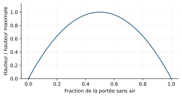
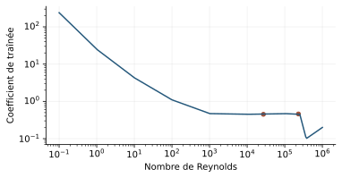
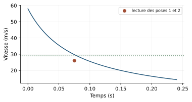
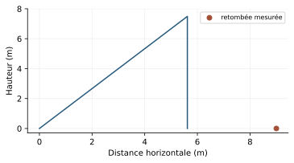
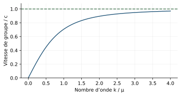
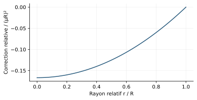

# X, ESPCI et ENS PC 2015 — Physique B · Corrigé guidé

*Corrigé rédigé par IA, non officiel. Signalez toute erreur.*

**Lecture du rapport du jury** · GPT-6.2 Astra Ultra · vitesse non renseignée

**Rédaction** · GPT-6.2 Astra Ultra · vitesse non renseignée

## Un volant de badminton et la masse du photon

## Mécanique du volant de badminton

### Question I.1 — Trajectoire de référence

**Indication.** Identifier les deux instants où le volant se trouve à la hauteur de départ.

Orientons $x$ le long du terrain, $y$ vers le haut. Sans résistance, $\ddot x=0$, $\ddot y=-g$. Avec pour origine le point de départ du volant, $x=U_0t\cos\theta_0$, $y=U_0t\sin\theta_0-gt^2/2$. L’élimination de $t$ donne la parabole $y=x\tan\theta_0-gx^2/(2U_0^2\cos^2\theta_0)$. Le second passage à $y=0$ a lieu à $2U_0\sin\theta_0/g$, d’où $L_0=U_0^2\sin(2\theta_0)/g$.

### Question I.2 — Contrôles de cohérence

**Indication.** Tester les deux orientations extrêmes, en gardant la même hauteur au départ et à l’arrivée.

Le rapport $U_0^2/g$ a pour dimension une longueur. À la verticale, $\theta_0=\pi/2$ et le volant retombe à son point de départ. Pour un départ horizontal au ras du sol, $\theta_0=0$, le temps de vol au-dessus du sol tend vers zéro. Les deux longueurs correspondantes sont nulles comme le prévoit la formule.

### Question I.3 — Maximum du modèle idéal

**Indication.** À vitesse fixée, repérer l’unique facteur qui dépend de l’angle.

Sur $0\le\theta_0\le\pi/2$, le facteur $\sin(2\theta_0)$ est au plus un et atteint cette valeur une seule fois, lorsque $2\theta_0=\pi/2$. Le maximum de ce modèle sans air correspond donc à $45^\circ$.

### Question I.4 — Traînée d’une sphère

**Indication.** Utiliser la distinction entre la turbulence du sillage et celle de la couche limite au voisinage de la sphère.

La quantité $\rho SU^2$ a les unités d’une force, donc $C_x$ est sans dimension. Pour une sphère et $\mathrm{Re}\ll1$, la traînée visqueuse de Stokes conduit à $C_x=24/\mathrm{Re}$. À mesure que le sillage se développe, la décroissance ralentit. Vers $10^3$ à $10^5$, $C_x$ est d’ordre $0,4$ et le sillage devient turbulent. Près de quelques $10^5$ survient la crise de traînée, associée à la transition de la couche limite. Le sillage et la couche limite ont donc des seuils distincts.

### Question I.5 — Reynolds mesurés

**Indication.** Faire deux estimations avec les valeurs imprimées aux deux extrémités de la trajectoire.

Avec $L=0,060\,\mathrm m$ et $\nu=1,5\,10^{-5}\,\mathrm{m^2\,s^{-1}}$, $\mathrm{Re}=UL/\nu=4,0\,10^3 U$ pour une vitesse en mètres par seconde. La photographie donne au départ $58\,\mathrm{m\,s^{-1}}$, soit $2\,10^5$, et en fin de chute $6,7\,\mathrm{m\,s^{-1}}$, soit $3\,10^4$. Le sillage est à grand Reynolds, avec une traînée approximativement quadratique sur ce domaine. Le volant réel diffère d’une sphère.

### Question I.6 — Chute uniforme

**Indication.** Imposer une accélération nulle comme condition vectorielle.

Avec $\mathbf e_y$ vers le haut, $m\dot{\mathbf U}=-mg\mathbf e_y-(\rho SC_x/2)U\mathbf U$. Une vitesse constante exige une traînée verticale ascendante de norme $mg$. Il existe donc la solution $\mathbf U=-U_\infty\mathbf e_y$ avec $U_\infty=\sqrt{2mg/(\rho SC_x)}$.

### Question I.7 — Équation réduite

**Indication.** Employer la vitesse limite pour éliminer le produit des paramètres de traînée.

En remplaçant $\rho SC_x/(2m)$ par $g/U_\infty^2$, on a $g^{-1}\dot{\mathbf U}=-\mathbf e_y-(U/U_\infty)(\mathbf U/U_\infty)$. Avec $\mathbf u=\mathbf U/U_\infty$ et $\tau=gt/U_\infty$, la même relation s’écrit $d\mathbf u/d\tau=-\mathbf e_y-|\mathbf u|\mathbf u$.

### Question I.8 — Freinage initial

**Indication.** Prendre la dérivée de l’inverse de la vitesse.

Le rapport de la traînée au poids vaut $(U/U_\infty)^2$. Si $U\gg U_\infty$, l’accélération est antiparallèle à la vitesse. Le volant suit alors approximativement une droite. En intégrant $dU/dt=-gU^2/U_\infty^2$, on trouve $1/U=1/U_0+gt/U_\infty^2$, ou $U=U_0/(1+t/t_b)$ avec $t_b=U_\infty^2/(gU_0)$.

### Question I.9 — Mesure d’une demi-vitesse

**Indication.** Mesurer la distance oblique entre centres des points, puis utiliser la barre d’échelle.

La vitesse vaut $U_0/2$ à $t_b=6,7^2/(9,8\times58)\simeq0,08\,\mathrm s$, entre les poses 1 et 2 séparées de $0,050\,\mathrm s$. Sur la figure, leur écart oblique représente environ $0,15$ de la flèche horizontale de $9\,\mathrm m$, soit $1,3\,\mathrm m$. On déduit une vitesse moyenne proche de $26\,\mathrm{m\,s^{-1}}$ près de $0,075\,\mathrm s$, compatible à la précision graphique avec les $29\,\mathrm{m\,s^{-1}}$ attendus.

### Question I.10 — Position pendant le freinage

**Indication.** Utiliser l’angle constant durant la toute première phase du mouvement.

Dans cette phase l’angle varie peu, donc $\dot x=U_0\cos\theta_0/(1+t/t_b)$. En choisissant $x(0)=0$, l’intégrale donne $x(t)=\ell_b\cos\theta_0\ln(1+t/t_b)$ où $\ell_b=U_\infty^2/g=U_0t_b$ est une longueur.

### Question I.11 — Position en fonction de la vitesse

**Indication.** Le logarithme doit porter sur un rapport sans dimension.

Puisque $1+t/t_b=U_0/U$, le résultat devient $x=\ell_b\cos\theta_0\ln(U_0/U)$. Lorsque $U=U_0$, la position obtenue est bien l’origine.

### Question I.12 — Fin de la phase ascendante simplifiée

**Indication.** Projeter la traînée sur la verticale avant de poser l’égalité des normes.

La composante verticale de la traînée vaut en module $mg(U/U_\infty)^2\sin\theta_0$. Son égalité avec le poids conduit à $U_*=U_\infty/\sqrt{\sin\theta_0}$. La distance horizontale correspondante vaut $L=\ell_b\cos\theta_0\ln(U_0\sqrt{\sin\theta_0}/U_\infty)$. Le repère impose ici un mouvement initial ascendant et une vitesse initiale suffisante.

### Question I.13 — Dernières poses

**Indication.** Observer simultanément l’orientation et la longueur des déplacements entre poses.

À la fin, vers les points 40 et suivants, les marques sont à peu près alignées verticalement et équidistantes pour des temps égaux. Cela indique un vecteur vitesse presque constant, dirigé vers le sol, comme en I.6. Des écarts constants sans alignement ne suffiraient pas à établir une accélération négligeable.

### Question I.14 — Approximation à deux segments

**Indication.** Prolonger les deux régimes rectilignes jusqu’à leur intersection.

En supprimant le raccord courbe, le premier segment suit l’angle $\theta_0$ entre $(0,0)$ et $(L,L\tan\theta_0)$. Le second descend verticalement jusqu’à $(L,0)$. Le coude du tracé est un artefact de l’approximation.

### Question I.15 — Comparaison des distances

**Indication.** Former le rapport avec la portée sans air et employer $\sin(2\theta)=2\sin\theta\cos\theta$.

Dans ce modèle, la descente verticale n’ajoute aucune distance horizontale. La portée est donc le $L$ de I.12. En posant $a=U_0\sqrt{\sin\theta_0}/U_\infty$, on obtient $L/L_0=\ln(a)/(2a^2)$. Pour $a\gg1$, le vol freiné est beaucoup plus court et la longueur ne croît que logarithmiquement avec la vitesse initiale.

### Question I.16 — Comparaison à la photographie

**Indication.** Comparer la valeur calculée à la longueur entière de la flèche de la photographie.

$\ell_b\simeq4,6\,\mathrm m$, $a\simeq8$, donc $L\simeq4,6\times0,6\times2\simeq6\,\mathrm m$ à un chiffre significatif. La photographie donne $9\,\mathrm m$. L’ordre de grandeur convient, avec une sous-estimation de quelques mètres, compatible avec la progression horizontale pendant le raccord négligé.

### Question I.17 — Échelle du raccord

**Indication.** Déduire successivement l’échelle de vitesse, celle de temps et celle de longueur.

Dans le régime intermédiaire, la traînée est du même ordre que le poids, donc $U\sim U_\infty$. L’accélération est d’ordre $g$, la durée $U_\infty/g$ et la distance $U_\infty^2/g=\ell_b$. Négliger cette distance devant $L$ exige $\cos\theta_0\ln a\gg1$, pour une inclinaison non extrême.

### Question I.18 — Limite du modèle pour le badminton

**Indication.** Examiner comment le rapport de la longueur du raccord à la portée dépend du seul logarithme.

À inclinaison fixée et modérée, un rapport $U_0/U_\infty$ plus grand rapproche la forme du volant de la courbe à deux segments. Dans la comparaison de volants de badminton, une vitesse initiale plus grande ou une valeur plus faible de $m/(SC_x)$ augmente ce rapport à densité d’air fixée. L’erreur relative due au raccord décroît seulement comme $1/\ln a$. La convergence est donc lente.

### Question I.19 — Durées caractéristiques

**Indication.** Une petite longueur relative du raccord n’implique pas automatiquement une petite durée face à celle de la montée.

La montée à deux segments dure $t_m=t_b(U_0/U_*-1)=(U_\infty/g)(\sqrt{\sin\theta_0}-U_\infty/U_0)$. La hauteur vaut $L\tan\theta_0=\ell_b\sin\theta_0\ln a$, donc $t_d=(U_\infty/g)\sin\theta_0\ln a$. Pour le raccord $t_i\sim U_\infty/g$. À angle fixé et $a$ très grand, $t_m$ et $t_i$ gardent le même ordre tandis que la descente est plus longue d’un facteur logarithmique.

## Dispersion électromagnétique

### Question II.1 — Relation de dispersion modifiée

**Indication.** Le laplacien et la dérivée temporelle seconde apportent chacun un signe moins.

Pour une onde proportionnelle à $e^{i(\mathbf k\cdot\mathbf r-\omega t)}$, l’équation devient $-k^2+\omega^2/c^2=\mu^2$. Ainsi $\omega^2=c^2(k^2+\mu^2)$. On retrouve exactement le modèle de Maxwell pour $\mu=0$ et approximativement pour $\mu/k\ll1$.

### Question II.2 — Retard de groupe

**Indication.** Dériver à $\mu$ fixé, puis développer en $(\mu/k)^2$.

Sur la branche positive, $v_g=d\omega/dk=ck/\sqrt{k^2+\mu^2}$. Pour $k\gg\mu$, la formule $(1+x)^{-1/2}=1-x/2+O(x^2)$ donne $c-v_g\simeq c\mu^2/(2k^2)$. Le retard croît donc avec la longueur d’onde.

### Question II.3 — Énergie au repos

**Indication.** Vérifier que $\mu$ est un inverse de longueur.

Dans un champ uniforme, $k=0$. L’équation est $\ddot{\mathbf E}+c^2\mu^2\mathbf E=0$, soit $\omega_0=c\mu$. Un quantum a pour énergie $\hbar\omega_0=\hbar c\mu$. L’identification à $mc^2$ conduit à $m=\hbar\mu/c$.

## Mesure sur le pulsar du Crabe

### Question II.4 — Retard entre impulsions

**Indication.** L’information sur le temps d’arrivée est portée par l’enveloppe de l’impulsion.

Une même impulsion émise dans les deux bandes arriverait à deux dates légèrement différentes. D’après II.2 la bande rouge, de longueur d’onde plus grande, arriverait après la bleue. À source périodique, les deux trains d’impulsions ont la même période et un décalage de phase mesurable sous l’hypothèse d’émission simultanée.

### Question II.5 — Résolution temporelle

**Indication.** Écrire la différence des inverses avant de remplacer les vitesses par $c$ au dénominateur.

Pour deux vitesses proches de $c$, la différence de temps de vol en valeur absolue est $L|1/v_1-1/v_2|\simeq L\Delta v/c^2$. Un retard inférieur à $\delta t$ est indiscernable. La résolution sur $\Delta v/c$ est donc $c\delta t/L$.

### Question II.6 — Borne issue du Crabe

**Indication.** Une non-détection impose une limite supérieure à la différence de vitesses.

En l’absence de décalage détecté, $\Delta v/c\lesssim(3\,10^8)(2\,10^{-5})/(6\,10^{19})=1\,10^{-16}$. Cette borne est sans dimension.

### Question II.7 — Limites sur le paramètre et la masse

**Indication.** Employer une différence entre bandes, car on mesure le retard rouge-bleu.

En écrivant $k=2\pi/\lambda$, la différence prévisible est $\Delta v/c\simeq\mu^2(\lambda_r^2-\lambda_b^2)/(8\pi^2)$. À titre d’estimation, $\lambda_b\simeq450\,\mathrm{nm}$ et $\lambda_r\simeq650\,\mathrm{nm}$ donnent $\mu\lesssim0,2\,\mathrm{m^{-1}}$. Ainsi $m\lesssim(10^{-34}/3\,10^8)\times0,2\simeq7\,10^{-44}\,\mathrm{kg}$, d’ordre $10^{-43}\,\mathrm{kg}$. Les couleurs seules déterminent ici un ordre de grandeur.

### Question II.8 — Choix des observations

**Indication.** Reprendre les deux facteurs $L$ et $\lambda_r^2-\lambda_b^2$ du retard.

La grande distance accumule le retard de groupe tout au long du trajet. À précision temporelle égale, une paire de bandes plus éloignées en $\lambda^2$ et comportant des longueurs d’onde plus grandes, par exemple dans le domaine radio, accroît le signal pour un même $\mu$. Dans une mesure astrophysique réelle, il faut séparer la dispersion due au plasma sur le trajet.

## Expérience électrostatique

### Question II.9 — Compatibilité en régime statique

**Indication.** Utiliser l’identité du double rotationnel puis la relation champ-potentiel.

En électrostatique, $\mathbf E=-\nabla V$ et $\nabla\times\mathbf E=0$. Alors $\Delta\mathbf E=\nabla(\nabla\cdot\mathbf E)=\nabla\rho/\epsilon_0-\mu^2\nabla V$. Dans le vide sans charges (ou localement si $\nabla\rho=0$), on retrouve $\Delta\mathbf E=\mu^2\mathbf E$, qui est la forme stationnaire de (1).

### Question II.10 — Cavité classique

**Indication.** Spécifier les invariances puis appliquer Gauss sur une surface où le champ a une norme constante.

Les rotations autour du centre conservent la sphère et sa condition de potentiel. Le champ intérieur est radial et sa norme ne dépend que de $r$ par unicité du problème. Une sphère de Gauss concentrique enferme une charge nulle, d’où $4\pi r^2 E_r=0$. Ainsi $\mathbf E=0$ et $V=V_0$ dans toute la cavité.

### Question II.11 — Correction à petit paramètre

**Indication.** Évaluer le flux sur une sphère intérieure, puis intégrer le champ en partant de la paroi.

L’équation pour $V$ dépend de $\mu^2$. La solution régulière reste proche de la constante $V_0$ lorsque $\mu R\ll1$. Dans le terme déjà multiplié par $\mu^2$, remplaçons donc $V$ par $V_0$. L’intégration de $\nabla\cdot\mathbf E\simeq-\mu^2V_0$ sur la sphère de rayon $r$ donne $E_r\simeq-\mu^2V_0r/3$. Puis $\partial_rV=-E_r$ et $V(R)=V_0$ conduisent à $V(r)\simeq V_0[1+\mu^2(r^2-R^2)/6]$.

### Question II.12 — Consistance de l’approximation

**Indication.** Identifier l’endroit où la correction de potentiel est la plus grande.

L’écart relatif maximal à $V_0$ se produit au centre. Il vaut $\mu^2R^2/6$ au premier ordre et doit être très inférieur à un. La condition perturbative est donc $\mu R\ll1$ à un facteur numérique d’ordre unité près.

### Question II.13 — Sensibilité de la cavité

**Indication.** Choisir les deux points qui maximisent l’écart et comparer une sensibilité relative à celle exigée par la borne du pulsar.

Entre le centre et la paroi, $|\Delta V|/|V_0|\simeq(\mu R)^2/6$. Une précision relative $\varepsilon$ conduirait en cas de non-détection à $\mu\lesssim\sqrt{6\varepsilon}/R$. Pour $R$ de l’ordre du mètre, battre $0,2\,\mathrm{m^{-1}}$ exige une précision meilleure qu’environ $7\,10^{-3}$, possible en électrostatique de précision. La conclusion dépend du rayon et de la sensibilité réellement disponibles.
