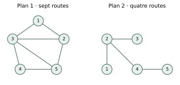
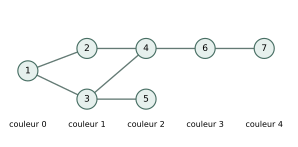
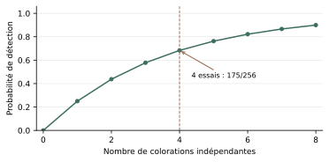

# X-ENS · PSI et PT · Informatique 2015 · Corrigé brut

*Corrigé rédigé par IA, non officiel. Signalez toute erreur.*

**Rédaction** · GPT-6.2 Astra Ultra · vitesse non renseignée · 25 novembre 2026

**Quand la taille n’est pas un problème.** Le code est en Python et utilise les primitives `creerTableau`, `entierAleatoire` et `affiche` fournies par l’énoncé. Le plan est un graphe simple non orienté.

## I · Listes sans redondance

### Question 1 · Réserver une liste vide

```python
def creerListeVide(n):
    liste = creerTableau(n + 1)
    liste[0] = 0
    return liste
```

Les cases d’indices 1 à $n$ peuvent rester indéterminées tant que la taille vaut zéro. Même une capacité nulle réserve la case du compteur.

### Question 2 · Tester l’appartenance

```python
def estDansListe(liste, x):
    for i in range(1, liste[0] + 1):
        if liste[i] == x:
            return True
    return False
```

Si la taille courante vaut $d$, une recherche infructueuse compare exactement $d$ éléments. Le pire temps pour la capacité $n$ est donc $\Theta(n)$, et un succès à la première position coûte $\Theta(1)$.

### Question 3 · Ajouter sans répétition

```python
def ajouteDansListe(liste, x):
    if not estDansListe(liste, x):
        nouvelle_taille = liste[0] + 1
        liste[nouvelle_taille] = x
        liste[0] = nouvelle_taille
```

Le coût maximal est $\Theta(n)$. Si la liste est pleine, un doublon laisse son contenu intact. Pour une valeur absente, l’écriture hors limites lève `IndexError` en Python. Comme l’écriture précède la mise à jour du compteur, celui-ci conserve alors sa valeur.

## II · Représenter un plan

### Question 4 · Lire les deux plans

L’ordre des voisins est libre. L’astérisque désigne une case inutilisée. Pour le premier plan on lit sept routes, dont les deux traits intérieurs $2$–$3$ et $3$–$5$.

```text
Plan 1                 Plan 2
[ [5, 7],              [ [5, 4],
  [2, 2, 3, *, *],       [1, 2, *, *, *],
  [3, 1, 3, 5, *],       [3, 1, 3, 4, *],
  [4, 1, 2, 4, 5],       [1, 2, *, *, *],
  [2, 3, 5, *, *],       [2, 2, 5, *, *],
  [3, 2, 3, 4, *] ]      [1, 4, *, *, *] ]
```

Les degrés sont respectivement $(2,3,4,2,3)$ et $(1,3,1,2,1)$. Leurs sommes 14 et 8 contrôlent les deux compteurs de routes. Les traits qui se rejoignent en un sommet représentent des routes distinctes.



### Question 5 · Initialiser le plan sans route

```python
def creerPlanSansRoute(n):
    plan = creerTableau(n + 1)
    plan[0] = creerTableau(2)
    plan[0][0], plan[0][1] = n, 0
    for x in range(1, n + 1):
        plan[x] = creerListeVide(n - 1)
    return plan
```

Chaque ville peut avoir jusqu’à $n-1$ voisins. Sa ligne a donc $n$ cases en comptant le degré. La représentation prescrite réserve au total un espace quadratique en $n$.

### Question 6 · Tester une route

```python
def estVoisine(plan, x, y):
    return estDansListe(plan[x], y)
```

Dans un plan cohérent, la présence de $y$ dans la ligne de $x$ équivaut à la présence de $x$ dans la ligne de $y$. La recherche prend au plus $\deg(x)$ comparaisons.

### Question 7 · Ajouter une route dans les deux sens

```python
def ajouteRoute(plan, x, y):
    if x != y and not estVoisine(plan, x, y):
        ajouteDansListe(plan[x], y)
        ajouteDansListe(plan[y], x)
        plan[0][1] += 1
```

Dans ce graphe simple, les boucles sont exclues. Si la route manque, $x$ a au plus $n-2$ voisins, puisque $y$ est une autre ville encore absente. Il reste donc une place également chez $y$. Un deuxième appel, y compris avec les extrémités inversées, ne modifie aucune case.

### Question 8 · Afficher une fois chaque route

```python
def afficheToutesLesRoutes(plan):
    n, m = plan[0]
    affiche("Ce plan contient", m, "route(s)")
    for x in range(1, n + 1):
        for i in range(1, plan[x][0] + 1):
            y = plan[x][i]
            if x < y:
                affiche(x, "-", y)
```

Chaque route $\{x,y\}$ figure dans exactement deux lignes et vérifie le test dans exactement une d’entre elles. Les boucles parcourent $n$ villes et $\sum_x\deg(x)=2m$ cases actives, d’où $\Theta(n+m)$ dans le modèle d’affichage élémentaire du sujet. Les cases libres ne sont pas parcourues.

## III · Chemins arc-en-ciel

### Question 9 · Colorier les villes indépendamment

```python
def coloriageAleatoire(plan, couleur, k, s, t):
    for x in range(1, plan[0][0] + 1):
        if x == s:
            couleur[x] = 0
        elif x == t:
            couleur[x] = k + 1
        else:
            couleur[x] = entierAleatoire(k)
```

Le tableau transmis est rempli en $\Theta(n)$ opérations pour $k\geqslant 1$. Le cas sans ville intermédiaire se ramène au seul test de la route $s$–$t$, comme à la question 13, sans effectuer de tirage.

### Question 10 · Filtrer les voisins d’une ville

```python
def voisinesDeCouleur(plan, couleur, i, c):
    resultat = creerListeVide(plan[0][0] - 1)
    for j in range(1, plan[i][0] + 1):
        v = plan[i][j]
        if couleur[v] == c:
            resultat[0] += 1
            resultat[resultat[0]] = v
    return resultat
```

La capacité suffit, même quand tous les voisins ont la bonne couleur. Une seconde recherche d’appartenance serait superflue. Outre l’allocation du tableau, il y a $\deg(i)$ lectures de voisins.

### Question 11 · Réunir les voisins de plusieurs villes

```python
def voisinesDeLaListeDeCouleur(plan, couleur, liste, c):
    n = plan[0][0]
    resultat = creerListeVide(n)
    vu = creerTableau(n + 1)
    for v in range(1, n + 1):
        vu[v] = False
    for a in range(1, liste[0] + 1):
        x = liste[a]
        for j in range(1, plan[x][0] + 1):
            v = plan[x][j]
            if couleur[v] == c and not vu[v]:
                vu[v] = True
                resultat[0] += 1
                resultat[resultat[0]] = v
    return resultat
```

La première rencontre d’un voisin de couleur $c$ l’ajoute au résultat et le marque. Toutes les rencontres ultérieures sont ignorées. Comme l’entrée est sans répétition, le nombre de voisins examinés est au plus $2m$. Le temps est $O(n+m)$ et l’espace supplémentaire $O(n)$. Sur une entrée contenant toutes les villes, toutes les incidences sont effectivement lues.

### Question 12 · Chercher un chemin aux couleurs ordonnées

```python
def existeCheminArcEnCiel(plan, couleur, k, s, t):
    if k == 0:
        return estVoisine(plan, s, t)
    front = creerListeVide(1)
    front[0], front[1] = 1, s
    for c in range(1, k + 2):
        front = voisinesDeLaListeDeCouleur(plan, couleur, front, c)
        if front[0] == 0:
            return False
    return estDansListe(front, t)
```

Initialement le seul préfixe admissible est réduit à $s$. Après le passage à la couleur $c$, le tableau contient exactement les villes atteignables en suivant successivement les couleurs $0,1,\ldots,c$. En effet, tout préfixe obtenu se prolonge par une route depuis le front précédent, et réciproquement tout chemin admissible se termine par une telle route. Les couleurs distinctes interdisent la répétition d’un sommet. La dernière couleur appartient au seul $t$.

Une borne directe est $O((k+1)(n+m))$. On peut la préciser pour le code donné. Chaque ville a une seule couleur et apparaît au plus dans un front parcouru. Les lectures de voisins cumulées sont donc au plus $2m$. Les initialisations de tableaux restent en $O((k+1)n)$, d’où $O((k+1)n+m)$ et $O(n)$ d’espace auxiliaire.



## IV · Chemins simples et probabilité

### Question 13 · Répéter des colorations pour atteindre la probabilité demandée

```python
def existeCheminSimple(plan, k, s, t):
    n = plan[0][0]
    if k == 0:
        return estVoisine(plan, s, t)
    if k > n - 2:
        return False
    couleur = creerTableau(n + 1)
    for essai in range(k ** k):
        coloriageAleatoire(plan, couleur, k, s, t)
        if existeCheminArcEnCiel(plan, couleur, k, s, t):
            return True
    return False
```

Pour un chemin simple fixé, les $k$ tirages indépendants prennent chacun la couleur prescrite avec probabilité $1/k$. Un essai détecte donc un chemin avec probabilité au moins $k^{-k}$. Pour $k\geqslant 1$, la probabilité d’échec après $k^k$ essais indépendants est au plus $(1-k^{-k})^{k^k}\leqslant e^{-1}$. Pour $k=1$ un seul essai suffit. Un succès fournit toujours un chemin et un échec peut manquer un chemin existant.

Le pire temps est $O(k^k((k+1)n+m))$ pour ce code. En particulier une réponse de la forme demandée est $f(k)=k^k(k+1)$ et $g(n,m)=n+m$ pour $k\geqslant 1$. Le cas $k=0$ est déterministe. On peut prendre un espace de travail $O(n)$, en réutilisant les tableaux d’un essai au suivant.



### Question 14 · Reconstruire un chemin témoin

Dans la fonction de la question 11, ajouter un paramètre `parent` et, juste après `vu[v] = True`, écrire `parent[v] = x`. Pour chaque coloration, la recherche de la question 12 crée un tableau `parent` de taille $n+1$ et initialise `parent[s] = s`. L’instant où $t$ est atteint remplace le retour booléen de réussite par la reconstruction suivante.

```python
def reconstruire(parent, k, s, t):
    chemin = creerTableau(k + 2)
    v = t
    for i in range(k + 1, 0, -1):
        chemin[i] = v
        v = parent[v]
    chemin[0] = s
    return chemin
```

Chaque lien parental diminue la couleur de un et suit une route du plan. Au terme des $k+1$ sauts, $v=s$, ce qui prouve que le résultat possède exactement $k$ sommets internes distincts. La question 13 transmet le premier tableau trouvé et retourne `None` en cas d’échec. Pour $k=0$, elle retourne $[s,t]$ si la route existe. Les parents dépendent de la coloration qui a réussi. La reconstruction ajoute $O(k)$ opérations et $O(n)$ cases suffisent pour les parents.
