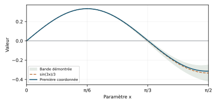
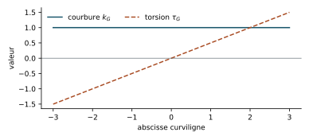

# X–ENS · PSI · Mathématiques 2015 · Corrigé guidé

*Corrigé rédigé par IA, non officiel. Signalez toute erreur.*

**Rédaction** · GPT-6.2 Astra Ultra · vitesse non renseignée

**Révision (tour 1)** · GPT-6.2 Astra Ultra · vitesse non renseignée

L’épreuve met en relation une équation de Schrödinger et une évolution de courbe spatiale. Le profil complexe de la première partie a une énergie conservée. Dans la dernière, la courbure et la torsion du profil géométrique déterminent explicitement la phase de la solution.

[Sujet officiel](https://ens-paris-saclay.fr/sites/default/files/CONCOURS/ANNALES_1C/1C_PSI/2015_Sujet_1C_PSI_Maths.pdf)

Pour les questions 1 à 7, $\alpha>0$, $f(0)=1$ et $f^{\prime}(0)=0$. Dans la partie III, $T=G^{\prime}$ est le vecteur tangent au profil de la courbe. La vérification suit les questions du sujet officiel. Le rapport écrit de mathématiques de cette session reste introuvable dans les archives consultées.

## I. Profil complexe et équation de Schrödinger

### Question 1

> [!INDICATION]
> Séparer les parties réelle et imaginaire du terme où intervient i.

#### Solution

Notons $K=1+\alpha(f_1^2+f_2^2)$. L’équation donne $f_1''=xf_2'/2-K f_1/2$ et $f_2''=-xf_1'/2-Kf_2/2$.

### Question 2

> [!INDICATION]
> Dériver l’énergie et prendre la partie réelle après multiplication de l’équation par la dérivée conjuguée.

#### Solution

Posons $u=|f|^2$ et $K=1+\alpha u$. Alors $u'=2\operatorname{Re}(f'\bar f)$ et $(|f'|^2)'=2\operatorname{Re}(f''\overline{f'})=-K\operatorname{Re}(f\overline{f'})$, car le terme en $ix|f'|^2$ est imaginaire pur. Or $(K^2/(4\alpha))'=K u'/2$. La somme est constante et vaut $(1+\alpha)^2/(4\alpha)$ à l’origine.

### Question 3

> [!INDICATION]
> Majorer séparément les deux termes positifs de l’énergie.

#### Solution

Puisque $\alpha>0$, on a $1\le 1+\alpha|f|^2\le1+\alpha$, donc $|f|\le1$. L’autre terme vérifie $|f'|\le(1+\alpha)/(2\sqrt\alpha)=:D$.

### Question 4a

> [!INDICATION]
> Dériver la partie imaginaire d’un produit et utiliser l’équation du profil.

#### Solution

Pour $J=\operatorname{Im}(f'\bar f)$, on a $J'=\operatorname{Im}(f''\bar f)=-x\operatorname{Re}(f'\bar f)/2=-xu'/4$. Par conséquent $J+xu/4-\tfrac14\int_0^x u$ est constante. Elle vaut zéro en $x=0$.

### Question 4b

> [!INDICATION]
> Différencier le quotient intégral puis remplacer le numérateur par la relation précédente.

#### Solution

Pour $x>0$ posons $A(x)=x^{-1}\int_0^x u$. Alors $A'=(xu(x)-\int_0^x u)/x^2=-4J(x)/x^2$ par 4a.

### Question 4c

> [!INDICATION]
> Prouver que la dérivée de la moyenne est intégrable à l’infini.

#### Solution

Par 3, $|J|\le D$, d’où $|A'|\le4D/x^2$. La dérivée est intégrable sur $[1,\infty[$, donc $A$ a une limite finie $\ell$. Comme $0\le A(x)\le1$, on a $0\le\ell\le1$.

Pour $v>u\ge1$, l’intégration de la dérivée donne $|A(v)-A(u)|\le 4D(1/u-1/v)\le4D/u$. Le critère de Cauchy à l’infini montre ainsi directement que la limite existe, avant même d’estimer sa valeur.

### Question 4d

> [!INDICATION]
> Intégrer la borne de la dérivée depuis x jusqu’à l’infini.

#### Solution

On a $|A(x)-\ell|\le\int_x^\infty 4D/s^2\,ds=4D/x$ pour tout $x>0$. Le choix $M=4D$ convient.

### Question 4e

> [!INDICATION]
> Revenir de la moyenne à la valeur ponctuelle avec le terme imaginaire.

#### Solution

La question 4a donne $u(x)-A(x)=-4J(x)/x$. Ainsi $|u(x)-\ell|\le8D/x$ et on peut prendre $M_0=8D$.

### Question 5a

> [!INDICATION]
> Sous l’hypothèse limite un, l’énergie améliore d’un demi-ordre la décroissance de la dérivée.

#### Solution

Supposons $\ell=1$. Par 2,
$$
|f'|^2=\tfrac14(1-u)(2+\alpha+\alpha u)\le (1+\alpha)(1-u)/2 .
$$
Avec 4e cela donne $|J|\le|f'|\le K/\sqrt x$, $K=\sqrt{(1+\alpha)M_0/2}$. Donc $|A'|\le4Kx^{-5/2}$ et $|A-1|\le(8K/3)x^{-3/2}$. Enfin $|u-A|\le4Kx^{-3/2}$ par 4e et l’identité qui la précède. Prendre $M_1=20K/3$.

### Question 5b

> [!INDICATION]
> Intégrer le défaut à un et déterminer sa limite par l’identité exacte.

#### Solution

Si $\ell=1$, la relation de 4a donne $\int_0^x(1-u)=x(1-u(x))-4J(x)$. Par 5a et sa preuve, les deux termes du membre droit tendent vers zéro. L’intégrande est continu positif ou nul, donc son intégrale croissante étant de limite nulle, $u\equiv1$ sur $[0,\infty[$. L’énergie impose alors $f'\equiv0$ et $f\equiv1$ sur ce demi-axe. C’est impossible dans l’équation, car $1+\alpha>0$. Ainsi $\ell<1$.

On peut repérer la contradiction localement. L’équation initiale impose $f''(0)=-(1+\alpha)/2$, donc $(|f|^2)''(0)=-(1+\alpha)<0$. Or la nullité de l’intégrale précédente forcerait $|f|^2=1$ dès l’origine.

### Question 6

> [!INDICATION]
> Comparer les valeurs aux multiples d’une période avec la limite à l’infini.

#### Solution

Si $|f|$ avait une période $T>0$, on aurait $u(nT)=u(0)=1$ pour tout $n$. Or $u(x)\to\ell<1$ d’après 4e et 5b. C’est une contradiction.

### Question 7a

> [!INDICATION]
> Le facteur de phase ne modifie pas le module.

#### Solution

Une période non nulle $P$ de $\Psi_\alpha(t,\cdot)$ donnerait $P/\sqrt t$ pour période de $|f|$, puisque $|\Psi_\alpha(t,x)|=t^{-1/2}|f(x/\sqrt t)|$. Cela contredit 6 pour chaque $t>0$.

### Question 7b

> [!INDICATION]
> Dériver deux fois le produit du profil et de la phase quadratique.

#### Solution

Avec $e(x)=e^{ix^2/4}$, on a $|f_\alpha|=|f|$,
$$
f_\alpha'=e(f'+ix f/2),\qquad
f_\alpha''=e\big(f''+ix f'+(i/2-x^2/4)f\big).
$$

### Question 7c

> [!INDICATION]
> Réduire toutes les dérivées à une équation dans la variable x sur racine de t.

#### Solution

Posons $s=x/\sqrt t$, $h=f_\alpha$. La régularité partielle suit de $h\in C^2$ et des règles de composition pour $t>0$. On a $\Psi_t=-(h+sh')/(2t^{3/2})$ et $\Psi_{xx}=h''/t^{3/2}$. Le membre gauche de $(F_\alpha)$, multiplié par $t^{3/2}$, vaut
$$
h''-i(h+sh')/2+h(\alpha|h|^2+1)/2.
$$
En remplaçant par 7b, les termes en $s^2 f$ et en $if$ se compensent. Il reste $e(s)[f''+isf'/2+f(\alpha|f|^2+1)/2]=0$ par $(E_\alpha)$.

### Question 8a

> [!INDICATION]
> Majorer le module de chaque terme indépendamment des deux variables.

#### Solution

Pour $k\ge1$, $|a_k|\le k^2|a_k|$. Ainsi $\sum|a_k|<\infty$ et les phases ont module un. La série converge normalement sur $\mathbb R^2$, donc définit $\Phi_0$ partout.

### Question 8b

> [!INDICATION]
> Contrôler les séries dérivées avec le même majorant sommable.

#### Solution

La dérivée en $t$ a pour facteurs $-ik^2$ et les deux dérivées en $x$ ont pour facteurs $ik$ et $-k^2$. Toutes les séries dérivées convergent normalement car $\sum k^2|a_k|<\infty$. On peut donc dériver terme à terme avec les régularités demandées. Si $e_k=e^{-ik^2t+ikx}$, alors $\partial_t\Phi_0=\sum_k(-ik^2)a_ke_k$, $\partial_x^2\Phi_0=-\sum_k k^2a_ke_k$. En particulier $i\Phi_{0,t}+\Phi_{0,xx}=0$.

### Question 8c

> [!INDICATION]
> Compenser la multiplication par la fonction de temps à l’aide d’une phase scalaire.

#### Solution

Prenons
$$
\Psi_0(t,x)=e^{i\ln(t)/2}\sum_{k\ge0}c_ke^{-ik^2(t-1)+ikx}.
$$
La somme satisfait l’équation libre par 8b avec les coefficients $c_ke^{ik^2}$ et est $2\pi$-périodique en $x$. Le facteur de temps $b$ vérifie $ib'+b/(2t)=0$. La règle du produit donne donc $(F_0)$ et conserve les régularités demandées pour $t>0$. En $t=1$ on retrouve $f_0$.

Le décalage $t-1$ préserve chaque coefficient initial. Pour un seul mode $k$, la dérivée en temps de sa phase vaut $-ik^2+i/(2t)$. Après multiplication par $i$, sa contribution s’annule avec la dérivée seconde spatiale et le potentiel $1/(2t)$. La convergence normale de 8b permet de sommer ces identités.

## II. Rotations et exponentielle matricielle

### Question 9

> [!INDICATION]
> Séparer l’action sur le plan horizontal et sur l’axe vertical.

#### Solution

Sur le plan horizontal identifié à $\mathbb C$, $M$ est la multiplication par $im$. La série de $F_n(t)$ y converge donc vers la multiplication par $e^{imt}$. Sur l’axe vertical, tous les termes au-delà de l’identité sont nuls. La convergence des coefficients donne $F(t)=R(mt)$ dans $M_3(\mathbb R)$.

### Question 10

> [!INDICATION]
> Pour le produit vectoriel, caractériser chaque vecteur par ses produits scalaires avec un vecteur arbitraire.

#### Solution

La transposée de $F(t)$ est son inverse $F(-t)$, d’où $(F(t)X)\cdot Y=X\cdot(F(-t)Y)$. Pour tout $Z$, le produit mixte de $F X,F Y,F Z$ est celui de $X,Y,Z$ car $\det F=1$. Il est donc égal à $F(X\wedge Y)\cdot FZ$ par isométrie. Comme $FZ$ parcourt l’espace, $FX\wedge FY=F(X\wedge Y)$.

### Question 11

> [!INDICATION]
> Dériver les coefficients de la rotation explicite.

#### Solution

Les coefficients de $R(mt)$ sont lisses et le bloc horizontal a pour dérivée la multiplication par $im e^{imt}$. La dérivée du coefficient vertical constant est nulle. Donc $F'(t)=F(t)M$ et $F\in C^1$.

### Question 12

> [!INDICATION]
> Écrire la transformation en coordonnées cylindriques.

#### Solution

Comme $M^t=-M$, $X^tMX=0$. En coordonnées $(z,h)\in\mathbb C\times\mathbb R$, $(I+M)(z,h)=((1+im)z,h)$. Chaque plan horizontal est conservé et subit une similitude directe de rapport $\sqrt{1+m^2}$ et d’angle $\arctan m$, centrée sur l’axe vertical. Cet axe est fixé point par point.

### Question 13

> [!INDICATION]
> Suivre la norme d’un vecteur horizontal non nul.

#### Solution

Si $m\ne0$, le facteur de dilatation horizontal est strictement supérieur à un et les normes des images de $e_1$ par les puissances divergent. Les matrices ne convergent donc pas. Si $m=0$ toutes les puissances valent $I$. La condition nécessaire et suffisante est $m=0$.

## III. Flot binormal et repère de Frenet

### Question 14

> [!INDICATION]
> Dériver la vitesse au carré et utiliser l’orthogonalité au produit vectoriel.

#### Solution

On a $(\|T\|^2)'=2T\cdot G''=T\cdot(((I+M)G)\wedge T)=0$. La valeur initiale un donne $\|T(x)\|=1$ partout.

### Question 15

> [!INDICATION]
> Calculer la projection du vecteur transformé sur la tangente.

#### Solution

Posons $V=(I+M)G$. Alors $(V\cdot T)'=((I+M)T)\cdot T+V\cdot(V\wedge T)/2=1$ par 12 et 14. La condition initiale donne $V\cdot T=x$. Par double produit vectoriel, $2T\wedge G''=T\wedge(V\wedge T)=V-xT$, comme demandé.

### Question 16

> [!INDICATION]
> Faire le changement d’échelle dans les trois dérivées et utiliser que la rotation conserve le produit vectoriel.

#### Solution

Notons $s=x/\sqrt t$, $R=F(\ln(t)/2)$. Par 11 et la composition, les régularités partielles découlent de $G\in C^2$ et $t>0$. On obtient $\widetilde G_x=RG'(s)$, $\widetilde G_{xx}=t^{-1/2}RG''(s)$ et
$$
\widetilde G_t=(2\sqrt t)^{-1}R\big((I+M)G(s)-sG'(s)\big).
$$
Les questions 15 et 10 identifient ce dernier terme à $\widetilde G_x\wedge\widetilde G_{xx}$.

### Question 17

> [!INDICATION]
> Intégrer la vitesse de la première coordonnée depuis l’origine.

#### Solution

On a $|G_1'|\le\|G'\|=1$ et $G_1(0)=0$, donc $|G_1(x)|\le |x|$.

### Question 18

> [!INDICATION]
> Réinjecter la régularité acquise dans le membre droit polynomial.

#### Solution

Si $G$ est de classe $C^k$ avec $k\ge2$, $G''=G\wedge G'/2$ est de classe $C^{k-1}$. Donc $G\in C^{k+1}$. La récurrence à partir de $k=2$ donne $G\in C^\infty$.

### Question 19

> [!INDICATION]
> Dériver l’équation puis faire un produit scalaire avec l’accélération.

#### Solution

On a $T'=G\wedge T/2$ et $T''=G\wedge T'/2$. Ainsi $(\|T'\|^2)'=0$. En zéro $T'(0)=(2\lambda e_3)\wedge e_1/2=\lambda e_2$. Il s’ensuit $\|T'\|=\lambda$ partout.

### Question 20a

> [!INDICATION]
> Réécrire la question 15 avec la binormale puis dériver.

#### Solution

Comme $T'=\lambda n$, on a $G-xT=2\lambda b$. La dérivation donne $-xT'=2\lambda b'$, donc $2b'=-xn$.

### Question 20b

> [!INDICATION]
> Déterminer les trois coefficients en dérivant les orthogonalités du repère.

#### Solution

On a $n'\cdot n=0$, $n'\cdot T=-n\cdot T'=-\lambda$ et $n'\cdot b=-n\cdot b'=x/2$. Donc $n'=-\lambda T+xb/2$.

Les signes se lisent aussi sur la matrice des dérivées. Pour $U=(T\ n\ b)$ à colonnes vectorielles, on a
$$U'=U\begin{pmatrix}0&-\lambda&0\\ \lambda&0&-x/2\\ 0&x/2&0\end{pmatrix}.$$
La matrice de droite est antisymétrique. L’équation préserve ainsi les produits scalaires des trois vecteurs du repère orthonormal initial.

### Question 20c

> [!INDICATION]
> Éliminer la binormale de l’expression de la dérivée de la normale.

#### Solution

Puisque $G'''=\lambda n'=-\lambda^2G'+(\lambda x/2)b$ et $2\lambda b=G-xG'$, on obtient $G'''+(\lambda^2+x^2/4)G'-xG/4=0$.

### Question 21a

> [!INDICATION]
> Prendre comme blocs les trois dérivées de niveaux successifs.

#### Solution

Le vecteur colonne $X=(Y,Y',Y'')^t$ par blocs est de dimension $n=9$. L’équation est équivalente à $X'=A(x)X$ avec
$$
A(x)=\begin{pmatrix}0&I_3&0\\0&0&I_3\\(x/4)I_3&-(\lambda^2+x^2/4)I_3&0\end{pmatrix}.
$$
Ses coefficients sont continus sur toute la droite.

### Question 21b

> [!INDICATION]
> Comparer les fonctions réfléchies à l’unique solution ayant les mêmes données initiales.

#### Solution

L’équation scalaire de 20c est conservée par $y(x)\mapsto y(-x)$ et par changement de signe. Les données vectorielles sont $G(0)=2\lambda e_3$, $G'(0)=e_1$, $G''(0)=\lambda e_2$. Ainsi $-G_1(-x)$ a les mêmes données d’ordre zéro à deux que $G_1(x)$. Pour $G_2,G_3$, c’est la réflexion sans signe qui conserve les données. L’unicité du problème linéaire de 21a donne les trois parités.

### Question 21c

> [!INDICATION]
> Utiliser le produit scalaire calculé en 15.

#### Solution

Ici $M=0$, donc $G\cdot G'=x$ par 15. En intégrant $(\|G\|^2)'=2x$ et en utilisant $\|G(0)\|^2=4\lambda^2$, on trouve $\|G(x)\|^2=x^2+4\lambda^2$.

### Question 21d

> [!INDICATION]
> Une collision ne peut se produire qu’entre deux paramètres opposés.

#### Solution

Si $G(x)=G(y)$, 21c impose $x^2=y^2$. Dans le seul cas encore possible $y=-x\ne x$, l’imparité de $G_1$ imposerait $G_1(x)=0$ avec $x\ne0$. L’hypothèse exclut ce cas, donc $G$ est injective.

### Question 22a

> [!INDICATION]
> Isoler un oscillateur forcé pour G₁′ et contrôler la force grâce à la vitesse unitaire.

#### Solution

L’inégalité imprimée a un membre droit négatif pour $x<0$. Sur toute la droite il faut lire $|x|^3/(6\lambda)$. Posons $y=G_1'$. La question 20c donne $y''+\lambda^2y=r(x)=xG_1(x)/4-x^2G_1'(x)/4$. Par 17 et 14, $|r(x)|\le x^2/2$. Comme $y(0)=1$, $y'(0)=0$, la formule indiquée et $|\sin|\le1$ donnent $|G_1'(x)-\cos(\lambda x)|\le |x|^3/(6\lambda)$, avec la borne imprimée sur $x\ge0$.

### Question 22b

> [!INDICATION]
> Intégrer l’approximation et tester la première oscillation franchement négative.

#### Solution

Pour $x\ge0$, l’intégration de 22a donne $|G_1(x)-\sin(\lambda x)/\lambda|\le x^4/(24\lambda)$. En $x_*=3\pi/(2\lambda)$, le sinus vaut $-1$. Si $\lambda>3\pi/(2\sqrt[4]{24})$, alors $G_1(x_*)<0$. Or $G_1(0)=0$ et $G_1'(0)=1$, donc $G_1$ est strictement positive juste à droite de zéro. Par continuité, elle s’annule en un point strictement compris entre zéro et $x_*$.

Par exemple, si $\lambda=3$, le point d’essai vaut $x_*=\pi/2$. Au même point, le majorant est $G_1(x_*)\le-1/3+\pi^4/1152<0$. Cela localise un zéro dans $]0,\pi/2[$ sans recourir à la valeur numérique du profil.

### Question 23

> [!INDICATION]
> Identifier les coefficients de Frenet et intégrer la torsion dilatée dans la phase.

#### Solution

Par 19 et 20, $k_G=\lambda$ et $\tau_G(s)=s/2$. La formule fournie devient $\Psi=\lambda t^{-1/2}e^{ix^2/(4t)}$. Une dérivation directe donne $i\Psi_t+\Psi_{xx}=0$ : les contributions en $i/(2t)$ et en $x^2/(4t^2)$ s’annulent. Le terme restant de $(F_\alpha)$ vaut $\Psi(\alpha\lambda^2+1)/(2t)$. Il est nul pour $\alpha=-1/\lambda^2$. Cette valeur négative est autorisée par la question finale.

En posant $\phi=x^2/(4t)$, on a $\Psi_t/\Psi=-1/(2t)-ix^2/(4t^2)$ et $\Psi_{xx}/\Psi=i/(2t)-x^2/(4t^2)$. Comme $|\Psi|^2=\lambda^2/t$, la condition sur $\alpha$ vient alors de la seule combinaison $(1+\alpha\lambda^2)/(2t)$.
