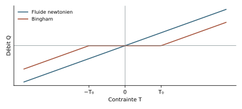
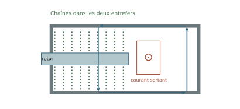
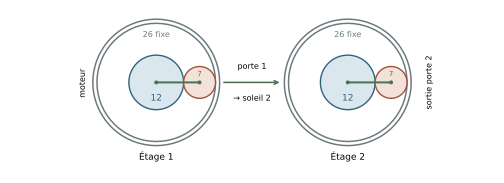

# X-ENS PSI · Modélisation 2015 · Corrigé guidé

*Corrigé rédigé par IA, non officiel. Signalez toute erreur.*

**Rédaction** · GPT-6.2 Astra Ultra · vitesse non renseignée · 25 novembre 2026

L’épreuve porte sur la modélisation physique et la commande d’un banc de rééducation musculaire. Les lectures de courbes et de dimensions non cotées sont données comme des estimations. Les couples de freinage des questions 15 à 28 sont exprimés en module.

## Repères

Suivre successivement la chaîne champ–seuil–couple et la chaîne tension–courant–couple moteur–position. Dans le premier calcul, chaque face du disque contribue. Dans le second, la vitesse du moteur et celle de la tige diffèrent du rapport des deux étages du réducteur.

## Introduction · Machine passive

### Question 1 · Modes accessibles avec une masse suspendue

**Indication.** Comparer ce que la charge impose avec ce que la personne peut maintenir en équilibre.

#### Solution

Lorsque la masse est soulevée lentement, la tension du câble vaut environ son poids. Le rayon d’enroulement représenté étant fixe, le couple résistant est sensiblement constant : c’est un travail isotonique. On peut aussi effectuer un effort statique, par exemple tant que la masse repose sur son appui sans décoller, contre une butée, ou en maintenant l’équilibre avec le poids. Pour imposer un blocage isométrique à **toute** position malgré une variation d’effort, il faudrait un dispositif de blocage. Rien dans cette transmission passive n’impose une vitesse constante en présence d’un effort variable : elle n’assure pas le mode isocinématique.

## I · Fluide magnétorhéologique

### Question 2 · Chaînes de particules et modes d’écoulement

**Indication.** Identifier la direction du champ et la direction du mouvement dans la figure 3.

#### Solution

Le champ aimante les particules qui s’assemblent en chaînes parallèles au champ, d’une plaque à l’autre. L’écoulement longitudinal doit les déformer ou les rompre. Le seuil de cisaillement et la viscosité apparente à vitesse donnée augmentent. En mode valve, les parois sont fixes et une différence de pression entraîne le débit. Le champ règle l’obstacle rencontré par le fluide, jusqu’à l’arrêter en dessous du seuil. En cisaillement direct, une plaque mobile entraîne le fluide par adhérence et tend à incliner les chaînes. Une force tangentielle doit vaincre leur résistance.

### Question 3 · Échelles de longueur et fraction particulaire

**Indication.** Comparer plusieurs diamètres à la barre de 2,5 micromètres. Préciser l’hypothèse nécessaire pour passer d’une image à un volume.

#### Solution

Sur la figure 4, plusieurs grains mesurent entre environ un tiers et deux tiers de la barre de $2{,}5\,\mu\mathrm m$. Un diamètre représentatif est $d\sim1$ à $1{,}5\,\mu\mathrm m$. En supposant des sphères, $v_p=\pi d^3/6$ est de l’ordre de $10^{-18}\,\mathrm m^3$. La zone claire attribuable aux grains occupe une grande partie de l’image, avec des interstices visibles. Une estimation grossière consiste à compter quelques dizaines de disques sur un carré de quelques longueurs de barre, puis à représenter le carré par une couche d’épaisseur $d$. Dans cette hypothèse, une occupation projetée de $0{,}7$ donne une occupation volumique de l’ordre de $(2/3)\times0{,}7\simeq0{,}5$. Le cliché projeté et les grains de tailles diverses justifient seulement l’ordre de grandeur **quelques dizaines de pour cent**.

Augmenter la concentration ou fraction volumique augmente typiquement le nombre de chaînes, donc la contrainte seuil et la résistance à l’écoulement. Augmenter la masse volumique propre des grains à fraction constante accroît d’abord la masse volumique du mélange et la tendance à la sédimentation si les grains sont plus denses que le liquide. La photo seule ne permet pas de chiffrer la variation de viscosité.

### Question 4 · Comparer les deux familles de fluides

**Indication.** Former les produits tension–courant aux extrêmes du tableau.

#### Solution

ER et MR ont les mêmes plages de viscosité ($0{,}1$ à $10\,\mathrm{Pa\,s}$) et des temps de réponse inférieurs à $1\,\mathrm{ms}$. Le MR supporte un seuil d’environ 50 à 100 kPa contre 2 à 5 kPa, et une plage de températures plus large. Il est plus dense. Pour l’ER, $P=UI$ s’étend approximativement de $2000\times0{,}001=2$ W à $5000\times0{,}010=50$ W. Pour le MR, les extrêmes donnent aussi 2 à 50 W. Ces enveloppes supposent qu’on puisse combiner les extrêmes. Le MR offre ici un effort sensiblement supérieur sous faible tension, avantageux pour l’interface de la machine, au prix d’un courant supérieur.

### Question 5 · Excitation et induction magnétiques

**Indication.** Le courant de bobine est lié à la circulation de $H$ tandis que $B$ dépend aussi du matériau.

#### Solution

La loi d’Ampère rapporte la circulation de l’excitation $H$ aux courants libres. À excitation donnée l’induction $B$ dépend de la réponse du milieu, $B=\mu_0(H+M)$ en écriture scalaire colinéaire. On compare donc le champ électrique imposé à l’ER et l’excitation imposée au MR. Le premier maximum vaut environ $4\times10^6\,\mathrm{V\,m^{-1}}$, unité de base $\mathrm{kg\,m\,s^{-3}\,A^{-1}}$. Le second vaut $2{,}5\times10^5\,\mathrm{A\,m^{-1}}$, déjà en unités de base. L’induction $B$, distincte de $H$, s’exprime en teslas.

### Question 6 · Débit avec et sans seuil

**Indication.** Conserver la même pente au-dessus du seuil et ajouter le domaine sans écoulement.

#### Solution

Pour $T\ge0$, le modèle newtonien donne $Q=kT$ et le modèle simplifié de Bingham $Q=k\max(T-T_0,0)$, avec la même pente $k>0$. La première droite part de l’origine. La seconde part du point $(T_0,0)$ après un segment horizontal. Pour les deux sens d’écoulement, prolonger par symétrie impaire : le débit de Bingham est nul sur $[-T_0,T_0]$.



### Question 7 · Lire la viscosité plastique

**Indication.** Distinguer la pente d’une branche de son ordonnée à l’origine.

#### Solution

Sur une branche d’écoulement, la pente $\Delta T/\Delta\lambda$ est la viscosité plastique $\mu$ en $\mathrm{Pa\,s}$. Les branches dessinées sont parallèles. C’est l’ordonnée au départ, $T_0(H)$, qui augmente avec l’excitation. À vitesse de cisaillement imposée, la viscosité apparente $T/\lambda=\mu+T_0/|\lambda|$ augmente, ce qui précise le sens de l’observation de la question 2.

### Question 8 · Modèle de Stanway

**Indication.** Dans un montage parallèle, la vitesse est commune et les efforts s’ajoutent.

#### Solution

Pour la force à appliquer dans le sens du mouvement, $F=\alpha v+f_C$ si $v>0$ et $F=\alpha v-f_C$ si $v<0$. À l’arrêt, l’élément de Coulomb peut équilibrer un effort dans $[-f_C,f_C]$. L’effort résistant exercé par le dispositif a le signe opposé. On retrouve deux branches de même pente et un seuil, comme dans le modèle plastique. En lisant approximativement la figure 6, le seuil est de l’ordre de $10^3$ N et l’effort approche $1{,}5\times10^3$ N vers $0{,}12\,\mathrm{m\,s^{-1}}$. D’où $\alpha\sim(1500-1000)/0{,}12\sim4\times10^3\,\mathrm{N\,s\,m^{-1}}$. La faible résolution du tracé limite la précision.

### Question 9 · Écart à proximité du renversement

**Indication.** Comparer les parcours à vitesse croissante et décroissante.

#### Solution

La réponse expérimentale dessine une boucle : à une vitesse donnée, la force dépend de l’histoire du mouvement, en particulier près de zéro. Le saut de Coulomb instantané ne reproduit ni cette hystérésis ni la transition progressive. Le modèle de Bingham est pertinent pour l’ordre de grandeur du seuil et la pente en écoulement établi, moins précis lors des changements de sens.

### Question 10 · Modèle viscoélastique de Gamota

**Indication.** Les ressorts introduisent des déplacements internes qui dépendent de l’histoire du chargement.

#### Solution

Le second modèle ajoute des ressorts et un amortisseur au mécanisme de frottement. Une partie du déplacement est stockée élastiquement puis restituée. Les déplacements internes n’évoluent donc pas instantanément avec la vitesse externe. La figure 7 suit mieux les branches de la boucle, sans coïncider partout avec les mesures. Les équations font alterner adhérence et glissement selon un seuil et comportent plusieurs temps caractéristiques, dont les plus courts sont de l’ordre d’un rapport amortissement/raideur. Un pas de temps doit résoudre ces transitions et rester compatible avec la stabilité du schéma. Pour une même durée simulée, diminuer le pas augmente le nombre d’itérations.

### Question 11 · Nombre de Reynolds

**Indication.** Comparer les termes inertiel et visqueux dans l’équation du mouvement.

#### Solution

$\mathrm{Re}=\rho V L/\mu$ est le nombre de Reynolds. L’inertie volumique est d’ordre $\rho V^2/L$ et le terme visqueux $\mu V/L^2$. Un faible rapport caractérise un régime dominé par la viscosité. Une éventuelle transition dépend également de la géométrie et des perturbations.

### Question 12 · Analyse dimensionnelle du nombre de Bingham

**Indication.** Choisir le sens du rapport grâce à la phrase qui précède la question 11.

#### Solution

Avec $[T]=M L^{-1}t^{-2}$, $[\mu]=M L^{-1}t^{-1}$ et $[V]=L t^{-1}$, l’absence de dimension donne $c=-a$, $d=-a$ et $b=a$. Le facteur à comparer à $T$ est la contrainte visqueuse $\mu V/L$. Le seuil est au numérateur d’après l’énoncé, donc le quadruplet primitif est $(1,1,-1,-1)$ et $\mathrm{Bm}=TL/(\mu V)$. Un grand $\mathrm{Bm}$ indique que le seuil domine la contribution visqueuse.

### Question 13 · Ordres de grandeur des trois nombres

**Indication.** Choisir et annoncer une vitesse et une viscosité dans les plages données avant toute application numérique.

#### Solution

$\mathrm{He}=\mathrm{Re}\,\mathrm{Bm}=\rho T L^2/\mu^2$. Avec $L=10^{-2}$ m, $V\sim0{,}1\,\mathrm{m\,s^{-1}}$ d’après la figure 6, $\rho\sim3{,}5\times10^3\,\mathrm{kg\,m^{-3}}$, $\mu\sim1\,\mathrm{Pa\,s}$ et $T\sim6\times10^4$ Pa, on obtient environ $\mathrm{Re}=3{,}5$, $\mathrm{Bm}=6\times10^3$ et $\mathrm{He}=2{,}1\times10^4$. La viscosité du tableau varie de 0,1 à 10 Pa·s, de sorte que ces valeurs sont des estimations. L’inertie reste faible aux vitesses considérées face aux valeurs usuelles de transition en conduite newtonienne. Pour le fluide de Bingham le seuil est prépondérant, ce qui favorise également un régime laminaire, voire des régions non cisaillées. Le nombre de Hedström seul ne constitue pas un critère universel de turbulence.

## II · Frein magnétique

### Question 14 · Orientation du courant et des chaînes

**Indication.** Lire le sens des flèches dans le plan de coupe puis appliquer la règle de la main droite.

#### Solution

La ligne de la figure 9 se dirige vers la gauche en haut et vers le bas à travers le rotor. Elle tourne donc dans le sens antihoraire autour de la section de la bobine, vue sur le dessin. Le courant traverse la page **vers le lecteur**, symbole $\odot$. Dans les deux entrefers, les chaînes de particules s’alignent avec le champ, perpendiculairement aux faces du rotor. Une chaîne n’a pas, à elle seule, de sens de parcours imposé.



### Question 15 · Moment de la contrainte tangentielle

**Indication.** Porter l’effort élémentaire au rayon où il agit.

#### Solution

Un élément $dA$ supporte une force tangentielle $dF=T\,dA$. Son moment axial en valeur absolue vaut $r\,dF$. En séparant la contrainte en $T_0$ et $\mu\lambda$, puis en sommant les moments sur les faces actives, on obtient les deux intégrales. Les couples sur le rotor sont opposés au sens de rotation.

### Question 16 · Couple magnétique sur les deux faces

**Indication.** Compter les deux couronnes élémentaires de même rayon.

#### Solution

Sur une face, $dA=2\pi r\,dr$. Avec deux faces,

$$
C_m=4\pi T_0\int_{R_i}^{R_r}r^2\,dr
 =\frac{4\pi}{3}T_0(R_r^3-R_i^3)\simeq\frac{4\pi}{3}T_0R_r^3 .
$$

Ainsi $C_1=4\pi/3$. Augmenter l’excitation augmente $T_0$ jusqu’à la saturation ; au-delà, le gain devient faible pour des pertes électriques supplémentaires.

### Question 17 · Profil de vitesse dans l’entrefer

**Indication.** Comparer l’épaisseur d’entrefer au rayon et préciser dans quel sens le fluide se déplace.

#### Solution

À un rayon fixé, la vitesse du rotor est tangentielle, constante dans le temps en régime permanent. L’écoulement forcé par son mouvement se lit dans le plan tangent contenant l’épaisseur. Le petit entrefer et la viscosité élevée conduisent à un faible Reynolds basé sur $g$. Localement, les deux faces sont assimilables à des plans parallèles. Sans gradient de pression tangent important, le modèle de Couette laminaire conduit à un profil linéaire entre $0$ au stator et $r\Omega$ au rotor. La constance concerne le régime et le gradient de vitesse du modèle ; la vitesse elle-même change dans l’épaisseur.

### Question 18 · Couple visqueux

**Indication.** Intégrer une puissance de $r$ de plus que pour le couple de seuil.

#### Solution

L’adhérence aux parois impose $v(0)=0$, $v(g)=r\Omega$, donc $\lambda=r\Omega/g$. Sur les deux disques,

$$
C_v=4\pi\frac{\mu\Omega}{g}\int_{R_i}^{R_r}r^3\,dr
 =\frac{\pi\mu\Omega}{g}(R_r^4-R_i^4)
 \simeq\frac{\pi\Omega}{g}\mu R_r^4 .
$$

On a $C_2=\pi\Omega/g$ pour la valeur positive du couple.

### Question 19 · Trois objectifs de conception

**Indication.** Relier chaque indicateur au couple utile, à l’encombrement ou aux pertes.

#### Solution

Maximiser $T_V=C_m/V$ revient à obtenir beaucoup de couple par unité de volume. Minimiser $R_r$ à couple fixé rend la machine compacte et contribue à limiter son inertie. Minimiser les pertes Joule $W_e$ réduit la puissance d’alimentation et l’échauffement. Ces choix peuvent se contrarier, puisqu’une excitation accrue peut augmenter à la fois le couple et les pertes.

### Question 20 · Conservation du flux dans le circuit

**Indication.** Comparer une section axiale de disque, une section cylindrique mince et une section annulaire du retour de flux.

#### Solution

L’équation $\nabla\cdot\mathbf B=0$ implique la conservation du flux dans un tube de champ. En négligeant les fuites, $R_i$ et $R_b$ comme le propose le sujet, le même flux vaut, en module,

$$
\Phi\simeq B_{MR}\pi R_r^2
 \simeq B_{fer}\,2\pi R_r h
 \simeq B_{fer}\,\pi[(R_r+a)^2-R_r^2].
$$

Ainsi $h=R_r B_{MR}/(2B_{fer})$. La dernière égalité donne $2R_r h=2R_r a+a^2$, donc $a=R_r(\sqrt{1+2h/R_r}-1)\simeq h$ en section mince. Pour $h/R_r=1/4$, la formule annulaire donne $a/R_r\simeq0{,}225$ contre $0{,}25$ avec l’approximation.

### Question 21 · Couple volumique et convention sur le volume

**Indication.** La figure 8 cote les joues et les entrefers mais ne donne pas une cote axiale indépendante pour le disque rotorique.

#### Solution

Lorsque $B_{fer}=2B_{MR}$, on a $h=R_r/4$ et, au premier ordre de 20, $R_s=R_r+a\simeq5R_r/4$. Pour le **volume d’encombrement** du stator, notons $e$ l’épaisseur du rotor. Le cylindre extérieur a pour hauteur $2h+e+2g$ d’après la coupe. Avec $g\ll h$,

$$
T_V\simeq\frac{(4\pi/3)T_0R_r^3}{\pi(R_r+a)^2(2h+e)}
 \simeq\frac{64}{75}\frac{T_0}{1/2+e/R_r}.
$$

Si, comme le suggèrent les proportions de la figure, on prend $e\simeq h$, on obtient $T_V\simeq256T_0/225$. Si l’on néglige plutôt l’épaisseur du rotor devant celle des joues, le résultat est $128T_0/75$. Le texte ne fixe pas $e$ indépendamment ; il faut annoncer cette hypothèse pour chiffrer le volume. Pour le **volume de fer seul**, on soustrait la cavité : $V_{fer}\simeq2\pi hR_s^2+\pi(R_s^2-R_r^2)(e+2g)$. À géométrie fixée, $T_V$ croît comme $T_0(H)$. La quasi-saturation exploite donc le seuil disponible.

### Question 22 · Théorème d’Ampère et coquille d’unité

**Indication.** Vérifier l’unité du résultat en ampères par mètre.

#### Solution

Sur un contour traversant les deux couches de fluide, $NI=2gH_{MR}+\int_{fer}\mathbf H\cdot d\boldsymbol\ell$. La grande perméabilité du fer motive l’approximation de réluctance du fer négligeable devant celle des entrefers. On obtient $H_{MR}\simeq NI/(2g)$. Près de la saturation il s’agit d’une hypothèse du modèle, à contrôler expérimentalement. Le quotient $2g/(NI)$ imprimé dans l’énoncé est l’inverse et a pour dimension $\mathrm{m\,A^{-1}}$.

### Question 23 · Pertes Joule de la bobine

**Indication.** Faire intervenir la longueur totale du fil et la section disponible pour une seule spire.

#### Solution

En remplissage idéal, la section métallique d’un fil est $S/N$ et sa longueur totale $2\pi R_r N$. La résistance vaut $R=2\pi R_r N^2/(\sigma S)$. Ainsi

$$
W_e=RI^2=\frac{2\pi}{\sigma S}R_r(NI)^2\simeq\frac{2\pi}{\sigma S}R_r(2gH_{MR})^2.
$$

Donc $C_3=2\pi/(\sigma S)$. Un facteur de remplissage inférieur à un accroîtrait la résistance.

### Question 24 · Influence du seuil et de l’entrefer

**Indication.** Distinguer le réglage du champ sur un frein existant et le redimensionnement à couple donné.

#### Solution

Pour un frein donné, les pertes croissent comme $g^2H_{MR}^2$. Un entrefer réduit permet une même excitation avec moins d’ampères-tours. Obtenir un seuil $T_0$ plus élevé exige généralement un $H_{MR}$ plus grand et accroît alors les pertes. À couple magnétique fixé et frein redimensionné, $R_r\propto T_0^{-1/3}$, d’où $W_e\propto g^2H_{MR}(T_0)^2T_0^{-1/3}$. La diminution du rayon atténue le coût en courant. Sans la loi $T_0(H)$ on ne peut déduire une puissance en $T_0$ seul. Il faut aussi conserver un jeu mécaniquement réalisable.

### Question 25 · Induction et excitation à saturation

**Indication.** Convertir l’excitation donnée dans le tableau à l’aide de la perméabilité du fluide.

#### Solution

À l’interface active, côté fluide, $H_{MR}=2{,}5\times10^5\,\mathrm{A\,m^{-1}}$ et $B_{MR}=\mu_0\mu_{r,MR}H_{MR}\simeq0{,}628$ T. Sur les sections de retour en fer choisies en 20, l’hypothèse de dimensionnement donne $B_{fer}\simeq1{,}26$ T. Localement, la composante normale de $B$ est continue à une même interface : les deux valeurs de flux surfacique concernent des sections d’aires différentes. Une valeur numérique de $H_{fer}$ demanderait la caractéristique du fer.

### Question 26 · Volume pour un couple de deux newtons-mètres

**Indication.** Employer la valeur de $T_0$ de la figure 5 et conserver la convention géométrique de 21.

#### Solution

La figure 5 donne $T_0(H_{max})=6\times10^4\,\mathrm{Pa}$. Pour $e\simeq h$ et $a\simeq h$, le volume d’encombrement de 21 conduit à $T_V\simeq6{,}83\times10^4\,\mathrm{N\,m\,m^{-3}}$ et $V=2/T_V\simeq2{,}93\times10^{-5}\,\mathrm m^3$, soit environ $29\,\mathrm{cm^3}$. Si le modèle retient un disque d’épaisseur négligeable, $T_V\simeq1{,}02\times10^5\,\mathrm{Pa}$ et $V\simeq19{,}5\,\mathrm{cm^3}$. Ces deux estimations illustrent l’incidence de la cote axiale laissée implicite.

### Question 27 · Rayons et épaisseur de la culasse

**Indication.** Le rayon du rotor se déduit directement du couple et ne dépend pas de l’épaisseur axiale choisie pour le volume.

#### Solution

$R_r=(3C_m/(4\pi T_0))^{1/3}\simeq1{,}996\times10^{-2}$ m, soit $20$ mm. Puis $h=R_r/4\simeq5{,}0$ mm et $R_s=R_r+a\simeq25$ mm en négligeant $R_b$. L’expression annulaire exacte de 20 donnerait $a\simeq4{,}49$ mm, soit $R_s\simeq24{,}5$ mm. L’entrefer de $0{,}1$ mm est bien petit devant $h$. L’ensemble actif a un diamètre d’environ cinq centimètres.

### Question 28 · Puissance électrique estimée

**Indication.** Calculer d’abord les ampères-tours et convertir le millimètre carré en mètre carré.

#### Solution

$NI\simeq 2gH_{MR}=2\times10^{-4}\times2{,}5\times10^5=50$ A·tours. Avec $\sigma=6\times10^7\,\mathrm{S\,m^{-1}}$ et $S=10^{-6}\,\mathrm m^2$, 23 donne $W_e\simeq2\pi(0{,}01996)50^2/(6\times10^7\times10^{-6})\simeq5{,}2$ W. Cette puissance est dans l’enveloppe de 4. Il s’agit des pertes au bobinage dans le modèle, pas de la puissance mécanique absorbée par le frein.

### Question 29 · Superposition et coût d’un maillage

**Indication.** À volume fixé, diviser chaque dimension de maille par dix multiplie le nombre de cubes par mille.

#### Solution

Dans les milieux linéaires supposés, les équations électromagnétiques et les lois constitutives permettent la superposition des champs. Le nombre de mailles cubiques est d’ordre $V/c^3$, donc la mémoire est en $O(c^{-3})$. Raffiner le maillage améliore en général la résolution spatiale jusque dans les zones de fort gradient. Sous symétrie de révolution de la géométrie, des sources et des conditions aux limites, le champ se déduit de celui d’une section méridienne par rotation. Une discrétisation en deux coordonnées réduit alors le nombre d’inconnues à l’ordre de $c^{-2}$.

### Question 30 · Mémoire pour trois tailles de maille

**Indication.** Calculer le volume du cylindre en millimètres cubes.

#### Solution

Pour un diamètre de 60 mm et une hauteur de 100 mm, le volume vaut $\pi\times30^2\times100\simeq2{,}83\times10^5\,\mathrm{mm^3}$. À $c=1$ mm, on a environ autant de mailles. Avec 32 bits, soit quatre octets par maille, cela donne $1{,}13\times10^6$ octets, soit **1,13 Mo** en convention décimale. Pour $0{,}1$ mm, on obtient environ 1,13 Go ; pour $0{,}01$ mm, 1,13 To. Le décompte exclut mailles partiellement remplies, index, autres composantes éventuelles et stockage du solveur. Le coût d’un raffinement uniforme justifie l’exploitation de la symétrie ou d’un raffinement local.

### Question 31 · Contenu de la variable champ

**Indication.** Observer que split découpe les chaînes sans convertir les nombres.

#### Solution

`champ` est une liste de lignes. Pour chaque ligne de fichier, `interm` est une liste de chaînes de caractères séparées par les tabulations. `champ[i][j]` est donc le **texte** de la valeur au volume élémentaire de la ligne $i$, colonne $j$. Pour faire un calcul physique, il faut utiliser par exemple `float(champ[i][j])`.

### Question 32 · Moyenne, variance et indicateur de variation

**Indication.** Faire porter le calcul uniquement sur les échantillons de la face et utiliser une normalisation qui conserve le sens physique.

#### Solution

Avec le rayon croissant vers la droite et `interface_ver` pris comme premier indice hors rotor, les éléments du profil sont entre les colonnes 0 incluse et `interface_ver` exclue. Si la frontière est codée comme la dernière colonne du rotor, il faut inclure cette dernière. Voici le calcul sur les échantillons de la coupe demandée.
```python
def dispersion(champ, interface_hor, interface_ver, par_aire=False):
    profil = [float(s) for s in champ[interface_hor][:interface_ver]]
    if not profil:
        raise ValueError("La face doit comporter au moins une mesure.")
    poids = [2*j + 1 if par_aire else 1 for j in range(len(profil))]
    total = sum(poids)
    moyenne = sum(w*b for w, b in zip(poids, profil)) / total
    variance = sum(w*(b-moyenne)**2 for w, b in zip(poids, profil)) / total
    print(moyenne, variance)
    if moyenne == 0:
        return 0.0 if variance == 0 else float("inf")
    return variance ** 0.5 / abs(moyenne)
```
La variance de population s’exprime en $\mathrm T^2$. Le coefficient de variation est sans dimension, nul pour un profil constant et petit si les écarts sont faibles devant la moyenne. Pour une moyenne **sur l’aire physique** du disque à partir d’un pas radial uniforme, appeler la fonction avec `par_aire=True`. Elle emploie les aires des anneaux, proportionnelles à $2j+1$ pour une maille comprise entre $j\Delta r$ et $(j+1)\Delta r$. La même pondération s’applique à la variance.

### Question 33 · Interpréter la simulation du champ

**Indication.** Séparer le plateau de la face active et les deux effets de bord.

#### Solution

La figure 11 montre sur presque toute la longueur utile un plateau proche de $0{,}6$ à $0{,}63$ T, cohérent avec 25. Les extrémités montrent une montée rapide près de l’axe et une baisse vers $0{,}4$ T au bord externe. Le champ dans le frein entier varie fortement, mais l’approximation uniforme est raisonnable pour un premier calcul sur la face active. Pour affiner le couple, il faut intégrer $T_0(H(r))r\,dA$, le bord externe ayant un bras de levier important.

## III · Asservissements et essais

### Question 34 · Réducteur à deux trains épicycloïdaux

**Indication.** Dans chaque étage, la couronne est fixe, le soleil est l’entrée et le porte-satellites est la sortie.

#### Solution

Le schéma montre pour chaque étage le soleil de 12 dents, le satellite de 7 dents, la couronne interne de 26 dents et le porte-satellites. Les rayons primitifs sont proportionnels à $12:7:26$, avec $26=12+2\times7$. Les deux couronnes sont liées au bâti. Le porte-satellites du premier étage entraîne le soleil du second. Pour chaque étage, la formule de Willis donne

$$
\frac{\omega_s-\omega_p}{\omega_c-\omega_p}
 =-\frac{Z_c}{Z_s},\qquad \omega_c=0,
 \qquad \frac{\omega_p}{\omega_s}=\frac{12}{12+26}=\frac6{19}.
$$

Le rapport de vitesse global vaut $r=\omega_{tige}/\omega_m=(6/19)^2=36/361\simeq0{,}0997$. La réduction est donc d’un facteur $1/r\simeq10{,}03$, sans inversion.



### Question 35 · Blocs électriques du moteur

**Indication.** Écrire l’équation tension–courant en Laplace, à conditions initiales nulles.

#### Solution

$I_m=(U_m-E_m)/(R_m+L_m p)$ et $C_m=k_m I_m$. Ainsi $H_5=1/(R_m+L_m p)$ et $H_6=k_m$. Ici $C_m$ désigne le couple du moteur de la figure 13.

### Question 36 · Blocs mécaniques

**Indication.** Identifier la sortie du premier bloc et les deux intégrations.

#### Solution

Sur l’axe de la tige, $J\ddot\theta=C_r+C_h-C_f$. D’où $H_1=1/J$, puis $H_2=1/p$ entre accélération et vitesse et $H_3=1/p$ entre vitesse et position, à conditions initiales nulles.

### Question 37 · Retour de force électromotrice et couple de sortie

**Indication.** Le capteur du retour H4 reçoit la vitesse de sortie du réducteur.

#### Solution

$e_m=k_e\omega_m=(k_e/r)\dot\theta$, d’où $H_4=0{,}04\times361/36\simeq0{,}401$ V par $\mathrm{rad\,s^{-1}}$. Pour un réducteur idéal, $C_r\dot\theta=C_m\omega_m$, donc $H_7=1/r=361/36\simeq10{,}03$. Les deux blocs dépendent du rapport dans le même sens.

### Question 38 · Équation en mode isométrique

**Indication.** Après mise en position, le couple moteur est nul et le frein ramène à la référence.

#### Solution

Avec les signes de la figure 13, $J\ddot\theta=C_h-k_f(\theta-\theta_{ref})$, soit $J\ddot\theta+k_f\theta=C_h+k_f\theta_{ref}$. Pour écrire l’inertie en unités SI avec $\theta$ en radians, la raideur $1\,\mathrm{N\,m}/{}^\circ$ devient $180/\pi\,\mathrm{N\,m\,rad^{-1}}$.

### Question 39 · Erreur statique en position

**Indication.** Conserver les degrés pour utiliser directement la raideur du sujet.

#### Solution

En régime quasi statique, $|\theta-\theta_{ref}|=|C_h|/k_f\le2{}^\circ$ avec la valeur d’essai de 2 N·m. L’exigence de $5{}^\circ$ est satisfaite dans le modèle statique.

### Question 40 · Trois fonctions de transfert en mode isocinématique

**Indication.** Écrire séparément le bilan des couples et la tension de retour avant de fermer les boucles.

#### Solution

Posons $P=H_1H_2H_3$, $K=H_5H_6H_7$. Alors $C_r=K(U_m-H_4\theta/H_3)$ et $C_f=H_8(\theta-\theta_{ref})$. En reportant dans $\theta=P(C_r+C_h-C_f)$, avec $D=1+PH_8+H_1H_2KH_4$, on obtient

$$
H_\theta=\frac{PH_8}{D},\qquad H_h=\frac{P}{D},\qquad H_m=\frac{PK}{D}.
$$

Les deux boucles sont des contre-réactions, d’où les signes positifs au dénominateur.

### Question 41 · Insensibilité au couple perturbateur

**Indication.** Examiner la fonction de transfert de $C_h$ vers la vitesse plutôt que la seule erreur statique de position.

#### Solution

Pour un gain $H_8$ constant, la perturbation de vitesse vaut $pP C_h/D$. La fonction $pP/D$ n’est pas identiquement nulle. Une variation quelconque de l’effort agit donc sur la vitesse, et l’insensibilité générale demandée n’est pas garantie. À distinguer du cas particulier d’un échelon de couple et d’une boucle stable : le gain de $C_h$ vers la vitesse tend à zéro à fréquence nulle pour $H_8\ne0$, donc cette perturbation permanente peut laisser une erreur statique de position mais pas de vitesse finale.

### Question 42 · Discrétiser le contrôleur PID

**Indication.** Appliquer les trapèzes à l’intégrale, la différence arrière à la dérivée, puis la limite supérieure indiquée.

#### Solution

```python
def calc_Cf(epsilon_1, epsilon_0, dt, C_Smax, C_0,
            int_epsilon_tmdt, k_P, k_I, k_D):
    if dt <= 0:
        raise ValueError("Le pas doit être strictement positif.")
    integrale = int_epsilon_tmdt + dt * (epsilon_0 + epsilon_1) / 2
    derivee = (epsilon_1 - epsilon_0) / dt
    commande = k_P * epsilon_1 + k_I * integrale + k_D * derivee
    return C_0 + min(commande, C_Smax)
```
La saturation porte sur la commande avant l’addition de $C_0$. L’état intégral à mémoriser pour le prochain appel est `integrale`. Le sujet spécifie un plafond pour ce schéma.

### Question 43 · Plage d’angle et signe des vitesses

**Indication.** Relier la figure à un cycle aller–retour de la tige de travail.

#### Solution

La course de l’articulation et de la tige est limitée dans l’essai, d’où le domaine angulaire fini allant d’environ $-90{}^\circ$ à $90{}^\circ$. À un même angle, le dispositif peut avancer ou revenir. Le signe de la dérivée $\dot\theta$ distingue ces deux sens.

### Question 44 · Comparer les plateaux à la tolérance

**Indication.** Faire la comparaison en valeur absolue et exclure les transitoires de retournement.

#### Solution

Pour les consignes de 50, 100 et $150{}^\circ/\mathrm s$, les bandes à 10 % sont respectivement $[45,55]$, $[90,110]$ et $[135,165]{}^\circ/\mathrm s$. Sur les plateaux aller et retour de la figure 15a, les modules sont proches de leurs consignes dans ces bandes à la précision de lecture du graphe. Le couple appliqué varie pourtant sur la figure 15b. L’exigence de précision en régime établi est compatible avec les essais présentés. Le passage de la vitesse par zéro en fin de course est un transitoire.

### Question 45 · Précision de couple en régime permanent

**Indication.** Déterminer la classe de la boucle ouverte.

#### Solution

Pour le frein $F(p)=k_F/(1+T_Fp)$ et le correcteur $C(p)=k_C(1+1/(T_Cp))$, le gain en boucle ouverte diverge comme $1/p$ à basse fréquence. Sous stabilité et hors saturation, le retour unitaire donne une erreur statique nulle pour une consigne constante. L’exigence de précision totale en couple constant est donc satisfaite par ce modèle.

### Question 46 · Réglage pour 45 degrés de marge de phase

**Indication.** À la pulsation imposée, la partie imaginaire du correcteur vaut cinq fois sa partie réelle en module.

#### Solution

À $\omega_c=1/(5T_C)$, le correcteur vaut $k_C(1-5\mathrm i)$. La phase de boucle doit être $-135{}^\circ$, soit $\arctan5+\arctan(\omega_cT_F)=135{}^\circ$. D’où $\omega_cT_F=\tan(135{}^\circ-\arctan5)=3/2$. Avec $T_F=0{,}05$ s, $\omega_c=30\,\mathrm{rad\,s^{-1}}$ et $T_C=1/150$ s. L’unité de gain au croisement donne

$$
1=k_C\sqrt{26}\frac{2}{\sqrt{1+(3/2)^2}}
   =4\sqrt2\,k_C,\qquad k_C=\frac1{4\sqrt2}\simeq0{,}177\,\mathrm{A/(N\,m)} .
$$


### Question 47 · Marge de gain

**Indication.** Chercher une pulsation de phase égale à moins 180 degrés.

#### Solution

À toute pulsation positive finie, la phase est $-\arctan(1/(\omega T_C))-\arctan(\omega T_F)$, somme de deux termes strictement supérieurs à $-90{}^\circ$. Il n’y a pas de croisement à $-180{}^\circ$. La marge de gain est infinie dans ce modèle sans retard. Elle dépasse les 10 dB requis.

### Question 48 · Confronter les trois profils à l’expérience

**Indication.** Une classe un n’implique pas une erreur identiquement nulle pour toute consigne variable.

#### Solution

La figure 17a montre que l’échelon de couple rejoint un plateau très voisin de la référence. La consigne linéaire et le profil parabolique sont également suivis de près sur l’intervalle observé, avec des écarts transitoires. Le PI impose l’erreur nulle pour une consigne constante. Pour une rampe prolongée l’erreur peut tendre vers une valeur non nulle, et pour une parabole prolongée elle peut croître. Le faible écart observé sur quelques secondes est compatible avec ces conclusions. En 17b, le surplus de couple aux extrémités du déplacement peut provenir du freinage puis de l’inversion du mouvement, avec une accélération et un couple inertiel importants, ainsi que du frottement au redémarrage. Les courbes ne permettent pas d’isoler ces contributions.
