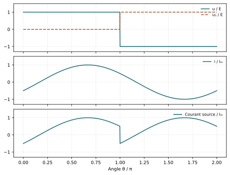
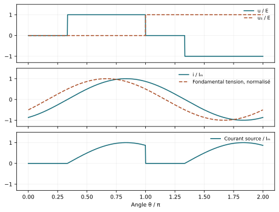
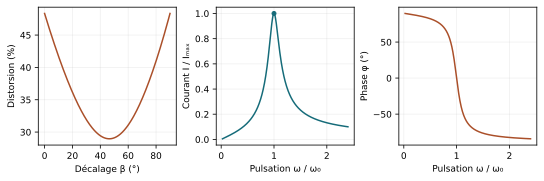
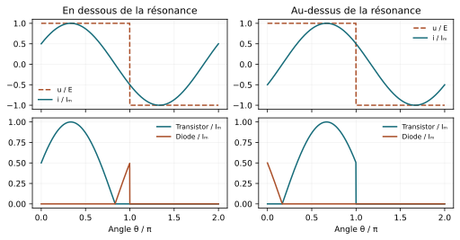
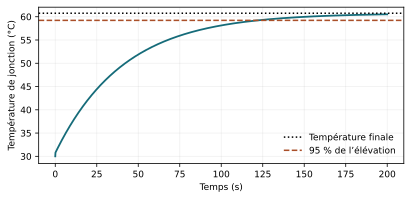
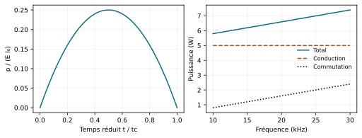

# X–ENS PSI 2015 — Physique (Banque commune X–InterENS) · Corrigé guidé

*Corrigé rédigé par IA, non officiel. Signalez toute erreur.*

**Lecture du rapport du jury** · GPT-6.2 Astra Ultra · vitesse non renseignée

**Rédaction** · GPT-6.2 Astra Ultra · vitesse non renseignée

## Convertisseur pour table à induction

## I. Commande pleine onde du modèle idéal

### Question I.1.1 — Nature des ports

**Indication.** Examiner la continuité instantanée imposée par l’inductance en série.

La charge est de type source de courant à l’échelle d’une commutation car son courant ne peut sauter sous une tension finie. La source idéale $E$ impose une tension. Le modèle doit conserver un chemin au courant de charge et exclure le court-circuit de la source. Dans chaque bras, les deux états idéaux sont complémentaires hors du bref instant de transition.

### Question I.1.2 — Quatre chronogrammes

**Indication.** Écrire la tension des deux milieux de bras puis utiliser la conservation instantanée de puissance.

Sur $0<\theta<\pi$, $K_1,K'_2$ conduisent et $(u,u_1,i')=(E,0,i)$. Sur $\pi<\theta<2\pi$, $K'_1,K_2$ conduisent et $(u,u_1,i')=(-E,E,-i)$. Ici $i=I_m\sin(\theta+\varphi)$, continu avec $\varphi<0$. Les portions négatives de $i'$ correspondent au retour d’énergie à la source.

### Question I.1.3 — Tension efficace

**Indication.** Examiner le carré de la tension sur les deux demi-périodes.

Comme $u^2=E^2$ presque partout, $U=\sqrt{T^{-1}\int_0^Tu^2dt}=E$.

### Question I.1.4 — Fondamental de la tension

**Indication.** La valeur efficace d’une sinusoïde est son amplitude divisée par $\sqrt2$.

Le premier terme de Fourier est $(4E/\pi)\sin\theta$. Sa valeur efficace est $U_1=2\sqrt2 E/\pi\simeq0{,}90E$.

### Question I.1.5.a — Distorsion de la tension

**Indication.** Employer la valeur efficace du fondamental au dénominateur.

La définition donne $\tau_H(u)=100\sqrt{(U/U_1)^2-1}=100\sqrt{\pi^2/8-1}$. Avec $\pi^2\simeq10$ on obtient $50\,\%$ (valeur plus précise $48{,}3\,\%$).

### Question I.1.5.b — Distorsion du courant

**Indication.** Préciser l’hypothèse faite ici sur sa forme avant de discuter le circuit réel.

Le courant est supposé purement sinusoïdal, donc $I=I_1$ et $\tau_H(i)=0$. La charge RLC répond différemment aux différentes fréquences et peut fortement atténuer les harmoniques de tension dans le courant. La partie III chiffre l’erreur de cette approximation.

### Question I.1.6 — Courant moyen fourni par la source

**Indication.** Les deux demi-alternances de $i'$ sont identiques par translation de $\pi$.

On a $\overline{i'}=(I_m/\pi)\int_0^\pi\sin(\theta+\varphi)d\theta=2I_m\cos\varphi/\pi$. Cette moyenne inclut les intervalles de restitution d’énergie.

### Question I.1.7 — Puissance reçue par le RLC

**Indication.** Seul le fondamental de tension a un produit moyen non nul avec le courant sinusoïdal.

La puissance moyenne vaut $P=U_1(I_m/\sqrt2)\cos\varphi=(2EI_m/\pi)\cos\varphi$. En régime périodique les énergies stockées dans $L$ et $C$ retrouvent leur valeur initiale à chaque période.

### Question I.1.8 — Puissance débitée en amont

**Indication.** La tension de la source est constante.

Il vient $P'=E\overline{i'}=(2EI_m/\pi)\cos\varphi=P$. L’égalité traduit le bilan énergétique d’un convertisseur idéal sans dissipation.

### Question I.1.9 — Composants conducteurs

**Indication.** Dans la diagonale sélectionnée, choisir transistor ou diode selon le signe instantané de $i$.

Sur $[0,-\varphi]$, le courant négatif circule dans $D_1,D'_2$. Sur $[-\varphi,\pi]$, il est positif dans $T_1,T'_2$. Sur $[\pi,\pi-\varphi]$, il est encore positif mais la diagonale inverse est sélectionnée, d’où $D'_1,D_2$. Sur $[\pi-\varphi,2\pi]$ le courant négatif emprunte $T'_1,T_2$. Aux zéros du courant le changement se fait sans ambiguïté énergétique.

## II. Commande décalée

### Question II.1 — Tensions et roue libre

**Indication.** Pendant les intervalles nuls, les deux bornes de la charge sont au même potentiel.

Sur les quatre intervalles délimités par $0,\beta,\pi,\pi+\beta,2\pi$, la tension $u$ vaut successivement $0,E,0,-E$. Le bras 1 n’ayant pas bougé, $u_1=0$ sur la première demi-période et $E$ sur la seconde. Sur $[0,\beta]$ le courant recircule par les deux composants supérieurs et sur $[\pi,\pi+\beta]$ par les deux inférieurs. Son sens détermine lequel des deux assure la conduction en diode.

### Question II.2 — Phase du fondamental et du courant

**Indication.** Le sommet du fondamental se situe au centre du plateau positif.

Ce centre est $\theta=(\pi+\beta)/2$. Par symétrie le fondamental est donc proportionnel à $\sin(\theta-\beta/2)$. À charge et fréquence identiques, l’impédance au fondamental garde la même phase. Le courant est $i=I_m\sin(\theta-\beta/2+\varphi)$, avec l’amplitude correspondant à la nouvelle commande.

### Question II.3 — Courant de source en commande décalée

**Indication.** Employer $Ei'=ui$ pour le modèle idéal.

Le courant $i'$ est nul pendant les deux intervalles où $u=0$. Il vaut $+i$ sur $[\beta,\pi]$ et $-i$ sur $[\pi+\beta,2\pi]$. Les tracés ci-dessous montrent le décalage propre du courant et les deux phases de recirculation.

### Question II.4 — Effet du décalage

**Indication.** Comparer le contenu harmonique et l’amplitude utile avec ceux de la pleine onde.

Le décalage règle continûment la tension efficace et le fondamental. Certains décalages réduisent la distorsion et peuvent supprimer un harmonique choisi. Le fondamental diminue avec $\beta$, la charge peut porter du courant pendant les intervalles à puissance d’entrée nulle et l’amélioration du taux de distorsion est limitée à une plage d’angles.

### Question II.5 — Tension efficace décalée

**Indication.** Mesurer la fraction de période où $|u|=E$.

Les deux plateaux sont de longueur angulaire $\pi-\beta$ chacun. Donc $U'^2=E^2(1-\beta/\pi)$ et $U'=E\sqrt{1-\beta/\pi}$ pour $0\le\beta\le\pi$.

### Question II.6 — Distorsion en fonction de l’angle

**Indication.** Former le rapport du carré de la tension efficace au carré du fondamental donné.

En remplaçant $U_1'=2\sqrt2 E\cos(\beta/2)/\pi$, on obtient $\tau_H(u)=100\sqrt{\pi(\pi-\beta)/[8\cos^2(\beta/2)]-1}$. L’expression s’applique pour $\beta<\pi$, avant extinction du signal.

### Question II.7 — Angle optimal

**Indication.** Dériver le logarithme de $g+1$, où $g=(\tau_H/100)^2$.

Sa dérivée vaut $-1/(\pi-\beta)+\tan(\beta/2)$. Le minimum intérieur satisfait $(\pi-\beta)\tan(\beta/2)=1$. Le tableau place la racine entre $45^\circ$ et $52{,}5^\circ$, près de $46^\circ$. La substitution donne $\tau_{H,\min}\simeq29\,\%$. La dérivée change de signe de négatif à positif.

### Question II.8 — Courbe de distorsion

**Indication.** Calculer les niveaux aux deux bornes ainsi qu’au point stationnaire.

De $0^\circ$ à environ $46{,}4^\circ$, le taux descend de $48{,}3\,\%$ à $29{,}0\,\%$, puis remonte à $48{,}3\,\%$ pour $90^\circ$. La forme de la courbe est représentée avec les réponses fréquentielles de la partie suivante.

## III. Réponse fréquentielle du circuit

### Question III.1 — Impédance et courant

**Indication.** Additionner les impédances des trois dipôles en série.

Posons $X=\omega L-1/(\omega C)$. L’impédance complexe est $Z=R+iX$. Le courant $i(t)=\sqrt2 I\sin(\omega t+\varphi)$ a pour valeur efficace $I=U/\sqrt{R^2+X^2}$ et pour phase $\varphi=-\arctan(X/R)$.

### Question III.2 — Maximum et phase

**Indication.** Rechercher le minimum du module de l’impédance série.

À $\omega_0=1/\sqrt{LC}$, $X=0$ et $I_{\max}=U/R$, avec $\varphi=0$. Aux basses fréquences le courant tend vers zéro et avance de $\pi/2$. Aux hautes fréquences il retombe vers zéro et retarde de $\pi/2$. La courbe ci-dessous est tracée sur une échelle linéaire de fréquence.

### Question III.3 — Bande passante exacte

**Indication.** Aux deux fréquences de coupure la réactance vaut $-R$ ou $+R$.

Avec $Q=\omega_0L/R$, la condition $I=I_{\max}/\sqrt2$ donne $\omega_{1,2}=(\sqrt{(R/L)^2+4\omega_0^2}\mp R/L)/2$. Ainsi $\Delta f=(\omega_2-\omega_1)/(2\pi)=R/(2\pi L)=f_0/Q$, sans hypothèse sur la grandeur de $Q$.

### Question III.4 — Somme exacte des harmoniques

**Indication.** La linéarité du RLC permet de répondre séparément à chaque terme de Fourier du créneau.

Pour $n=2k+1$, posons $X_n=n\omega L-1/(n\omega C)$. La réponse exacte est $i(t)=\sum_{k\ge0}J_n\sin(n\omega t+\varphi_n)$ avec $J_n=4E/[n\pi\sqrt{R^2+X_n^2}]$ et $\varphi_n=-\arctan(X_n/R)$. Les $J_n$ sont ici des amplitudes crête. Les valeurs efficaces de la suite sont $I_n=J_n/\sqrt2$.

### Question III.5 — Résonance numérique

**Indication.** Inspecter le produit $LC$ et le rapport $\omega_0L/R$.

Les valeurs fournies donnent $\sqrt{LC}=5\times10^{-5}/(2\pi)\ \mathrm s$, donc $f_0=2\times10^4\ \mathrm{Hz}$ et $Q=2\pi f_0 L/R=5$. La bande passante en courant est d’environ $4\ \mathrm{kHz}$.

### Question III.6 — Poids des premiers partiels

**Indication.** À la résonance du fondamental, la réactance du rang $n$ vaut $RQ(n-1/n)$.

Pour tout rang impair, $I_n=[2\sqrt2E/(\pi R)]/[n\sqrt{1+Q^2(n-1/n)^2}]$. Donc $I_1=30\ \mathrm A$, $I_3=I_1/\sqrt{9+64Q^2}$ et $I_5=I_1/\sqrt{25+576Q^2}$. Pour $Q=5$, leurs rapports au fondamental valent $0{,}025$ et $0{,}0083$. Plus haut, la tension incidente diminue en $1/n$ et la réactance croît comme $n$, donnant un courant qui décroît en $1/n^2$.

### Question III.7 — Approximation sinusoïdale

**Indication.** Appliquer Parseval aux composantes de courant de rang trois et cinq.

Le taux approché vaut $100\sqrt{(I_3/I_1)^2+(I_5/I_1)^2}\simeq2{,}6\,\%$. Les termes supérieurs sont très faibles et le taux reste sous $5\,\%$. Le remplacement du courant par le fondamental est donc justifié au critère donné.

### Question III.8 — Avance ou retard selon la fréquence

**Indication.** Déterminer le signe de $\varphi$ de part et d’autre de $f_0$.

En dessous de $f_0$ la charge est capacitive et le sinus de courant est en avance sur le fondamental du créneau. Au-dessus la charge est inductive et le sinus est en retard. Pour la même tension $u=E\operatorname{sgn}(\sin\theta)$, les passages de $i$ par zéro se déplacent donc vers la gauche ou vers la droite.

### Question III.9 — Chronogrammes du transistor et de la diode

**Indication.** Pendant la première demi-période séparer les parties positive et négative du courant de charge.

Pour $0<\theta<\pi$, $i_{T1}=\max(i,0)$ et $i_{D1}=\max(-i,0)$ dans le sens des flèches de chaque composant. Ces deux courants s’annulent pour $\pi<\theta<2\pi$. En avance ($\varphi>0$) le transistor conduit jusqu’à $\pi-\varphi$, puis la diode. En retard ($\varphi<0$) la diode conduit jusqu’à $-\varphi$, puis le transistor.

### Question III.10 — Extinction naturelle

**Indication.** Repérer le cas où le transistor se trouve déjà à courant nul à la fin de son demi-cycle.

Pour $f<f_0$, $i$ change de signe avant la fin de l’intervalle commandé. Le transistor cesse alors de conduire naturellement et la diode prend le relais. Pour $f>f_0$ le transistor porte encore du courant à la fin du demi-cycle.

## IV. Boucle de puissance

### Question IV.1 — Rôle de la fréquence

**Indication.** Relier la puissance active à la valeur efficace du courant dans la résistance.

Dans l’approximation du fondamental $P=R U_1^2/(R^2+X^2)$. À tension imposée, la fréquence modifie $X$ et donc la puissance dissipée. Ce réglage est possible sur chacune des deux branches monotones autour de la résonance.

### Question IV.2 — Points possibles à trois quarts du maximum

**Indication.** Intersecter la courbe en cloche avec la droite horizontale au niveau demandé.

Il y a deux intersections, une fréquence inférieure et une supérieure à $f_0$. En effet $P/P_{\max}=3/4$ correspond à $X=\pm R/\sqrt3$.

### Question IV.3 — Stabilité de la rétroaction

**Indication.** Suivre l’effet d’une hausse accidentelle de la puissance sur la fréquence imposée par le retour négatif.

Une hausse de $P$ augmente la mesure, diminue l’erreur et diminue $f$ si le gain de l’oscillateur est positif. Sur la branche $f<f_0$ cela abaisse $P$ et corrige la perturbation. Sur la branche descendante cela l’accentue. On retient le côté basse fréquence. Au sommet le gain local $dP/df$ est nul et la pente change de signe, donc cette commande simple ne régule pas le maximum des deux côtés.

### Question IV.4 — Mesure instantanée de puissance

**Indication.** Multiplier les trois gains de la chaîne de mesure.

Le multiplieur donne $s=K_0 k_i k_v\,ui$. Ainsi $s/p=0{,}1\times0{,}2\times0{,}05=10^{-3}\ \mathrm{V\,W^{-1}}$. Le signe de la puissance instantanée est conservé.

### Question IV.5 — Spectre de puissance et filtre

**Indication.** Multiplier le fondamental de courant par chaque harmonique impair de la tension.

Le produit d’un sinus à $f$ par un sinus à $(2k+1)f$ donne des termes à $2kf$ et $(2k+2)f$. Le spectre contient donc une composante continue et des raies à $2f,4f,6f,\ldots$ dont la hauteur diminue globalement. La mesure moyenne demande un passe-bas de gain statique unitaire. Une pente de $-40\ \mathrm{dB}$ par décade donne cent d’atténuation à partir de $2f/f_c\simeq10$, donc $f_c\lesssim f/5$. Le capteur complet a pour gain en continu $k_p=10^{-3}\ \mathrm{V\,W^{-1}}$.

### Question IV.6 — Consigne et erreur statique

**Indication.** Distinguer l’idéal d’erreur nulle de la loi proportionnelle de l’oscillateur indiquée sur le schéma.

La chaîne directe est comparateur, OCT de gain $K_f$, puis pente locale $A_0=dP/df$. La boucle de retour porte $k_p$. La cible idéale de régulation est $e=0$, ce qui donnerait $C_{\rm réf}=k_p P_{\rm réf}=3k_pP_{\max}/4$. Si le schéma est pris littéralement avec $f=K_fe$ sans fréquence de repos ni intégration, un point à $f_\star>0$ exige en réalité $e_\star=f_\star/K_f$ et $C_{\rm réf}=k_pP_{\rm réf}+f_\star/K_f$. L’erreur nulle demande une prépolarisation au point de travail ou une action intégrale.

### Question IV.7 — Dérives des composants

**Indication.** Distinguer le déplacement du sommet de la variation de sa hauteur.

Une variation de $L$ ou $C$ déplace $f_0$ et la fréquence de fonctionnement, mais $P_{\max}\simeq U_1^2/R$ reste la même. La boucle peut retrouver la branche stable si sa plage le permet. Une augmentation de $R$ abaisse le maximum. Lorsque $P_{\max}$ devient inférieur à la consigne, celle-ci devient inaccessible. Une diminution de $R$ rehausse le maximum et laisse un point de fonctionnement sous la résonance.

## V. Températures et échanges

### Question V.1.a — Loi de Fourier

**Indication.** Relier la direction du flux à celle des températures décroissantes.

Le vecteur densité de flux thermique est $\mathbf j=-\lambda\nabla T$, en $\mathrm{W\,m^{-2}}$. Dans le barreau $j_x=-\lambda\partial_x T$ et la puissance traversant une section est $P=Sj_x$.

### Question V.1.b — Bilan local avec source

**Indication.** Écrire puissance entrante moins puissance sortante plus source interne.

Sur $Sdx$, $\rho cSdx\,\partial_tT=P(x)-P(x+dx)+P_v Sdx$. Pour $\lambda$ constante, la substitution de Fourier donne $\rho c\partial_tT=\lambda\partial_x^2T+P_v$. Une source positive augmente bien la température.

### Question V.2 — Cellule thermique équivalente

**Indication.** Comparer la chute de température par unité de débit et la variation d’énergie de stockage.

La chute stationnaire est $T(x)-T(x+dx)=P\,dx/(\lambda S)$. La capacité à la température locale absorbe $\rho cSdx\,\partial_t(T-T_{\rm réf})$. L’analogie tension-température et courant-puissance donne $dR_{\rm th}=dx/(\lambda S)$ et $dC_{\rm th}=\rho cSdx$ entre le nœud et la référence.

### Question V.3 — Paramètres par unité de longueur

**Indication.** Diviser les deux éléments différentiels par la longueur du tronçon.

Les paramètres sont $\Lambda_x=1/(\lambda S)$ en $\mathrm{K\,W^{-1}\,m^{-1}}$ et $\Gamma_x=\rho c S$ en $\mathrm{J\,K^{-1}\,m^{-1}}$. Le premier diminue lorsque la section augmente, le second croît avec la quantité de matériau.

### Question V.4 — Équations du réseau continu

**Indication.** Écrire la chute dans chaque résistance et la conservation du flux au nœud capacitif.

Les limites continues donnent $\partial_xT=-\Lambda_x P$ et $\partial_xP=-\Gamma_x\partial_tT$. La seconde exprime la puissance prélevée pour accroître l’énergie thermique locale.

### Question V.5 — Retour à la diffusion

**Indication.** Dériver la première équation par rapport à $x$, puis remplacer $\partial_xP$.

Il vient $\partial_x^2T=\Lambda_x\Gamma_x\partial_tT=(\rho c/\lambda)\partial_tT$. Le réseau retrouve donc exactement la diffusivité $\lambda/(\rho c)$ du milieu homogène sans source.

### Question V.6 — Géométrie et matériaux non uniformes

**Indication.** Conserver localement l’énergie et les flux normaux de part et d’autre de chaque face.

Un maillage par volumes finis associe à chaque maille une capacité $\rho c\,\Delta V$ et à chaque face une conductance tenant compte de son aire, de la distance entre centres et des conductivités locales. On applique les conditions de bord et les sources, puis on intègre le bilan dans le temps. Un raffinement du maillage et du pas de temps permet de contrôler la convergence.

### Question V.7 — Équation thermique à deux nœuds

**Indication.** Éliminer la température du boîtier entre les deux bilans de stockage.

Posons $y=T_j-T_a$, $a=R_{jb}R_{ba}C_jC_b$, $b=R_{jb}C_j+R_{ba}(C_b+C_j)$, $c=R_{jb}R_{ba}C_b$, $d=R_{jb}+R_{ba}$. Les équations $C_j\dot T_j=p-(T_j-T_b)/R_{jb}$ et $C_b\dot T_b=(T_j-T_b)/R_{jb}-(T_b-T_a)/R_{ba}$ conduisent à $a\ddot y+b\dot y+y=c\dot p+dp$. Les dérivées temporelles correspondent aux facteurs $i\omega$ de la fonction de transfert.

### Question V.8 — Réponse à un échelon thermique

**Indication.** Trouver la pente initiale du nœud de jonction avec les deux températures initialement égales.

Pour $t>0$, $a\ddot y+b\dot y+y=dP_0$, $y(0)=0$ et $\dot y(0^+)=P_0/C_j$. En posant $\tau_{s,f}=(b\pm\sqrt{b^2-4a})/2$, $y=dP_0-A_s e^{-t/\tau_s}-A_f e^{-t/\tau_f}$ avec $A_s+A_f=dP_0$ et $A_s/\tau_s+A_f/\tau_f=P_0/C_j$. Ainsi $A_f=(P_0/C_j-dP_0/\tau_s)/(1/\tau_f-1/\tau_s)$, $A_s=dP_0-A_f$. Les nombres fournis donnent $\tau_s\simeq41\ \mathrm s$, $\tau_f\simeq0{,}024\ \mathrm s$, $A_s\simeq30{,}0\ \mathrm K$, $A_f\simeq0{,}7\ \mathrm K$. À 5 % de l’élévation finale, $t_r\simeq\tau_s\ln[A_s/(0{,}05dP_0)]\simeq1{,}2\times10^2\ \mathrm s$.

### Question V.9 — Température finale de la jonction

**Indication.** En régime permanent les deux résistances thermiques sont traversées par le même flux.

La limite est $T_a+P_0(R_{jb}+R_{ba})=30+15(0{,}05+2)=60{,}75\,^\circ\mathrm C$. Dans les conditions du modèle la température reste sous la limite de $100\,^\circ\mathrm C$.

### Question V.10 — Ondulation thermique en régime commuté

**Indication.** Identifier la période des pertes d’un composant individuel et comparer aux constantes thermiques.

Pour un interrupteur donné, le motif de conduction et de pertes se reproduit une fois par période, donc le fondamental des pertes est en général $f$. À plus de $1\ \mathrm{kHz}$, même la coupure du mode thermique rapide $1/(2\pi\tau_f)\sim7\ \mathrm{Hz}$ est largement dépassée. La température suit essentiellement la puissance moyenne, avec une très faible ondulation à $f$ et à ses multiples.

### Question V.11.1 — Coefficient d’échange

**Indication.** Diviser un flux thermique surfacique par un écart de température.

La loi surfacique $j_{\rm ext}=h(T-T_a)$ fixe pour $h$ l’unité $\mathrm{W\,m^{-2}\,K^{-1}}$.

### Question V.11.2 — Bilan sur une tranche d’ailette

**Indication.** Distinguer section conductrice et surface latérale exposée à l’air.

Posons $S=ab$ et $s=2(a+b)$ le périmètre. En stationnaire $P(x)-P(x+dx)=hs\,dx[T(x)-T_a]$, où $P=-\lambda'S T'$. Chaque terme a la dimension d’une puissance.

### Question V.11.3 — Équation spatiale des températures

**Indication.** Éliminer le flux axial par la loi de Fourier.

Le bilan donne $\lambda'S T''-hs(T-T_a)=0$. La conduction axiale compense les pertes latérales vers l’air ambiant.

### Question V.11.4 — Longueur de décroissance

**Indication.** Construire le carré d’une longueur à partir du rapport des deux coefficients de l’équation.

En posant $\delta=\sqrt{\lambda'S/(hs)}=\sqrt{\lambda'ab/[2h(a+b)]}$ et $\theta=T-T_a$, on obtient $\theta''=\theta/\delta^2$. La capacité thermique n’intervient pas à l’état stationnaire.

### Question V.11.5 — Ailette longue

**Indication.** Admettre que le bout est assez éloigné pour ne pas perturber la solution près de la base.

La solution est une combinaison de $e^{x/\delta}$ et $e^{-x/\delta}$. Pour une ailette assimilée à un demi-axe, la condition bornée à l’infini supprime le premier terme et $T(0)=T_b$ fixe $T(x)=T_a+(T_b-T_a)e^{-x/\delta}$.

### Question V.11.6 — Échange latéral d’une tranche

**Indication.** Appliquer l’échange surfacique à l’aire $s\,dx$.

La puissance évacuée par la tranche est $dP=hs(T_b-T_a)e^{-x/\delta}\,dx$. Pour $T_b>T_a$ elle est positive et maximale près du boîtier.

### Question V.11.7 — Puissance totale évacuée

**Indication.** Intégrer le flux latéral jusqu’à l’infini pour une ailette longue.

L’intégrale donne $P=hs\delta(T_b-T_a)=\sqrt{hs\lambda'S}(T_b-T_a)$. Une longueur supplémentaire de plusieurs $\delta$ contribue très peu au flux total.

### Question V.11.8 — Puissance reçue de la base

**Indication.** Évaluer le flux de Fourier en $0^+$.

On trouve $P_0=-\lambda'S T'(0)=\lambda'S(T_b-T_a)/\delta$. Comme $\delta^2=\lambda'S/(hs)$, cette puissance égale le flux latéral intégré. C’est le bilan stationnaire de l’ailette entière.

### Question V.11.9 — Résistance thermique

**Indication.** Rapporter la différence de température au flux extrait.

La résistance vaut $R_\infty=\delta/(\lambda'S)=1/\sqrt{hs\lambda'S}$. Un barreau sans échange latéral entre la base chaude et un bout maintenu à $T_a$ aurait $R=L/(\lambda'S)$. Le rapport vaut donc $R_\infty/R=\delta/L\ll1$ pour l’ailette longue.

### Question V.12 — Condition à la base d’une ailette finie

**Indication.** Le boîtier fixe ici la température de contact.

En supposant un contact thermique parfait, $T(0)=T_b$, donc $\theta(0)=T_b-T_a$.

### Question V.13 — Échange par le bout

**Indication.** À l’extrémité, égaler la conduction axiale et le flux cédé par la face d’aire $S$.

On impose $-\lambda'S T'(L)=hS[T(L)-T_a]$. Il s’agit d’une condition mixte, soit $-\lambda'\theta'(L)=h\theta(L)$.

### Question V.14 — Solution complète pour l’ailette finie

**Indication.** Utiliser les fonctions hyperboliques de $(L-x)/\delta$ pour simplifier la condition au bout.

En posant $H=h\delta/\lambda'$, la solution qui satisfait la condition au bout est proportionnelle à $\cosh[(L-x)/\delta]+H\sinh[(L-x)/\delta]$. La condition de base donne $T=T_a+(T_b-T_a)\{\cosh[(L-x)/\delta]+H\sinh[(L-x)/\delta]\}/[\cosh(L/\delta)+H\sinh(L/\delta)]$.

### Question V.15 — Longueur utile

**Indication.** Évaluer en $x=L$ la solution de la question précédente.

Le rapport $(T(L)-T_a)/(T_b-T_a)$ vaut $1/[\cosh(L/\delta)+H\sinh(L/\delta)]$. La longueur seuil est la racine positive de $\cosh(L/\delta)+H\sinh(L/\delta)=20$. Toute longueur supérieure satisfait l’inégalité stricte.

## VI. Pertes moyennes d’un interrupteur

### Question VI.1 — Pertes de conduction

**Indication.** Intégrer les deux lobes de courant de sens opposés, chacun pris positif dans son composant.

Pour $0<\varphi<\pi/2$, le transistor conduit de 0 à $\pi-\varphi$ avec $i_{T1}=I_m\sin(\theta+\varphi)$ et la diode de $\pi-\varphi$ à $\pi$ avec $i_{D1}=-I_m\sin(\theta+\varphi)$, comme en III.9. Les deux courants sont nuls ailleurs. Leurs puissances moyennes sont $V_0I_m(1+\cos\varphi)/(2\pi)$ et $V_0I_m(1-\cos\varphi)/(2\pi)$. La somme vaut $P_{\rm cond}=V_0I_m/\pi$.

### Question VI.2 — Énergie pendant une commutation

**Indication.** Multiplier les deux fonctions affines lues sur la figure du sujet.

Avec $z=t/t_c$ entre 0 et 1, $u_T=E(1-z)$ et $i_T=I_0z$. La puissance $p=EI_0z(1-z)$ forme une parabole, nulle aux extrémités avec sommet $EI_0/4$. Son intégrale donne $W_c=EI_0t_c/6$. À raison d’un événement de ce type par période, $P_{\rm com}=fEI_0t_c/6$ et $P_0=V_0I_m/\pi+fEI_0t_c/6$.

### Question VI.3 — Pertes selon la fréquence

**Indication.** Identifier l’ordonnée à l’origine et la pente de la droite avant de comparer les contributions.

Les données donnent $P_{\rm cond}=5\ \mathrm W$ et $P_{\rm com}=(8\times10^{-5}\ \mathrm{W\,Hz^{-1}})f$. Sur $10$ à $30\ \mathrm{kHz}$ la puissance totale monte linéairement de $5{,}8$ à $7{,}4\ \mathrm W$. L’égalité arriverait à $62{,}5\ \mathrm{kHz}$, au-delà de la plage tracée. La commutation devient prépondérante au-dessus de cette fréquence selon cette loi.

