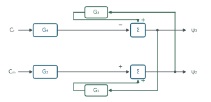
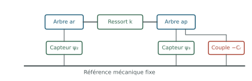
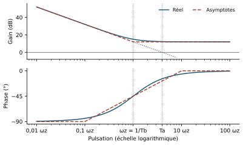
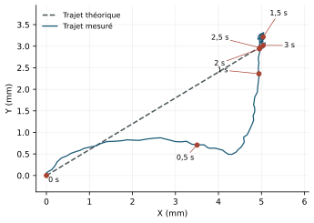
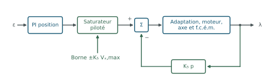
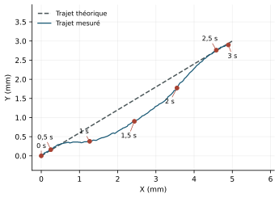

# X-ENS PSI · Sciences industrielles 2015 · Corrigé guidé

*Corrigé rédigé par IA, non officiel. Signalez toute erreur.*

**Rédaction** · GPT-6.2 Astra Ultra · vitesse non renseignée · 25 novembre 2026

**Révision** · GPT-6.2 Astra Ultra · vitesse non renseignée · 26 novembre 2026

Un banc de laboratoire reproduit les mouvements relatifs des deux satellites d’un télescope. Les valeurs numériques lues sur les courbes sont arrondies. Les parties I et III du sujet présentent le système et la génération du code sans poser de question.

## Repères

Avant de projeter un mouvement, relever si l’angle du bras est absolu ou relatif. Pour les asservissements, identifier les signaux qui entrent réellement dans un même comparateur. Enfin, mesurer la distance d’un point à la trajectoire dans le plan, après avoir apparié les relevés de X et de Y au même instant.

## II · Conception et modélisation

### Question II.1 · Ce qui bouge sur le banc

**Indication.** Suivre séparément la mesure, le calcul numérique et le mouvement obtenu dans chacune des deux boucles.

#### Solution

Sur la figure 8, les blocs **1 et 6** mesurent le désalignement et l’attitude. Les blocs **5 et 10** sont les axes physiques du robot, respectivement le chariot avec les deux articulations, et l’axe d’attitude A. Le calculateur réalise **2 et 7** (correcteurs), **3 et 8** (effets des tuyères simulées), **4 et 9** (lois de translation et de rotation du satellite en orbite). Ce sont les mouvements du robot que les capteurs voient réellement.

### Question II.2 · Attitudes qui se font face

**Indication.** Orienter les deux vecteurs de pointage avant de comparer leurs angles.

#### Solution

Sur la figure 7, les deux directions de pointage doivent être parallèles et de sens opposés. Les angles sont comptés depuis la même direction du bâti. On impose donc $\beta=\alpha+\pi\pmod{2\pi}$, et leurs vitesses angulaires sont égales pendant la manœuvre.

### Question II.3 · Décomposition du décalage

**Indication.** Exprimer le vecteur unitaire transverse dans la base du banc.

#### Solution

On a $\vec y_4=-\sin\alpha\,\vec x_0+\cos\alpha\,\vec y_0$. Comme le déplacement prescrit vaut $s\vec y_4$, ses coordonnées sont $\Delta X=-s\sin\alpha$ et $\Delta Y=s\cos\alpha$. Pour $\alpha=0$, tout le déplacement se fait suivant $y_0$.

### Question II.4 · Géométrie directe

**Indication.** Additionner les trois vecteurs successifs allant de l’origine du banc au poignet.

#### Solution

Le second bras fait l’angle absolu $\theta_1+\theta_2$ avec $x_0$. La position de $O_3$ est donc

$$
X=\lambda+L\cos\theta_1+L\cos(\theta_1+\theta_2),\qquad Y=a+L\sin\theta_1+L\sin(\theta_1+\theta_2).
$$

### Question II.5 · Déplacements depuis la référence

**Indication.** Un déplacement est la différence entre deux positions dans la même base.

#### Solution

Les valeurs recherchées sont $\Delta X=\lambda+L[\cos\theta_1+\cos(\theta_1+\theta_2)]-X_{\rm ref}$ et $\Delta Y=a+L[\sin\theta_1+\sin(\theta_1+\theta_2)]-Y_{\rm ref}$. Elles s’annulent au départ. À l’arrivée elles doivent prendre les valeurs projetées en II.3.

### Question II.6 · Vitesses cartésiennes

**Indication.** Dériver les angles absolus, y compris la somme qui donne l’orientation du deuxième bras.

#### Solution

La dérivation dans le repère fixe donne

$$
\begin{aligned}
V_X&=\dot\lambda-L\dot\theta_1\sin\theta_1-L(\dot\theta_1+\dot\theta_2)\sin(\theta_1+\theta_2),\\
V_Y&=L\dot\theta_1\cos\theta_1+L(\dot\theta_1+\dot\theta_2)\cos(\theta_1+\theta_2).
\end{aligned}
$$

### Question II.7 · Découpler le déplacement vertical

**Indication.** Introduire la constante d’intégration et demander l’annulation de la vitesse horizontale du poignet relative au chariot pendant tout le mouvement.

#### Solution

La loi des vitesses donne $2\theta_1+\theta_2=c$, avec $c=2\theta_{1\rm ref}+\theta_{2\rm ref}$. La condition $V_X-\dot\lambda=0$ devient $L\dot\theta_1[\sin(c-\theta_1)-\sin\theta_1]=0$. Pour un intervalle de mouvement, il faut $c=\pi\pmod{2\pi}$. Ainsi $\theta_{2\rm ref}=\pi-2\theta_{1\rm ref}$ et $\theta_2=\pi-2\theta_1$ modulo un tour. Les projections horizontales des deux bras s’annulent.

### Question II.8 · Angles de consigne

**Indication.** Choisir la branche de l’inverse du sinus en partant de la configuration représentée.

#### Solution

Posons $u=(Y_{\rm ref}+\Delta Y-a)/(2L)$. Il faut $|u|\le1$. Sur la branche du sujet, qui part de $180^\circ$ et s’approche de $90^\circ$, $\theta_{1C}=\pi-\arcsin u$ et $\theta_{2C}=\pi-2\theta_{1C}$. La solution $\arcsin u$ correspond à l’autre configuration du bras. Les deux coïncident pour $u=1$.

### Question II.9 · Consigne du chariot

**Indication.** Évaluer la géométrie directe au départ et utiliser le mouvement vertical imposé au bras.

#### Solution

$X_{\rm ref}=\lambda_{\rm ref}+L\cos\theta_{1\rm ref}+L\cos(\theta_{1\rm ref}+\theta_{2\rm ref})$. La relation de II.7 donne $X_{\rm ref}=\lambda_{\rm ref}$ et $X=\lambda$ au cours du déplacement. Ainsi $\lambda_C=\lambda_{\rm ref}+\Delta X$.

### Question II.10 · Contacts du guidage

**Indication.** Observer le sens du basculement relatif sous une accélération horizontale positive.

#### Solution

Le centre de masse est au-dessus du rail. Dans le repère du chariot l’effet d’inertie est dirigé vers la gauche et tend à tourner l’ensemble dans le sens trigonométrique. Avec le jeu, la diagonale chargée est **A–D**. Les actions non nulles sont $N_A,T_A,N_D,T_D$. Les deux tangentielles s’opposent au glissement vers la droite, tandis que les normales sont dirigées vers le haut en A et le bas en D.

### Question II.11 · Équilibre dynamique au centre du guide

**Indication.** Le moment dynamique en un point extérieur au centre de masse subsiste, même en translation.

#### Solution

En notant $F=F_{m0\to1}$ et $q=\ddot\lambda>0$, les projections de la résultante et du moment en $O_C$ donnent

$$
F-T_A-T_D=Mq,\quad N_A-N_D=0,\quad -\frac l2(N_A+N_D)+\frac d2(T_A-T_D)=-Meq.
$$

Le dernier terme vient du moment de $Mq\vec x_0$ appliqué à la hauteur $e$. La distance horizontale du centre de masse au milieu du guidage disparaît.

### Question II.12 · Condition de glissement

**Indication.** Avec deux efforts tangentiels égaux, calculer d’abord les normales puis la limite des deux cônes de frottement.

#### Solution

On trouve $N_A=N_D=Meq/l$ et $T_A=T_D=(F-Mq)/2$. L’adhérence est mécaniquement possible si $T_A\le f_sN_A$, soit $F-Mq\le 2f_sMeq/l$. À la limite de glissement $F=Mq(1+2f_se/l)$. Pour assurer une marge d’entraînement à l’accélération prescrite il faut donc

$$
F_{\rm disponible}>Mq\left(1+\frac{2f_s e}{l}\right).
$$

Pour un effort donné, diminuer l’excentration $e$ et le frottement, augmenter la longueur $l$ ou limiter $q$. La largeur $d$ a disparu par symétrie. Avec un moteur tirant dans l’axe et aucune autre charge, les normales retombent à zéro à l’arrêt dans ce modèle. Le blocage étudié provient de l’excentration de l’action dynamique.

### Question II.13 · Couple d’attitude du satellite

**Indication.** Isoler le solide 4 et prendre le moment autour de son articulation pour éliminer la réaction du pivot.

#### Solution

On pose $\overrightarrow{O_3G_4}=b\vec x_4$. Le moment des forces en $O_3$ est le couple moteur. En transportant le moment dynamique depuis $G_4$, on obtient

$$
C_{m3\to4}=(C_4+m_4b^2)\ddot\alpha+m_4b(-\ddot X\sin\alpha+\ddot Y\cos\alpha).
$$

En effet $\vec a_{G_4}=\vec a_{O_3}+b\ddot\alpha\vec y_4-b\dot\alpha^2\vec x_4$ et le dernier terme a un moment nul. Ici $\ddot X,\ddot Y$ sont les dérivées de II.6. Plus explicitement, pour chaque bras d’angle absolu $u=\theta_1,\theta_1+\theta_2$, sa contribution à $-\ddot X\sin\alpha+\ddot Y\cos\alpha$ vaut $L[\ddot u\cos(u-\alpha)-\dot u^2\sin(u-\alpha)]$. Le chariot ajoute $-\ddot\lambda\sin\alpha$.

### Question II.14 · Maintien d’une orientation fixe

**Indication.** Supprimer les dérivées des angles du bras et du satellite dans le résultat précédent.

#### Solution

Le poignet est en translation d’accélération $\ddot\lambda\vec x_0$. Bien que $\ddot\alpha=0$, le moteur doit exercer $C_{m3\to4}=-m_4b\ddot\lambda\sin\alpha$ pour accélérer la masse décalée sans la laisser tourner.

### Question II.15 · Annulation du couple

**Indication.** Chercher quand la droite d’action de l’effort d’inertie traverse le pivot.

#### Solution

Pour $b\ne0$ et une accélération non nulle, le couple s’annule si $\sin\alpha=0$, c’est-à-dire si $O_3G_4$ est horizontal et parallèle à l’accélération. Un centrage $G_4=O_3$ l’annulerait également pour toute orientation.

### Question II.16 · Effort moteur en fonction des mouvements

**Indication.** Projeter la résultante dynamique de l’ensemble mobile sur l’axe du chariot et repérer les abscisses des centres de masse.

#### Solution

Sous $\theta_2=\pi-2\theta_1$, les abscisses des centres des deux bras sont toutes deux $\lambda+(L/2)\cos\theta_1$. Celle de $G_4$ est $\lambda+b\cos\alpha_0$ et celle du chariot varie comme $\lambda$. La glissière parfaite n’exerce pas de force axiale. Avec $M=m_1+m_2+m_3+m_4$,

$$
F_{m0\to1}=\underbrace{M\ddot\lambda}_{F_1}
-\underbrace{\frac{(m_2+m_3)L}{2}\big(\ddot\theta_1\sin\theta_1+\dot\theta_1^2\cos\theta_1\big)}_{-F_2}.
$$

Seules les masses interviennent dans cette projection. Les couples internes s’éliminent par le choix de l’ensemble isolé.

### Question II.17 · Ordonnée du poignet

**Indication.** Les deux projections verticales ont même signe.

#### Solution

$\sin(\theta_1+\theta_2)=\sin(\pi-\theta_1)=\sin\theta_1$, d’où $Y=a+2L\sin\theta_1$. La variation depuis $\theta_1(0)=\pi$ vaut $2L\sin\theta_1$.

### Question II.18 · Plage angulaire pour l’accélération demandée

**Indication.** Tracer une horizontale à la cote positive du cahier des charges sur le graphe de l’accélération.

#### Solution

Pour l’exigence orientée $\ddot Y\ge2{,}7\ \mathrm{m\,s^{-2}}$, le graphe de la figure 13 commence au-dessus du seuil et le coupe vers $170^\circ$. La plage utile va donc approximativement de $180^\circ$ à $170^\circ$ dans le sens du mouvement. Plus loin la courbe passe par zéro puis devient négative. Si l’on spécifiait seulement un module, il faudrait aussi retenir, approximativement, la partie de $127^\circ$ à $90^\circ$ sous le seuil $-2{,}7$.

### Question II.19 · Signe de l’influence des bras

**Indication.** Dessiner les bras aux deux extrémités de l’axe horizontal de la figure 14.

#### Solution

L’abscisse du graphe décroît de $180^\circ$ vers $90^\circ$. D’abord repliés l’un sur l’autre, les deux bras se déploient jusqu’à devenir alignés verticalement. Sur la cinématique d’essai, leurs centres de masse prennent en plus de l’accélération du chariot une composante horizontale positive. La crémaillère doit donc fournir un supplément de force, $F_2/F_1\ge0$. Par exemple, à $160^\circ$, il faut environ $1{,}12F_1$. Le signe dépend du profil d’accélération choisi.

### Question II.20 · Effort majoré pour le dimensionnement

**Indication.** Lire le maximum du rapport et revenir de ce rapport à la force totale.

#### Solution

La figure 14 culmine à environ $23\,\%$. L’enveloppe simplifiée vaut $F_{\rm dim}\simeq1{,}23M\ddot\lambda$ pour l’essai considéré, ou $1{,}25M|\ddot\lambda|$ en module en arrondissant par excès. Avec le rayon primitif $R_p$, le couple de charge correspondant a pour module $R_p|F_{\rm dim}|$.

### Question II.21 · Trois bilans de moments

**Indication.** Écrire un bilan par arbre et transporter le couple à travers le réducteur par conservation de la puissance.

#### Solution

Notons $C_t=C_{m\to ar}$ le couple transmis en sortie de réducteur. Comme $\dot\psi_2=r\dot\psi_m$, le couple correspondant sur l’arbre moteur a pour module $rC_t$. À partir des signes imposés aux frottements et au ressort,

$$
\begin{aligned}
J_m\ddot\psi_m&=C_m-rC_t,\\
J_{ar}\ddot\psi_2&=C_t-b\dot\psi_2-k(\psi_2-\psi_3),\\
J_{ap}\ddot\psi_3&=k(\psi_2-\psi_3)-b\dot\psi_3-C_r .
\end{aligned}
$$

La position $\psi_3$ est ici la position absolue de l’arbre de sortie, conformément au ressort détendu pour $\psi_2=\psi_3$ et au couple de frottement donné. Le repérage relatif figurant sur une ligne du texte serait, lui, $\psi_3-\psi_2$ avec ces conventions.

### Question II.22 · Fonctions de transfert de l’arbre souple

**Indication.** Éliminer le couple transmis, ramener l’inertie moteur à l’arbre de sortie et normaliser le terme constant des deux dénominateurs.

#### Solution

Posons $J_2=J_{ar}+J_m/r^2$, $D_2=1+(b/k)p+(J_2/k)p^2$ et $D_3=1+(b/k)p+(J_{ap}/k)p^2$. Après transformation de Laplace à l’état initial nul, $kD_2\psi_2=k\psi_3+C_m/r$ et $kD_3\psi_3=k\psi_2-C_r$. Les quatre blocs sont donc

$$
G_1=1/D_2,\qquad G_2=1/(rkD_2),\qquad G_3=1/D_3,\qquad G_4=1/(kD_3).
$$

Par élimination des angles, les transferts explicites satisfont $(D_2D_3-1)\psi_3=C_m/(rk)-D_2C_r/k$ et $(D_2D_3-1)\psi_2=D_3 C_m/(rk)-C_r/k$. Le signe moins devant la charge traduit le sens résistant du couple. À $p=0$, $D_2D_3-1=0$, comme attendu pour les deux arbres libres d’effectuer une rotation commune.

### Question II.23 · Relier les quatre blocs du DR 1

**Indication.** Repérer quel couple est moteur et quel couple est défini comme résistant.

#### Solution

La somme qui donne $\psi_2$ reçoit $G_2C_m$ et $G_1\psi_3$, tous deux avec le signe plus. La somme qui donne $\psi_3$ reçoit $G_3\psi_2$ avec le signe plus et $G_4 C_r$ avec le signe moins. Chaque angle de sortie repart vers l’autre somme.

### Question II.24 · Port mécanique de rotation

**Indication.** Identifier la grandeur cinématique commune et la grandeur d’effort qui se répartit.

#### Solution

Une ligne de connexion représente un arbre indéformable de masse négligeable ou une liaison d’encastrement idéale entre les ports. Tous ses ports ont la même vitesse angulaire et, pour une référence commune, le même angle. La somme algébrique des couples entrants est nulle. La connexion ne stocke ni ne dissipe d’énergie.

### Question II.25 · Perturbation et mesures sur le DR 1

**Indication.** Le ressort sépare deux nœuds physiques dont les angles doivent être mesurés par rapport au bâti.

#### Solution

Raccorder la source de couple résistant entre l’arbre aval $ap$ et la référence fixe, orientée pour appliquer $-C_r$ à cet arbre. Si le port R reçoit le couple positif de C, raccorder **C à l’arbre et R au bâti** pour une commande $+C_r$. Raccorder un capteur avec R à $ar$, C au bâti, et l’autre avec R à $ap$, C au bâti. Utiliser les sorties angulaires A pour lire respectivement $\psi_2$ et $\psi_3$. Les capteurs idéaux en parallèle ne relient pas mécaniquement les deux arbres entre eux.

### Question II.26 · Réponse de vitesse mesurée

**Indication.** Comparer les premières fractions de seconde, puis les valeurs atteintes sur le plateau.

#### Solution

À 40 V, l’axe réel accélère un peu moins vite que le modèle. Pendant environ $0{,}6$ s, l’écart atteint de l’ordre de $2\ \mathrm{m\,s^{-1}}$ puis se résorbe. Les deux plateaux se situent vers $20$ à $21\ \mathrm{m\,s^{-1}}$ selon l’unité imprimée sur la figure 17. Le gain statique est cohérent. Reprendre les inerties rapportées à l’axe, la raideur et l’amortissement de la liaison, puis examiner les frottements secs, permettrait de rapprocher les transitoires. Cette courbe seule ne permet pas d’identifier séparément tous ces paramètres.

### Question II.27 · Les gains du DR 2

**Indication.** Le bloc imprimé $K_t$ est déjà renseigné. Suivre les deux retours distincts de position et de force contre-électromotrice.

#### Solution

On a $K_1=K_3=K_{\rm capt}$ pour comparer consigne et mesure dans la même unité. La f.c.é.m. vaut $K_e\dot\psi_m=(K_e/r)\dot\psi_2$, d’où $K_2(p)=K_ep/r$. Enfin le roulement sans glissement donne $\lambda=R_p\psi_3$ avec le sens de rotation positif du dessin, soit $K_4=R_p$. L’inductance et la constante de couple figurent déjà dans la chaîne directe.

### Question II.28 · Essai avec couple de charge nul

**Indication.** Identifier l’organe par lequel la charge du chariot remonte sur l’arbre.

#### Solution

Pour un essai de la motorisation à vide, désaccoupler le pignon de la crémaillère. Ainsi la réaction du chariot ne produit plus de couple sur l’arbre $ap$. Si l’on conserve un relevé en unités de position du chariot, il faut alors le reconstruire par $R_p\psi_3$ à partir de l’angle mesuré. Un autre montage d’essai consiste à compenser extérieurement la réaction de la charge pendant la mesure.

### Question II.29 · Temps de réponse au grand échelon

**Indication.** Sur des réponses monotones, chercher le premier franchissement durable de 95 %.

#### Solution

Pour 25 mm, la limite basse est $23{,}75$ mm. La lecture de la figure 18 donne environ $3{,}5$ à $3{,}7$ s pour le modèle et $5$ à $5{,}2$ s pour l’axe, soit près de $1{,}5$ s de retard. Une grande erreur au départ demanderait une tension élevée. La carte l’écrête à $V_{\rm sat}$ et limite ainsi la vitesse réelle, ce qui explique la longue rampe observée.

### Question II.30 · Précision au petit échelon

**Indication.** Lire la valeur stabilisée et la retrancher à la consigne de 2,5 mm.

#### Solution

Le modèle atteint $2{,}5$ mm. Le système réel se stabilise vers $2{,}35$ mm, soit un déficit d’environ $0{,}15$ mm. À faible erreur la commande devient trop petite pour franchir la tension de seuil $V_{\rm seuil}$ et vaincre les frottements secs. Une saturation haute expliquerait mal une immobilisation durable près de la consigne.

### Question II.31 · Deux non-linéarités du modèle

**Indication.** Associer chaque écart expérimental à l’organe qui le produit.

#### Solution

Ajouter les bornes $\pm V_{\rm sat}$ à la sortie de la carte de puissance et un seuil de démarrage identifié sur le moteur, par exemple une zone morte ou un frottement sec avec adhérence. Mesurer les seuils dans les deux sens puis simuler les deux échelons avec le même jeu de paramètres. Le modèle obtenu doit reproduire simultanément le retard à grande amplitude et l’erreur finale à petite amplitude.

### Question II.32 · Marges de la boucle ouverte

**Indication.** Lire la phase au passage du gain par zéro et le gain au passage de la phase par moins 180 degrés.

#### Solution

Le gain passe par 0 dB vers $3{,}5\ \mathrm{rad\,s^{-1}}$, avec une phase voisine de $-115^\circ$, d’où une marge de phase d’environ $65^\circ$. À la phase $-180^\circ$, vers $70\ \mathrm{rad\,s^{-1}}$, le gain vaut environ $-40$ dB, d’où une marge de gain d’environ 40 dB. Les seuils de stabilité $50^\circ$ et 15 dB sont franchis. Les marges seules ne déterminent pas la rapidité. Le temps de réponse de plusieurs secondes du modèle linéaire non corrigé en II.29 dépasse $1{,}2$ s. Une variation de l’amplitude d’entrée ne change pas son temps de réponse relatif.

### Question II.33 · Correction proportionnelle à marge de gain imposée

**Indication.** Un gain positif translate le module en décibels sans changer la phase.

#### Solution

Si la marge non corrigée est $M_G$, il faut $20\log_{10}K_{\rm cor}=M_G-15$. Avec $M_G\simeq40$ dB, $K_{\rm cor}\simeq17{,}8$ (environ 18 à 19 suivant la lecture). Le nouveau passage à 0 dB se trouve vers $22\ \mathrm{rad\,s^{-1}}$, où la phase est proche de $-162^\circ$. Il ne reste qu’environ $18^\circ$ de marge, en dessous des $50^\circ$ demandés.

### Question II.34 · Ce que peut garantir un gain proportionnel

**Indication.** Lire la tolérance chiffrée de précision, puis distinguer suivi de consigne et rejet d’une charge.

#### Solution

**Pour la seule précision, c’est envisageable.** L’exigence est un écart inférieur à 1 mm sur 10 mm. Même un écart stationnaire non nul peut convenir. Dans le modèle idéal en position, l’intégrateur cinématique donne d’ailleurs une erreur de suivi nulle pour un échelon sans charge. En présence d’une perturbation constante ou d’une zone morte, il faut mesurer ou borner l’erreur résiduelle. Le gain de II.33 échoue déjà sur la marge de phase. Un correcteur P ne garantit donc pas à lui seul l’ensemble du cahier des charges.

### Question II.35 · Diagrammes du correcteur PI

**Indication.** Factoriser le correcteur en un intégrateur et un zéro. Distinguer le prolongement d’une asymptote et le gain réel.

#### Solution

Avec $\omega_z=1/T_b$, on a $H_{\rm cor}=T_a(1+T_bp)/p$. Son action intégrale accroît le gain à basse fréquence et permet, si la boucle reste stable, d’annuler l’écart constant dû à une charge. L’action proportionnelle règle le gain aux pulsations supérieures à $\omega_z$. Les courbes exactes s’écrivent

$$
G_{\rm dB}=20\log_{10}(T_a/\omega)+10\log_{10}[1+(T_b\omega)^2],\qquad
\varphi=-90^\circ+\arctan(T_b\omega).
$$

La pente du gain passe de $-20$ dB par décade à zéro au raccord $\omega_z$, où la courbe réelle est 3 dB au-dessus des asymptotes. Le plateau vaut $20\log_{10}(T_aT_b)>0$. Le prolongement de l’asymptote oblique coupe 0 dB à $T_a>\omega_z$. La phase va de $-90^\circ$ à $0^\circ$ et vaut $-45^\circ$ au raccord. Le tracé donne aussi l’approximation linéaire usuelle de la phase sur deux décades.

### Question II.36 · Choisir les paramètres du PI

**Indication.** Choisir une pulsation de coupure, contrôler le retard de phase du zéro, puis déplacer le module.

#### Solution

Prendre une coupure $\omega_c$ compatible avec la rapidité et laissant au procédé une phase supérieure à $-130^\circ$ avec une réserve pour le PI. Placer le zéro en dessous, par exemple une décade plus bas pour débuter, soit $T_b=1/\omega_z$. Fixer ensuite

$$
T_a=\frac{\omega_c}{|H_{\rm BO}(j\omega_c)|\sqrt{1+(T_b\omega_c)^2}}.
$$

Relire la marge de phase à $\omega_c$ et celle de gain au nouveau passage à $-180^\circ$. Vérifier sur réponses temporelles l’échelon de 10 mm, le rejet de charge, le dépassement et le temps à 5 %. Si un critère échoue, déplacer la coupure ou le zéro et reprendre la vérification, notamment avec les deux non-linéarités identifiées.

### Question II.37 · Performances du modèle corrigé

**Indication.** Utiliser la bande 9,5–10,5 mm pour le temps de réponse et comparer l’effet de l’échelon de charge à 8 s.

#### Solution

La figure 21 donne une valeur finale de 10 mm, un pic proche de $11{,}9$ mm (environ 19 %), et une entrée définitive dans la bande de 5 % en environ 1 s. Les seuils sont respectivement 1 mm, 20 % et $1{,}2$ s. Le dépassement est proche de la limite et sa valeur dépend de la précision de lecture. Après l’échelon de perturbation à 8 s, la position chute vers $9{,}6$ mm puis revient vers 10 mm, ce qui illustre le rejet en régime permanent. Les marges fréquentielles doivent être vérifiées sur la boucle ouverte corrigée.

## IV · Intégration et vérification

### Question IV.1 · Accumulation de l’intégrale pendant la saturation

**Indication.** Distinguer la tension demandée par le PI de la tension effectivement envoyée au moteur.

#### Solution

Pour une erreur constante $e_0$, la commande interne vaut $u(t)=T_aT_be_0+I(0)+T_ae_0t$ tant que cette approximation reste valable. Entre 0 et $1{,}15$ s, elle croît alors que la tension appliquée est plafonnée à $V_{\rm sat}$. L’intégrateur mémorise donc une commande que le moteur ne reçoit pas. Lorsque la position atteint la consigne, le terme accumulé continue à entraîner le chariot. Il faut ensuite une erreur de signe contraire pour décharger l’intégrateur. On obtient le fort dépassement et le lent retour observés sur la figure 22.

### Question IV.2 · Boucle anti-emballement de l’intégrateur

**Indication.** Écrire le signal avant l’intégrateur comme la somme de l’erreur et de l’écart entre commande réalisable et commande calculée.

#### Solution

Posons $u=\mathrm{outPI}$, $v=\mathrm{outPIsat}$. À conditions initiales nulles la figure 25 donne $u=T_aT_b\varepsilon+(T_a/p)(\varepsilon+v-u)$, soit

$$
u(p)=\frac{T_a(1+T_bp)}{p+T_a}\varepsilon(p)+\frac{T_a}{p+T_a}v(p).
$$

Pendant une saturation avec $e_0$ et $v=V_{\rm sat}$ constants, $\dot u+T_au=T_a(e_0+V_{\rm sat})$. Ainsi $u(t)=V_{\rm sat}+e_0+[u(0^+)-V_{\rm sat}-e_0]e^{-T_at}$. La commande interne reste bornée et redescend rapidement lorsque l’erreur décroît. Hors saturation, $v=u$ et on retrouve exactement le PI initial.

### Question IV.3 · Mesures après modification

**Indication.** Lire la position finale, le sommet du signal et le dernier passage dans la bande de 5 %.

#### Solution

Pour 10 mm demandés, la figure 26 se stabilise autour de 10 mm, avec un bruit de quelques dixièmes de millimètre. Le maximum est voisin de $10{,}5$ mm, soit environ 5 %. L’entrée dans la bande $[9{,}5;10{,}5]$ mm se lit vers $1{,}1$ s, à la précision du tracé. L’erreur finale reste inférieure à 1 mm, le dépassement inférieur à 20 % et la rapidité compatible avec la limite de $1{,}2$ s. Les marges de gain et de phase ne peuvent pas être mesurées directement sur cette réponse temporelle.

### Question IV.4 · État interne des capteurs

**Indication.** Suivre l’action d’entrée des états Actif et Défaut.

#### Solution

Pour la voie $j$, $cap_j=1$ signifie que sa mesure est admise dans le calcul et $cap_j=0$ qu’elle est écartée. Un signal de défaut invalide immédiatement la voie. Après sa disparition, la voie reste temporairement écartée pendant le délai de requalification.

### Question IV.5 · Compteurs de requalification

**Indication.** Observer ce que fait un nouveau défaut à un compteur déjà en cours.

#### Solution

$i_1$ et $i_2$ comptent les pas de temps de fonctionnement sans défaut dans l’état de surveillance de chaque voie. La réentrée sur défaut réinitialise le compteur à 1. Il faut atteindre 10 pour revenir à l’état actif. Le retard évite qu’un défaut intermittent ne provoque une alternance de mesures valides et invalides à chaque échantillon.

### Question IV.6 · Calcul nominal et double défaillance

**Indication.** Vérifier qu’un chemin complet permet réellement d’atteindre chaque état qui porte une valeur de sortie.

#### Solution

Appelons $s_1,s_2$ les lectures. Quand les voies sont requalifiées, le tableau voulu est le suivant.

| Voies admises | Valeur prévue |
|---|---|
| Les deux | $(s_1+s_2)/2$ |
| Seulement la voie 2 (défaut de la voie 1) | $s_2$ |
| Seulement la voie 1 (défaut de la voie 2) | $s_1$ |
| Aucune | code de défaut 1000 |

**Dans la figure 28 imprimée, le dernier cas est inaccessible.** Pour atteindre son dernier losange, il faudrait d’abord satisfaire $(cap1=0\ \text{et}\ cap2=1)$ puis $(cap1=0\ \text{et}\ cap2=0)$ dans la même chaîne de choix. Si les deux voies sont invalides, aucune affectation ne s’exécute et la sortie conserve sa précédente valeur si elle en possédait une. Remplacer la garde intermédiaire par $cap1=0$ rend les deux issues suivantes accessibles et produit effectivement le code 1000 en double défaut.

### Question IV.7 · Délai avant réutilisation

**Indication.** Compter les intervalles entre l’initialisation à 1, le seuil 10 et l’échantillon de mesure suivant.

#### Solution

Au premier pas sans défaut le compteur est parti de 1. Neuf incréments conduisent à 10, soit $0{,}09$ s. La mesure admise est exploitée au pas suivant, $0{,}01$ s plus tard. Pour la séquence échantillonnée du sujet, le délai est **0,10 s**, à condition que le défaut ne réapparaisse pas.

## V · Validation de la trajectoire

### Question V.1 · Trajectoire sans limitation de vitesse

**Indication.** Associer à chaque instant les deux coordonnées lues sur des courbes distinctes et mesurer une distance perpendiculaire.

#### Solution

Le segment théorique va de $(0,0)$ à $(5,3)$ mm. La distance à sa droite support est $|3X-5Y|/\sqrt{34}$. Pour les points au-delà de l’extrémité, on prend la distance à $(5,3)$ pour mesurer l’écart au segment fini. Les valeurs suivantes sont des lectures arrondies.

| Temps (s) | 0 | 0,5 | 1 | 1,5 | 2 | 2,5 | 3 |
|---|---:|---:|---:|---:|---:|---:|---:|
| $X$ (mm) | 0 | 3,50 | 4,94 | 5,04 | 4,95 | 4,97 | 5,04 |
| $Y$ (mm) | 0 | 0,71 | 2,36 | 3,21 | 2,94 | 2,97 | 3,02 |

Dès $0{,}5$ s, la distance est d’environ **1,2 mm**. Un relevé plus fin des deux courbes donne un pic voisin de **1,8 mm vers 0,7 s**, entre les deux premiers points non nuls. La tolérance de 1 mm est donc dépassée.

### Question V.2 · Boucle interne de vitesse

**Indication.** Le saturateur limite une référence de vitesse. Fermer la boucle de vitesse à l’intérieur de la boucle de position.

#### Solution

À la sortie du correcteur de position, placer le saturateur piloté. Il borne la consigne de vitesse, qui entre avec le signe plus dans un nouveau comparateur. Ramener la vitesse mesurée avec le signe moins, puis appliquer l’écart de vitesse, après l’adaptation d’amplitude nécessaire, à la chaîne de tension du moteur du DR 2. Si la mesure est prise sur la sortie linéaire, le retour vaut $K_5p\lambda$ et les limites de consigne se règlent dans les mêmes unités. Le retour de position $K_3\lambda$ et celui de f.c.é.m. $K_2\psi_2$ restent aux sommateurs d’origine.

### Question V.3 · Vitesse simulée du télescope et projection sur X

**Indication.** Intégrer la force effectivement mesurée sur sa durée non nulle. La durée du signal électrique est donnée séparément.

#### Solution

Dans le modèle orbital de l’énoncé, $M_s\dot v=F_i$ et le satellite part du repos. La figure 33 donne environ 35 N de $0{,}4$ à $0{,}7$ s. L’impulsion vaut donc environ $10{,}5\ \mathrm{N\,s}$ et $V_{\max}\simeq10{,}5/800=0{,}0131\ \mathrm{m\,s^{-1}}$, soit **13 mm/s**. Pour un déplacement unitaire $\vec u$, la borne physique du chariot est $V_{X,\max}=V_{\max}|\vec u\cdot\vec x_0|$. Dans la manœuvre selon $\vec y_4$ elle vaut $V_{\max}|\sin\alpha|$ ; pour la direction $(5,3)$, elle vaut environ $11{,}3$ mm/s. Avec la convention de II.27 et V.2, le saturateur applique les bornes symétriques $\pm K_5V_{X,\max}$ si sa commande est exprimée en signal tachymétrique. Pour une consigne directement en vitesse, on utilise $\pm V_{X,\max}$.

### Question V.4 · Trajectoire avec limitation de vitesse

**Indication.** Reprendre la construction du DR 3 sur les figures 34 et 35 en conservant les mêmes échelles.

#### Solution

Les lectures arrondies toutes les demi-secondes donnent la seconde trajectoire.

| Temps (s) | 0 | 0,5 | 1 | 1,5 | 2 | 2,5 | 3 |
|---|---:|---:|---:|---:|---:|---:|---:|
| $X$ (mm) | 0 | 0,25 | 1,27 | 2,44 | 3,55 | 4,58 | 4,90 |
| $Y$ (mm) | 0 | 0,16 | 0,38 | 0,90 | 1,77 | 2,76 | 2,90 |

Le plus grand écart des sept points est d’environ $0{,}48$ mm à $1{,}5$ s. Une lecture plus fine le situe autour de $0{,}5$ mm. L’écart à l’extrémité à 3 s est d’environ $0{,}14$ mm. La trajectoire mesurée satisfait ainsi la tolérance de 1 mm sur cet essai.

