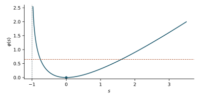

# École polytechnique · MP · Mathématiques B 2015 · Corrigé brut

*Corrigé rédigé par IA, non officiel. Signalez toute erreur.*

**Rédaction** · GPT-6.2 Astra Ultra · vitesse non renseignée · 25 novembre 2026

**Révision** · GPT-6.2 Astra Ultra · vitesse non renseignée · 26 novembre 2026

Le problème relie l’approximation de Laplace pour la fonction gamma, la troncature d’une série divergente, l’interpolation périodique et la moyenne d’un mouvement non résonnant sur un tore.

## I. Méthode de Laplace et fonction gamma

### Question 1a

Pour $y>0$, $e^{-t}t^{y-1}\sim t^{y-1}$ en zéro et décroît à l’infini plus vite qu’une puissance intégrable. Dans $\Gamma(y+1)$ une intégration par parties sur $[\varepsilon,R]$ fait apparaître $[-t^ye^{-t}]_\varepsilon^R$, qui tend vers zéro aux deux extrémités. Il reste $\Gamma(y+1)=y\Gamma(y)$. De $\Gamma(1)=1$, on tire par récurrence $\Gamma(n+1)=n!$.

### Question 1b

La relation de 1a donne $\Gamma(y)=y^{-1}\int_0^\infty e^{-t}t^y\,dt$. Posons $t=y(1+s)$, $dt=y\,ds$. Alors $e^{-t}t^y=e^{-y}y^y\exp[-y(s-\ln(1+s))]$ et $-1<s<\infty$, ce qui donne la formule annoncée.

### Question 2a

Pour $x>0$, toute puissance de $t$ est intégrable sur $[\delta,\infty[$ après multiplication par $e^{-t/x}$. Si $0<x\le1$, on a $e^{-t/x}\le e^{-\delta/(2x)}e^{-t/2}$ sur cet intervalle. L’intégrale est donc $O(e^{-\delta/(2x)})=o(x^n)$ pour chaque entier $n$. Le reste $\rho_N$ est localement intégrable sur cet intervalle et de croissance au plus polynomiale à l’infini, par (a) et la somme finie retranchée. Le même argument s’applique à $|\rho_N|$.

### Question 2b

Posons $p=(N+\lambda)/\mu>0$. Le petit $o$ donne $\delta>0$ tel que $|\rho_N(t)|\le\varepsilon t^{p-1}$ pour $0<t\le\delta$. Donc pour tout $x>0$ le module de l’intégrale tronquée est au plus $\varepsilon\int_0^\infty e^{-t/x}t^{p-1}dt=\varepsilon\Gamma(p)x^p$ par $t=xu$. On peut prendre $C'=\Gamma(p)$, indépendant de $\varepsilon,\delta$.

### Question 2c

Avec le $\delta$ de 2b, la contribution de la queue divisée par $x^p$ tend vers zéro par 2a, en prenant un entier $n\ge p$. La limite supérieure du module du quotient total est au plus $\Gamma(p)\varepsilon$. Comme $\varepsilon$ est arbitraire, l’intégrale entière est $o(x^p)$.

### Question 2d

Près de zéro, tous les exposants $p_k-1$, $p_k=(k+\lambda)/\mu$, sont supérieurs à $-1$, et le reste est intégrable par 2b. À l’infini l’exponentielle domine la croissance de $f$. Ainsi $F$ existe et, en calculant chaque intégrale par $t=xu$, on obtient
$$
F(x)=\sum_{k=0}^Na_k\Gamma(p_k)x^{p_k}+o(x^{p_N}).
$$

### Question 3a

On a $\varphi'(s)=s/(1+s)$ et $\varphi''(s)=1/(1+s)^2>0$. La fonction décroît strictement de $+\infty$ à zéro sur $]-1,0]$, puis croît strictement de zéro à $+\infty$ sur $[0,\infty[$. Ses restrictions aux deux intervalles ouverts sont donc des bijections sur $]0,\infty[$, par continuité et stricte monotonie.

À gauche, la droite $s=-1$ est une asymptote verticale. À droite, $\varphi(s)/s\to1$ tandis que $\varphi(s)-s=-\ln(1+s)\to-\infty$. La courbe a donc la direction de la droite de pente un et s’en éloigne indéfiniment. Sa tangente au minimum est horizontale.

### Question 3b

Pour $|s|<1$, le développement de $\ln(1+s)$ donne $\varphi(s)=s^2/2-s^3/3+s^4/4-\cdots=s^2\sum_{k\ge0}(-1)^ks^k/(k+2)$.

### Question 3c

Posons $s=au+bu^2+cu^3+O(u^4)$ et identifions dans $\varphi(s)=u^2$. Les coefficients donnent
$$
a^2/2=1,\qquad ab-a^3/3=0,\qquad ac+b^2/2-a^2b+a^4/4=0 .
$$
Ainsi $a=\pm\sqrt2$, $b=2/3$, $c=1/(9a)=\pm1/(9\sqrt2)$. Le signe supérieur est celui des $b_k$, l’inférieur celui des $c_k$. En posant $u=\sqrt q$ on trouve
$$
\varphi_\pm^{-1}(q)=\pm\sqrt{2q}+2q/3\pm q^{3/2}/(9\sqrt2)+O(q^2).
$$
Les séries sont convergentes en $u$ par hypothèse, on peut les dériver en $u$ puis multiplier par $1/(2\sqrt q)$. Ainsi $(\varphi_\pm^{-1})'(q)=\pm1/\sqrt{2q}+2/3\pm\sqrt q/(6\sqrt2)+O(q)$.

### Question 3d

Dans l’expression de 1b, posons $q=\varphi(s)$ sur chaque branche, d’abord sur des intervalles compacts éloignés des extrémités. Sur la branche négative $q$ décroît de l’infini à zéro, alors que la branche positive a l’orientation inverse. Par passage aux limites dans les intégrales convergentes et positives,
$$
\Gamma(y)=e^{-y}y^y\int_0^\infty e^{-yq}\big((\varphi_+^{-1})'(q)-(\varphi_-^{-1})'(q)\big)dq.
$$

### Question 3e

Par 3c, la différence vaut $\sqrt2\,q^{-1/2}+q^{1/2}/(3\sqrt2)+o(q^{1/2})$. À l’infini elle est bornée car chaque dérivée inverse vaut $(1+s)/s$ avec $s\to+\infty$ ou $s\to-1$. Appliquons 2d à $x=1/y$ (par exemple $\lambda=1,\mu=2,N=2$). Comme $\Gamma(1/2)=\sqrt\pi$ et $\Gamma(3/2)=\sqrt\pi/2$, il vient
$$
\Gamma(y)=e^{-y}y^y\sqrt{2\pi/y}\left(1+\frac1{12y}+o(1/y)\right).
$$

## II. Utilisation d’une série divergente

### Question 4

L’intégrande $e^{-t/x}/t$ est intégrable pour $t\ge1$. Sur $a\le x\le b$, $a>0$, chacune de ses dérivées en $x$ est majorée par une constante dépendant de l’ordre et du compact, fois $(1+t^m)e^{-t/b}$ pour un entier $m$. Cela se voit par récurrence en dérivant les facteurs $e^{-t/x}$ et les puissances de $1/x$. Ces majorantes sont intégrables. Les dérivations successives sous l’intégrale donnent $F\in C^\infty(]0,\infty[)$.

### Question 5

Si $I_m=\int_1^\infty e^{-t/x}t^{-m}dt$, les termes au bord donnent $I_m=xe^{-1/x}-mxI_{m+1}$. On a $F=I_1$. En itérant $N$ fois, on trouve $F=\sum_{k=1}^N(-1)^{k-1}(k-1)!x^k e^{-1/x}+(-1)^N N! x^N I_{N+1}=S_N+R_N$.

### Question 6a

La série en $x$ ne converge qu’en zéro car, pour $x\ne0$, le rapport des modules successifs vaut $k|x|\to\infty$. À $x>0$ fixé, $R_N-R_{N+1}=S_{N+1}-S_N=r_N$, dont le module tend également vers l’infini. Les différences d’une suite bornée étant bornées, la suite des restes ne l’est pas.

### Question 6b

Pour $t\ge1$, $t^{-(N+1)}\le1$, donc $|R_N|\le N!x^N\int_1^\infty e^{-t/x}dt=N!x^{N+1}e^{-1/x}=|r_N|$. Aussi $|R_{N+1}/r_N|\le |r_{N+1}/r_N|=(N+1)x\to0$ à $N$ fixé.

### Question 6c

Comme $R_N=r_N+R_{N+1}$ et $R_{N+1}=o(r_N)$, le quotient $R_N/r_N$ tend vers un lorsque $x\downarrow0$ à $N$ fixé.

### Question 6d

On a $|r_{N+1}|/|r_N|=(N+1)x$. Ce quotient est inférieur à un tant que $N+1<1/x$, égal à un si $N+1=1/x$, puis supérieur à un. Pour $x<1/2$, il y a au moins une diminution au début. Le minimum se situe en $N=\lfloor1/x\rfloor$ si $1/x$ n’est pas entier, et aux deux indices $1/x-1,1/x$ sinon.

### Question 7a

Regrouper les rangs $2\ell+1,2\ell+2$ donne
$$
S_{2M}=e^{-1/x}\sum_{\ell=0}^{M-1}(2\ell)!x^{2\ell+1}(1-(2\ell+1)x).
$$
Pour $x\le1/(2M)$ chaque parenthèse est strictement positive. De plus $R_{2M}>0$ par sa formule intégrale. Donc $0\le E_{2M}=R_{2M}/F\le |r_{2M}|/S_{2M}$, ce qui donne après simplification par $e^{-1/x}$ la fraction de l’énoncé.

### Question 7b

Pour $N=4$ et $x=1/10$, le numérateur est $24\cdot10^{-5}$ et le dénominateur $0{,}1(1-0{,}1)+2\cdot10^{-3}(1-0{,}3)=0{,}0914$. Le quotient est inférieur à $0{,}00263<3\cdot10^{-3}$.

## III. Densité des polynômes trigonométriques

### Question 8

Pour $u,v\in C_{\rm per}(\mathbb R)$, prenons des polynômes trigonométriques $P_m\to u$, $Q_m\to v$ uniformément. Alors $\|uv-P_mQ_m\|_\infty\le \|u-P_m\|_\infty\|v\|_\infty+\|P_m\|_\infty\|v-Q_m\|_\infty\to0$, les $P_m$ étant uniformément bornés. Ici les deux facteurs dépendent de deux variables distinctes, donc leur produit est un polynôme trigonométrique à deux variables. Additionner les approximations d’une somme finie donne la densité dans $C_{\rm sep}$.

### Question 9

Sur $[-1/2,1/2]$, $\max(0,1-j|t|)$ est continue et vaut zéro aux deux extrémités pour $j\ge2$. Son prolongement 1-périodique est donc continu, et chaque translatée $\psi_{j,k}$ l’est aussi.

### Question 10a

La somme finie définissant $S_j(f)$ est séparable par 9. On a $\psi_{j,k}(\ell/j)=1$ si $\ell\equiv k\pmod j$, zéro sinon. À un nœud du réseau un seul produit survit, d’où $S_j(f)(\ell_1/j,\ell_2/j)=f(\ell_1/j,\ell_2/j)$ par périodicité.

### Question 10b

Posons $u=j\theta_1-k_1$, $v=j\theta_2-k_2$ dans $[0,1[$. Avec $w_0(t)=1-t,w_1(t)=t$, le barycentre vaut
$$
S_j(f)(\theta)=\sum_{a,b\in\{0,1\}}w_a(u)w_b(v)\,f((k_1+a)/j,(k_2+b)/j).
$$
Les poids sont positifs ou nuls et de somme un, même sur le bord où les indices sont lus périodiquement. Chaque sommet du rectangle est à distance au plus $\sqrt2/j$ de $\theta$. L’uniforme continuité de $f$ périodique sur un domaine compact fondamental, avec ses prolongements aux cellules de bord, donne $\|S_j(f)-f\|_\infty\le\omega_f(\sqrt2/j)\to0$, où $\omega_f$ est le module de continuité.

### Question 11

Pour $\varepsilon>0$, choisissons $j$ tel que $\|S_j(f)-f\|_\infty<\varepsilon/2$, puis par 8 un polynôme $Q$ tel que $\|Q-S_j(f)\|_\infty<\varepsilon/2$. L’inégalité triangulaire donne $\|Q-f\|_\infty<\varepsilon$.

## IV. Moyennes le long d’un flot

### Question 12

Pour $x=0$, $\alpha'=\omega$ et $\alpha(0)=0$ imposent $\alpha(t)=t\omega$. Alors $F'(t)=f(t\omega)$, donc $F(t)=\int_0^t f(s\omega)ds$. Ces fonctions sont solutions et les deux intégrations avec conditions initiales assurent l’unicité.

### Question 13

Si $k\in\mathbb Z^2\setminus\{0\}$ vérifie $k\cdot\omega=0$, prenons $f(\theta)=e^{2\pi i k\cdot\theta}$. Une coordonnée non nulle de $k$ assure que sa moyenne sur le carré est nulle. Pourtant $f(t\omega)=1$ pour tout $t$, donc $F(t)=t$.

### Question 14a

La moyenne nulle annule le coefficient constant. Pour un polynôme $f=\sum_{k\ne0}c_ke^{2\pi i k\cdot\theta}$ à support fini, la non-résonance donne
$$
F(t)=\sum_{k\ne0}c_k\frac{e^{2\pi i(k\cdot\omega)t}-1}{2\pi i(k\cdot\omega)}.
$$
Chaque terme est borné pour tout $t\in\mathbb R$ et la somme est finie.

### Question 14b

Par 11, pour tout $\varepsilon>0$, un polynôme $Q$ vérifie $\|Q-f\|_\infty\le\varepsilon$. Sa moyenne $c_0$ a module au plus $\varepsilon$ puisque celle de $f$ est nulle. Alors $P=Q-c_0$ est de moyenne nulle et $\|P-f\|_\infty\le2\varepsilon$. Par 14a sa primitive le long du flot est bornée par un $C_P$ indépendant de $t$. Pour $t>0$, $|F(t)|/t\le C_P/t+2\varepsilon$. Il s’ensuit $F(t)=o(t)$.

### Question 15a

Par périodicité, chaque dérivée partielle de $h$ a une moyenne nulle. Donc $\nu=\int_{[0,1]^2}g=g_0$. Si $g=\sum_k g_ke^{2\pi i k\cdot\theta}$ et si $\omega$ reste non résonnant comme en 14, posons
$$
h(\theta)=-\sum_{k\ne0}\frac{g_k}{2\pi i k\cdot\omega}e^{2\pi i k\cdot\theta}.
$$
Cette somme finie est de moyenne nulle et réelle par conjugaison des coefficients opposés. La dérivation donne $dh\,\omega=\nu-g$. Si l’hypothèse de non-résonance n’était pas reconduite, un mode non constant avec $k\cdot\omega=0$ ne serait soluble que si $g_k=0$.

Par exemple, si $\omega=(1,0)$ et $g(\theta)=(\cos(2\pi\theta_2),0)$, la moyenne impose $\nu=0$. Intégrer (4) en $\theta_1$ sur une période imposerait alors $\cos(2\pi\theta_2)=0$ pour tout $\theta_2$. Ainsi, si la non-résonance de Q14 est levée, l’hypothèse exacte pour un polynôme donné est l’annulation de ses coefficients aux fréquences résonnantes non nulles.

### Question 15b

Par la chaîne, $\widetilde\alpha'=(I+x\,dh(\alpha))(\omega+xg(\alpha))=\omega+x\nu+x^2dh(\alpha)g(\alpha)$. Posons $\varepsilon(x,t)=x\,dh(\alpha(t))g(\alpha(t))$. Par périodicité et continuité, $\sup_t\|\varepsilon(x,t)\|\le|x|\|dh\|_\infty\|g\|_\infty\to0$. Le contrôle est valable sur toute la droite.

### Question 15c

Comme $\widetilde\alpha(0)=xh(0)$, la question précédente donne la formule demandée avec
$$
\eta(x,t)=\int_0^t\varepsilon(x,s)ds+h(\omega t)-h(\alpha(t)).
$$
Pour $0\le t\le T$, on a $\|\alpha(t)-\omega t\|\le |x|T\|g\|_\infty$ par l’équation initiale. Le premier terme de $\eta$ est majoré en norme par $T\sup_s\|\varepsilon(x,s)\|$ et le second par $\|dh\|_\infty |x|T\|g\|_\infty$. Les deux tendent uniformément vers zéro.

En reportant la définition de $\eta$, l’égalité obtenue est
$$
\alpha(t)=(\omega+x\nu)t+x\big(h(0,0)-h(\omega t)\big)+x\eta(x,t).
$$
La majoration précédente donne même $\sup_{0\le t\le T}\|\eta(x,t)\|\le 2T|x|\|dh\|_\infty\|g\|_\infty$.
