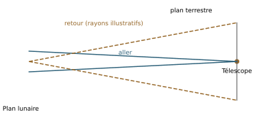
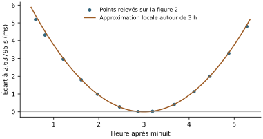
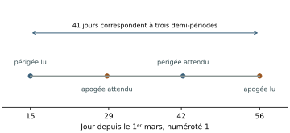

# X–ESPCI PC 2015 — Physique A · Corrigé guidé

*Corrigé rédigé par IA, non officiel. Signalez toute erreur.*

**Rédaction** · GPT-6.2 Astra Ultra · vitesse non renseignée

**Objectif Lune.** Les distances de télémétrie sont des distances aller simple. On prend $c=3{,}0\times10^8\ \mathrm{m\,s^{-1}}$.

Le rapport de jury demande de justifier les hypothèses de modélisation et les unités. Un même graphique donne plusieurs temps caractéristiques selon que l’on suit la rotation d’une station ou l’orbite lunaire. Les questions 18 à 25 distinguent ces échelles.

## Estimation initiale

### Question 1 — Du temps de vol à la distance

> [!INDICATION]
> Dessinez l’aller et le retour avant de convertir les secondes en kilomètres.

#### Solution

Une impulsion met environ $2{,}5\ \mathrm s$ pour revenir à l’observatoire. Elle parcourt deux fois la distance entre télescope et réflecteur. Ainsi $D=c\Delta t/2\simeq3{,}75\times10^8\ \mathrm m$, soit environ **380 000 km**. Remonter aux centres des astres nécessiterait ensuite les positions de la station et du réflecteur.

## I — Traversée de l’atmosphère

### Question 2 — Correction de la mesure verticale

> [!INDICATION]
> Comparez le temps de parcours d’une même tranche dans l’air et dans le vide. Fixez le signe avant de doubler le trajet.

#### Solution

Un élément de trajet $dz$ prend $n(z)\,dz/c$ dans l’air. La distance estimée par $c\Delta t/2$ inclut donc un excédent $\int_0^\infty[n(z)-1]dz$ par rapport à la distance géométrique. En définissant la correction comme la quantité à **ajouter** à la mesure brute, on obtient $$\boxed{\delta D=D_{\rm géom}-D_{\rm mes}=-\int_0^\infty[n(z)-1]dz}.$$ La limite supérieure peut être placée là où $n$ rejoint 1. Le facteur deux du parcours est déjà compensé par la division de Q1.

### Question 3 — Épaisseur équivalente de la colonne d’air

> [!INDICATION]
> Remplacez l’intégrale de masse volumique par une différence de pression. Le jury souligne que l’hypothèse d’une atmosphère isotherme est superflue.

#### Solution

La loi optique impose $n-1=(n_0-1)\rho/\rho_0$. L’équilibre hydrostatique donne $dP=-\rho g\,dz$. En intégrant jusqu’à une altitude où la pression est négligeable, on obtient $\int_0^\infty\rho\,dz=P_0/g$. Au sol le gaz parfait vérifie $P_0/\rho_0=RT_0/M$. Ainsi $$\delta D=-(n_0-1)H,\qquad H=\frac{P_0}{\rho_0g}=\frac{RT_0}{Mg}.$$ Une couche uniforme de masse volumique $\rho_0$ et de hauteur $H$ aurait la même masse par unité de surface que toute l’atmosphère. Le profil réel de température peut varier.

### Question 4 — Ordre de grandeur de la correction

> [!INDICATION]
> Convertissez la masse molaire en kilogrammes par mole.

#### Solution

Avec $M=0{,}029\ \mathrm{kg\,mol^{-1}}$, $H=(8{,}3\times290)/(0{,}029\times9{,}8)\simeq8{,}5\times10^3\ \mathrm m$. La correction verticale vaut environ **$-2{,}5\ \mathrm m$**. Cela correspond aux quelques mètres de trajet apparent supplémentaires signalés dans l’article.

### Question 5 — Visée au-dessus de l’horizon

> [!INDICATION]
> L’angle est mesuré à partir de l’horizontale. Vérifiez quelle fonction trigonométrique vaut un au zénith.

#### Solution

En assimilant l’atmosphère à des couches planes et le rayon à une droite, $dz=\sin h\,d\ell$. Le facteur de traversée est donc $1/\sin h$ et $$\boxed{\delta D(h)=-\frac{(n_0-1)H}{\sin h}}.$$ À $90^\circ$ on retrouve la visée verticale. Aux très faibles hauteurs, la courbure terrestre et la réfraction limitent cette approximation.

## II — Trajet Terre–Lune

### Question 6 — Retard gravitationnel solaire

> [!INDICATION]
> Cherchez une combinaison sans dimension, puis utilisez le bilan radial de la Terre sur son orbite.

#### Solution

Notons $R_s$ la distance Terre–Soleil. Le potentiel solaire par unité de masse, $-GM_s/R_s$, a la dimension d’une vitesse au carré. Le retard relatif est donc de la forme $\Delta t_{\rm grav}/t=kGM_s/(R_sc^2)$, avec $k>0$ sans dimension. Pour une orbite terrestre circulaire, $GM_s/R_s=v_\oplus^2$. La distance brute est trop grande, de sorte que $$\delta D_{\rm grav}=-kD(v_\oplus/c)^2.$$ L’analyse dimensionnelle fixe l’échelle de la correction et laisse $k$ indéterminé.

### Question 7 — Vitesse de révolution et retard

> [!INDICATION]
> Calculez le chemin parcouru en un an, puis élevez le rapport des vitesses au carré.

#### Solution

$v_\oplus\simeq2\pi R_s/(1\ \mathrm{an})\simeq2\pi(1{,}5\times10^{11})/(3{,}1\times10^7)\simeq3{,}0\times10^4\ \mathrm{m\,s^{-1}}$. D’où $D(v_\oplus/c)^2\simeq3{,}8\ \mathrm m$. Un coefficient de l’ordre de deux donnerait environ $8\ \mathrm m$, compatible avec la dizaine de mètres indiquée. La valeur précise de ce coefficient ne découle pas du calcul précédent.

## III — Écho lumineux

### Question 8 — Nombre de photons verts

> [!INDICATION]
> Associez la bonne énergie d’impulsion à la longueur d’onde verte.

#### Solution

L’énergie d’un photon est inversement proportionnelle à sa longueur d’onde. À $0{,}53\ \mu\mathrm m$, elle vaut $2{,}0\times10^{-19}/0{,}53\simeq3{,}8\times10^{-19}\ \mathrm J$. Une impulsion verte de $0{,}300\ \mathrm J$ contient donc **$N\simeq8\times10^{17}$ photons**, de l’ordre de $10^{18}$ comme l’annonce le texte.

### Question 9 — Diffraction à la sortie du télescope

> [!INDICATION]
> Distinguez l’angle entre l’axe et le premier minimum du diamètre angulaire total.

#### Solution

Pour une pupille circulaire de diamètre $d_T=1{,}5\ \mathrm m$, le premier minimum d’Airy est à $1{,}22\lambda/d_T\simeq4{,}3\times10^{-7}\ \mathrm{rad}$ de l’axe. Le diamètre angulaire de la tache est donc $8{,}6\times10^{-7}\ \mathrm{rad}$, soit $0{,}18''$. L’ouverture totale annoncée à la sortie vaut $1''$. Le miroir pourrait produire une tache plus étroite. Un faisceau qui ne remplit pas toute la pupille ou des imperfections optiques peuvent accroître l’ouverture.

### Question 10 — Fraction interceptée sur la Lune

> [!INDICATION]
> Additionnez les aires des ouvertures actives du panneau, puis divisez par l’aire de la tache du faisceau.

#### Solution

Prenons $\alpha=5''=2{,}4\times10^{-5}\ \mathrm{rad}$ comme ouverture **totale** et approchons le profil par un disque uniformément éclairé. À distance $D$, le rayon de la tache vaut $D\tan(\alpha/2)\simeq4{,}5\ \mathrm{km}$. La surface utile des 300 entrées circulaires est $S'=300\pi(0{,}038/2)^2\simeq0{,}34\ \mathrm{m^2}$. La fraction d’énergie reçue est $$f_{\rm aller}\simeq \frac{S'}{\pi[D\tan(\alpha/2)]^2}\simeq5\times10^{-9}.$$

### Question 11 — Retour par le coin de cube

> [!INDICATION]
> Suivez les trois composantes de la direction pour une incidence quelconque dans l’espace.

#### Solution

Prenons pour axes les normales aux trois miroirs orthogonaux. La réflexion sur le miroir normal à $Ox$ remplace $(u_x,u_y,u_z)$ par $(-u_x,u_y,u_z)$. Les deux autres réflexions inversent à leur tour $u_y$ et $u_z$. La direction de sortie est donc **$-\boldsymbol u$**, quel que soit l’ordre des trois réflexions, pour un rayon qui touche les trois faces. Le rayon sortant peut être décalé latéralement.

### Question 12 — Égalité des chemins optiques

> [!INDICATION]
> Dépliez les trois réflexions et regardez ce que devient le plan d’entrée après la troisième symétrie.

#### Solution

Dans l’approximation d’une onde plane, plaçons le sommet du coin à l’origine et prenons une section de référence perpendiculaire au faisceau à distance axiale $b$ du sommet. Déplions le trajet réfléchi en appliquant successivement les trois symétries planes. Leur composée est la symétrie centrale. La section de référence de sortie devient un plan parallèle à la section d’entrée, situé de l’autre côté du sommet et à distance $b$. Chaque rayon entre ces plans parcourt en ligne droite la même longueur $2b$ dans le milieu du coin, donc le même chemin optique $2nb$ si son indice est $n$. Les portions extérieures jusqu’aux fronts d’onde communs ajoutent la même contribution. Pour un réflecteur de quelques centimètres vu depuis la Terre, le front d’onde est localement plan.

### Question 13 — Diffraction au retour

> [!INDICATION]
> Choisissez la même convention d’ouverture totale qu’à la question 10.

#### Solution

Pour une ouverture de cataphote de diamètre $d=3{,}8\ \mathrm{cm}$, le rayon angulaire du premier minimum vaut $\theta'=1{,}22\lambda/d\simeq1{,}7\times10^{-5}\ \mathrm{rad}$, environ $3{,}5''$. L’ouverture totale correspondante est **$\alpha'=2\theta'\simeq3{,}4\times10^{-5}\ \mathrm{rad}\simeq7''$**. L’approximation $\sin\theta'\simeq\theta'$ est ici excellente.

### Question 14 — Fraction recueillie au retour

> [!INDICATION]
> Le diamètre du coin fixe l’étalement au retour. Le miroir du télescope fixe l’aire de collecte.

#### Solution

La tache centrale renvoyée par un coin a un rayon de l’ordre de $D\theta'\simeq6{,}4\ \mathrm{km}$ sur Terre. La surface collectrice du télescope vaut $S=\pi(0{,}75)^2\simeq1{,}8\ \mathrm{m^2}$. Dans le même modèle d’éclairement uniforme, $$f_{\rm retour}\simeq\frac{S}{\pi(D\theta')^2}\simeq1{,}4\times10^{-8}.$$ L’estimation additionne les énergies des coins et néglige les interférences et la structure des lobes.

### Question 15 — Bilan énergétique géométrique

> [!INDICATION]
> Contrôlez la dépendance en distance en comptant les deux aires de tache.

#### Solution

Les deux fractions interviennent successivement. Ainsi $\eta=E_{\rm reçue}/E_{\rm émise}\simeq f_{\rm aller}f_{\rm retour}\simeq7\times10^{-17}$. C’est une estimation d’ordre de grandeur pour une visée centrée. La loi varie comme $D^{-4}$ si les dimensions et les ouvertures restent fixées.

### Question 16 — Photons attendus et photons détectés

> [!INDICATION]
> Distinguez les photons émis, ceux qui arrivent à l’ouverture et les événements comptés électroniquement.

#### Solution

Le modèle idéal conduit à $N\eta\simeq(8\times10^{17})(7\times10^{-17})\simeq 6\times10^1$ photons par impulsion. Le texte indique en pratique environ $10^{-2}$ photon **détecté** par tir, soit une différence de plusieurs milliers avec ce modèle. Les transmissions aller et retour de l’atmosphère, les pertes dans les optiques et les filtres, la répartition réelle de la lumière, les écarts de visée et le rendement quantique du détecteur réduisent ensemble le nombre d’événements comptés.

### Question 17 — Incertitude temporelle

> [!INDICATION]
> Identifiez l’objet que l’on moyenne. Il faut compter les échos reçus, y compris quand de nombreux tirs donnent zéro écho.

#### Solution

Pour un unique photon de retour, sa date d’émission dans une impulsion de largeur $400\ \mathrm{ps}$ est inconnue. Cette largeur donne une échelle de distance $c\tau/2\simeq0{,}060\ \mathrm m$, de l’ordre du décimètre. Pour $m$ retours indépendants d’écart type temporel $\sigma_t$, l’incertitude statistique sur leur temps moyen vaut $\sigma_t/\sqrt m$ et celle sur la distance $c\sigma_t/(2\sqrt m)$. Les biais de datation et les fluctuations corrélées ne bénéficient pas de cette réduction.

## IV — Observations du 25 mars

### Question 18 — Phase lunaire de la nuit du 25 mars

> [!INDICATION]
> Situez la culmination des trois phases utiles par rapport au passage du Soleil au méridien.

#### Solution

La Lune est haute vers trois heures du matin. À la pleine Lune, elle culmine vers minuit solaire. Au premier quartier, elle culmine vers le coucher du Soleil et se couche près de minuit. Le dernier quartier culmine en fin de nuit. Trois heures place l’observation **entre la pleine Lune et le dernier quartier**, du côté de la Lune décroissante. Parmi les réponses proposées, on retient le voisinage du dernier quartier. La seule lecture de l’heure ne fixe pas une fraction d’éclairement précise.

### Question 19 — Pourquoi le minimum se produit pendant la nuit

> [!INDICATION]
> Convertissez quelques millisecondes de temps aller-retour en kilomètres avant d’attribuer le signal à un effet physique.

#### Solution

Au fil de la rotation terrestre, l’observatoire se rapproche de la direction de la Lune puis s’en éloigne. La variation observée, environ $5\times10^{-3}\ \mathrm s$, représente $c\delta t/2\simeq750\ \mathrm{km}$. La rotation de la station peut projeter une fraction du rayon terrestre sur la ligne de visée en quelques heures. Le retard atmosphérique ou solaire, de l’ordre de mètres, est trop petit. Dans le modèle synchrone de la partie IV, le réflecteur au centre de la face visible conserve sa direction vers la Terre. La courbe passe par son minimum vers **$t_0\simeq3\ \mathrm h$**, heure de culmination. Sur la figure 3, la distance orbitale change surtout à l’échelle des semaines.

### Question 20 — Modèle de la courbure au méridien

> [!INDICATION]
> Écrivez d’abord la distance au carré. La station décrit un parallèle de rayon $R\cos\varphi$.

#### Solution

Dans le repère géocentrique, appelons $b$ la distance au réflecteur, supposée constante pendant la nuit, et $R$ le rayon terrestre. L’angle horaire du réflecteur est $u=(\Omega_\oplus-n)(t-t_0)$, avec la vitesse orbitale $n$ de la Lune. La loi des cosinus pour la distance topocentrique $s$ donne $$s^2=b^2+R^2-2bR\cos\varphi\cos u.$$ À la culmination, $s_0^2=b^2+R^2-2bR\cos\varphi$. Avec $\cos u=1-u^2/2+O(u^4)$ puis un développement de la racine, $$\Delta t(t)=\frac{2s_0}{c}+\frac{bR\cos\varphi}{cs_0}(\Omega_\oplus-n)^2(t-t_0)^2+O((t-t_0)^4).$$ Le terme linéaire est nul par symétrie. En première approximation, $b/s_0\simeq1$ puisque $R/b\ll1$.

### Question 21 — Latitude déduite de la figure 2

> [!INDICATION]
> Gardez la même unité de temps pour le coefficient de la parabole et les deux vitesses angulaires.

#### Solution

La lecture graphique donne $\Delta t_0\simeq2{,}63795\ \mathrm s$. À environ une heure du minimum, la durée est plus grande d’environ $0{,}00094\ \mathrm s$. Le coefficient quadratique est donc $A\simeq9{,}4\times10^{-4}\ \mathrm{s\,h^{-2}}$. La vitesse angulaire relative est $2\pi(1/23{,}93-1/(27{,}3\times24))\simeq0{,}253\ \mathrm{rad\,h^{-1}}$. Avec $b/s_0\simeq1$, $$\cos\varphi\simeq \frac{cA}{R(\Omega_\oplus-n)^2}\simeq0{,}69,\qquad |\varphi|\simeq46^\circ\text{ à }47^\circ.$$ Le modèle ne donne que le cosinus. L’observatoire de la Côte d’Azur est dans l’hémisphère nord. Le résultat situe bien une station aux latitudes moyennes. Déclinaison lunaire, variation de distance pendant la nuit et choix des points modifient l’estimation de plusieurs degrés.

## V — Observations de mars et avril

### Question 22 — Cadre du mouvement képlérien

> [!INDICATION]
> Distinguez le mouvement relatif du mouvement de chacun des centres autour du barycentre et précisez la condition pour une orbite liée.

#### Solution

On assimile les astres à des masses à symétrie sphérique, de masses constantes, et on néglige les perturbations solaires, les marées et l’aplatissement. Dans un référentiel barycentrique galiléen, la séparation vérifie $\ddot{\boldsymbol r}=-G(M_\oplus+M_L)\boldsymbol r/r^3$. La force est centrale et le moment cinétique est constant. Pour un moment cinétique non nul et une énergie orbitale négative, la solution est une ellipse de foyer au centre de force de la coordonnée relative, d’équation $r=p/(1+e\cos\theta)$ avec $0\le e<1$.

### Question 23 — Variations de la figure 3

> [!INDICATION]
> Comparez l’amplitude du mois au rayon de la Terre et à la variation intranuit.

#### Solution

La distance Terre–Lune change entre périgée et apogée au cours du mouvement sur l’ellipse. De $2{,}42$ à $2{,}67\ \mathrm s$, la variation correspond à environ $3{,}8\times10^4\ \mathrm{km}$ sur le trajet simple. Cette amplitude est de plusieurs rayons terrestres. La rotation de la station explique la dispersion des points d’une même nuit et une petite partie de la variation globale. Les phases lunaires renseignent sur l’éclairement relatif au Soleil.

### Question 24 — Période, demi-grand axe et excentricité

> [!INDICATION]
> Utilisez l’intervalle le plus long entre deux extrêmes identifiables. Comptez soigneusement les demi-périodes.

#### Solution

La figure montre un minimum vers le jour 15 et un maximum vers le jour 56. Ils sont séparés par une révolution et demie. Ainsi $T\simeq(56-15)/(3/2)\simeq27{,}3$ jours. Avec les extrêmes visibles $t_p\simeq2{,}42\ \mathrm s$ et $t_a\simeq2{,}67\ \mathrm s$, $r_p\simeq ct_p/2$ et $r_a\simeq ct_a/2$. De $r_p=a(1-e)$ et $r_a=a(1+e)$ suit $$a\simeq\frac c4(t_a+t_p)\simeq3{,}8\times10^8\ \mathrm m,\qquad e\simeq\frac{t_a-t_p}{t_a+t_p}\simeq0{,}05.$$ Ces valeurs traitent les distances entre la station et le réflecteur comme des distances entre centres et ignorent la modulation journalière.

### Question 25 — Interruption des observations

> [!INDICATION]
> Reportez la phase du jour 25 sur un cycle synodique. Cherchez dans le texte les causes du bruit de fond.

#### Solution

Vers le jour 25 la Lune décroît et culmine tard (Q18). Durant les jours suivants, elle devient un croissant du matin, passe près du Soleil à la nouvelle Lune, puis devient un croissant du soir. Autour de la nouvelle Lune, les intervalles de visibilité nocturne sont courts et la Lune est basse. En journée, le fond lumineux du ciel gêne fortement la détection d’échos rares. Le texte signale aussi le bruit dû à la partie éclairée de la Lune. Ces contraintes expliquent une fenêtre d’observation réduite. La figure seule ne documente pas la cause de chaque nuit manquante.

## VI — Tests de physique

### Question 26 — Grandeur conservée si la gravitation varie

> [!INDICATION]
> Cherchez une loi qui requiert seulement la direction de la force.

#### Solution

La force mutuelle est toujours parallèle à la séparation des centres, quelle que soit la valeur instantanée de $G(t)$. Son moment dans le mouvement relatif est nul. Le moment cinétique orbital $\boldsymbol L=\mu\boldsymbol r\times\dot{\boldsymbol r}$ est donc constant, avec $\mu$ la masse réduite. L’énergie potentielle dépend explicitement du temps par $G(t)$, ce qui permet une variation de l’énergie mécanique.

### Question 27 — Effet d’une variation lente de $G$

> [!INDICATION]
> La vitesse angulaire dépend à la fois de la gravitation et du rayon. Éliminez le rayon avec le moment cinétique.

#### Solution

Pour une suite d’orbites quasi circulaires, $n^2r^3=G(M_\oplus+M_L)$ et $r^2n$ est constant par Q26. On obtient $r\propto G^{-1}$ puis $n\propto G^2$. La dérivée logarithmique donne $$\frac{\delta n}{n}\simeq2\frac{\delta G}{G}.$$ Une **diminution de 1 %** de $G$ ralentit donc la rotation orbitale d’environ **2 %**. La variation exacte sur la famille de cercles est $(0{,}99)^2-1=-1{,}99\,\%$.

### Question 28 — Décélération et éloignement

> [!INDICATION]
> Le siècle doit être converti en secondes puis élevé au carré. Gardez le signe jusqu’à la variation de distance.

#### Solution

Cette fois $G$ est fixe. La relation de Kepler impose $2\dot n/n+3\dot a/a=0$. Convertissons l’accélération angulaire donnée en $\mathrm{rad\,s^{-2}}$ : $$\dot n\simeq-\frac{24\times4{,}8\times10^{-6}}{(100\times3{,}1\times10^7)^2}\simeq-1{,}2\times10^{-23}\ \mathrm{s^{-2}}.$$ Avec $n=2\pi/(27{,}3\times86400)\simeq2{,}7\times10^{-6}\ \mathrm{s^{-1}}$ et $a\simeq3{,}8\times10^8\ \mathrm m$, $\dot a=-(2a/3)\dot n/n\simeq1{,}1\times10^{-9}\ \mathrm{m\,s^{-1}}$, soit **environ $3{,}5\ \mathrm{cm/an}$**.

### Question 29 — Moment cinétique du système Terre–Lune

> [!INDICATION]
> Comparez les moments cinétiques complets, qui contiennent chacun une vitesse de rotation.

#### Solution

Dans le référentiel barycentrique, sous l’hypothèse d’un couple extérieur négligeable, les couples internes de marée redistribuent le moment cinétique entre l’orbite et les rotations propres. Ils conservent la somme $L_{\rm tot}=L_{\rm orb}+I_\oplus\Omega_\oplus+I_L\Omega_L$ dans le modèle coplanaire et prograde. Pour des boules homogènes et une Lune synchrone, $$\frac{I_L\Omega_L}{I_\oplus\Omega_\oplus}\simeq\frac1{81}\left(\frac14\right)^2\frac1{27{,}3}\simeq3\times10^{-5}.$$ En outre, $I_L\Omega_L/L_{\rm orb}\simeq(2/5)(M_L/\mu)(R_L/a)^2\sim7\times10^{-6}$. Ces deux comparaisons justifient de négliger le spin lunaire.

### Question 30 — Sens de variation du jour terrestre

> [!INDICATION]
> Écrivez le moment orbital en fonction de la distance qui croît. Le moment restant fixe le sens de variation de la rotation terrestre.

#### Solution

Pour une orbite quasi circulaire, $L_{\rm orb}=\mu\sqrt{G(M_\oplus+M_L)a}$. L’allongement de l’orbite augmente donc le moment cinétique orbital, même si la vitesse angulaire de la Lune diminue. Avec $I_\oplus$ constant et la conservation de Q29, $I_\oplus\dot\Omega_\oplus=-L_{\rm orb}\dot a/(2a)<0$. La période propre $P_\oplus=2\pi/\Omega_\oplus$ **augmente**. À titre d’ordre de grandeur, $L_{\rm orb}/(I_\oplus\Omega_\oplus)\simeq4$ pour la Terre homogène, d’où un allongement d’environ $1{,}6\ \mathrm{ms}$ par siècle dans ce modèle.

[Énoncé de 2015](https://wikiprepa.fr/concours/data/x_physique-a_pc_2015.pdf) · [Rapport du jury de physique A](https://wikiprepa.fr/concours/data/x_physique-a_pc_2015_rapport_jury.pdf)
