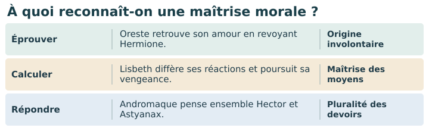

# Banque PT — Français A 2016 · Corrigé brut

*Corrigé rédigé par IA, non officiel. Signalez toute erreur.*

**Rédaction** · GPT-6.2 Astra Ultra · vitesse non renseignée

**Révision (tour 1)** · GPT-6.2 Astra Ultra · vitesse non renseignée

[Énoncé officiel](https://www.banquept.fr/documents/2016/fr_a_2016_pt.pdf) · [Rapport du jury](https://www.banquept.fr/documents/ecrit/rapport/2016/rapport_fra_a_ecrit_2016.pdf) · [Programme officiel](https://www.education.gouv.fr/bo/15/Hebdo23/MENS1501166A.htm) · [Grille de la session](https://www.banquept.fr/documents/livret/2016/Livret_PT_2016.pdf#page=12)

Épreuve de quatre heures sur « Le monde des passions ». Honoré de Balzac, La Cousine Bette · Jean Racine, Andromaque · David Hume, Dissertation sur les passions (traduction de Jean-Pierre Cléro).

## Sujet

Jean-Jacques Rousseau, L’Émile, 1762. Le feuillet propose les affirmations suivantes.

« Il ne dépend pas de nous d’avoir ou de n’avoir pas des passions, mais il dépend de nous de régner sur elles. Tous les sentiments que nous dominons sont légitimes, tous ceux qui nous dominent sont criminels. Un homme n’est pas coupable d’aimer la femme d’autrui, s’il tient cette passion malheureuse asservie à la loi du devoir ; il est coupable d’aimer sa propre femme au point d’immoler tout à son amour. »

Vous vous interrogerez sur la validité de ces affirmations de Jean-Jacques Rousseau (L’Emile 1762), à la lumière de vos lectures personnelles d’Andromaque de Racine, de la Dissertation sur les passions de Hume et de La cousine Bette de Balzac.

## Dissertation

Oreste, à peine arrivé en Épire, explique à Pylade qu’il avait cru guérir de son amour. Il parle pourtant en homme qui espère revoir Hermione. Sa première erreur a été d’attribuer à une décision de sa volonté le pouvoir de supprimer un attachement. Rousseau lui aurait volontiers concédé ce point. Il soutient dans *L’Émile* que l’épreuve de la liberté commence après la naissance de la passion, lorsque se pose la question de ce qu’on va lui permettre de gouverner. Il va jusqu’à dire légitimes tous les sentiments dominés et criminels tous ceux qui dominent. L’homme marié peut ainsi se perdre en aimant sa femme, tandis que l’amour pour la femme d’autrui peut demeurer innocent. Comment reconnaître un règne véritable de la personne sur ce qu’elle éprouve ? Les œuvres de Racine, Hume et Balzac confirment que l’apparition d’un sentiment et la responsabilité d’une conduite doivent être distinguées. Elles invitent à discuter un critère de maîtrise qui pourrait faire passer le calme pour la vertu et la violence d’un trouble pour un crime.

L’expérience quotidienne donne d’abord à la première proposition de Rousseau une force singulière. Un visage longtemps absent reparaît et la résolution d’oublier perd en un instant l’assurance qu’elle avait acquise dans la solitude. Quand Oreste retrace son voyage, il sait exposer à Pylade les raisons qu’il a eues de chercher puis de fuir Hermione. Leur connaissance n’a pas suffi à régler ses mouvements. Chez Hume, les passions ont des conditions d’apparition que l’observateur peut chercher à comprendre. L’incertitude d’un événement, en particulier, fait alterner la représentation de l’issue espérée et celle de l’issue redoutée. Un homme à qui l’on enjoint de cesser d’espérer n’obtient aucun résultat du seul fait qu’il a compris l’ordre. Pour qu’un sentiment change, quelque chose doit changer dans l’objet, dans l’idée qu’il en forme ou dans les autres dispositions de son esprit.

Cette part involontaire de l’affect rend d’autant plus nécessaire de situer exactement la responsabilité. Dans le roman de Balzac, une inclination du baron Hulot serait un événement privé si l’on s’arrêtait à la première impression. Mais cet homme dispose du crédit d’une famille, de l’autorité d’un fonctionnaire et du dévouement de proches qui lui font confiance. Il accorde progressivement à une satisfaction personnelle le droit de disposer de ces ressources. La ruine économique atteint des personnes qui n’ont rien choisi de son désir. On peut donc nommer ce qui dépendait de lui sans lui imputer la naissance de tout attrait. Ce sont les passages d’un ordre à un autre, du goût personnel à la dette imposée à autrui, qui font sortir le sentiment de son innocence initiale.

L’exemple conjugal de Rousseau prend alors tout son sens. Un lien reconnu donne des devoirs à l’époux. Il ne lui donne aucun droit de sacrifier tous ses autres engagements à celui-ci. Inversement, un sentiment qui troublerait l’ordre de deux familles s’il était suivi peut être tenu à distance des conduites qui nuiraient aux intéressés. Racine montre à quel point le problème se complique quand plusieurs fidélités sont légitimes ensemble. Veuve d’Hector, Andromaque demeure aussi la mère d’Astyanax. Refuser toute concession à Pyrrhus préserve le souvenir de l’époux, mais livre son fils à un danger dont elle connaît la gravité. En annonçant qu’elle va consulter Hector sur son tombeau, elle conserve aux deux liens leur poids. Racine fait entendre le projet à Céphise et laisse cette consultation hors scène. C’est parce qu’elle aime Hector et Astyanax qu’elle éprouve avec une telle acuité la nécessité de juger entre des obligations qui ne se laissent pas simplement additionner.

Il resterait pourtant dangereux de qualifier de moralement légitime tout ce qui paraît dominé. Lisbeth sait patienter, écouter sans révéler ce qu’elle pense, faire passer ses entreprises pour des services. Son ressentiment résiste précisément parce qu’il ne l’emporte pas à chaque instant hors d’elle-même. Est-elle maîtresse de sa passion ? Elle l’est dans le choix du moment et des moyens. Elle l’est bien moins lorsqu’il s’agit de demander pourquoi l’humiliation des Hulot devrait devenir la fin de sa vie. Une passion capable de se donner du temps exerce parfois sur la personne une domination plus profonde que l’accès de colère qui épuise son énergie en quelques minutes. L’homme de l’exemple de Rousseau pourrait lui aussi observer toutes les apparences et entretenir méthodiquement son désir. Pour faire du règne sur soi un critère moral, il faut inclure dans l’examen ce que l’on choisit de vouloir.

Hume permet de préciser cette difficulté. Dans la cinquième section de la *Dissertation*, la raison, prise au sens strict, juge du vrai et du faux. Elle peut corriger une croyance sur la personne aimée ou me faire découvrir qu’un moyen conduira à l’opposé de ma fin. Sa justesse intellectuelle ne lui donne pourtant pas, à elle seule, le pouvoir de mouvoir la volonté. Ce que l’on attribue couramment à la raison peut relever d’une passion calme, par exemple de l’intérêt général que je prends à un bien durable. Une passion calme peut être forte, puisque sa force se mesure à son effet sur la conduite. Cette analyse rend intelligible la puissance discrète de Bette autant que la constance d’Andromaque. Elle oblige aussi à chercher le critère de leur différence ailleurs que dans le contraste entre un visage impassible et un visage bouleversé.

La réciproque proposée par Rousseau appelle une difficulté comparable. Un sentiment peut s’emparer de quelqu’un sans que le mot de crime décrive convenablement ce qui se passe. La douleur d’Andromaque devant le malheur d’Hector est plus forte que tout projet de l’effacer. Elle conserve la présence d’une personne dont l’existence importe encore à d’autres. La tendresse obstinée d’Adeline est, elle aussi, compréhensible à partir de ce qu’elle garde. Elle ne veut abandonner ni son mari ni la maison dont leurs enfants dépendent. Pourtant le pardon accordé aujourd’hui peut permettre au baron de faire peser demain de nouvelles dettes sur cette même famille. Le jugement moral porte ici sur les effets qu’un dévouement accepte d’examiner. Louer son intensité ou condamner sa dépendance ne dispense pas de cette enquête.

Une liberté plus modeste devient dès lors pensable. Il dépend d’Oreste d’écouter Pylade, de reconnaître dans son ambassade une fonction qui l’oblige au-delà de sa personne et de demander ce qu’Hermione attend réellement de lui. La tragédie montre successivement ces possibilités et ce qui les ferme. Il dépend de la personne passionnée de ménager une place à une parole qu’elle n’avait aucun désir d’entendre. Pour Hume, un changement de perspective et une disposition concurrente peuvent modifier le rapport entre les passions. Pour Rousseau, la loi du devoir donne à cet effort son orientation morale. Les deux démarches se rejoignent sur un fait d’expérience. Celui qui croit donner un ordre à son mouvement intérieur dispose de peu de prise. Celui qui accepte de revoir ce qu’il doit à d’autres peut déjà changer sa conduite.

Rousseau a donc raison d’écarter le tribunal qui prétendrait condamner quelqu’un pour avoir éprouvé un amour imprévu ou l’absoudre parce que cet amour a un objet permis. Sa formule devient trop absolue si la domination désigne une simple habileté ou si tout sentiment qui s’impose fait du sujet un coupable. Régner moralement sur une passion demande de répondre des fins qu’on lui accorde, de ses effets sur autrui et des devoirs qu’elle risque de nous faire oublier. La mesure de cette liberté se trouve parfois dans le temps très court qui sépare un premier mouvement de la réponse que l’on consent à donner.

