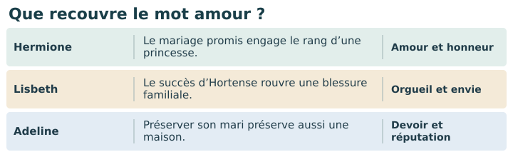

# Banque PT — Français B 2016 · Corrigé brut

*Corrigé rédigé par IA, non officiel. Signalez toute erreur.*

**Rédaction** · GPT-6.2 Astra Ultra · vitesse non renseignée

**Révision (tour 1)** · GPT-6.2 Astra Ultra · vitesse non renseignée

[Énoncé officiel](https://www.banquept.fr/documents/2016/fr_b_2016_pt.pdf) · [Rapport du jury](https://www.banquept.fr/documents/ecrit/rapport/2016/rapport_fra_b_ecrit_2016.pdf) · [Programme officiel](https://www.education.gouv.fr/bo/15/Hebdo23/MENS1501166A.htm) · [Grille de la session](https://www.banquept.fr/documents/livret/2016/Livret_PT_2016.pdf#page=12)

Épreuve de quatre heures sur « Le monde des passions ». Honoré de Balzac, La Cousine Bette · Jean Racine, Andromaque · David Hume, Dissertation sur les passions (traduction de Jean-Pierre Cléro).

## Sujet

Germaine de Staël, De l’influence des passions sur le bonheur des individus et des nations, chapitre IV, « De l’amour », 1796.

Le passage occupe les pages 2 à 4 du sujet, de « La nature et la société » à « qui devait et croître et dominer ». La notice biographique et les questions suivent l’extrait.

Vous résumerez ce texte en 190 mots (plus ou moins 10%). (8 points)

## Résumé

La nature et la société ont réservé aux hommes la puissance et les occupations. Les hommages de la jeunesse donnent aux femmes une souveraineté passagère. Leur réputation dépend de leur conduite amoureuse, tandis que le monde pardonne aux hommes une déloyauté qui les déshonorerait entre amis.

Le devoir peut soutenir la tendresse quand faiblit son élan. Pourtant la fidélité féminine, tenue pour acquise, décourage celui que stimule la difficulté. Ni la beauté ni la supériorité de son esprit ne garantissent à une femme un attachement durable. Après une trahison, le mépris console les hommes, tandis que la honte redouble la peine des femmes. Ceux qui retrouvent une carrière et des ambitions oublient. Celles qui espéraient aimer toujours demeurent effrayées de leur sensibilité.

Femmes, cherchez dans la vertu une protection que le désir de plaire ne saurait vous offrir. Devenir les rivales des hommes vous aliénerait leur affection. La maternité vous laisse la joie de donner. Un compagnon sensible, loyal et constant pourrait assurer le bonheur de son amie. Mais quand vient le temps du retour sur soi, qui voudrait échanger la paix du renoncement contre les ravages des espérances déçues ?

*190 mots.*

« L'amour est la seule passion des femmes ». La thèse de cette intellectuelle du XVIIIe siècle est–elle illustrée dans les œuvres au programme de Racine, Hume et Balzac ?

## Dissertation

Lorsque Hermione demande à Oreste de la venger, qu’aime-t-elle encore ? Pyrrhus, dont elle continue à guetter un signe, elle-même, dont la dignité a été blessée, ou la place de reine qu’un mariage annoncé lui promettait ? Il serait aussi imprudent de répondre tout de suite par un seul de ces objets que de les supposer indépendants. « L’amour est la seule passion des femmes », écrit Madame de Staël en 1796. Elle fait suivre cette formule d’un contraste entre l’homme qui peut revenir à ses entreprises et la femme dont la réputation entière dépend de la conduite du cœur. Les œuvres de Racine, Hume et Balzac donnent-elles à voir l’unicité d’une passion ou la puissance d’un monde qui fait dépendre plusieurs aspirations du même lien ? Il faut prendre au sérieux la place que l’amour occupe dans ces vies, puis examiner les sentiments qu’il rencontre, enfin comprendre pourquoi ils deviennent si souvent visibles sous un seul nom.

La cour de Pyrrhus donne d’abord à la proposition de Staël une apparence de nécessité. Hermione attend le geste du roi qui doit l’épouser. Selon que cette promesse reprend ou perd sa force, la jeune femme se dispose à rester, à repartir ou à faire entendre sa colère. La brièveté de la tragédie achève de concentrer l’existence du personnage. Nul lendemain ordinaire ne vient relativiser la nouvelle qu’apporte un confident. Dans la scène où elle attend ce que fera Oreste, un même instant peut porter une espérance et son contraire. Si l’on demande, à cet instant précis, ce qui pourrait intéresser Hermione tout à fait en dehors de Pyrrhus, la pièce ne semble fournir aucune réponse. Une passion unique désigne ici un pouvoir de mobilisation. Tout événement mérite attention dans la mesure où il affecte un lien.

Balzac donne à cette intuition l’épaisseur d’une vie conjugale. Adeline a connu son mari dans l’éclat de sa réussite. Les changements qu’il subit et les humiliations qu’il lui inflige peinent à entamer ce premier attachement. Il faut suivre dans la durée les occasions successives qu’elle a de lui en vouloir pour mesurer l’importance du fait qu’elle continue à le chercher. Un jugement extérieur lui conseillerait de se détourner d’un homme qui compromet jusqu’à l’avenir de ses enfants. Le roman nous oblige à compter aussi avec la joie qu’elle espère trouver à lui rouvrir sa maison. L’amour peut donc prendre pour une femme la consistance d’une histoire entière. Mais cet exemple laisse ouverte la question de savoir si un tel pouvoir lui est propre en tant que femme.

Les hommes de ces œuvres constituent déjà une épreuve de la distinction de Staël. Oreste représente les Grecs auprès du roi d’Épire. Il compte pourtant sur l’ambassade pour retrouver Hermione et accepte de faire dépendre son avenir de la réponse qu’elle lui réserve. Hulot devrait, de son côté, trouver dans sa charge publique, dans sa paternité et dans les souvenirs de sa carrière autant de raisons de reprendre ses distances. Il compromet ces biens au profit de ses désirs. Les charges disponibles pour un homme ne lui assurent donc aucune indépendance intérieure. La comparaison ne suffit certes pas à prouver qu’une femme éprouve autre chose que l’amour. Elle affaiblit déjà l’idée que l’on pourrait identifier une forme de cœur à partir de la seule répartition des emplois.

C’est Lisbeth qui met le plus clairement à l’épreuve le mot « seule ». Elle a pris Wenceslas sous sa protection et supporte mal de le voir épouser Hortense. La jalousie amoureuse fournirait une explication commode si la blessure datait de cette rencontre. Elle plonge bien plus loin dans l’histoire familiale, dans les comparaisons qui ont tourné à son désavantage et dans le rang subalterne qu’on lui a laissé. Que veut-elle prouver lorsque la famille se fie à elle et qu’elle prépare pourtant son abaissement ? Elle veut goûter la puissance de rendre à ceux qui l’ont humiliée quelque chose de leur humiliation. Wenceslas peut devenir l’occasion de cette revanche. Ce qu’elle éprouve à l’égard d’Adeline ou d’Hortense ne reçoit pas pour autant son sens entier de ce qu’elle éprouve pour lui.

La *Dissertation sur les passions* donne le moyen d’analyser cet exemple. Chez Hume, l’orgueil et l’humilité ont pour objet le moi. L’amour et la haine ont pour objet une autre personne. Ce qui cause ma passion peut être un avantage qui m’est attribué ou dont je suis privé, tandis que l’objet sur lequel mon esprit revient est ma propre personne. Un événement unique peut ainsi faire jouer des relations distinctes. Apprendre les fiançailles d’une rivale, c’est pouvoir souffrir de perdre la présence d’un être aimé, se sentir abaissé dans sa propre estime et se trouver porté à haïr une autre personne. Hume propose une analyse générale de ces mécanismes. Son silence sur une différence de nature entre les sexes autorise à examiner leurs situations concrètes, sans lui prêter une théorie de l’égalité sociale qu’il ne formule pas ici. Il appelle à chercher, dans les circonstances d’une vie, ce qui donne plus fréquemment à certaines passions l’occasion de se développer.

C’est alors la formule de Staël elle-même qu’il faut relire dans son contexte. Si une femme doit sa réputation à sa conduite amoureuse, la scène de l’amour peut devenir celle où elle joue aussi son avenir matériel et sa considération. Dans le Paris de Balzac, la situation financière des Hulot menace les chances de mariage d’Hortense. Sa rencontre avec Wenceslas lui ouvre à la fois une perspective affective et la perspective d’un établissement. Valérie Marneffe, elle, tire du désir de ses admirateurs de l’argent, une maison, du pouvoir sur des carrières. Dans les deux cas, la relation amoureuse est une voie d’action que les institutions et les usages rendent disponible. Confondre cette voie avec une fin unique ferait méconnaître la différence profonde entre les aspirations des deux femmes.

Cette lecture restitue aussi à la tragédie sa portée politique. Hermione appartient à une famille et à un peuple engagés par la promesse du roi. La place qui lui revient publiquement et celle qu’elle voudrait occuper dans le cœur de Pyrrhus se défont ensemble. À l’autre extrémité de l’échelle du pouvoir, Andromaque est une captive dont l’enfant dépend d’une décision royale. Elle garde la mémoire d’Hector, la sollicitude d’une mère et le souci de ce qui reste des Troyens. Tout cela passe devant Pyrrhus sous la forme d’une réponse à une demande en mariage. Quelle erreur ce serait de réduire la richesse de ses obligations au cadre dans lequel elle a le droit de les faire entendre ! Le théâtre donne précisément au spectateur l’accès aux paroles qu’elle échange avec Céphise lorsque le roi n’est plus là.

Les œuvres illustrent ainsi avec force le coût du partage des rôles décrit par Staël. Elles mettent en scène des femmes pour lesquelles la perte d’un lien risque d’emporter tout un monde et montrent comment l’amour peut absorber une existence. Elles fournissent aussi les moyens de contester l’exclusivité que la formule attribue à la nature féminine. L’orgueil blessé de Lisbeth, l’inquiétude maternelle d’Andromaque et l’ambition de Valérie ont leur objet et leur durée propres. Qu’une société oblige une femme à parler le langage de l’amour pour agir dit beaucoup sur ses chances et ses droits. L’écouter avec justice consiste à entendre aussi ce qu’elle cherche à dire et à faire dans ce langage.

