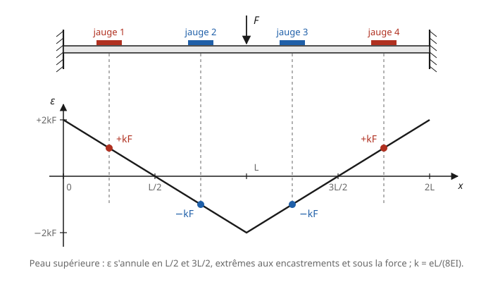
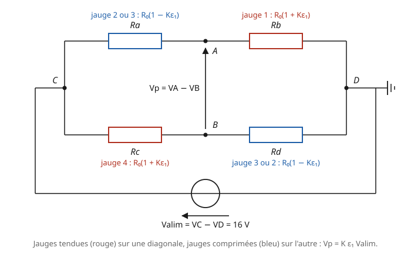
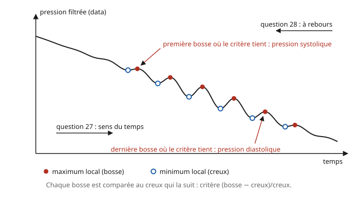

# Banque PT PT — Informatique et modélisation 2016 · Corrigé brut

*Corrigé rédigé par IA, non officiel. Signalez toute erreur.*

**Rédaction** · modèle exact non renseigné (famille Claude) · effort non renseigné · vitesse non renseignée

Épreuve de quatre heures, sans calculatrice : étude d'un tensiomètre électronique, 37 questions numérotées de 1 à 37 (la partie I de l'énoncé est une présentation sans question). Les applications numériques sont données avec un chiffre significatif, comme le demande l'énoncé. Documents officiels : [sujet](https://www.banquept.fr/documents/2016/info_mod_2016_pt.pdf) et [rapport du jury](https://www.banquept.fr/documents/ecrit/rapport/2016/rapport_info_model_ecrit_2016.pdf).

## Partie II — Étude du capteur de pression

**II.1 Modélisation de la déformation de la membrane (questions 1 à 5).**

Le problème est plan. Les torseurs sont écrits dans la base $(\vec x, \vec y, \vec z)$ ; le torseur de cohésion en $G$, de composantes $T_X$, $T_Y$, $M_Z$, est l'action de la partie droite sur la partie gauche.

### Question 1 — Équivalence des deux modèles et hyperstatisme

**Équivalence.** Dans le modèle complet, la géométrie, les liaisons (deux encastrements en $A$ et $C$) et le chargement (force portée par $\vec y$ au milieu $B$) sont symétriques par rapport au plan $(B, \vec y, \vec z)$. La déformée l'est donc aussi : $u_y(2L - x) = u_y(x)$. On en tire, pour la section médiane :

- la pente est nulle, $\theta(L) = 0$ : la rotation autour de $(B, \vec z)$ est bloquée ;
- le point $B$ ne se déplace pas suivant $\vec x$ ;
- le déplacement suivant $\vec y$ reste libre (c'est la flèche).

Ce sont exactement les mobilités de la liaison placée en $B$ sur la figure 3(b) : une glissière de direction $\vec y$. Il suffit donc d'étudier la moitié $[AB]$ de la poutre munie de cette liaison ; l'autre moitié s'en déduit par symétrie.

**Degré d'hyperstatisme.** Le modèle étant plan, l'isolement de la poutre fournit 3 équations de statique et la poutre n'a aucune mobilité.

- Modèle (a) : deux encastrements, soit $3 + 3 = 6$ inconnues de liaison, d'où $h_a = 6 - 3 = 3$.
- Modèle (b) : un encastrement (3 inconnues $X_A$, $Y_A$, $M_A$) et une glissière (2 inconnues $X_B$, $M_B$), d'où $h_b = 5 - 3 = 2$.

$$\boxed{h_a = 3 \qquad h_b = 2}$$

**Intérêt.** Le modèle simplifié a une inconnue hyperstatique de moins et un seul tronçon à étudier : le moment fléchissant y a une seule expression sur $[0, L]$, sans raccordement au point d'application de la force. La symétrie remplace les équations supplémentaires par la condition $\theta(L) = 0$.

**Remarque sur la charge.** Par symétrie, chaque moitié de la membrane ne reprend que $F/2$. La figure 3(b) conserve pourtant la force $\vec F = -F\,\vec y$ en $B$ et la question 2 demande l'effort tranchant en fonction de $F$ : on suit le modèle de l'énoncé, chargé par $F$. Avec la charge $F/2$, tous les déplacements, déformations et tensions qui suivent seraient divisés par deux.

### Question 2 — Moment fléchissant et effort tranchant

**Premier isolement : tronçon $[0, x]$.** Il est soumis à deux actions mécaniques :

- la liaison en $A$, de résultante $X_A\,\vec x + Y_A\,\vec y$ et de moment $M_A\,\vec z$ en $A$ ;
- la partie droite, par le torseur de cohésion : résultante $T_X\,\vec x + T_Y\,\vec y$ et moment $M_Z\,\vec z$ en $G$.

Le principe fondamental de la statique s'écrit comme la nullité de la somme de ces actions. En projection sur $\vec y$ :

$$Y_A + T_Y = 0 .$$

Pour l'équation de moment en $G$ suivant $\vec z$, on transporte l'action de $A$ : $\overrightarrow{GA} \wedge (X_A\,\vec x + Y_A\,\vec y) = -x\,\vec x \wedge Y_A\,\vec y = -x\,Y_A\,\vec z$. D'où

$$M_A - x\,Y_A + M_Z = 0 .$$

En éliminant $Y_A = -T_Y$ :

$$\boxed{M_Z = -M_A - x\,T_Y}$$

**Second isolement : tronçon $[x, L]$.** Il est soumis à l'action de la partie gauche (opposée du torseur de cohésion), à la force $-F\,\vec y$ en $B$ et à la liaison en $B$, qui ne transmet aucun effort suivant $\vec y$ (seulement $X_B$ et $M_B$). La résultante en projection sur $\vec y$ donne

$$-T_Y - F = 0 ,$$

$$\boxed{T_Y = -F}$$

On retrouve $Y_A = F$ : l'encastrement en $A$ reprend toute la charge du modèle simplifié.

**Conclusion.**

$$\boxed{M_Z(x) = F\,x - M_A}$$

Le moment d'encastrement $M_A$ reste inconnu à ce stade : c'est l'inconnue hyperstatique utile, la statique seule ne la donne pas. Vérification : $\dfrac{\mathrm{d}M_Z}{\mathrm{d}x} = F = -T_Y$, relation attendue entre moment fléchissant et effort tranchant avec cette convention.

### Question 3 — Déformée de la membrane

La relation de comportement donne

$$EI\,\frac{\mathrm{d}^2 u_y}{\mathrm{d}x^2} = F\,x - M_A .$$

Première intégration :

$$EI\,\frac{\mathrm{d} u_y}{\mathrm{d}x} = \frac{F\,x^2}{2} - M_A\,x + C_1 .$$

L'encastrement en $A$ bloque la rotation : $\theta(0) = 0$, donc $C_1 = 0$. Seconde intégration :

$$EI\,u_y = \frac{F\,x^3}{6} - \frac{M_A\,x^2}{2} + C_2 .$$

L'encastrement en $A$ bloque aussi le déplacement : $u_y(0) = 0$, donc $C_2 = 0$. Les deux constantes sont nulles à cause des conditions aux limites en $A$, et pour cette seule raison.

Il reste à déterminer $M_A$ par la condition en $B$, où la liaison bloque la rotation : $\theta(L) = 0$, soit

$$\frac{F\,L^2}{2} - M_A\,L = 0 ,$$

$$M_A = \frac{F\,L}{2} .$$

On obtient bien $u_y(x) = A_1\,x^3 + A_2\,x^2$ avec

$$\boxed{A_1 = \frac{F}{6\,EI} \qquad A_2 = -\frac{F\,L}{4\,EI}}$$

soit $u_y(x) = \dfrac{F\,x^2\,(2x - 3L)}{12\,EI}$. Vérifications : $u_y \le 0$ sur $[0, L]$ (la membrane descend sous la force), la flèche en $B$ vaut $u_y(L) = -\dfrac{F\,L^3}{12\,EI}$, et $F L^3/(EI)$ est bien une longueur.

### Question 4 — Déformation de la peau supérieure

En $y = e/2$ :

$$\varepsilon(x) = -\frac{e}{2}\,\frac{\mathrm{d}^2 u_y}{\mathrm{d}x^2} = -\frac{e}{2}\,(6A_1\,x + 2A_2) = -\frac{e}{2\,EI}\left(F\,x - \frac{F\,L}{2}\right).$$

Donc $\varepsilon = A_3 + A_4\,x$ avec

$$\boxed{A_3 = \frac{e\,F\,L}{4\,EI} \qquad A_4 = -\frac{e\,F}{2\,EI}}$$

soit $\varepsilon(x) = \dfrac{e\,F}{2\,EI}\left(\dfrac{L}{2} - x\right)$. La peau supérieure est tendue près de l'encastrement ($\varepsilon > 0$ pour $x < L/2$) et comprimée près de la force ($\varepsilon < 0$ pour $x > L/2$) ; la déformation est sans dimension, comme il se doit ($e F L/(EI)$ : $\mathrm{m \cdot N \cdot m / (Pa \cdot m^4)}$).

### Question 5 — Position des jauges

**Position idéale.** La jauge doit être placée là où $|\varepsilon|$ est le plus grand. Comme $\varepsilon$ est affine en $x$, ses extrêmes sont aux bornes : $\varepsilon(0) = +\dfrac{eFL}{4EI}$ à l'encastrement et $\varepsilon(L) = -\dfrac{eFL}{4EI}$ sous la force, et par symétrie en $x = 2L$. Les positions idéales sont donc les encastrements et le milieu de la membrane. À l'inverse, $x = L/2$ est la pire position : la déformation y est nulle. En pratique une jauge a une longueur non nulle et ne peut être collée ni dans l'encastrement ni sous la tige du piston, d'où les positions retenues.

**Positions réelles.** Sur la moitié gauche :

$$\varepsilon\!\left(\frac{L}{4}\right) = \frac{e\,F}{2\,EI}\cdot\frac{L}{4} = \frac{e\,F\,L}{8\,EI} \qquad\qquad \varepsilon\!\left(\frac{3L}{4}\right) = -\frac{e\,F\,L}{8\,EI} .$$

Ce sont les jauges 1 et 2. Par symétrie par rapport au milieu, la jauge 3 (en $2L - 3L/4$) subit la même déformation que la jauge 2 et la jauge 4 (en $2L - L/4$) la même que la jauge 1 :

$$\boxed{\varepsilon_1 = -\varepsilon_2 = -\varepsilon_3 = \varepsilon_4 = k\,F \quad\text{avec}\quad k = \frac{e\,L}{8\,EI}}$$

Chaque jauge mesure la moitié de la déformation maximale. Deux jauges sont tendues et deux comprimées, avec la même valeur absolue : c'est ce qui rendra le pont de la partie II.3 quatre fois plus sensible qu'avec une seule jauge.



**II.2 Choix des jauges de déformation (questions 6 à 11).**

### Question 6 — Variation relative de résistance

On prend le logarithme de $R = \rho\,\ell / s$ :

$$\ln R = \ln \rho + \ln \ell - \ln s .$$

En différentiant, pour de petites variations :

$$\boxed{\frac{\delta R}{R} = \frac{\delta \rho}{\rho} + \frac{\delta \ell}{\ell} - \frac{\delta s}{s}}$$

### Question 7 — Rôle du coefficient de Poisson

La section vaut $s = a\,b$, donc

$$\frac{\delta s}{s} = \frac{\delta a}{a} + \frac{\delta b}{b} = -2\nu\,\frac{\delta \ell}{\ell} .$$

En reportant :

$$\boxed{\frac{\delta R}{R} = (1 + 2\nu)\,\frac{\delta \ell}{\ell} + \frac{\delta \rho}{\rho}}$$

Le terme $(1 + 2\nu)\,\delta\ell/\ell$ est purement géométrique : la jauge s'allonge et sa section diminue.

### Question 8 — Facteur de jauge d'un métal

Le volume vaut $V = \ell\,s$, donc

$$\frac{\delta V}{V} = \frac{\delta \ell}{\ell} + \frac{\delta s}{s} = (1 - 2\nu)\,\frac{\delta \ell}{\ell} .$$

La loi de Bridgman donne alors $\dfrac{\delta\rho}{\rho} = c\,(1 - 2\nu)\,\dfrac{\delta\ell}{\ell}$, et

$$\frac{\delta R}{R} = \bigl[\,1 + 2\nu + c\,(1 - 2\nu)\,\bigr]\,\frac{\delta \ell}{\ell} .$$

C'est la forme demandée, avec

$$\boxed{K = 1 + 2\nu + c\,(1 - 2\nu)}$$

### Question 9 — Facteur de jauge d'un semi-conducteur

Ici $\dfrac{\delta\rho}{\rho} = \Pi\,\sigma$ et $\sigma = E\,\dfrac{\delta\ell}{\ell}$, donc $\dfrac{\delta\rho}{\rho} = \Pi\,E\,\dfrac{\delta\ell}{\ell}$. En reportant dans le résultat de la question 7 :

$$\boxed{K = 1 + 2\nu + \Pi\,E}$$

Le produit $\Pi E$ est sans dimension ($\mathrm{Pa^{-1} \cdot Pa}$).

### Question 10 — Valeurs numériques et commentaire

Pour le cuivre :

$$K_{\mathrm{Cu}} = 1 + 2 \times 0{,}3 + 1 \times (1 - 2 \times 0{,}3) = 1 + 0{,}6 + 0{,}4 = \mathbf{2} .$$

Pour le silicium, $\Pi E = 10^{-9} \times 10^{11} = 100$ :

$$K_{\mathrm{Si}} = 1 + 2 \times 0{,}4 + 100 = 101{,}8 \approx \mathbf{1 \times 10^{2}} .$$

**Commentaire.** Le facteur de jauge du silicium est environ cinquante fois plus grand que celui du cuivre : à déformation égale, la variation de résistance, donc le signal, est cinquante fois plus forte. Dans le métal, l'effet est surtout géométrique (allongement et striction, $1 + 2\nu = 1{,}6$ sur 2). Dans le semi-conducteur, il est dominé par la piézorésistivité ($\Pi E = 100$ contre $1{,}8$ pour la géométrie). C'est ce qui justifie des jauges en silicium pour mesurer les très petites déformations de la membrane.

### Question 11 — Source d'erreur

**La température.** La résistivité dépend de la température, très fortement pour un semi-conducteur, et la jauge comme son support se dilatent : une variation de température change $R$ sans qu'aucun effort ne soit appliqué, ce que la mesure interprète comme une contrainte. L'échauffement de la jauge par effet Joule, dû au courant de mesure, agit dans le même sens.

Le montage en pont de la partie suivante limite ce défaut : une variation de température commune aux quatre jauges modifie les quatre résistances de la même quantité et laisse $V_p$ inchangée au premier ordre.

**II.3 Circuit de conditionnement : pont de Wheatstone (questions 12 à 17).**

Lecture de la figure 6 : la branche supérieure relie $C$ à $D$ par $R_a$ puis $R_b$, avec le point $A$ entre les deux ; la branche inférieure relie $C$ à $D$ par $R_c$ puis $R_d$, avec le point $B$ entre les deux. La flèche de $V_p$ va de $B$ vers $A$, donc $V_p = V_A - V_B$ ; la source impose $V_C - V_D = V_{alim}$ et $D$ est à la masse.

### Question 12 — Tension de déséquilibre du pont

L'amplificateur branché entre $A$ et $B$ a une résistance d'entrée très grande : il ne prélève aucun courant. $R_a$ et $R_b$ sont donc en série, de même que $R_c$ et $R_d$, et les deux branches sont soumises à $V_{alim}$. Deux diviseurs de tension, avec $V_D = 0$ :

$$V_A = \frac{R_b}{R_a + R_b}\,V_{alim} \qquad\qquad V_B = \frac{R_d}{R_c + R_d}\,V_{alim} .$$

D'où

$$\boxed{V_p = V_A - V_B = \left(\frac{R_b}{R_a + R_b} - \frac{R_d}{R_c + R_d}\right) V_{alim} = \frac{R_b\,R_c - R_a\,R_d}{(R_a + R_b)(R_c + R_d)}\,V_{alim}}$$

Le pont est équilibré ($V_p = 0$) quand $R_b\,R_c = R_a\,R_d$.

### Question 13 — Linéarisation autour de l'équilibre

On pose $R_i = R_0 + \Delta R_i$ avec $|\Delta R_i| \ll R_0$. Au premier ordre :

$$\frac{R_b}{R_a + R_b} = \frac{R_0 + \Delta R_b}{2R_0 + \Delta R_a + \Delta R_b} \approx \frac{1}{2}\left(1 + \frac{\Delta R_b}{R_0}\right)\left(1 - \frac{\Delta R_a + \Delta R_b}{2R_0}\right) \approx \frac{1}{2} + \frac{\Delta R_b - \Delta R_a}{4R_0} .$$

De même $\dfrac{R_d}{R_c + R_d} \approx \dfrac{1}{2} + \dfrac{\Delta R_d - \Delta R_c}{4R_0}$. Par différence :

$$\boxed{\Delta V_p = \frac{V_{alim}}{4\,R_0}\,\bigl(\Delta R_b + \Delta R_c - \Delta R_a - \Delta R_d\bigr)}$$

Les résistances de deux bras opposés ($R_b$ et $R_c$) agissent dans le même sens, celles de deux bras adjacents en sens contraires.

### Question 14 — Place des jauges dans le pont

D'après la question 8 ou 9, $\dfrac{\Delta R}{R_0} = K\,\varepsilon$ : les jauges 1 et 4 ($\varepsilon = +kF$) voient leur résistance augmenter de $K\varepsilon_1 R_0$, les jauges 2 et 3 ($\varepsilon = -kF$) la voient diminuer d'autant.

Pour que les quatre contributions s'ajoutent dans $\Delta V_p$, il faut que $\Delta R_b$ et $\Delta R_c$ aient le même signe, opposé à celui de $\Delta R_a$ et $\Delta R_d$. La jauge 1 étant $R_b$ :

$$\boxed{R_c = \text{jauge 4} \qquad R_a \text{ et } R_d = \text{jauges 2 et 3 (dans un ordre indifférent)}}$$

Les deux jauges tendues occupent deux bras opposés du pont, les deux jauges comprimées les deux autres.



### Question 15 — Tension en fonction de la déformation

Avec ce câblage, $\Delta R_b = \Delta R_c = K\,\varepsilon_1\,R_0$ et $\Delta R_a = \Delta R_d = -K\,\varepsilon_1\,R_0$, donc

$$V_p = \frac{V_{alim}}{4\,R_0} \times 4\,K\,\varepsilon_1\,R_0 ,$$

$$\boxed{V_p = K\,\varepsilon_1\,V_{alim}}$$

Le pont complet est quatre fois plus sensible qu'un pont à une seule jauge active.

### Question 16 — Sensibilité du capteur

On a $\varepsilon_1 = k\,F$ avec $k = \dfrac{e\,L}{8\,EI}$ (question 5) et $F = P\,S_m$. Donc

$$\boxed{V_p = \frac{K\,V_{alim}\,e\,L\,S_m}{8\,EI}\;P}$$

La sensibilité du capteur est le rapport de la grandeur de sortie à la grandeur d'entrée, ici constant puisque la loi est linéaire :

$$\boxed{s = \frac{V_p}{P} = \frac{K\,V_{alim}\,e\,L\,S_m}{8\,EI}}$$

Application numérique, en unités SI, avec $K \approx 100$, $e = 10^{-4}\ \mathrm{m}$, $L = 2 \times 10^{-3}\ \mathrm{m}$, $S_m = 4 \times 10^{-6}\ \mathrm{m^2}$ et $I = 2 \times 10^{-4}\ \mathrm{mm^4} = 2 \times 10^{-16}\ \mathrm{m^4}$ :

$$s = \frac{100 \times 16 \times 10^{-4} \times 2 \times 10^{-3} \times 4 \times 10^{-6}}{8 \times 10^{11} \times 2 \times 10^{-16}} = \frac{1{,}28 \times 10^{-9}}{1{,}6 \times 10^{-4}} = 8 \times 10^{-6}\ \mathrm{V \cdot Pa^{-1}} .$$

Soit $8\ \mathrm{\mu V}$ par pascal, ou environ $1\ \mathrm{mV}$ par millimètre de mercure ($1\ \mathrm{mmHg} \approx 133\ \mathrm{Pa}$). Un écart d'un millimètre de mercure donne donc une tension de l'ordre du millivolt, facile à mesurer après amplification : l'objectif de précision annoncé est accessible.

### Question 17 — Tension pour 50 kPa

$$V_p = s\,P = 8 \times 10^{-6} \times 5 \times 10^{4} ,$$

$$\boxed{V_p = 0{,}4\ \mathrm{V}}$$

Contrôle : la déformation des jauges vaut alors $\varepsilon_1 = V_p / (K\,V_{alim}) = 2{,}5 \times 10^{-4}$, valeur très inférieure à 1, compatible avec l'hypothèse des petites déformations ; et $V_p \ll V_{alim} = 16\ \mathrm{V}$, ce qui valide la linéarisation de la question 13. Avec la charge $F/2$ évoquée à la question 1, on trouverait $0{,}2\ \mathrm{V}$.

## Partie III — Traitement numérique des informations

Les programmes sont écrits en Python. Tout le code de cette partie et de la suivante a été exécuté et testé.

**III.1 Numérisation du signal (questions 18 et 19).**

### Question 18 — Résolution du convertisseur

Étendue de mesure en millimètres de mercure :

$$1350\ \mathrm{hPa} \times \frac{750\ \mathrm{mmHg}}{1013\ \mathrm{hPa}} \approx 1000\ \mathrm{mmHg} .$$

Un convertisseur de $n$ bits découpe cette étendue (la plage $[0, 5\ \mathrm{V}]$) en $2^n$ niveaux ; son pas vaut $1000 / 2^n\ \mathrm{mmHg}$. Pour un pas d'au plus $0{,}02\ \mathrm{mmHg}$, il faut

$$2^n \ge \frac{1000}{0{,}02} = 50\,000 .$$

Or $2^{10} = 1024$, $2^{12} = 4096$ et $2^{16} = 65\,536$. Les pas correspondants sont environ $1\ \mathrm{mmHg}$, $0{,}24\ \mathrm{mmHg}$ et $0{,}015\ \mathrm{mmHg}$.

**Seul le convertisseur de 16 bits respecte le critère** ; celui de 12 bits suffirait pour l'affichage au millimètre de mercure, pas pour le traitement.

### Question 19 — Type de stockage et mémoire

Un convertisseur analogique-numérique de 16 bits délivre un **entier** compris entre $0$ et $2^{16} - 1 = 65\,535$. Le type adapté est donc l'**entier non signé codé sur 16 bits**, qui couvre exactement cet intervalle. Un entier relatif sur 16 bits s'arrête à $32\,767$ et ne convient pas ; les types de 32 ou 64 bits, entiers ou réels, conviendraient mais doubleraient ou quadrupleraient la mémoire sans rien apporter.

Nombre de valeurs : $60\ \mathrm{s} \times 1000\ \mathrm{Hz} = 60\,000$ échantillons, de 2 octets chacun :

$$\boxed{60\,000 \times 2 = 120\,000\ \text{octets} \approx 120\ \text{ko}}$$

**III.2 Filtrage numérique du signal (questions 20 à 26).**

### Question 20 — Choix des paramètres du filtre

L'équation est celle d'un filtre passe-bas du second ordre, de gain statique 1, de pulsation propre $\omega$ et de coefficient d'amortissement $z$.

- **Pulsation.** La fréquence cardiaque maximale est $190 / 60 \approx 3{,}2\ \mathrm{Hz}$, soit une pulsation $2\pi \times 3{,}2 \approx 20\ \mathrm{rad \cdot s^{-1}}$. En prenant $\omega = 20\ \mathrm{rad \cdot s^{-1}}$, on place la coupure juste au-dessus de la bande utile : les oscillations dues aux battements du cœur sont conservées et le bruit de mesure, de fréquence plus élevée, est atténué de 40 dB par décade.
- **Amortissement.** Avec $z = 0{,}7 \approx 1/\sqrt{2}$, la réponse en fréquence n'a pas de résonance (pas d'amplification artificielle autour de $\omega$, bande passante la plus plate possible) et la réponse temporelle est la plus rapide, avec un dépassement d'environ 5 % seulement.

### Question 21 — Relation de récurrence

L'équation différentielle au pas $(i+1)\,T_e$ s'écrit

$$\frac{1}{\omega^2}\,\ddot U_{f,i+1} + \frac{2z}{\omega}\,\dot U_{f,i+1} + U_{f,i+1} = U_{e,i+1} .$$

On y remplace $\dot U_{f,i+1}$ et $U_{f,i+1}$ par les deux relations de Newmark, puis on regroupe les termes en $\ddot U_{f,i+1}$ dans le membre de gauche :

$$\left(\frac{1}{\omega^2} + \frac{2z\gamma}{\omega}\,T_e + \beta\,T_e^2\right)\ddot U_{f,i+1} = U_{e,i+1} - \left[\frac{2z}{\omega}(1-\gamma)\,T_e + T_e^2\left(\tfrac12 - \beta\right)\right]\ddot U_{f,i} - \left(\frac{2z}{\omega} + T_e\right)\dot U_{f,i} - U_{f,i} .$$

Le facteur de gauche est $1/B_1$. On obtient bien $\ddot U_{f,i+1} = B_1\,\bigl(U_{e,i+1} + B_2\,\ddot U_{f,i} + B_3\,\dot U_{f,i} + B_4\,U_{f,i}\bigr)$ avec

$$\boxed{B_2 = -\frac{2z}{\omega}(1-\gamma)\,T_e - T_e^2\left(\frac12 - \beta\right) \qquad B_3 = -\frac{2z}{\omega} - T_e \qquad B_4 = -1}$$

Les constantes dépendent aussi du pas $T_e$. Homogénéité : $B_2$ en $\mathrm{s^2}$ comme $1/\omega^2$, $B_3$ en $\mathrm{s}$, $B_4$ sans dimension, et $B_1$ en $\mathrm{s^{-2}}$ : le produit est bien une dérivée seconde.

### Question 22 — Stabilité du schéma

Lecture de la figure 7 (réponse à un échelon unité) :

- pour $T_e = 0{,}2\ \mathrm{s}$, la sortie oscille avec une amplitude croissante (environ $2{,}1$ à $t = 1{,}2\ \mathrm{s}$, puis une valeur négative) : le schéma diverge ;
- pour $T_e = 0{,}175\ \mathrm{s}$, les oscillations gardent une amplitude à peu près constante (entre $0{,}55$ et $1{,}45$ environ) : c'est la limite de stabilité ;
- pour $T_e = 0{,}13\ \mathrm{s}$, les oscillations s'amortissent et la sortie tend vers 1 ;
- pour $T_e \le 0{,}05\ \mathrm{s}$, la sortie tend vers 1 sans oscillation parasite.

**Le schéma est conditionnellement stable : il est stable tant que le pas de temps reste inférieur à une valeur critique voisine de $0{,}175\ \mathrm{s}$** (soit $\omega\,T_e$ de l'ordre de $3{,}5$), et instable au-delà.

### Question 23 — Ordre de convergence

Le tableau donne $\eta = 0{,}05$, $0{,}005$ et $0{,}0005$ pour $T_e = 0{,}01$, $0{,}001$ et $0{,}0001$ : chaque fois que le pas est divisé par 10, l'erreur est divisée par 10. L'erreur est proportionnelle au pas,

$$\eta \approx 5\,T_e ,$$

**le schéma converge donc à l'ordre 1 dans cette configuration** (une méthode d'ordre $p$ donnerait une erreur divisée par $10^p$).

Contrôle par simulation de la réponse indicielle du filtre avec la fonction de la question 25 : on retrouve des erreurs de $0{,}047$, $0{,}0046$ et $0{,}00046$ pour ces trois pas.

### Question 24 — Qualité du signal filtré

Le pas d'intégration est imposé par l'acquisition : $T_e = 1/f_e = 10^{-3}\ \mathrm{s}$.

- **Stabilité.** Ce pas est environ 175 fois plus petit que le pas critique de la question 22 : le calcul est stable, avec une marge très large.
- **Précision.** D'après le tableau, l'erreur vaut $\eta = 0{,}005$ pour un échelon unité, soit $0{,}5\ \%$ de l'amplitude du signal ; sur la figure 7, la courbe $T_e = 0{,}001\ \mathrm{s}$ est lisse et se confond avec celle de $T_e = 0{,}01\ \mathrm{s}$.

**Le signal filtré est donc calculé de façon stable et précise** : l'intégration numérique ne dégrade pas la mesure, et il est inutile de chercher un schéma plus fin.

### Question 25 — Fonction newmark

On calcule, à chaque pas, la dérivée seconde par la relation de la question 21, puis la dérivée première et le signal par les deux relations de Newmark. Les trois grandeurs sont nulles au premier indice (conditions initiales nulles). Les constantes $B_1$ à $B_4$ sont des variables globales.

```python
def newmark(gamma, beta, omega, z, e, Te):
    """Renvoie la liste Uf du signal e filtré (conditions initiales nulles)."""
    N = len(e)
    Uf = [0.0] * N        # signal filtré
    Vf = [0.0] * N        # dérivée première
    Af = [0.0] * N        # dérivée seconde
    for i in range(N - 1):
        # accélération au pas i+1 (relation de la question 21)
        Af[i + 1] = B1 * (e[i + 1] + B2 * Af[i] + B3 * Vf[i] + B4 * Uf[i])
        # vitesse puis position au pas i+1 (schéma de Newmark)
        Vf[i + 1] = Vf[i] + (1 - gamma) * Te * Af[i] + gamma * Te * Af[i + 1]
        Uf[i + 1] = (Uf[i] + Te * Vf[i] + Te**2 * (0.5 - beta) * Af[i]
                     + Te**2 * beta * Af[i + 1])
    return Uf
```

La fonction effectue $N - 1$ passages dans la boucle : sa complexité est linéaire en la taille du signal. Test : pour un échelon unité, $\omega = 20\ \mathrm{rad \cdot s^{-1}}$, $z = 0{,}7$ et $T_e = 10^{-3}\ \mathrm{s}$, la sortie tend vers 1 et s'écarte de la solution exacte d'au plus $0{,}0046$.

### Question 26 — Version économe en mémoire

La fonction précédente crée trois listes de taille $N$ alors que seule `Uf` est demandée : les dérivées première et seconde ne servent qu'au pas suivant. On les remplace par deux scalaires, mis à jour à chaque pas ; la mémoire auxiliaire passe de $2N$ flottants à trois.

```python
def newmark2(gamma, beta, omega, z, e, Te):
    """Même calcul avec trois scalaires au lieu de deux listes auxiliaires."""
    N = len(e)
    Uf = [0.0] * N
    u, v, a = 0.0, 0.0, 0.0           # valeurs au pas courant i
    for i in range(N - 1):
        a_suiv = B1 * (e[i + 1] + B2 * a + B3 * v + B4 * u)
        # u d'abord : il utilise encore l'ancienne vitesse v
        u = u + Te * v + Te**2 * (0.5 - beta) * a + Te**2 * beta * a_suiv
        v = v + (1 - gamma) * Te * a + gamma * Te * a_suiv
        a = a_suiv
        Uf[i + 1] = u
    return Uf
```

L'ordre des mises à jour compte : le signal `u` est calculé avant `v`, car il utilise la vitesse du pas $i$. Test : cette fonction renvoie la même liste que celle de la question 25 pour tous les pas de temps essayés.

**III.3 Détermination des pressions systolique et diastolique (questions 27 et 28).**

Convention retenue pour le critère : chaque maximum local (bosse) est comparé au minimum local (creux) qui le suit immédiatement dans le temps.

### Question 27 — Pression systolique

Le brassard se dégonfle : la pression décroît, d'abord sans oscillation, puis avec des bosses et des creux. On saute la descente initiale jusqu'au premier creux, puis on répète : monter jusqu'à la bosse, descendre jusqu'au creux suivant, évaluer le critère. On s'arrête à la première bosse qui le vérifie.

```python
def pression_systolique(data):
    n = len(data)
    i = 0
    # descente initiale : on rejoint le premier creux
    while i < n - 1 and data[i + 1] <= data[i]:
        i = i + 1
    critere = False
    while not critere:
        # montée jusqu'au maximum local
        while i < n - 1 and data[i + 1] >= data[i]:
            i = i + 1
        maxi = data[i]
        # descente jusqu'au minimum local suivant
        while i < n - 1 and data[i + 1] <= data[i]:
            i = i + 1
        mini = data[i]
        critere = (maxi - mini) / mini > 4e-5
    return maxi
```

Les tests `i < n - 1` empêchent de sortir du tableau. Les inégalités larges font franchir les éventuels paliers. Complexité linéaire : l'indice `i` ne recule jamais.



Test : sur un signal synthétique (rampe décroissante de $175$ à $65\ \mathrm{mmHg}$ à laquelle s'ajoutent des oscillations d'amplitude variable), la fonction renvoie la même valeur qu'une recherche exhaustive de tous les couples bosse-creux, pour 41 signaux différents.

### Question 28 — Pression diastolique

On cherche cette fois la **dernière** bosse qui vérifie le critère (seuil $4 \times 10^{-3}$) et qui dépasse $40\ \mathrm{mmHg}$. Le plus simple est de parcourir le tableau à rebours, depuis la fin, et de s'arrêter à la première bosse rencontrée qui convient. En remontant le temps, on écarte d'abord la dernière bosse, dont le creux suivant n'est pas dans le tableau, puis on répète : mémoriser le creux, remonter jusqu'à la bosse qui le précède, tester, remonter jusqu'au creux précédent.

```python
def pression_diastolique(data):
    i = len(data) - 1
    # on remonte le temps : dernière bosse (son creux suivant est inconnu) ...
    while i > 0 and data[i - 1] >= data[i]:
        i = i - 1
    # ... puis creux qui la précède
    while i > 0 and data[i - 1] <= data[i]:
        i = i - 1
    critere = False
    while not critere:
        mini = data[i]                  # creux qui suit la bosse cherchée
        while i > 0 and data[i - 1] >= data[i]:
            i = i - 1
        maxi = data[i]                  # bosse
        critere = (maxi - mini) / mini > 4e-3 and maxi > 40
        while i > 0 and data[i - 1] <= data[i]:
            i = i - 1                   # creux précédent
    return maxi
```

La valeur `maxi` retenue est celle qui a rendu le critère vrai : la dernière boucle interne ne la modifie pas. Test : même contrôle qu'à la question 27, sur les mêmes 41 signaux, par comparaison avec la recherche exhaustive de la dernière bosse satisfaisant les deux conditions.

## Partie IV — Stockage et analyse des résultats

Les requêtes ont été exécutées sur une base d'essai (SQLite) reproduisant les deux tables.

### Question 29 — Clé primaire

Une clé primaire est un attribut (ou un groupe d'attributs) dont la valeur **identifie de façon unique** chaque enregistrement d'une table : deux lignes distinctes n'ont jamais la même clé, et la clé est toujours renseignée.

- Dans `patients`, `id` désigne un patient sans ambiguïté, même en cas d'homonymes. C'est lui que la table `mesures` recopie dans `pid` pour rattacher chaque mesure à son patient : la clé primaire rend les jointures possibles.
- Dans `mesures`, `id` distingue deux mesures, même prises sur le même patient et de même type.

**Autre clé possible.** Dans `patients`, le numéro de sécurité sociale `numero_secu` est propre à chaque personne et pourrait servir de clé primaire, sous réserve que tout patient en ait un (ce n'est pas garanti pour un nouveau-né ou un patient étranger, d'où l'intérêt d'un identifiant interne). Les autres attributs ne conviennent pas : nom, prénom, date de naissance, adresse ou téléphone peuvent être communs à plusieurs patients. Dans `mesures`, aucun attribut seul ne convient (`pid`, `type` et `datetime` se répètent) ; seule une association comme (`pid`, `type`, `datetime`) pourrait jouer ce rôle.

### Question 30 — Mesures entre deux dates

```sql
SELECT datetime, pdias, psyst, pouls
FROM mesures
WHERE datetime >= time1 AND datetime <= time2;
```

La condition peut aussi s'écrire `datetime BETWEEN time1 AND time2`. Dans le format année-mois-jour heure:minute:seconde, l'ordre des chaînes de caractères coïncide avec l'ordre chronologique, la comparaison est donc correcte.

`time1` et `time2` sont des variables du programme : en Python, la requête envoyée au serveur est la chaîne

```python
requete = ("SELECT datetime, pdias, psyst, pouls FROM mesures WHERE datetime >= '"
           + time1 + "' AND datetime <= '" + time2 + "'")
```

### Question 31 — Mesures de tension d'un patient

On ajoute deux conditions, sur le patient et sur le type de mesure. Les champs sont rangés dans l'ordre du tableau décrit ensuite par l'énoncé (date, systolique, diastolique, pouls).

```sql
SELECT datetime, psyst, pdias, pouls
FROM mesures
WHERE datetime >= time1 AND datetime <= time2
  AND pid = id_patient
  AND type = 'tension';
```

Aucune jointure n'est nécessaire : l'identifiant du patient figure dans `mesures` sous le nom `pid` (l'attribut `id` de cette table est l'identifiant de la mesure).

### Question 32 — Tracé des trois courbes

On extrait les quatre colonnes du tableau, puis on trace les trois courbes sur le même graphique, chacune avec son style, avant d'ajouter les titres et la légende (fonctions de l'annexe, supposées importées).

```python
n = len(resultat_requete)
temps = [resultat_requete[k][0] for k in range(n)]   # colonne datetime
psyst = [resultat_requete[k][1] for k in range(n)]   # pression systolique
pdias = [resultat_requete[k][2] for k in range(n)]   # pression diastolique
pouls = [resultat_requete[k][3] for k in range(n)]   # pouls
plot(temps, psyst, 'r-')     # systolique : trait continu rouge
plot(temps, pdias, 'b--')    # diastolique : tirets bleus
plot(temps, pouls, 'k:')     # pouls : pointillés noirs
xlabel('Date et heure de la mesure')
ylabel('Pression (mmHg) et pouls (pulsations par minute)')
title('Evolution de la tension et du pouls du patient')
legend(['Pression systolique', 'Pression diastolique', 'Pouls'])
```

La légende est donnée dans l'ordre des tracés. Pression et pouls partagent l'axe vertical : leurs valeurs sont du même ordre (quelques dizaines à deux centaines), ce qui garde le graphique lisible. Ces instructions ont été exécutées avec matplotlib sur un tableau d'essai.

### Question 33 — Minimum, maximum et moyenne

Un seul parcours de la liste suffit : on tient à jour le plus petit élément, le plus grand et la somme. La liste est supposée non vide.

```python
def analyse(valeurs):
    mini = valeurs[0]
    maxi = valeurs[0]
    somme = valeurs[0]
    for k in range(1, len(valeurs)):
        v = valeurs[k]
        somme = somme + v
        if v < mini:
            mini = v
        elif v > maxi:
            maxi = v
    return mini, maxi, somme / len(valeurs)
```

Le `elif` évite une comparaison inutile : un élément plus petit que le minimum courant ne peut pas dépasser le maximum. Test : résultats identiques à ceux de `min`, `max` et `sum` sur 2000 listes aléatoires de 1 à 30 éléments.

### Question 34 — Complexité de la fonction analyse

La boucle est exécutée $n - 1$ fois. À chaque passage : 1 addition, puis 1 ou 2 comparaisons entre valeurs. Après la boucle : 1 division.

- **Meilleur cas** (liste strictement décroissante : chaque élément est un nouveau minimum, le second test n'est jamais fait) : $n - 1$ comparaisons, $n - 1$ additions, 1 division, soit $2n - 1$ opérations.
- **Pire cas** (aucun élément n'est plus petit que le minimum courant, par exemple une liste croissante : les deux tests sont toujours faits) : $2(n - 1)$ comparaisons, $n - 1$ additions, 1 division, soit $3n - 2$ opérations.

$$\boxed{\text{Complexité linéaire, en } O(n), \text{ dans le meilleur comme dans le pire des cas}}$$

Il n'y a ni soustraction ni multiplication. On ne peut pas faire mieux qu'un coût linéaire : chaque valeur doit être lue au moins une fois.

### Question 35 — Médiane par tri fusion

La médiane est la valeur centrale de la liste triée (la moyenne des deux valeurs centrales si le nombre d'éléments est pair). On trie donc une copie de la liste, ici par **tri fusion** : on coupe la liste en deux moitiés, on trie chacune récursivement, puis on fusionne les deux moitiés triées en prenant à chaque étape le plus petit des deux éléments de tête.

```python
def fusion(a, b):
    """Fusionne deux listes triées en une liste triée."""
    c = []
    i, j = 0, 0
    while i < len(a) and j < len(b):
        if a[i] <= b[j]:
            c.append(a[i])
            i = i + 1
        else:
            c.append(b[j])
            j = j + 1
    # l'une des deux listes est épuisée : on recopie le reste de l'autre
    return c + a[i:] + b[j:]


def tri_fusion(t):
    if len(t) <= 1:
        return t[:]
    m = len(t) // 2
    return fusion(tri_fusion(t[:m]), tri_fusion(t[m:]))


def mediane(valeurs):
    t = tri_fusion(valeurs)
    n = len(t)
    if n % 2 == 1:
        return t[n // 2]
    return (t[n // 2 - 1] + t[n // 2]) / 2
```

La liste reçue n'est pas modifiée. Test : `mediane` renvoie la même valeur que la fonction `median` du module `statistics` sur 2000 listes aléatoires, de longueur paire ou impaire.

### Question 36 — Complexité et efficacité

Seul le tri effectue des comparaisons entre valeurs ; le choix de la valeur centrale n'en demande aucune. Notons $C(n)$ le nombre de comparaisons du tri fusion, pour $n = 2^p$.

La fusion de deux listes triées de $n/2$ éléments demande entre $n/2$ comparaisons (une liste est épuisée avant que l'autre soit entamée) et $n - 1$ comparaisons (les éléments s'intercalent jusqu'au bout).

- **Meilleur cas** (par exemple une liste déjà triée) : $C(n) = 2\,C(n/2) + n/2$ avec $C(1) = 0$, d'où

$$C(n) = \frac{n}{2}\,\log_2 n .$$

- **Pire cas** : $C(n) = 2\,C(n/2) + n - 1$, d'où

$$C(n) = n\,\log_2 n - n + 1 .$$

$$\boxed{\text{Complexité en } O(n \log n) \text{ dans le meilleur comme dans le pire des cas}}$$

Contrôle par comptage sur machine pour $n = 8$ : 12 comparaisons pour une liste triée et 17 au maximum sur toutes les permutations, conformément aux deux formules.

**Efficacité.** Pour un tri, oui : $O(n \log n)$ est le meilleur ordre de grandeur possible pour un tri par comparaisons, bien meilleur que le $O(n^2)$ du tri par insertion ou par sélection dans le pire cas, et le tri fusion n'a pas de cas défavorable (contrairement au tri rapide). Pour la médiane seule, on fait cependant plus que nécessaire : trier toute la liste n'est pas indispensable, un algorithme de sélection trouve la valeur centrale en temps linéaire en moyenne. Le tri fusion consomme en outre une mémoire auxiliaire proportionnelle à $n$.

### Question 37 — Patients à surveiller

Les noms sont dans `patients`, les constantes dans `mesures` : il faut une jointure, sur l'égalité entre la clé primaire `patients.id` et l'attribut `mesures.pid`. On retient les patients dont au moins une mesure vérifie les trois conditions à la fois.

```sql
SELECT DISTINCT patients.nom, patients.prenom, patients.telephone
FROM patients JOIN mesures ON patients.id = mesures.pid
WHERE mesures.psyst > 160 AND mesures.pdias > 110
  AND mesures.pouls > 100 AND mesures.pouls < 150;
```

Les deux tables ont un attribut `id` : il faut le préfixer par le nom de la table. `DISTINCT` évite qu'un patient apparaisse autant de fois qu'il a de mesures concernées. Test : sur la base d'essai, un patient ayant deux mesures conformes n'apparaît qu'une fois, et les patients dont une constante est exactement à la borne (pouls de 150, diastolique de 110) sont écartés.
