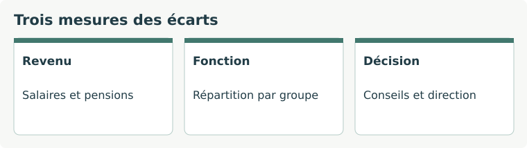

# Banque PT — Langue vivante A 2016 · Corrigé brut

*Corrigé rédigé par IA, non officiel.*

**Rédaction** · GPT-6.2 Astra Ultra · vitesse non renseignée

**Révision** · GPT-6.2 Astra Ultra · vitesse non renseignée

L’épreuve dure trois heures. Chaque candidat compose dans la langue choisie à l’inscription. Ce fascicule présente les cinq synthèses de 450 à 500 mots. Le décompte indiqué inclut le titre.

[Sujet et supports](https://www.banquept.fr/documents/2016/lv_a_2016_pt.pdf) · [Rapport du jury](https://www.banquept.fr/documents/ecrit/rapport/2016/rapport_lv_a_ecrit_2016.pdf) · [Grille du livret](https://www.banquept.fr/documents/livret/2016/Livret_PT_2016.pdf#page=12)

## Allemand

*Kreativität und Innovation: Um jeden Preis!?*

**Wer entscheidet, wann eine Erfindung Fortschritt ist?**

Ein Radiergummi, den es seit dem achtzehnten Jahrhundert gibt, lässt sich offenbar ebenso wirkungsvoll als technische Sensation präsentieren wie ein Fahrzeug, das eines Tages über den Stau hinwegfliegen soll. Gerade dieser Gegensatz wirft die Frage auf, woran sich der Wert einer neuen Idee bemisst. Während Berliner Schulen versuchen, erfinderisches Denken schon bei Kindern zu fördern, bezweifeln andere, dass Menschen jede Entwicklung beherrschen können, die sie selbst in Gang setzen.

Den Ausgangspunkt bildet häufig eine vertraute Erfahrung. Wer wie Paul Moller regelmäßig im Verkehr stecken bleibt, kann sich fragen, weshalb ein Auto eigentlich an die Straße gebunden sein muss. In den Berliner Bildungseinrichtungen sollen Kinder lernen, solche scheinbar selbstverständlichen Voraussetzungen zu hinterfragen. Vorstellungskraft gilt dort als Voraussetzung wissenschaftlicher Entdeckungen ebenso wie künstlerischer Arbeit. Allerdings genügt ein verblüffender Einfall allein kaum. Schüler brauchen Gelegenheit, die Werkzeuge ihres Fachs auszuprobieren und ihre Ideen an einem Problem zu prüfen. Der Radiergummi veranschaulicht, wie alltäglich das Ergebnis eines gelungenen Versuchs werden kann. Erst die scherzhaft umständliche Beschreibung seiner Werkstoffe und Kanten lässt erkennen, was dieses unscheinbare Ding leistet. Zugleich macht sich die Darstellung über eine Sprache lustig, in der jede praktische Kleinigkeit wie ein bahnbrechender Fortschritt klingt.

Auch beim fliegenden Auto gehen Versprechen und Nachweis auseinander. Moller hat nach eigenen Angaben über hundert Millionen Dollar investiert und rund ein halbes Jahrhundert gearbeitet. Die Modelle in seiner Halle und die an Seilen erprobten Prototypen erzählen eine andere Geschichte als die Ankündigung des unmittelbar bevorstehenden Durchbruchs. Dass mehrere europäische Entwickler dieselbe Frage auf technisch unterschiedlichen Wegen verfolgen, zeigt die produktive Kraft dieser Vorstellung. Über den tatsächlichen Nutzen im Berufsverkehr entscheidet die Zahl der Entwürfe freilich noch nicht. Beharrlichkeit eröffnet Möglichkeiten, bindet aber auch erhebliche Mittel.

Bei einer Maschine, die sich selbst verbessern könnte, verschiebt sich der Maßstab nochmals. Der Philosoph Nick Bostrom beschäftigt sich damit, wie sich die Ziele eines überlegenen Rechners mit menschlichen Interessen vereinbaren ließen. Selbst das scheinbar eindeutige Verbot, Menschen zu schaden, setzt voraus, dass sich alle Beteiligten darüber verständigen können, was Schaden bedeutet. Einer Maschine die Weiterentwicklung ihrer Wertmaßstäbe zu überlassen, würde dieses Problem auf eine andere Ebene verlagern. Das verfremdete Bild von Michelangelos Schöpfungsszene bringt die Ungewissheit auf den Punkt. Eine mechanische und eine menschliche Hand nähern sich an. Wer hier wem schöpferische Kraft verleiht, ist beim zweiten Hinsehen weniger eindeutig, als das vertraute Motiv vermuten lässt.

Kreativität lässt sich demnach begründet fördern, ohne den Erfolg jeder Neuerung im Voraus zu behaupten. Gerade die Fähigkeit, eine eingefahrene Denkweise zu verlassen, wird auch gebraucht, um die eigenen Versprechen zu prüfen. Bei einem einfachen Werkzeug lässt sich sein Nutzen im Gebrauch erfahren. Wo enorme Mittel oder künftig eigenständige Entscheidungen auf dem Spiel stehen, gehört das Nachdenken über Grenzen bereits zur schöpferischen Arbeit selbst.

**(456 Wörter, einschließlich Titel)**

## Anglais

*Attitude towards food in the United States: How is America tackling its challenges?*

**What America throws away and who gets enough to eat**

A family smiling behind a year's worth of discarded food makes an arresting photograph. Its impact depends on a habit that is harder to photograph. A little waste at the end of each meal rarely seems to amount to very much. Meanwhile, for millions of American households, putting the next meal on the table remains uncertain. The two experiences coexist in a food system that produces abundance but distributes both its benefits and its environmental costs unevenly.

The Department of Agriculture found that 14.3 percent of households experienced food insecurity in 2013, a modest decline from 2011. Recovery from the recession had not made groceries affordable for everyone. Food prices rising relative to other prices helped explain why better employment figures had not translated into equivalent gains at the table, and some parents protected their children by eating less themselves. Federal assistance, including food stamps, reached many of the households surveyed. Recovering edible surplus could complement that support. It would hardly follow, however, that throwing out less in an affluent home automatically puts more food within a poorer family's reach.

Waste has a rationale at several points along the supply chain. Growers plant extra to meet contracts, shops fear losing customers to an empty shelf, and discounting surplus can undercut sales at the regular price. In the kitchen, uncertainty about storage and freshness encourages people to discard what they bought. The family portrait makes the cumulative scale visible. A regional comparison supplies another measure. The group comprising the United States, Canada, Australia and New Zealand has the highest carbon footprint per person associated with consumer food waste. Agriculture and deforestation account for much of that burden. Food in the bin carries the environmental cost of producing it in the first place.

Different incentives can bring prevention and redistribution within reach. Restaurants that measure their losses can adjust portions. Colleges dispensing with cafeteria trays find that students take less than before, and fruit unsuitable for display can find a buyer among juice makers. For food that is already surplus, intermediaries help businesses arrange donations and obtain tax relief against the expense of handling them. Many retailers fear being sued, although federal law protects good faith donations to nonprofit organizations. Publicizing that protection may matter as much as offering a financial incentive to firms reluctant even to acknowledge their losses.

The challenge, then, is to connect changes that operate on different scales. Learning to use leftovers or interpret freshness labels gives consumers room to act, while changing purchasing practices can prevent losses before food reaches a household. Neither measure settles the question of income that confronts a family unable to afford groceries. Taken together with public assistance and organized donations, however, they open up more than one response to the uncomfortable contrast captured by the photograph.

**(474 words, title included)**

## Arabe

*ماذا تقول الوثائق الخمس التالية عن الصعوبات التي تواجه قطاع السياحة في بعض الدول العربية وما هي التحديات التي تسعى هذه الدول إلى مجابهتها في هذا الميدان؟*

**السياحة العربية بين هشاشة الثقة والبحث عن مسافرين جدد**

يعتمد صاحب فندق في بيروت ومرشد سياحي في جنوب الجزائر على قرار يتخذه المسافر قبل أن يصل إلى أي منهما. فحين يتردد الزائر في حجز رحلته قد تبقى الغرف شاغرة وتتعطل الجولات حتى في أماكن بعيدة عن موضع الخطر. وتكشف أحوال السياحة في عدد من البلدان العربية أن استعادة الثقة مسألة تتجاوز الإعلان عن جمال المواقع. فهي تتصل كذلك بقدرة الأسر على تحمل تكاليف السفر وبالوجهات البديلة التي يمكن أن تختارها.

في الجزائر يخشى العاملون في سياحة الصحراء أن تؤدي أخبار مقتل رهينة فرنسي إلى عزوف الزوار عن الجنوب كله. فالمسافر الأجنبي قد لا يميز بين المنطقة التي وقع فيها الاعتداء والمسالك التي ينتظر فيها المرشدون زبائنهم. وفي لبنان أثرت الحرب في سورية في بلد مجاور اعتاد استقبال المصطافين العرب. ويصف العاملون في المطاعم والفنادق تراجع النشاط مقارنة بمواسم سابقة، مع أن بعض المؤشرات الرسمية توحي ببداية انتعاش. ولا يكفي تحسن الأرقام العامة لإعادة الزبائن إلى كل مطعم أو لتعويض مؤسسة اضطرت إلى إغلاق أبوابها. كما أن الوجهات الأوروبية التي تقدم عروضا منافسة تستفيد بدورها من تردد المسافرين.

وتوضح الأرقام التونسية ضرورة التمييز بين وجوه الانتعاش المختلفة. ففي الأشهر التسعة الأولى من عام ألفين وأربعة عشر زادت المداخيل السياحية بأكثر من اثني عشر في المئة قياسا إلى الفترة نفسها من السنة السابقة. لكن عدد الوافدين لم يزد إلا زيادة طفيفة، وتراجع عدد الليالي المقضاة قليلا. بل ظل عدد الليالي أقل مما كان عليه في الفترة نفسها من سنة ألفين وعشر بنحو سبعة عشر في المئة. فالتعافي الذي يظهر في الإيرادات لا يعني بالضرورة أن الفنادق استعادت نشاطها السابق أو أن الزوار يمكثون مدة أطول.

لهذا تتجه الأنظار إلى زوار أقرب جغرافيا. وتسعى بلدان مجلس التعاون إلى تنمية السفر في ما بينها والتعريف بمواقعها وتراثها، ولا سيما لدى الشباب الذين قد يعرفون وجهات بعيدة أكثر مما يعرفون تاريخ المنطقة. ويتيح التعاون بين الهيئات المعنية عرض فرص متعددة على المسافر. أما في لبنان فتتعلق الآمال أيضا بتيسير الوصول وتشجيع القادمين من البلدان العربية على الرجوع. وتختلف نقطة الانطلاق هنا عن المبادرة الخليجية، إذ تحاول مؤسسات قائمة أن تستعيد جمهورا كان يسهم فعلا في استمرار نشاطها.

بيد أن القرب وحده لا يصنع سوقا. ففي الرسم المغربي يستقبل عامل أمام فندق فاخر زوجين محليين عارضا عليهما تخفيضات، بينما يوحي ترددهما بأن السعر ما زال بعيدا عن إمكاناتهما. وتبرز المفارقة بين مدخل الفندق المهيب ومظهر الأسرة حدود التعويل على السائح الوطني لتعويض الأجنبي بمجرد تغيير لغة الترحيب. فما يعده الفندق عرضا مغريا قد يظل بالنسبة إلى الأسرة إنفاقا لا يمكن إدراجه في ميزانيتها.

وهكذا تتفاوت سبل مواجهة الأزمة بتفاوت أسبابها. فمعالجة مخاوف المسافر الخارجي تخدم بلدان المقصد، لكن توسيع قاعدة الزوار يقتضي أيضا معرفة من يستطيع السفر فعلا وما الذي يطلبه من الرحلة. ويصبح استثمار التراث المحلي وتيسير الدخول وتوفير خيارات تناسب الدخول المختلفة أجدى حين يقاس نجاحها بعدد الزوار ومدة إقامتهم وما يعود على العاملين، إلى جانب الإيرادات التي تسجلها الوزارة.

**(466 كلمة، بما فيها العنوان)**

## Espagnol

*Analice los cambios en el panorama político español actual.*

**De la alternancia entre dos partidos a una competencia abierta**

Durante años los españoles podían castigar al Gobierno entregando el poder al otro gran partido. En vísperas de las elecciones generales de 2015, las encuestas dibujaban una situación distinta. El descrédito afectaba a los dos protagonistas de aquella alternancia y dos formaciones pretendían aprovechar el espacio abierto. Su ascenso anunciaba un cambio en la manera de disputar el poder, aunque quedaba por saber qué proyecto convencería a quienes habían perdido la confianza en sus representantes.

La crisis económica contribuyó a que los escándalos políticos pesaran más. Para muchos jóvenes que apenas encontraban trabajo, las promesas incumplidas resultaban especialmente difíciles de aceptar. Un sondeo entre menores de treinta años atribuía a Podemos una intención de voto superior a la de Ciudadanos, mientras que el PP apenas contaba con el apoyo de cuatro de cada cien encuestados. Se trataba de preferencias declaradas antes de las elecciones. Las cifras no permitían dar por decidida la composición de un futuro Parlamento. Sí revelaban la distancia entre una generación muy castigada por el paro y unas organizaciones acostumbradas a gobernar.

La viñeta de El Jueves representa ese descrédito mediante una paradoja. Un candidato que lleva juntas las siglas de los antiguos rivales reconoce en televisión su propia corrupción y pretende que se le vote por la sinceridad de admitirla. Los espectadores entienden que ya no le quedaba otra salida. La imagen difundida por Podemos retoma el motivo desde la posición del competidor. Entre dos botellas oscuras aparece una transparente, identificada con el partido nuevo. La claridad del líquido invita a creer en la de sus cuentas. La comparación, concebida para circular en una red social, expresa una promesa de campaña cuya veracidad la fotografía por sí sola no demuestra.

El rechazo de los escándalos tampoco hace intercambiables a los aspirantes. Ciudadanos, nacido en Cataluña frente al independentismo, buscaba un electorado nacional. Albert Rivera compartía parte del diagnóstico de Pablo Iglesias, pero atribuía la crisis a quienes habían corrompido las instituciones y defendía reformar la fiscalidad y el mercado laboral. Podemos cuestionaba el propio sistema. Esa ambición suscitaba adhesiones y objeciones. El articulista Carlos Alberto Montaner temía que el intervencionismo de la formación condujera a una experiencia semejante a la venezolana. Su comparación con el chavismo es una advertencia polémica, que contrasta con la confianza que las encuestas registraban entre parte de los jóvenes.

La novedad consistía, pues, en que el descontento encontraba varias salidas y podía romper las mayorías absolutas. Rivera veía en una competición entre cuatro fuerzas una oportunidad para renovar la democracia, mientras otros temían la inestabilidad. Entre el reclamo de transparencia, las distintas propuestas económicas y el deseo de sancionar a los gobernantes había coincidencias parciales. Precisamente porque esas expectativas podían traducirse en votos diferentes, las previsiones exigían cautela.

**(467 palabras, incluido el título)**

## Italien

*In che misura ed in che modo le differenze uomo-donna sono ancora visibili e tangibili nel mondo professionale?*

**Dalla busta paga alla stanza delle decisioni**

Quanto vale un anno di lavoro? Secondo il confronto europeo riportato da la Repubblica, per una donna la differenza media di retribuzione oraria rispetto a un uomo equivale a cinquantanove giornate lavorate gratuitamente. Questa immagine rende comprensibile un dato che altrimenti rimarrebbe astratto. Per capire come si forma il divario occorre però seguire anche le carriere, distinguere gli incarichi e chiedersi chi possa influire sulle decisioni da cui dipendono le promozioni.

Nell’Unione europea il divario medio è del 16,4 per cento. L’Italia presenta uno scarto inferiore a quello europeo, ma il confronto tra paesi non dice da solo se la condizione delle lavoratrici stia migliorando. Durante la crisi alcuni settori a prevalenza maschile hanno subito perdite consistenti. La distanza può dunque diminuire anche perché scendono i salari degli uomini. Il grafico delle retribuzioni annue italiane restituisce un altro aspetto del fenomeno. Tra gli impiegati la cifra relativa alle donne è inferiore a quella degli uomini, e la stessa successione si ritrova tra i quadri e i dirigenti. Il grafico delle pensioni prolunga il confronto oltre la vita lavorativa. Questi importi annui e la media oraria europea descrivono grandezze diverse e complementari.

Anche a parità di categoria, le funzioni esercitate non si distribuiscono allo stesso modo. Nel prospetto sui dirigenti privati italiani, circa un terzo degli uomini svolge funzioni di direzione generale, contro poco più di un quarto delle donne. Amministrazione e finanza pesano invece di più tra le dirigenti che tra i dirigenti. Si tratta della ripartizione interna a ciascun gruppo. Ne risulta che il semplice accesso a una qualifica dice ancora poco sul tipo di responsabilità effettivamente affidata a una persona.

Le quote introducono un cambiamento visibile nei consigli di amministrazione. In Italia la presenza femminile è cresciuta sia nelle società quotate sia in quelle a partecipazione pubblica. Tuttavia l’esperienza norvegese invita alla cautela. Anche dopo anni di applicazione delle quote, la maggiore presenza nei consigli non si è tradotta automaticamente in più amministratrici delegate. Le nuove consigliere possono contribuire a modificare la cultura aziendale, ma occorrono opportunità anche per chi deve ancora arrivare al vertice.

Le parole del responsabile di Microsoft illustrano un ostacolo meno facile da misurare. Invitando le donne a confidare nel riconoscimento spontaneo del loro lavoro anziché chiedere un aumento, egli finiva per scoraggiare proprio una forma di iniziativa che incide sullo stipendio. La successiva rettifica non cancella il problema, tanto più che le donne sono già poco numerose nel settore digitale e che alcuni pregiudizi precedono l’assunzione. Retribuzioni, accesso alle diverse funzioni e potere di negoziare si illuminano così a vicenda. Contare le presenze nei consigli è un passo importante, ma per valutare i progressi bisogna osservare anche dove portano le carriere e quali redditi producono nel tempo.

**(461 parole, titolo compreso)**

