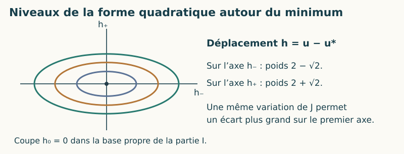
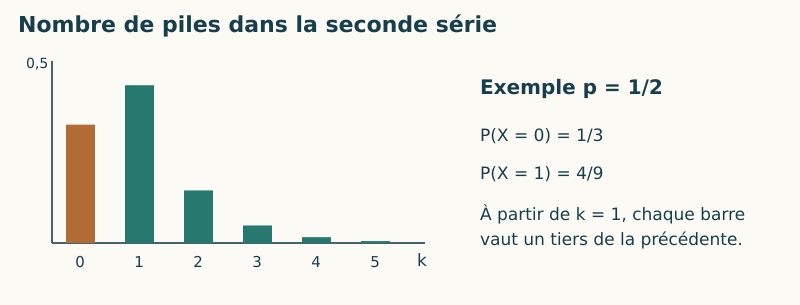

# Banque PT — Mathématiques A 2016 · Corrigé brut

*Corrigé rédigé par IA, non officiel. Signalez toute erreur.*

**Rédaction** · GPT-6.2 Astra Ultra · vitesse non renseignée · 26 novembre 2026

Le calendrier du livret fixe l’épreuve au lundi 9 mai 2016, de 14 h à 18 h. La garde porte le code 125. La calculatrice est interdite. Les questions occupent les pages 2 à 4 du PDF de cinq pages. La dernière page est sans question. Le problème associe la minimisation d’une fonction quadratique à la reconstruction de l’inverse d’une matrice symétrique définie positive. L’exercice indépendant étudie un nombre de piles dans une série de longueur aléatoire. [Sujet de la Banque PT](https://www.banquept.fr/documents/2016/math_a_2016_pt.pdf) · [Rapport du jury](https://www.banquept.fr/documents/ecrit/rapport/2016/rapport_math_a_ecrit_2016.pdf) · [Livret annuel, p. 8–9](https://www.banquept.fr/documents/livret/2016/Livret_PT_2016.pdf)

## I. Réduction de la matrice symétrique

### Question I.1

Nous travaillons dans $\mathbb R^3$ muni du produit scalaire usuel. La matrice tridiagonale $A$ a pour diagonale $(2,2,2)$ et pour deux diagonales voisines $(-1,-1)$. Elle est réelle symétrique. Le théorème spectral fournit une base orthonormée de vecteurs propres.

### Question I.2

Posons $s=t-2$. En développant suivant la première ligne, $\det(tI-A)=s(s^2-1)-s=s(s^2-2)$. Les valeurs propres croissantes sont $\lambda=2-\sqrt2$, $2$ et $\mu=2+\sqrt2$. Une base propre associée dans cet ordre est
$$v_-=\tfrac12(1,\sqrt2,1),\qquad v_0=\tfrac1{\sqrt2}(1,0,-1),\qquad v_+=\tfrac12(1,-\sqrt2,1).$$
En effet, $A(x,y,z)=(2x-y,-x+2y-z,-y+2z)$ donne par substitution $Av_-=\lambda v_-$, $Av_0=2v_0$ et $Av_+=\mu v_+$. Les trois normes sont un et les produits scalaires deux à deux sont nuls. Nous gardons cet ordre pour la suite.

### Question I.3

Aucune des trois valeurs propres n’est nulle puisque $2-\sqrt2>0$. Le noyau de $A$ est réduit à zéro, donc $A$ est inversible. On retrouve $\det A=2(2-\sqrt2)(2+\sqrt2)=4$.

### Question I.4

Les colonnes de la matrice de passage $Q$ sont $v_-,v_0,v_+$. L’égalité $u=Q(x',y',z')^{\mathsf T}$ s’inverse par $Q^{\mathsf T}$. On obtient
$$x'=(x+\sqrt2 y+z)/2,\qquad y'=(x-z)/\sqrt2,\qquad z'=(x-\sqrt2 y+z)/2.$$

### Question I.5

En coordonnées canoniques, $u^{\mathsf T}Au=2x^2+2y^2+2z^2-2xy-2yz$. Dans la base propre, les termes croisés disparaissent et
$$\langle Au,u\rangle=\lambda x'^2+2y'^2+\mu z'^2.$$

### Question I.6

La base propre étant orthonormée, $x'^2+y'^2+z'^2=\|u\|^2$. Les trois carrés étant positifs ou nuls, I.5 donne $\langle Au,u\rangle\ge\lambda\|u\|^2$. L’égalité vaut par exemple pour $u=v_-$.

### Question I.7

L’application $(u,v)\mapsto u^{\mathsf T}A v=\langle Au,v\rangle$ est bilinéaire. La symétrie de $A$ rend cette forme symétrique. Pour $u\ne0$, I.6 donne une valeur diagonale au moins égale à $\lambda\|u\|^2>0$. Ces trois propriétés en font un produit scalaire.

## II. Minimisation de la fonction quadratique

### Question II.1

Le vecteur $b\in\mathbb R^3$ est fixé. À tout $u\in\mathbb R^3$, $J_b$ associe le réel $\tfrac12\langle Au,u\rangle-\langle u,b\rangle$. L’ensemble de départ est $\mathbb R^3$ et celui d’arrivée $\mathbb R$. En zéro, les deux produits scalaires s’annulent, donc $J_b(0)=0$.

### Question II.2

La symétrie donne
$$J_b(u+h)-J_b(u)=\langle Au-b,h\rangle+\tfrac12\langle Ah,h\rangle.$$
Le dernier terme est quadratique en $h$. Le gradient vaut donc $Au-b$, autrement dit $(2x-y-b_1,-x+2y-z-b_2,-y+2z-b_3)$. Sa matrice jacobienne, la Hessienne de $J_b$, est $A$ en tout point. Le jury précise en première page de son rapport que cette demande de Hessienne à trois variables dépassait le programme et qu’il en a tenu compte dans la notation.

### Question II.3

On a $\langle u,b\rangle\le\|u\|\|b\|$. En combinant cette majoration avec I.6, on obtient
$$J_b(u)\ge \tfrac{\lambda}{2}\|u\|^2-\|b\|\|u\|.$$

### Question II.4

Pour $t\ge0$, $\lambda t^2/2-\|b\|t=\tfrac{\lambda}{2}(t-\|b\|/\lambda)^2-\|b\|^2/(2\lambda)$. Le dernier terme constant minore donc $J_b$. Le polynôme tend vers $+\infty$ lorsque $t\to+\infty$. Appliquée à $u=t v_-$, la même minoration entraîne $J_b(t v_-)\to+\infty$. La fonction n’admet pas de majorant.

### Question II.5

Le domaine contient l’origine. Par définition de l’infimum et par II.1, $\inf_{\mathbb R^3}J_b\le J_b(0)=0$. Si $b=0$, l’infimum est effectivement nul.

### Question II.6

Avec $t=\|u\|$, le minorant de II.3 vaut $t(\lambda t/2-\|b\|)$. Dès que $t>2\|b\|/\lambda$, les deux facteurs sont positifs. En particulier $J_b(u)\ge0$ dans le domaine demandé, et la même inégalité large vaut sur la sphère frontière.

### Question II.7

Posons $r=2\|b\|/\lambda$ et $m_r=\inf_{\|u\|\le r}J_b(u)$. La boule contient zéro, donc $m_r\le0$. À l’extérieur, II.6 donne $J_b(u)\ge0\ge m_r$. Ainsi $m_r$ minore toutes les valeurs de $J_b$. L’inclusion de la boule donne l’autre inégalité et $\inf_{\mathbb R^3}J_b=m_r$. Lorsque $r=0$, la boule se réduit à l’origine et l’argument subsiste.

### Question II.8

La boule fermée de rayon $r$ est non vide et compacte dans $\mathbb R^3$. La fonction $J_b$ y est continue car polynomiale. Le théorème des bornes atteintes fournit un point où elle vaut $m_r$. Par II.7, ce point réalise le minimum global.

### Question II.9

Le domaine est l’espace entier. Au minimum, le gradient est nul, donc $Au=b$ et $u_*=A^{-1}b$. Pour vérifier directement la nature du point, II.2 avec $u=u_*$ donne
$$J_b(u_*+h)-J_b(u_*)=\tfrac12\langle Ah,h\rangle\ge\tfrac{\lambda}{2}\|h\|^2.$$
L’égalité impose $h=0$. Le minimiseur est unique et sa valeur est $-\tfrac12\langle b,A^{-1}b\rangle$.

## III. Directions conjuguées et reconstruction de l’inverse

### Question III.1.a

Le nouveau $A$ est réel symétrique d’ordre $n$ et ses valeurs propres sont strictement positives. Le théorème spectral fournit une base orthonormée de vecteurs propres. En rangeant les vecteurs suivant leur valeur propre avec répétition des multiplicités, on a $Ae_i=\lambda_i e_i$ et $0<\lambda_1\le\cdots\le\lambda_n$.

### Question III.1.b

Pour $u=\sum_i\alpha_i e_i$, les égalités $\langle e_i,e_j\rangle=\delta_{ij}$ donnent $\|u\|^2=\sum_i\alpha_i^2$. Puisque $Au=\sum_i\lambda_i\alpha_i e_i$, on trouve $\langle Au,u\rangle=\sum_i\lambda_i\alpha_i^2$.

### Question III.1.c

La différence $\langle Au,u\rangle-\lambda_1\|u\|^2=\sum_i(\lambda_i-\lambda_1)\alpha_i^2$ est positive ou nulle, d’où la minoration.

### Question III.1.d

Pour $u\ne0$, $\lambda_1\|u\|^2>0$ et III.1.c donne $\langle Au,u\rangle>0$. Les dénominateurs utilisés plus loin sont donc bien définis.

### Question III.2

Soit $\sum_{i=0}^{n-1}a_iv_i=0$. En prenant le produit scalaire avec $Av_j$, tous les termes de rang différent de $j$ s’annulent par conjugaison et symétrie. Il reste $a_j\langle Av_j,v_j\rangle=0$. Par III.1.d, $a_j=0$ pour chaque $j$. Cette famille libre de $n$ vecteurs de $\mathbb R^n$ en est une base.

### Question III.3

Lorsque les tailles conviennent, $(\alpha M+\beta N)^{\mathsf T}=\alpha M^{\mathsf T}+\beta N^{\mathsf T}$ et $(MN)^{\mathsf T}=N^{\mathsf T}M^{\mathsf T}$.

### Question III.4

Pour une colonne de taille $n\times1$, $v^{\mathsf T}v$ a taille $1\times1$ et s’identifie au réel $\|v\|^2$. L’autre produit $vv^{\mathsf T}$ a taille $n\times n$ et son entrée $(i,j)$ vaut $v_i v_j$.

### Question III.5

Pour toute matrice réelle $B$ d’ordre $n$, $\langle Bu,v\rangle=(Bu)^{\mathsf T}v=u^{\mathsf T}B^{\mathsf T}v=\langle u,B^{\mathsf T}v\rangle$.

### Question III.6.a

Posons $s_i=\langle Av_i,v_i\rangle>0$. Le terme $v_iv_i^{\mathsf T}/s_i$ est symétrique puisque $(v_iv_i^{\mathsf T})^{\mathsf T}=v_iv_i^{\mathsf T}$. La somme $C_k$ de ces termes pour $0\le i<k$ l’est aussi.

### Question III.6.b

On a $v_iv_i^{\mathsf T}Aw=v_i(v_i^{\mathsf T}Aw)=v_i\langle Av_i,w\rangle$ car $A$ est symétrique. En sommant et en divisant chaque terme par $s_i$, on obtient $C_kAw=\sum_{i=0}^{k-1}\langle Av_i,w\rangle\,v_i/s_i$.

### Question III.6.c

Pour $0\le j<k$, le numérateur $\langle Av_i,v_j\rangle$ est nul si $i\ne j$ et vaut $s_j$ si $i=j$. Il reste $C_kAv_j=v_j$.

### Question III.6.d

Pour $1\le k\le n$ et $0\le j<k$, $D_kv_j=v_j-C_kAv_j=0$. Par symétrie de $A,C_k$, $D_k^{\mathsf T}=I_n-AC_k$ et $D_k^{\mathsf T}Av_j=A(v_j-C_kAv_j)=0$. La restriction $k\le n$ vient de la définition de $C_k$ et $D_k$.

### Question III.6.e

Le noyau de $D_n$ contient les $n$ vecteurs de la base établie en III.2. Donc $D_n=0$ et $C_nA=I_n$. La matrice $A$ est inversible puisque tout son spectre est positif. En multipliant à droite par $A^{-1}$, on trouve $C_n=A^{-1}$.

## P. Deux séries de lancers

### Question P.1

Posons $q=1-p$. Les lancers sont indépendants, chacun de probabilité $p$ de donner pile. Le premier pile de la première série est obtenu au rang $n$ avec probabilité $q^{n-1}p$, pour $n\ge1$. Ainsi $N$ suit la loi géométrique de support $\{1,2,\ldots\}$. Sachant $N=n$, la seconde série comporte $n$ lancers indépendants, d’où $X\mid(N=n)\sim\mathcal B(n,p)$.

### Question P.2

Pour $n\ge1$ et $0\le k\le n$,
$$\mathbb P(N=n,X=k)=p q^{n-1}\binom nk p^k q^{n-k}.$$
Cette probabilité est nulle pour tous les autres couples entiers.

### Question P.3

Une récurrence sur $k\ge0$ donne $f^{(k)}(x)=k!/(1-x)^{k+1}$. Pour $|x|<1$, la série $\sum_{n\ge0}x^n$ est dérivable terme à terme à tout ordre. En divisant sa dérivée d’ordre $k$ par $k!$ et en posant $m=n-k$, on obtient
$$(1-x)^{-k-1}=\sum_{m=0}^\infty\binom{m+k}{k}x^m.$$

### Question P.4

Si $k\ge1$, P.2 et P.3 donnent
$$\mathbb P(X=k)=p^{k+1}q^{k-1}\sum_{m\ge0}\binom{m+k}{k}(q^2)^m
=\frac{q^{k-1}}{(2-p)^{k+1}},$$
car $1-q^2=p(2-p)$. Pour $k=0$, on trouve $\sum_{n\ge1}p q^{2n-1}=p q/(1-q^2)=q/(2-p)$. La masse des rangs positifs est $1/(2-p)$, ce qui vérifie la normalisation.

### Question P.5.a

Le paramètre commun des variables $U,V$ est désormais $\lambda\in(0,1)$. La loi de Bernoulli donne $\mathbb E U=\lambda$, la loi géométrique sur les entiers strictement positifs $\mathbb E V=1/\lambda$. Par indépendance, $\mathbb E Y=\mathbb E(UV)=1$.

### Question P.5.b

Puisque $V\ge1$, $\mathbb P(Y=0)=\mathbb P(U=0)=1-\lambda$. Pour $k\ge1$, $\{Y=k\}=\{U=1,V=k\}$. Par indépendance,
$$\mathbb P(Y=k)=\lambda^2(1-\lambda)^{k-1}.$$

### Question P.5.c

Pour la géométrique, la série dérivée donne $\mathbb E[V(V-1)]=2(1-\lambda)/\lambda^2$, puis $\mathbb EV^2=(2-\lambda)/\lambda^2$. Comme $U^2=U$ et que $U,V$ sont indépendantes, $\mathbb E Y^2=\lambda\mathbb EV^2=(2-\lambda)/\lambda$. En retirant $(\mathbb E Y)^2=1$, on trouve $\operatorname{Var}(Y)=2(1-\lambda)/\lambda$.

### Question P.6

L’égalité $1-\lambda=q/(2-p)$ impose $\lambda=1/(2-p)$, bien dans $(0,1)$. Pour $k\ge1$ on a alors $\lambda^2(1-\lambda)^{k-1}=q^{k-1}/(2-p)^{k+1}$. Toutes les masses coïncident avec P.4. Ainsi $X$ a la loi du produit d’une Bernoulli et d’une géométrique indépendantes de paramètre $1/(2-p)$. L’égalité porte sur les lois et ne nécessite aucune identification des expériences de lancers.

