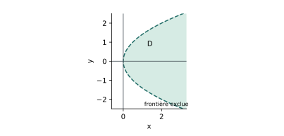
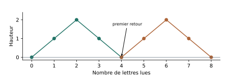

# Banque PT — Mathématiques C 2016 · Corrigé guidé

*Corrigé rédigé par IA, non officiel. Signalez toute erreur.*

**Rédaction** · GPT-6.2 Astra Ultra · vitesse non renseignée · 26 novembre 2026

Le calendrier du livret fixe l’épreuve au mardi 3 mai 2016, de 14 h à 18 h. La garde porte le code 127 et interdit la calculatrice. Les questions occupent les pages 2 à 4 du PDF de cinq pages. [Sujet de la Banque PT](https://www.banquept.fr/documents/2016/math_c_2016_pt.pdf) · [Rapport du jury](https://www.banquept.fr/documents/ecrit/rapport/2016/rapport_math_c_ecrit_2016.pdf) · [Livret annuel, p. 8 et 10](https://www.banquept.fr/documents/livret/2016/Livret_PT_2016.pdf)

## I. Équations différentielles et changement de variables

### Question I.1.a

> [!INDICATION]
> Factoriser le trinôme unitaire après avoir calculé son discriminant.

#### Solution

Posons $\delta=b^2-4c>0$. Les deux racines réelles distinctes sont $r_1=(-b-\sqrt\delta)/2$ et $r_2=(-b+\sqrt\delta)/2$. L’identification de $(r-r_1)(r-r_2)$ avec $r^2+br+c$ donne $r_1+r_2=-b$ et $r_1r_2=c$.

### Question I.1.b

> [!INDICATION]
> Calculer le premier et le second dérivés.

#### Solution

Pour $y_i(t)=e^{r_i t}$, on a $y_i'=r_i y_i$ et $y_i''=r_i^2 y_i$. Ainsi $y_i''+b y_i'+c y_i=(r_i^2+br_i+c)y_i=0$ en tout réel $t$.

### Question I.1.c

> [!INDICATION]
> Développer l’expression sans choisir de solution particulière.

#### Solution

Pour toute solution $y$, le membre de gauche se développe en $y''-(r_1+r_2)y'+r_1r_2 y$. Par I.1.a il s’agit de $y''+by'+cy$, nul par hypothèse.

### Question I.1.d

> [!INDICATION]
> Multiplier chaque équation par un facteur exponentiel.

#### Solution

Posons $z=y'-r_1y$. Par I.1.c, $z'-r_2z=0$, donc $(e^{-r_2t}z)'=0$. Puisque $\mathbb R$ est un intervalle, $z=C_2e^{r_2t}$. En permutant les racines, on obtient de même $y'-r_2y=C_1e^{r_1t}$. Les constantes réelles $C_1,C_2$ dépendent de la solution $y$ choisie.

### Question I.1.e

> [!INDICATION]
> Éliminer la dérivée entre les deux identités.

#### Solution

La première identité de I.1.d moins la seconde donne $(r_2-r_1)y=C_2e^{r_2t}-C_1e^{r_1t}$. Comme les racines sont distinctes, $y(t)=\lambda e^{r_1t}+\mu e^{r_2t}$. Réciproquement, toute combinaison de ces exponentielles est solution par linéarité et I.1.b. Cela établit les deux inclusions.

### Question I.1.f.i

> [!INDICATION]
> Calculer les racines lorsque b = 0 et c = −16.

#### Solution

L’équation caractéristique est $r^2-16=0$, dont les racines sont $-4$ et $4$. Les solutions réelles sur $\mathbb R$ sont $y(t)=a e^{-4t}+d e^{4t}$ avec $(a,d)\in\mathbb R^2$.

### Question I.1.f.ii

> [!INDICATION]
> Évaluer la solution et sa dérivée à l’origine.

#### Solution

Les conditions imposent $a+d=2e$ et $-4a+4d=0$. Elles donnent l’unique couple $a=d=e$. Il existe exactement une solution, $y(t)=e(e^{-4t}+e^{4t})=2e\cosh(4t)$.

### Question I.2.a

> [!INDICATION]
> Écrire l’inégalité en isolant x pour une ordonnée donnée.

#### Solution

On a $D=\{(x,y):x>y^2/2\}$. Pour chaque $y$, la section horizontale est la demi-droite située strictement à droite de $x=y^2/2$. La parabole de sommet $(0,0)$ est exclue, comme le marque le trait discontinu de la figure.

### Question I.2.b

> [!INDICATION]
> Résoudre d’abord la deuxième coordonnée, puis choisir le signe de la racine.

#### Solution

Sur $\Delta=(0,\infty)\times\mathbb R$, $h(u,v)=((u^2+v^2)/2,v)$ donne $2x-y^2=u^2>0$. Réciproquement, à tout $(x,y)\in D$ correspond l’unique $(u,v)=(\sqrt{2x-y^2},y)$, puisque $u>0$. Les deux compositions sont les identités. Les coordonnées de $h$ sont polynomiales et celles de l’inverse sont lisses là où le radicand est strictement positif. Ces applications sont en particulier de classe $C^1$.

### Question I.2.c

> [!INDICATION]
> Dériver deux fois par rapport à u en gardant v fixe.

#### Solution

Avec $\psi=\varphi\circ h$, la chaîne donne $\psi_u=u(\varphi_x\circ h)$, puis $\psi_{uu}=(\varphi_x\circ h)+u^2(\varphi_{xx}\circ h)$. Puisque $2x-y^2=u^2$ en $(x,y)=h(u,v)$, $\psi_{uu}-16\psi$ est exactement le membre de gauche de $(E)$ composé avec $h$. La surjectivité de $h$ établit l’équivalence sur les deux domaines.

### Question I.2.d

> [!INDICATION]
> Fixer v pour résoudre en u, puis déterminer la régularité des coefficients.

#### Solution

À $v$ fixé, l’équation est celle de I.1.f.i sur $u>0$. Les solutions sont donc $\psi(u,v)=A(v)e^{4u}+B(v)e^{-4u}$. Pour une solution $C^2$, les valeurs aux deux droites $u=1$ et $u=2$ donnent un système linéaire constant de déterminant $e^{-4}-e^4\ne0$ pour $A(v),B(v)$. Ces fonctions sont donc $C^2$ en $v$. Inversement toute paire $A,B\in C^2(\mathbb R)$ convient. Les solutions correspondantes sur $D$ s’obtiennent en remplaçant $u$ par $\sqrt{2x-y^2}$ et $v$ par $y$.

## II. Intégrales de fractions rationnelles

### Question II.1

> [!INDICATION]
> Compléter le carré, puis factoriser par sa valeur minimale.

#### Solution

Posons $a=\mu-\lambda^2>0$. On a $x^2+2\lambda x+\mu=(x+\lambda)^2+a=a[1+(x+\lambda)^2/a]$. On peut donc prendre $\alpha=a$ et $\beta=1/\sqrt a$. Le choix opposé pour $\beta$ donne la même identité.

### Question II.2

> [!INDICATION]
> Examiner séparément la continuité et les deux extrémités infinies.

#### Solution

Sur $\mathbb R$, le dénominateur est au moins $a>0$ avant élévation à la puissance $n+1$. L’intégrande est continue et positive, et équivalente à $|x|^{-2n-2}$ en chacune des deux extrémités infinies. Les intégrales de comparaison convergent car $2n+2>1$. Pour $n=0$, la substitution $s=(x+\lambda)/\sqrt a$ donne $I_0=(1/\sqrt a)[\arctan s]_{-\infty}^{+\infty}=\pi/\sqrt{\mu-\lambda^2}$.

### Question II.3.a

> [!INDICATION]
> Dériver le quotient x/(1+x²)ⁿ sur un segment avant de passer à la limite.

#### Solution

Ici $\lambda=0,\mu=1$. Pour $n\ge1$, la dérivée de $x(1+x^2)^{-n}$ vaut $(1-2n)(1+x^2)^{-n}+2n(1+x^2)^{-n-1}$. Intégrons l’identité sur $[-R,R]$. Le terme de bord $2R/(1+R^2)^n$ tend vers zéro. Les deux intégrales convergent par II.2, donc $0=(1-2n)I_{n-1}+2n I_n$, d’où $I_n=(2n-1)I_{n-1}/(2n)$.

### Question II.3.b

> [!INDICATION]
> Séparer les facteurs pairs et impairs de (2n)!.

#### Solution

L’itération donne $I_n=\pi\prod_{j=1}^n(2j-1)/(2j)$, avec produit vide à $n=0$. Le produit des pairs est $2^n n!$, celui des impairs vaut $(2n)!/(2^n n!)$. Il vient $I_n=\pi(2n)!/[4^n(n!)^2]$.

## III. Série génératrice et mots de Dyck

### Question III.1

> [!INDICATION]
> L’inconnue du trinôme est Y. Le réel x en est un coefficient.

#### Solution

Sur $|x|\le1/4$, le discriminant $1-4x$ est positif ou nul. Les racines sont $Y_1=(1-\sqrt{1-4x})/2$ et $Y_2=(1+\sqrt{1-4x})/2$. Elles coïncident en $1/2$ pour $x=1/4$.

### Question III.2

> [!INDICATION]
> Tester la condition d’existence de la racine carrée en dehors de l’intervalle précédent.

#### Solution

La seule contrainte est $1-4x\ge0$. Le domaine maximal réel de $f(x)=(1-\sqrt{1-4x})/2$ est donc $I_Y=(-\infty,1/4]$.

### Question III.3

> [!INDICATION]
> Exprimer les coefficients à l’aide d’un produit descendant.

#### Solution

Pour $|x|<1$ et tout $\alpha\ne0$ réel,
$$(1+x)^\alpha=1+\sum_{n\ge1}\frac{\alpha(\alpha-1)\cdots(\alpha-n+1)}{n!}x^n.$$
Pour un entier positif $\alpha$, les termes après le rang $\alpha$ sont nuls et l’expression est un polynôme.

### Question III.4

> [!INDICATION]
> Appliquer le développement binomial avec α = 1/2 et remplacer x par −4x.

#### Solution

Pour $|x|<1/4$, on obtient $S_0=0$ et, pour $n\ge1$,
$$S_n=-\tfrac12(-4)^n\binom{1/2}{n}=\frac{2^{n-1}}{n!}\prod_{j=1}^{n-1}(2j-1).$$
En particulier $S_1=1$. Le quotient $S_{n+1}/S_n=2(2n-1)/(n+1)$ tend vers $4$, donc le rayon vaut $1/4$. L’intervalle ouvert suffit pour les manipulations. Aux bords la convergence est encore absolue. En effet, les coefficients sont positifs et, pour $x\uparrow1/4$, la limite de $f(x)$ vaut $1/2$. La convergence monotone appliquée à la somme donne $\sum_n S_n4^{-n}=1/2$. La convergence absolue uniforme sur $[-1/4,1/4]$ et la continuité de $f$ y prolongent l’égalité aux deux extrémités.

### Question III.5

> [!INDICATION]
> Pour un coefficient fixé, additionner toutes les paires de degrés de somme donnée.

#### Solution

Si les deux séries ont coefficients $a_n,b_n$ et rayons $R_a,R_b$, leur produit a pour coefficient $c_n=\sum_{k=0}^n a_kb_{n-k}$. Pour $|x|<\min(R_a,R_b)$, les séries convergent absolument et $\sum_n c_n x^n=(\sum_n a_nx^n)(\sum_n b_nx^n)$. Le rayon du produit est au moins le minimum des deux rayons. Des annulations peuvent l’augmenter.

### Question III.6

> [!INDICATION]
> Utiliser l’équation du trinôme satisfaite par la petite racine.

#### Solution

Le renvoi imprimé à II.1 se lit III.1, où apparaît le trinôme en $Y$. Pour $|x|<1/4$, $f^2-f+x=0$. L’identification des coefficients à l’ordre $n\ge2$ donne $S_n=\sum_{k=0}^n S_kS_{n-k}$. Comme $S_0=0$, la somme se réduit aux indices $1,\ldots,n-1$. À l’ordre un, on retrouve $S_1=1$.

### Question III.7

> [!INDICATION]
> Regrouper les facteurs pairs et impairs jusqu’à 2n−2.

#### Solution

Le produit des impairs de $1$ à $2n-3$ vaut $(2n-2)!/[2^{n-1}(n-1)!]$. En le reportant dans III.4, on trouve $S_n=(2n-2)!/[n!(n-1)!]=\binom{2n-2}{n-1}/n$ pour $n\ge2$. Cette formule redonne aussi $S_1=1$.

### Question III.8

> [!INDICATION]
> Examiner d’abord la condition nécessaire de convergence.

#### Solution

Le quotient $S_{n+1}/S_n$ tend vers $4>1$. Les termes sont strictement positifs et leur quotient est par exemple supérieur à deux à partir d’un certain rang. Ils tendent donc vers $+\infty$. La série numérique $\sum_n S_n$ diverge vers $+\infty$.

### Question III.9.a

> [!INDICATION]
> Compter les préfixes en fonction des nombres de A et de B.

#### Solution

Notons $T(a,b)$ le nombre de préfixes valides ayant $a$ lettres A et $b$ lettres B. On a $T(a,0)=1$ et $T(a,b)=0$ pour $b>a$. En classant d’après la dernière lettre, $T(a,b)=T(a-1,b)+T(a,b-1)$ si $1\le b\le a$. Pour $a=1,2,3,4$, les lignes $T(a,0),\ldots,T(a,a)$ sont respectivement $(1,1)$, $(1,2,2)$, $(1,3,5,5)$ et $(1,4,9,14,14)$. Les termes diagonaux donnent $C_1=1$, $C_2=2$, $C_3=5$, $C_4=14$.

### Question III.9.b

> [!INDICATION]
> Repérer le premier préfixe non vide ayant autant de A que de B.

#### Solution

Un mot non vide commence par A. Sa hauteur, nombre de A moins nombre de B lus, revient pour la première fois à zéro à l’instant $2k$, avec $1\le k\le n$. Le mot s’écrit de façon unique $A\,u\,B\,v$, où $u$ est un mot de Dyck de longueur $2(k-1)$ et $v$ un mot de longueur $2(n-k)$. Réciproquement tout tel couple fournit un mot dont le premier retour est $2k$, car les hauteurs à l’intérieur du premier bloc dépassent zéro. Pour $C_0=1$, le dénombrement des couples, puis des positions de retour disjointes, donne $C_n=\sum_{k=1}^n C_{k-1}C_{n-k}$.

### Question III.9.c

> [!INDICATION]
> Comparer les deux récurrences avec un décalage d’un indice.

#### Solution

Au rang zéro, $C_0=1=S_1$. Si $C_j=S_{j+1}$ pour tout $j<n$, III.9.b donne $C_n=\sum_{k=1}^n S_kS_{n+1-k}=S_{n+1}$ par III.6. La récurrence et III.7 donnent donc pour tout $n\ge0$
$$C_n=\frac1{n+1}\binom{2n}{n}.$$
