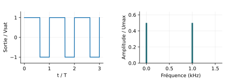
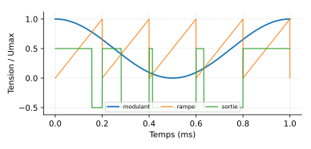
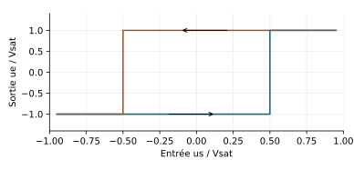
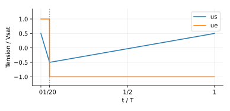
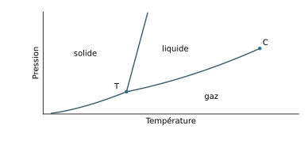
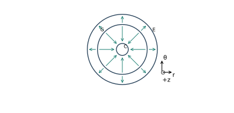
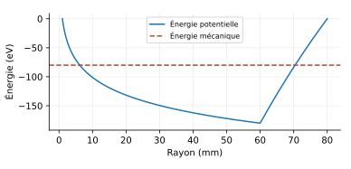
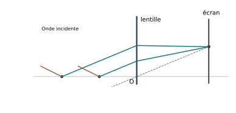

# Banque PT — Physique A 2016 · Corrigé guidé

*Corrigé rédigé par IA, non officiel. Signalez toute erreur.*

**Rédaction** · GPT-6.2 Astra Ultra · vitesse non renseignée · 26 novembre 2026

La Banque PT a programmé cet écrit le mercredi 4 mai 2016, de 8 h à 12 h. La garde interdit la calculatrice. Le code imprimé est 133. Le document-réponse C réunit les graphiques C.1 et C.2 (p. 17 du PDF) et C.3 (p. 18). Les trois tracés complétés figurent dans le corrigé. Les questions figurent aux pages 2 à 12 du PDF de 18 pages. En admissibilité, le coefficient de Physique A est de 3 pour chacune des ENS de Cachan et de Rennes et de 6 pour l’École polytechnique. [Sujet](https://www.banquept.fr/documents/2016/ph_a_2016_pt.pdf) · [Rapport du jury](https://www.banquept.fr/documents/ecrit/rapport/2016/rapport_phys_a_ecrit_2016.pdf) · [Livret de la Banque PT, p. 8, 10 et 12](https://www.banquept.fr/documents/livret/2016/Livret_PT_2016.pdf)

## A. Modulation de largeur d’impulsion

### Question A.Q1

> [!INDICATION]
> Séparer les propriétés des entrées et celles de la sortie.

#### Solution

Un ALI idéal a une impédance d’entrée infinie, des courants d’entrée nuls, une impédance de sortie nulle, un gain différentiel et une bande passante idéalisés infinis. En régime linéaire $u_+=u_-$, tandis qu’en saturation le signe de $u_+-u_-$ commande la valeur limite $\pm V_{\rm sat}$.

### Question A.Q2

> [!INDICATION]
> Identifier les deux entrées de la figure A.2.

#### Solution

Aucune contre-réaction ne maintient l’écart à zéro. L’ALI compare le modulant $u_e$ sur l’entrée positive à la dent de scie sur l’entrée négative. La sortie vaut $+V_{\rm sat}$ si $u_e>u_{\rm scie}$ et $-V_{\rm sat}$ dans l’autre cas, hors instants de basculement.

### Question A.Q3

> [!INDICATION]
> Comparer les extrémités de la rampe.

#### Solution

La tension passe de zéro à $U_{\max}$ pendant $T$, donc $a=U_{\max}/T$. Sur chaque intervalle $[nT,(n+1)T[$, elle vaut $a(t-nT)$.

### Question A.Q4

> [!INDICATION]
> Chercher l’intersection de la rampe avec le niveau constant.

#### Solution

Pour $0\le U_0\le U_{\max}$, l’intersection est à $t=nT+TU_0/U_{\max}$. Le plateau haut commence à $nT$ et dure $\tau_+=TU_0/U_{\max}$. Le plateau bas dure $\tau_-=T(1-U_0/U_{\max})$. La même paire se répète trois fois jusqu’à $3T$.

### Question A.Q5

> [!INDICATION]
> Comparer l’entrée constante au maximum de la rampe.

#### Solution

Si $U_0>U_{\max}$, la tension différentielle reste positive. La sortie demeure en saturation haute et le rapport cyclique est égal à un.

### Question A.Q6.a

> [!INDICATION]
> Trouver le milieu, la demi-excursion et la phase initiale.

#### Solution

Le minimum vaut zéro et le maximum $U_{\max}$ à $t=0$. Ainsi $u_e(t)=\tfrac12U_{\max}[1+\cos(2\pi f_e t)]$ avec $f_e=1$ kHz. On a $T_e=1$ ms et $T=0,20$ ms.

### Question A.Q6.b

> [!INDICATION]
> Séparer la composante continue et l’oscillation.

#### Solution

Le spectre unilatéral en amplitudes crêtes comprend une raie continue $U_{\max}/2$ et une raie $U_{\max}/2$ à $1$ kHz. En spectre bilatéral, la seconde se partage en deux coefficients $U_{\max}/4$ aux fréquences $\pm1$ kHz.

### Question A.Q6.c

> [!INDICATION]
> À chaque instant comparer les hauteurs des deux courbes.

#### Solution

Sur la durée $T_e$, il faut cinq rampes, chacune de zéro à $U_{\max}$. La sortie vaut $+U_{\max}/2$ si le modulant dépasse la rampe et $-U_{\max}/2$ sinon. Dans l’abscisse réduite $q=t/T_e$, les fins des plateaux hauts sont les intersections de $(1+\cos 2\pi q)/2$ avec $5q-n$ pour $n=0,\ldots,4$, soit environ $0,156$, $0,281$, $0,414$, $0,633$ et $1$. Le tracé ci-dessous utilise les intersections exactes calculées numériquement.

### Question A.Q6.d

> [!INDICATION]
> Examiner le groupe de raies autour de la fondamentale.

#### Solution

Un passe-bas laisse passer le continu et la composante à $1$ kHz, tout en atténuant les groupes de commutation autour de $5$ kHz et de ses multiples. La fréquence de coupure se choisit entre la bande du message et les premières composantes parasites visibles. Un gain et un décalage continu ajustent ensuite la sortie à l’échelle du modulant initial.

### Question A.Q7

> [!INDICATION]
> Donner des ordres de grandeur pour un modèle usuel.

#### Solution

Pour un ALI classique à entrées bipolaires, l’impédance différentielle est par exemple de l’ordre du mégohm, davantage pour des entrées à effet de champ. L’impédance de sortie en boucle ouverte est typiquement de quelques dizaines à une centaine d’ohms. Ces ordres dépendent du composant et de la fréquence.

### Question A.Q8

> [!INDICATION]
> Comparer l’impédance de sortie à la charge à l’entrée suivante.

#### Solution

Chaque sortie d’ALI idéal impose sa tension sans chute et les entrées ne prélèvent aucun courant. On peut établir la relation propre à chaque étage en lui imposant la tension fournie par l’autre, puis identifier les deux tensions à la fermeture de la boucle. Le courant de la liaison résistive ne change pas la tension du premier étage.

### Question A.Q9.a

> [!INDICATION]
> Suivre le courant par la diode D1 et la résistance R1.

#### Solution

La contre-réaction capacitive impose la masse virtuelle à l’entrée inverseuse. Pour $u_e>0$, la branche $D_1,R_1$ conduit. La loi des nœuds donne $u_e/R_1=-C\,du_s/dt$, soit $\dot u_s=-u_e/(R_1 C)$. C’est un intégrateur inverseur.

### Question A.Q9.b

> [!INDICATION]
> Identifier la résistance de l’autre branche.

#### Solution

Pour $u_e<0$, $D_2$ conduit et $D_1$ est bloquée. Le même bilan donne $\dot u_s=-u_e/(R_2C)$, positive pour une entrée négative constante.

### Question A.Q10.a

> [!INDICATION]
> Vérifier vers quelle entrée retourne la sortie.

#### Solution

La résistance $R_4$ ramène la sortie sur l’entrée non inverseuse. Cette rétroaction positive renforce un déséquilibre et conduit aux deux états saturés. L’entrée négative est à zéro.

### Question A.Q10.b

> [!INDICATION]
> Calculer la tension au nœud des résistances R3 et R4.

#### Solution

En l’absence de courant d’entrée, $u_+=(R_4u_s+R_3u_e)/(R_3+R_4)$. L’état $u_e=+V_{\rm sat}$ se maintient si $u_+>0$, donc si $u_s>-(R_3/R_4)V_{\rm sat}=-V_{\rm sat}/2$. Le seuil descendant est l’égalité.

### Question A.Q10.c

> [!INDICATION]
> Appliquer le critère de signe à l’autre niveau de sortie.

#### Solution

Pour $u_e=-V_{\rm sat}$ il faut $u_+<0$, soit $u_s<(R_3/R_4)V_{\rm sat}=V_{\rm sat}/2$. L’égalité donne le seuil montant.

### Question A.Q10.d

> [!INDICATION]
> Orienter les deux basculements de la caractéristique.

#### Solution

En entrée croissante la sortie bascule de bas en haut à $+V_{\rm sat}/2$. En entrée décroissante elle bascule de haut en bas à $-V_{\rm sat}/2$. Entre ces seuils, l’état dépend de l’histoire. C’est un comparateur à hystérésis non inverseur.

### Question A.Q11.a

> [!INDICATION]
> Utiliser la continuité de la tension du condensateur au basculement.

#### Solution

L’état haut vient d’être atteint au seuil montant, $u_s(0)=+V_{\rm sat}/2$. Jusqu’au prochain basculement $u_e=+V_{\rm sat}$ et $u_s(t)=V_{\rm sat}/2-V_{\rm sat}t/(R_1C)$.

### Question A.Q11.b

> [!INDICATION]
> Chercher quand la rampe descend au seuil bas.

#### Solution

Le signal perd $V_{\rm sat}$ avec une pente de module $V_{\rm sat}/(R_1C)$. Il atteint $-V_{\rm sat}/2$ à $t_1=R_1C$, donc $\Delta t_{\rm haut}=R_1C$.

### Question A.Q12.a

> [!INDICATION]
> Repartir du seuil réellement atteint à la date t1.

#### Solution

Après la commutation, $u_e=-V_{\rm sat}$ et la tension du condensateur demeure continue. On trouve $u_s(t)=-V_{\rm sat}/2+V_{\rm sat}(t-t_1)/(R_2 C)$ jusqu’au seuil supérieur.

### Question A.Q12.b

> [!INDICATION]
> Additionner les durées des deux pentes.

#### Solution

L’ascension jusqu’à $+V_{\rm sat}/2$ prend $\Delta t_{\rm bas}=R_2C$. Ainsi $t_2=t_1+R_2C$ et $T=(R_1+R_2)C$. À $t_2$ l’état initial est retrouvé.

### Question A.Q13

> [!INDICATION]
> Placer le premier changement de pente au vingtième de la période.

#### Solution

Avec $\Delta t_{\rm bas}=19\Delta t_{\rm haut}$, $u_e$ vaut $+V_{\rm sat}$ jusqu’à $T/20$, puis $-V_{\rm sat}$ jusqu’à $T$. Le signal $u_s$ descend de $+V_{\rm sat}/2$ à $-V_{\rm sat}/2$ sur la première durée et remonte linéairement sur les $19T/20$ restants.

### Question A.Q14

> [!INDICATION]
> Combiner le rapport des durées et leur somme.

#### Solution

Comme $R_2=19R_1$ et $f^{-1}=20R_1C$, on trouve $R_1=1/(20Cf)$ et $R_2=19/(20Cf)$. Avec $C=10$ pF et $f=1$ MHz, cela donne $5$ k$\Omega$ et $95$ k$\Omega$.

## B1. Cellule de Knudsen

### Question B1.Q15

> [!INDICATION]
> Égaler séparément les exposants du temps et de la longueur.

#### Solution

Dans $\Phi=(6\pi)^{-1/2}N_V u^a s^b$, le membre de droite a la dimension $L^{-3+a+2b}T^{-a}$. Pour obtenir un nombre de particules par seconde, $a=1$ puis $-3+1+2b=0$, d’où $b=1$.

### Question B1.Q16

> [!INDICATION]
> Se placer à pression fixe et augmenter la température.

#### Solution

En dessous des courbes de sublimation et de vaporisation le gaz est stable. Au-dessus de ces courbes se trouvent les phases condensées, le solide du côté des températures basses et le liquide entre les courbes de fusion et de vaporisation. Le dessin reprend la topologie du schéma fourni.

### Question B1.Q17

> [!INDICATION]
> Compter les phases coexistantes au point T et suivre la frontière jusqu’à C.

#### Solution

T est le point triple où solide, liquide et gaz coexistent à un couple pression-température déterminé pour le corps pur. C est le point critique où liquide et vapeur deviennent indiscernables. Au-delà, on peut passer continûment de l’un à l’autre.

### Question B1.Q18

> [!INDICATION]
> Repérer la branche de la courbe de saturation au-dessus du point triple.

#### Solution

À $1200$ K, bien au-dessus de $T_{\rm triple}=301,91$ K, la coexistence avec la vapeur sur la courbe de pression saturante fournie est liquide-vapeur. Le gallium condensé de la cellule est liquide.

### Question B1.Q19

> [!INDICATION]
> Moyenner le carré de la norme de la vitesse.

#### Solution

On définit $u=\sqrt{\langle v^2\rangle}$, où la moyenne porte sur les particules de gaz. Pour un gaz isotrope au repos, la vitesse vectorielle moyenne s’annule alors que $u$ reste positive.

### Question B1.Q20

> [!INDICATION]
> Compter les degrés de liberté de translation.

#### Solution

Pour un gaz parfait monoatomique en équilibre, chacun des trois degrés de liberté de translation apporte $k_BT_V/2$. Ainsi $\langle E_c\rangle=m\langle v^2\rangle/2=3k_BT_V/2$.

### Question B1.Q21

> [!INDICATION]
> Écrire la masse d’un atome avec la constante d’Avogadro.

#### Solution

En utilisant $m=M_{\rm Ga}/N_A$ et $k_B=R/N_A$, on obtient $u=\sqrt{3RT_V/M_{\rm Ga}}$. Il faut exprimer la masse molaire en kg/mol.

### Question B1.Q22

> [!INDICATION]
> Remplacer la densité par la loi du gaz parfait.

#### Solution

Le gaz vérifie $N_V=P_V/(k_BT_V)$. En substituant dans $\Phi=sN_Vu/\sqrt{6\pi}$ puis en simplifiant, on obtient $\Phi=sP_VN_A/\sqrt{2\pi R M_{\rm Ga}T_V}$. Le facteur géométrique est une surface et le flux est homogène à un inverse de temps.

### Question B1.Q23

> [!INDICATION]
> Utiliser la coexistence des deux phases.

#### Solution

Tant que les phases coexistent à l’équilibre, $P_V=P_{\rm sat}(T_V)$ est fixée par la température. Pour une substance et un orifice donnés, les autres facteurs de Q22 sont constants. Le flux est ainsi déterminé par la température de la cellule.

### Question B1.Q24

> [!INDICATION]
> Interpréter l’angle solide sous lequel apparaît le substrat.

#### Solution

Le rapport $\Phi_1/\Phi=[S/(\pi d^2)]\cos\alpha\cos\theta$ croît proportionnellement à la surface interceptante. Le facteur $d^{-2}$ traduit l’étalement du flux sur des surfaces de rayon $d$ dont l’aire croît comme $d^2$. Les cosinus traduisent l’orientation de l’émission et la projection de la cible.

### Question B1.Q25.a

> [!INDICATION]
> Calculer l’aire par site dans le réseau carré.

#### Solution

Un site occupe une aire $a^2$. En négligeant les bords, le nombre d’atomes d’une couche complète d’aire $S$ est $N=S/a^2$.

### Question B1.Q25.b

> [!INDICATION]
> Diviser le nombre de sites par le flux reçu.

#### Solution

Dans l’orientation optimale, $\Phi_1=\Phi S/(\pi d^2)$. Avec une adhésion parfaite, $\tau=N/\Phi_1=\pi d^2/(a^2\Phi)$. Pour $d=2$ cm, $a=0,3$ nm, $\Phi=10^{16}\ {\rm s^{-1}}$, on obtient environ $1,4$ s par couche.

### Question B1.Q25.c

> [!INDICATION]
> Estimer le nombre de plans nécessaires pour un micromètre.

#### Solution

En supposant un espacement vertical de l’ordre de $a$, $1\ \mu{\rm m}/a\simeq3,3\,10^3$ couches. Avec la durée idéale précédente, cela demande environ $4,7\,10^3$ s, soit $1,3$ h. Cet ordre de grandeur suppose une croissance continue et la même vitesse pour chaque couche.

## B2. Jauge de pression Bayard-Alpert

### Question B2.Q26.a

> [!INDICATION]
> Construire la tangente dans le sens des angles croissants.

#### Solution

Dans une coupe regardée du côté $+z$, $\mathbf e_r$ pointe vers l’extérieur, $\mathbf e_\theta$ est obtenu en tournant $\mathbf e_r$ d’un quart de tour antihoraire, et $\mathbf e_z=\mathbf e_r\times\mathbf e_\theta$ sort de la feuille. Les trois directions figurent sur le dessin de Q29.d.

### Question B2.Q26.b

> [!INDICATION]
> Employer les invariances du modèle cylindrique infini.

#### Solution

Une translation suivant $Oz$ et une rotation autour de cet axe conservent les électrodes et les tensions imposées. Le potentiel est donc indépendant de $z$ et de $\theta$. Il suit $\mathbf E=-\nabla V=-V'(r)\mathbf e_r$. L’énoncé assimile la perturbation du filament à zéro.

### Question B2.Q27.a

> [!INDICATION]
> Préciser quelle densité intervient.

#### Solution

La relation de Maxwell-Gauss est $\nabla\cdot\mathbf E=\rho/\varepsilon_0$. Entre les électrodes on néglige les charges volumiques, donc la divergence y est nulle.

### Question B2.Q27.b

> [!INDICATION]
> Appliquer le laplacien en coordonnées cylindriques.

#### Solution

Puisque $\mathbf E=-\nabla V$, l’équation de Poisson donne $\Delta V=-\rho/\varepsilon_0=0$ dans cette zone. Elle devient $r^{-1}d(rV')/dr=0$.

### Question B2.Q27.c

> [!INDICATION]
> Intégrer deux fois en conservant les constantes.

#### Solution

Une première intégration donne $rV'=c_1$, puis $V=c_1\ln r+c_2$. En imposant $V(R_c)=0$ et $V(R_g)=V_g$, on obtient $V(r)=V_g\ln(r/R_c)/\ln(R_g/R_c)$ pour $R_c\le r\le R_g$.

### Question B2.Q28

> [!INDICATION]
> Dériver le logarithme et repérer le signe.

#### Solution

Entre collecteur et grille, $\mathbf E=-V_g\mathbf e_r/[r\ln(R_g/R_c)]$. Le champ est orienté de la grille positive vers le collecteur et son module varie comme $1/r$.

### Question B2.Q29.a

> [!INDICATION]
> Lire le bord du palier nul puis le sommet de potentiel.

#### Solution

Sur la figure B.6 le potentiel commence à s’élever vers $R_c\simeq1$ mm et atteint $180$ V vers $R_g\simeq60$ mm. La lecture à gauche est limitée par l’épaisseur du trait. Le zéro extérieur donne aussi $R_e\simeq80$ mm.

### Question B2.Q29.b

> [!INDICATION]
> Changer les deux valeurs aux limites dans la solution logarithmique.

#### Solution

Entre la grille G (ou A) et l’enceinte E, $V(R_g)=V_g$ et $V(R_e)=0$. La solution de l’équation de Laplace est $V(r)=V_g\ln(R_e/r)/\ln(R_e/R_g)$.

### Question B2.Q29.c

> [!INDICATION]
> Vérifier la direction grâce à la décroissance du potentiel.

#### Solution

Pour $R_g<r<R_e$, $\mathbf E=+V_g\mathbf e_r/[r\ln(R_e/R_g)]$. La force sur un électron est donc dirigée vers la grille.

### Question B2.Q29.d

> [!INDICATION]
> Partir de la grille vers les deux électrodes à zéro volt.

#### Solution

Les lignes radiales partent de la grille de potentiel maximal. Elles aboutissent au collecteur dans la couronne intérieure et à l’enceinte dans la couronne extérieure, orthogonalement aux électrodes. Dans le métal, le champ électrostatique est nul.

### Question B2.Q30

> [!INDICATION]
> Choisir la branche extérieure du graphe au niveau 80 volts.

#### Solution

En imposant $80=180\ln(R_e/R_K)/\ln(R_e/R_g)$, on obtient $R_K=R_e(R_g/R_e)^{80/180}\simeq70$ mm. La seconde intersection avec la courbe se trouve du côté du collecteur et ne correspond pas au filament.

### Question B2.Q31.a

> [!INDICATION]
> Examiner les composantes angulaire et axiale.

#### Solution

La force électrique est radiale. Le moment cinétique axial $mr^2\dot\theta$ et la quantité de mouvement axiale sont constants. Comme la vitesse initiale est nulle, $\dot\theta=\dot z=0$ et la trajectoire reste sur une droite radiale partant du filament, tant qu’il n’y a pas de collision.

### Question B2.Q31.b

> [!INDICATION]
> Utiliser sa charge algébrique.

#### Solution

Avec l’origine d’énergie correspondant au potentiel nul, $E_p(r)=-eV(r)$, où $e>0$ est la charge élémentaire. Le maximum du potentiel électrique est donc un minimum d’énergie potentielle.

### Question B2.Q31.c

> [!INDICATION]
> Relier le travail électrique à la variation d’énergie potentielle.

#### Solution

Le champ est stationnaire et dérive d’un potentiel. Comme seule la force électrique agit, $d(E_c+E_p)/dt=0$. Avec une émission sans vitesse à $V_K=80$ V, l’énergie mécanique constante vaut $E_m=-eV_K=-80$ eV.

### Question B2.Q31.d

> [!INDICATION]
> Inverser la courbe de potentiel pour une charge élémentaire négative.

#### Solution

En eV, $E_p$ est l’opposé numérique du potentiel exprimé en volts. La courbe descend de zéro à $-180$ eV à la grille et remonte à zéro à l’enceinte. La droite $E_m=-80$ eV coupe ce puits en deux points.

### Question B2.Q31.e

> [!INDICATION]
> Résoudre V égal à 80 volts sur chaque branche.

#### Solution

La condition $E_c=e(V-V_K)\ge0$ délimite le domaine entre les deux solutions. À l’intérieur $r_{\min}=R_c(R_g/R_c)^{80/180}\simeq6$ mm. À l’extérieur $r_{\max}=R_K\simeq70$ mm. L’électron renverse son mouvement radial aux deux limites dans le modèle sans choc.

### Question B2.Q32.a

> [!INDICATION]
> Prendre le moment de la force par rapport à l’axe.

#### Solution

La force $-eE_r\mathbf e_r$ n’a pas de moment suivant $Oz$. Le théorème du moment cinétique donne $dL_z/dt=0$, où $L_z=mr^2\dot\theta$ ; il peut désormais être non nul.

### Question B2.Q32.b

> [!INDICATION]
> Exprimer l’énergie cinétique tangentielle avec le moment cinétique.

#### Solution

Pour une vitesse perpendiculaire à l’axe, $\dot z=0$ et $E_c=m(\dot r^2+r^2\dot\theta^2)/2$. Il s’ensuit $E_m=m\dot r^2/2+E_{p,\rm eff}(r)$, avec $E_{p,\rm eff}=L_z^2/(2mr^2)-eV(r)$. Le premier terme est la contribution cinétique tangentielle, positive.

### Question B2.Q32.c

> [!INDICATION]
> Comparer l’énergie initiale à la valeur du potentiel effectif sur les parois.

#### Solution

Au départ $E_m=-80\ {\rm eV}+mv_K^2/2<0$ pour la faible énergie initiale supposée. Aux deux électrodes à zéro volt, $E_{p,\rm eff}=L_z^2/(2mr^2)\ge0$. Comme $E_{p,\rm eff}\le E_m$ est nécessaire, aucune de ces électrodes n’est accessible. L’intervalle radial accessible contenant $R_K$ est borné de part et d’autre. Pour une faible vitesse la grille, où $-eV=-180$ eV, est accessible ; ses fils peuvent interrompre la trajectoire.

### Question B2.Q33

> [!INDICATION]
> Projeter la force exclusivement radiale.

#### Solution

La projection de Newton donne $m\ddot z=0$, d’où $z=z_0+v_{z0}t$. Dans le cas perpendiculaire précédent $z$ reste constant. En général la vitesse axiale non nulle conduit à la fuite par une extrémité du cylindre fini, ce qui motive les grilles terminales.

## B3. Diffraction RHEED et croissance du cristal

### Question B3.Q34

> [!INDICATION]
> Relier deux descriptions du même électron.

#### Solution

La relation $p=h/\lambda$ associe une longueur d’onde à la quantité de mouvement du corpuscule. Les détections sont localisées et leur distribution présente des interférences, manifestation de la dualité onde-corpuscule.

### Question B3.Q35

> [!INDICATION]
> Former la quantité de mouvement non relativiste.

#### Solution

Pour des électrons de même masse et de même énergie cinétique, $p=\sqrt{2m_e E_c}$ et donc $\lambda=h/\sqrt{2m_e E_c}$ sont communs. Avec les arrondis du sujet $E_c=10^4$ eV $\simeq2\,10^{-15}$ J et $h=6\,10^{-34}$ J s, on obtient $\lambda\simeq1,0\,10^{-11}$ m, soit $10$ pm.

### Question B3.Q36

> [!INDICATION]
> Comparer la longueur d’onde à la taille d’un obstacle.

#### Solution

La diffraction devient étendue lorsque la taille $d$ de l’objet est comparable à $\lambda$ ou plus petite. Ici $\lambda/r_{\rm Ga}\simeq10/130\simeq0,08$, soit un écart d’environ un ordre de grandeur. Avec une taille caractéristique de 130 pm, l’échelle angulaire $\lambda/d$ vaut quelques degrés : l’effet reste observable, même si la diffusion d’un seul objet n’est pas isotrope. La périodicité du réseau produit ensuite les maxima distincts.

### Question B3.Q37

> [!INDICATION]
> Tracer un rayon auxiliaire parallèle passant par le centre.

#### Solution

Les deux rayons incidents sur la lentille suivant la même direction $\theta$ émergent vers le même point du plan focal image. Pour le construire, tracer par O un rayon auxiliaire parallèle, qui traverse la lentille sans déviation et fixe le point sur l’écran. Les deux contributions issues de la même onde incidente sont cohérentes et s’y superposent.

### Question B3.Q38

> [!INDICATION]
> Tenir compte du retard de l’onde incidente sur le second atome.

#### Solution

Pour deux atomes séparés de $a$ le long du réseau, le retard de trajet incident du second vaut $a\cos\theta_i$ ; son trajet vers le point focal est plus court de $a\cos\theta$. La différence de marche est donc $\delta=a(\cos\theta_i-\cos\theta)$ à la convention d’ordre près. L’égalité à un multiple de $\lambda$ équivaut à $\cos\theta=\cos\theta_i+m\lambda/a$, $m$ entier.

### Question B3.Q39

> [!INDICATION]
> Additionner les amplitudes selon une progression géométrique.

#### Solution

Le déphasage entre voisins vaut $\psi=2\pi\delta/\lambda$. L’amplitude résultante est $A_1\sum_{j=0}^{N-1}e^{ij\psi}$. Son module atteint la borne $N|A_1|$ si toutes les contributions sont en phase, donc si $\psi=2\pi m$. Les maxima principaux gardent les directions de Q38. Pour un nombre fini de sites il existe aussi des maxima secondaires d’intensité inférieure.

### Question B3.Q40

> [!INDICATION]
> Lier l’angle au point focal avant de développer le cosinus.

#### Solution

Dans l’approximation paraxiale $x_m=f'\tan\theta_m\simeq f'\theta_m$, et $\cos\theta_m\simeq1-\theta_m^2/2$. Ainsi, du côté observé,
$$
 x_m\simeq f'\sqrt{2(1-\cos\theta_i-m\lambda/a)}
 \simeq f'\sqrt{\theta_i^2-2m\lambda/a}.
$$
Le second développement demande également $\theta_i$ petit. On retient les ordres à radicande positif ou nul et dont l’angle est dans le champ observé.

### Question B3.Q41

> [!INDICATION]
> Étudier l’espacement des ordres dans la variable cosinus.

#### Solution

Pour une même plage angulaire, l’espacement entre ordres en $\cos\theta$ est $\lambda/a$. Accroître l’énergie diminue $\lambda$ et augmente le nombre d’ordres possibles. Cette conclusion suppose que la résolution de l’écran permet toujours de les séparer.

### Question B3.Q42

> [!INDICATION]
> Compter les intervalles de maximum à maximum, et non les extrema isolés.

#### Solution

La trace B.9 part d’un maximum à l’instant zéro. On distingue environ 22 intervalles entiers jusqu’au dernier maximum, puis une fraction de période. Cela représente 22 couches complètes et une couche en cours de croissance à la fin de l’enregistrement.

### Question B3.Q43

> [!INDICATION]
> Convertir la durée de l’enregistrement en durée par oscillation.

#### Solution

Sur $499,5$ s, on lit environ $22,5$ cycles, soit environ $22$ s par couche ou $0,045$ couche/s. C’est environ seize fois plus lent que les $1,4$ s idéales de Q25. Une fraction déposée ou collée plus petite que supposé, la géométrie et des flux expérimentaux différents peuvent expliquer cet écart ; le seul chronogramme ne les distingue pas.

### Question B3.Q44

> [!INDICATION]
> Relier la cohérence de l’oscillation à l’uniformité de la surface.

#### Solution

Si des îlots de couches différentes commencent à croître en même temps, les régions de la surface n’achèvent plus leur monocouche ensemble. Leurs contributions sont déphasées, ce qui réduit le contraste de l’intensité moyenne. Une rugosité cumulée ou un flux inhomogène favorisent ce mécanisme.
