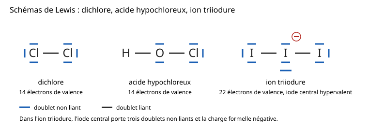
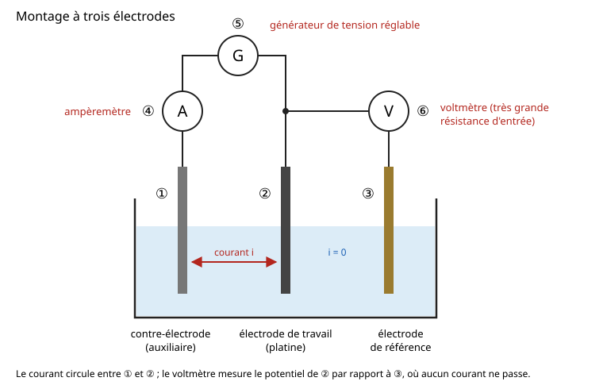
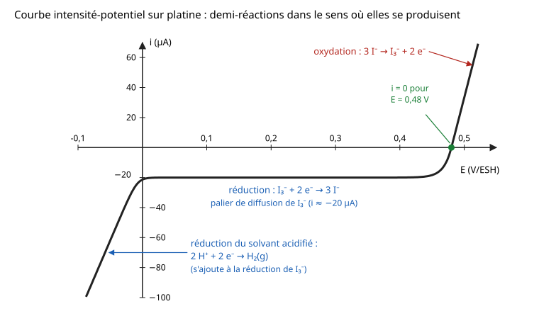
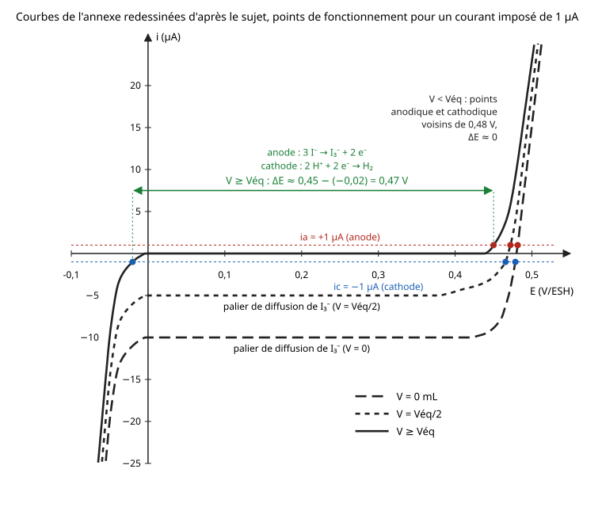
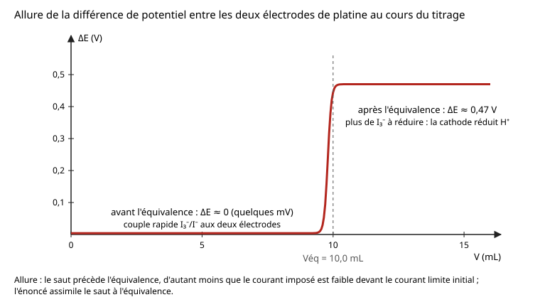

# Banque PT PT — Physique B - Chimie 2016 · Corrigé brut

*Corrigé rédigé par IA, non officiel. Signalez toute erreur.*

**Rédaction** · modèle exact non renseigné (famille Claude) · effort non renseigné · vitesse non renseignée

Épreuve de 2 heures, sans calculatrice, autour des dérivés halogénés : 36 questions en quatre parties indépendantes, une feuille annexe à rendre (courbes intensité-potentiel du dosage). Les 36 questions sont traitées. Les valeurs lues sur les graphiques et sur l'annexe sont signalées à l'endroit où elles servent.

[Sujet officiel](https://www.banquept.fr/documents/2016/ph_b_ch_2016_pt.pdf) · [Rapport du jury](https://www.banquept.fr/documents/ecrit/rapport/2016/rapport_phys_b_ecrit_2016.pdf)

## Partie 1 — Quelques aspects de la chimie des halogènes

### Question 1 — Configuration électronique de l'iode

L'iode est sous le brome (4ᵉ période) dans la 17ᵉ colonne : il appartient à la **5ᵉ période** et à l'avant-dernière colonne du bloc p. Sa couche de valence est donc $5s^2\,5p^5$, et le remplissage complet s'écrit

$$\boxed{\mathrm{I} : 1s^2\,2s^2\,2p^6\,3s^2\,3p^6\,4s^2\,3d^{10}\,4p^6\,5s^2\,4d^{10}\,5p^5}$$

soit $Z = 53$ électrons. Les **électrons de valence** sont ceux de la couche de nombre quantique principal le plus élevé, $5s^2\,5p^5$ : il y en a **sept** (la sous-couche $4d$, complète, n'en fait pas partie).

### Question 2 — Classement des dihalogènes par pouvoir oxydant

Dans une colonne, l'électronégativité diminue quand on descend : $\chi(\mathrm{I}) < \chi(\mathrm{Br}) < \chi(\mathrm{Cl})$. Un halogène capte d'autant plus facilement un électron (pour former l'ion halogénure, de configuration de gaz noble) qu'il est plus électronégatif. Le pouvoir oxydant du dihalogène suit donc le même ordre :

$$\boxed{\mathrm{I_2} < \mathrm{Br_2} < \mathrm{Cl_2}\quad\text{(pouvoir oxydant croissant)}}$$

### Question 3 — Protocole qualitatif

**Principe.** Un dihalogène $\mathrm{X_2}$ oxyde l'ion halogénure $\mathrm{Y^-}$ d'un halogène moins oxydant selon $\mathrm{X_2} + 2\,\mathrm{Y^-} = 2\,\mathrm{X^-} + \mathrm{Y_2}$. Les ions halogénure sont incolores et les trois dihalogènes ont des couleurs différentes en solution : la réaction se repère par un changement de couleur.

**Protocole.** Sous la hotte, avec gants et lunettes (dichlore et dibrome sont toxiques), on prépare six tubes à essai. Dans chacun, on verse environ 1 mL d'une solution de dihalogène, puis 1 mL d'une solution d'halogénure de potassium d'un **autre** halogène ; on agite et on compare la teinte à celle d'un tube témoin (dihalogène + eau).

| Dihalogène versé | Halogénure ajouté | Observation | Conclusion |
|---|---|---|---|
| $\mathrm{Cl_2}$ (jaune pâle) | $\mathrm{K^+ + Br^-}$ | la solution devient orange | $\mathrm{Cl_2}$ oxyde $\mathrm{Br^-}$ en $\mathrm{Br_2}$ |
| $\mathrm{Cl_2}$ (jaune pâle) | $\mathrm{K^+ + I^-}$ | la solution devient brune | $\mathrm{Cl_2}$ oxyde $\mathrm{I^-}$ |
| $\mathrm{Br_2}$ (orange) | $\mathrm{K^+ + Cl^-}$ | reste orange | pas de réaction |
| $\mathrm{Br_2}$ (orange) | $\mathrm{K^+ + I^-}$ | la solution devient brune | $\mathrm{Br_2}$ oxyde $\mathrm{I^-}$ |
| $\mathrm{I_2}$ (brun) | $\mathrm{K^+ + Cl^-}$ | reste brune | pas de réaction |
| $\mathrm{I_2}$ (brun) | $\mathrm{K^+ + Br^-}$ | reste brune | pas de réaction |

**Exploitation.** Le dichlore oxyde les deux autres halogénures, le dibrome oxyde seulement l'iodure, le diiode n'en oxyde aucun : on retrouve $\mathrm{I_2} < \mathrm{Br_2} < \mathrm{Cl_2}$. Le critère est thermodynamique (la réaction a lieu ou non), et non cinétique : on ne compare pas des vitesses de changement de couleur.

### Question 4 — Schémas de Lewis

Décompte des électrons de valence : 7 par halogène, 6 pour l'oxygène ($Z = 8$ : $1s^2\,2s^2\,2p^4$), 1 pour l'hydrogène.

- $\mathrm{Cl_2}$ : $2\times 7 = 14$ électrons, soit 7 doublets. Une liaison simple $\mathrm{Cl-Cl}$ et trois doublets non liants sur chaque atome ; chaque chlore vérifie la règle de l'octet.
- $\mathrm{ClOH}$ : $7 + 6 + 1 = 14$ électrons, soit 7 doublets. L'oxygène est central : $\mathrm{H-O-Cl}$, deux doublets non liants sur l'oxygène, trois sur le chlore, aucune charge formelle.
- $\mathrm{I_3^-}$ : $3\times 7 + 1 = 22$ électrons, soit 11 doublets. Enchaînement $\mathrm{I-I-I}$ : deux liaisons simples, trois doublets non liants sur chaque iode terminal et **trois doublets non liants sur l'iode central**, qui s'entoure ainsi de 10 électrons (hypervalence, possible à partir de la 3ᵉ période). La charge formelle $-1$ est portée par l'iode central : $7 - (6 + 2) = -1$.

### Question 5 — États physiques des dihalogènes

Les molécules $\mathrm{Cl_2}$, $\mathrm{Br_2}$ et $\mathrm{I_2}$ sont **apolaires** (deux atomes identiques). La cohésion de leurs phases condensées n'est due qu'aux interactions de Van der Waals de type **dipôle instantané - dipôle induit** (interactions de London, ou de dispersion). Leur intensité augmente avec la **polarisabilité** de la molécule, c'est-à-dire avec la taille de son nuage électronique : $\mathrm{Cl_2} < \mathrm{Br_2} < \mathrm{I_2}$.

Plus ces interactions sont fortes, plus il faut d'énergie pour séparer les molécules, et plus les températures de fusion et d'ébullition sont élevées. À 298 K, l'agitation thermique suffit à disperser les molécules de dichlore (gaz), mais pas celles de dibrome (liquide) ni, a fortiori, celles de diiode (solide).

## Partie 2 — Suivi cinétique de la décoloration de l'érythrosine B

**2.1. Dosage de la solution d'hypochlorite de sodium commerciale**

### Question 6 — Réaction entre les ions hypochlorite et les ions iodure

Demi-équations (milieu acidifié par l'acide éthanoïque) :

$$\mathrm{ClO^-_{(aq)}} + 2\,\mathrm{H^+_{(aq)}} + 2\,e^- = \mathrm{Cl^-_{(aq)}} + \mathrm{H_2O_{(\ell)}}$$

$$2\,\mathrm{I^-_{(aq)}} = \mathrm{I_{2(aq)}} + 2\,e^-$$

Bilan :

$$\boxed{\mathrm{ClO^-_{(aq)}} + 2\,\mathrm{I^-_{(aq)}} + 2\,\mathrm{H^+_{(aq)}} = \mathrm{Cl^-_{(aq)}} + \mathrm{I_{2(aq)}} + \mathrm{H_2O_{(\ell)}}}$$

Les protons sont apportés par l'acide éthanoïque ; en présence de l'excès d'ions iodure, le diiode formé se trouve sous forme d'ions triiodure.

L'oxydant $\mathrm{ClO^-}$ appartient au couple de plus haut potentiel standard ($0{,}89\ \mathrm V$) et le réducteur $\mathrm{I^-}$ au couple de plus bas potentiel standard ($0{,}54\ \mathrm V$) : la réaction est **thermodynamiquement favorisée**. L'écart de $0{,}35\ \mathrm V$ pour deux électrons échangés correspond à une constante d'équilibre de l'ordre de $10^{2\times 0{,}35/0{,}06} \approx 10^{12}$ : la réaction est quantitative.

### Question 7 — Réaction de titrage du diiode par les ions thiosulfate

Demi-équations :

$$\mathrm{I_{2(aq)}} + 2\,e^- = 2\,\mathrm{I^-_{(aq)}}$$

$$2\,\mathrm{S_2O_3^{2-}{}_{(aq)}} = \mathrm{S_4O_6^{2-}{}_{(aq)}} + 2\,e^-$$

Bilan :

$$\boxed{\mathrm{I_{2(aq)}} + 2\,\mathrm{S_2O_3^{2-}{}_{(aq)}} = 2\,\mathrm{I^-_{(aq)}} + \mathrm{S_4O_6^{2-}{}_{(aq)}}}$$

L'oxydant $\mathrm{I_2}$ ($E^\circ = 0{,}54\ \mathrm V$) réagit avec le réducteur $\mathrm{S_2O_3^{2-}}$ d'un couple de potentiel standard nettement plus bas ($0{,}08\ \mathrm V$) : la réaction est **favorisée**, et même quantitative (écart de $0{,}46\ \mathrm V$ pour deux électrons, constante de l'ordre de $10^{15}$), comme il convient à une réaction de titrage.

### Question 8 — Concentration de la solution commerciale

C'est un titrage indirect. Les ions iodure et l'acide étant en excès, tous les ions hypochlorite de la prise d'essai sont transformés en diiode (question 6) :

$$n(\mathrm{I_2})_{\text{formé}} = n(\mathrm{ClO^-})_{\text{prise}}$$

À l'équivalence du titrage (question 7) :

$$n(\mathrm{I_2})_{\text{formé}} = \frac{n(\mathrm{S_2O_3^{2-}})_{\text{versé}}}{2} = \frac{C\,V'}{2}$$

La concentration de la solution fille est donc

$$C_{\text{fille}} = \frac{C\,V'}{2\,V_E} = \frac{2{,}0\cdot 10^{-2}\times 16{,}0}{2\times 10{,}0} = 1{,}6\cdot 10^{-2}\ \mathrm{mol\cdot L^{-1}}$$

La solution fille est obtenue par dilution d'un facteur $V_F/V_0 = 100/2{,}00 = 50$ :

$$C_{\text{com}} = \frac{V_F}{V_0}\,\frac{C\,V'}{2\,V_E}$$

$$\boxed{C_{\text{com}} = 50\times 1{,}6\cdot 10^{-2} = 0{,}80\ \mathrm{mol\cdot L^{-1}}}$$

Vérification : la solution ① de la suite contient 3,0 mL de solution commerciale dans 30,0 mL, soit $0{,}80\times 3{,}0/30{,}0 = 0{,}080\ \mathrm{mol\cdot L^{-1}}$, valeur du tableau de l'énoncé.

**2.2. Suivi cinétique de la décoloration de l'érythrosine B**

### Question 9 — Loi de vitesse simplifiée

Dans les quatre mélanges, $[\mathrm{ClO^-}]_0$ vaut de $8{,}00\cdot 10^{-2}$ à $0{,}320\ \mathrm{mol\cdot L^{-1}}$, alors que $[\mathrm{E127}]_0 = 2{,}8\cdot 10^{-6}\ \mathrm{mol\cdot L^{-1}}$ : l'ion hypochlorite est en excès d'un facteur supérieur à $10^{4}$. Sa concentration reste donc pratiquement égale à sa valeur initiale pendant toute la réaction (dégénérescence de l'ordre) :

$$\boxed{v = k_{app}\,[\mathrm{E127}]^{\alpha}\qquad\text{avec}\qquad k_{app} = k\,[\mathrm{ClO^-}]_0^{\beta}}$$

### Question 10 — Hypothèse α = 1

Par définition de la vitesse volumique, $v = -\dfrac{\mathrm d[\mathrm{E127}]}{\mathrm dt}$, d'où

$$\frac{\mathrm d[\mathrm{E127}]}{\mathrm dt} + k_{app}\,[\mathrm{E127}] = 0$$

Équation linéaire du premier ordre, de solution, avec la condition initiale $[\mathrm{E127}](0) = [\mathrm{E127}]_0$ :

$$\boxed{[\mathrm{E127}](t) = [\mathrm{E127}]_0\,\exp(-k_{app}\,t)}$$

soit, sous la forme utile à l'exploitation graphique,

$$\ln\frac{[\mathrm{E127}]}{[\mathrm{E127}]_0} = -k_{app}\,t$$

$k_{app}$ s'exprime alors en $\mathrm{s^{-1}}$ ; la concentration tend vers zéro aux temps longs, comme attendu pour une réaction totale.

### Question 11 — Hypothèse α = 2

$$\frac{\mathrm d[\mathrm{E127}]}{\mathrm dt} = -k_{app}\,[\mathrm{E127}]^{2}$$

On sépare les variables :

$$-\frac{\mathrm d[\mathrm{E127}]}{[\mathrm{E127}]^{2}} = k_{app}\,\mathrm dt$$

et on intègre entre $0$ et $t$ :

$$\boxed{\frac{1}{[\mathrm{E127}](t)} = \frac{1}{[\mathrm{E127}]_0} + k_{app}\,t}$$

soit

$$[\mathrm{E127}](t) = \frac{[\mathrm{E127}]_0}{1 + k_{app}\,[\mathrm{E127}]_0\,t}$$

$k_{app}$ s'exprime alors en $\mathrm{L\cdot mol^{-1}\cdot s^{-1}}$.

### Question 12 — Valeur de α et constante apparente pour la solution ①

- Si $\alpha = 1$, $\ln([\mathrm{E127}]/[\mathrm{E127}]_0)$ est une fonction linéaire de $t$, de pente $-k_{app}$. Sur le premier graphique, les points sont alignés sur une droite passant par l'origine, avec $R^2 = 0{,}9992$.
- Si $\alpha = 2$, $1/[\mathrm{E127}]$ est une fonction affine de $t$. Sur le second graphique, les points dessinent une courbe (au-dessus de la droite aux extrémités, en dessous au milieu), le coefficient $R^2 = 0{,}9827$ est moins bon, et l'ordonnée à l'origine de la droite, $3{,}18\cdot 10^{5}\ \mathrm{L\cdot mol^{-1}}$, ne redonne pas $1/[\mathrm{E127}]_0 = 1/(2{,}8\cdot 10^{-6}) \approx 3{,}6\cdot 10^{5}\ \mathrm{L\cdot mol^{-1}}$.

L'ordre 1 est donc le seul compatible avec l'expérience :

$$\boxed{\alpha = 1}$$

La pente de la première droite donne

$$\boxed{k_{app}^{(1)} = 2{,}20\cdot 10^{-3}\ \mathrm{s^{-1}}}$$

### Question 13 — Ordre partiel β et constante de vitesse

$k_{app} = k\,[\mathrm{ClO^-}]_0^{\beta}$. On forme le rapport $k_{app}/[\mathrm{ClO^-}]_0$ :

| Solution | $[\mathrm{ClO^-}]_0$ ($\mathrm{mol\cdot L^{-1}}$) | $k_{app}$ ($\mathrm{s^{-1}}$) | $k_{app}/[\mathrm{ClO^-}]_0$ ($\mathrm{L\cdot mol^{-1}\cdot s^{-1}}$) |
|---|---|---|---|
| ① | 0,0800 | $2{,}20\cdot 10^{-3}$ | $2{,}75\cdot 10^{-2}$ |
| ② | 0,160 | $4{,}40\cdot 10^{-3}$ | $2{,}75\cdot 10^{-2}$ |
| ③ | 0,240 | $6{,}60\cdot 10^{-3}$ | $2{,}75\cdot 10^{-2}$ |
| ④ | 0,320 | $8{,}80\cdot 10^{-3}$ | $2{,}75\cdot 10^{-2}$ |

Quand la concentration en ions hypochlorite double, triple ou quadruple, $k_{app}$ double, triple ou quadruple : $k_{app}$ est proportionnelle à $[\mathrm{ClO^-}]_0$, donc

$$\boxed{\beta = 1}$$

et le coefficient de proportionnalité est la constante de vitesse. L'énoncé le donne directement : pour $[\mathrm{ClO^-}]_0 = 1{,}00\cdot 10^{-1}\ \mathrm{mol\cdot L^{-1}}$, $k_{app} = 2{,}75\cdot 10^{-3}\ \mathrm{s^{-1}}$, soit

$$\boxed{k = \frac{k_{app}}{[\mathrm{ClO^-}]_0} = 2{,}75\cdot 10^{-2}\ \mathrm{L\cdot mol^{-1}\cdot s^{-1}}\quad\text{à 298 K}}$$

La loi de vitesse est $v = k\,[\mathrm{E127}]\,[\mathrm{ClO^-}]$, d'ordre global 2.

## Partie 3 — Étude du procédé Deacon

**3.1. Influence de la température sur l'équilibre**

### Question 14 — Variance

Le système comporte une seule phase gazeuse contenant quatre constituants. Son état d'équilibre est décrit par les paramètres intensifs

$$T,\quad P,\quad x_{\mathrm{HCl}},\quad x_{\mathrm{O_2}},\quad x_{\mathrm{Cl_2}},\quad x_{\mathrm{H_2O}}\qquad\text{(6 paramètres)}$$

liés par quatre relations indépendantes :

- la somme des fractions molaires : $x_{\mathrm{HCl}} + x_{\mathrm{O_2}} + x_{\mathrm{Cl_2}} + x_{\mathrm{H_2O}} = 1$ ;
- la condition d'équilibre chimique : $Q = K^\circ(T)$ ;
- les réactifs introduits en proportions stœchiométriques le restent : $n_{\mathrm{HCl}} = 4\,n_{\mathrm{O_2}}$, soit $x_{\mathrm{HCl}} = 4\,x_{\mathrm{O_2}}$ ;
- les produits, absents au départ, sont formés dans les proportions de l'équation : $n_{\mathrm{Cl_2}} = n_{\mathrm{H_2O}}$, soit $x_{\mathrm{Cl_2}} = x_{\mathrm{H_2O}}$.

$$\boxed{v = 6 - 4 = 2}$$

Le système est divariant : l'opérateur peut fixer deux paramètres intensifs, par exemple $T$ et $P$, et l'état d'équilibre (toutes les fractions molaires) est alors déterminé. C'est ce qui est fait dans la suite, où $P$ est fixée et où la donnée de $\tau$ fixe $T_f$.

### Question 15 — Enthalpies standard de formation du dioxygène et du dichlore

$$\boxed{\Delta_f H^\circ(\mathrm{O_{2(g)}}) = 0\qquad\text{et}\qquad\Delta_f H^\circ(\mathrm{Cl_{2(g)}}) = 0}$$

L'enthalpie standard de formation est l'enthalpie standard de la réaction de formation d'une mole du composé à partir des corps simples, dans leur état standard de référence, des éléments qui le constituent. Or $\mathrm{O_{2(g)}}$ et $\mathrm{Cl_{2(g)}}$ sont précisément les états standard de référence des éléments oxygène et chlore à la température considérée : leur réaction de formation ne transforme rien.

### Question 16 — Enthalpie standard de réaction et influence de la température

Loi de Hess :

$$\Delta_r H^\circ = 2\,\Delta_f H^\circ(\mathrm{Cl_{2(g)}}) + 2\,\Delta_f H^\circ(\mathrm{H_2O_{(g)}}) - 4\,\Delta_f H^\circ(\mathrm{HCl_{(g)}}) - \Delta_f H^\circ(\mathrm{O_{2(g)}})$$

$$\Delta_r H^\circ = 2\times(-242) - 4\times(-92) = -484 + 368$$

$$\boxed{\Delta_r H^\circ = -116\ \mathrm{kJ\cdot mol^{-1}}}$$

La réaction est **exothermique**. D'après la relation de Van't Hoff,

$$\frac{\mathrm d\ln K^\circ}{\mathrm dT} = \frac{\Delta_r H^\circ}{R\,T^{2}} < 0$$

la constante d'équilibre **diminue quand la température augmente** : une élévation de température défavorise la formation du dichlore.

### Question 17 — Choix d'une température de 700 à 900 K

Du seul point de vue thermodynamique, une basse température serait préférable (réaction exothermique, $K^\circ$ d'autant plus grande que $T$ est basse). Mais vers 300 K la réaction est beaucoup trop lente, même en présence du catalyseur : la vitesse de réaction augmente fortement avec la température (loi d'Arrhenius), et le catalyseur n'est actif qu'à chaud. Une température de 700 à 900 K résulte d'un **compromis** : la transformation est assez rapide, et la constante d'équilibre reste suffisante pour que le taux de conversion soit acceptable (encore $\tau = 0{,}50$ à 900 K d'après la suite).

**3.2. Choix de la température d'équilibre**

### Question 18 — Composition à l'équilibre pour τ = 0,50

Tableau d'avancement (quantités en mol) :

| | $4\,\mathrm{HCl_{(g)}}$ | $\mathrm{O_{2(g)}}$ | $2\,\mathrm{Cl_{2(g)}}$ | $2\,\mathrm{H_2O_{(g)}}$ | total gaz |
|---|---|---|---|---|---|
| État initial | 4,0 | 1,0 | 0 | 0 | 5,0 |
| Avancement $\xi$ | $4{,}0 - 4\xi$ | $1{,}0 - \xi$ | $2\xi$ | $2\xi$ | $5{,}0 - \xi$ |

Le mélange est stœchiométrique : $\xi_{\max} = 1{,}0\ \mathrm{mol}$, et $\xi_{\mathrm{éq}} = \tau\,\xi_{\max} = 0{,}50\ \mathrm{mol}$. D'où

$$\boxed{n_{\mathrm{HCl}} = 2{,}0\ \mathrm{mol},\quad n_{\mathrm{O_2}} = 0{,}50\ \mathrm{mol},\quad n_{\mathrm{Cl_2}} = 1{,}0\ \mathrm{mol},\quad n_{\mathrm{H_2O}} = 1{,}0\ \mathrm{mol},\quad n_{tot} = 4{,}5\ \mathrm{mol}}$$

### Question 19 — Constante d'équilibre à la température finale

Avec les pressions partielles $P_i = \dfrac{n_i}{n_{tot}}\,P$ (gaz parfaits) :

$$K^\circ(T_f) = \frac{P_{\mathrm{Cl_2}}^{2}\,P_{\mathrm{H_2O}}^{2}\,P^\circ}{P_{\mathrm{HCl}}^{4}\,P_{\mathrm{O_2}}} = \frac{n_{\mathrm{Cl_2}}^{2}\,n_{\mathrm{H_2O}}^{2}\,n_{tot}}{n_{\mathrm{HCl}}^{4}\,n_{\mathrm{O_2}}}\,\frac{P^\circ}{P}$$

Avec $P = P^\circ = 1{,}0\ \mathrm{bar}$ :

$$K^\circ(T_f) = \frac{1{,}0^{2}\times 1{,}0^{2}\times 4{,}5}{2{,}0^{4}\times 0{,}50} = \frac{4{,}5}{8{,}0}$$

$$\boxed{K^\circ(T_f) = \frac{9}{16} \approx 5{,}6\cdot 10^{-1}}$$

conforme à la valeur annoncée par l'énoncé.

### Question 20 — Relation de Van't Hoff et température finale

Relation de Van't Hoff :

$$\frac{\mathrm d\ln K^\circ}{\mathrm dT} = \frac{\Delta_r H^\circ}{R\,T^{2}}$$

$\Delta_r H^\circ$ étant indépendante de la température, on intègre entre $T'$ et $T_f$ :

$$\ln\frac{K^\circ(T_f)}{K^\circ(T')} = -\frac{\Delta_r H^\circ}{R}\left(\frac{1}{T_f} - \frac{1}{T'}\right)$$

$$\frac{1}{T_f} = \frac{1}{T'} - \frac{R}{\Delta_r H^\circ}\,\ln\frac{K^\circ(T_f)}{K^\circ(T')}$$

$$\boxed{T_f = \left[\frac{1}{T'} - \frac{R}{\Delta_r H^\circ}\,\ln\frac{K^\circ(T_f)}{K^\circ(T')}\right]^{-1}}$$

Contrôle : $\ln\dfrac{5{,}6\cdot 10^{-1}}{3{,}2\cdot 10^{6}} \approx -15{,}6$ et $\dfrac{R}{\Delta_r H^\circ} = \dfrac{8{,}3}{-116\cdot 10^{3}} \approx -7{,}2\cdot 10^{-5}\ \mathrm{K^{-1}}$, d'où $\dfrac{1}{T_f} \approx 2{,}22\cdot 10^{-3} - 1{,}11\cdot 10^{-3} = 1{,}11\cdot 10^{-3}\ \mathrm{K^{-1}}$, soit $T_f \approx 9{,}0\cdot 10^{2}\ \mathrm K$, valeur de l'énoncé. On vérifie que $T_f > T'$ : la constante est plus petite à $T_f$, ce qui est cohérent avec une réaction exothermique.

**3.3. Choix de la température initiale**

### Question 21 — Variation d'enthalpie nulle

La transformation est **isobare** (état initial et état final à l'équilibre mécanique sous la pression extérieure constante $P$), sans autre travail que celui des forces de pression. Le premier principe donne alors $\Delta H = Q_P$. Le réacteur étant **calorifugé**, le transfert thermique est nul, $Q_P = 0$ :

$$\boxed{\Delta H = 0}$$

### Question 22 — Température initiale

L'enthalpie est une fonction d'état : on calcule $\Delta H$ sur un chemin fictif menant du même état initial au même état final. Les capacités thermiques fournies étant celles des réactifs, on choisit :

- étape 1 : échauffement du mélange initial ($4{,}0\ \mathrm{mol}$ de $\mathrm{HCl}$ et $1{,}0\ \mathrm{mol}$ de $\mathrm{O_2}$) de $T_i$ à $T_f$, sans réaction ;
- étape 2 : réaction chimique à $T_f$ et $P$ constantes, jusqu'à l'avancement $\xi_{\mathrm{éq}} = \tau\,\xi_{\max}$.

En notant $n_0 = \xi_{\max} = 1{,}0\ \mathrm{mol}$ :

$$\Delta H_1 = n_0\left[4\,C^\circ_{P,m}(\mathrm{HCl}) + C^\circ_{P,m}(\mathrm{O_2})\right](T_f - T_i)$$

$$\Delta H_2 = \tau\,n_0\,\Delta_r H^\circ$$

$$\Delta H = \Delta H_1 + \Delta H_2 = 0$$

$$\boxed{T_i = T_f + \frac{\tau\,\Delta_r H^\circ}{4\,C^\circ_{P,m}(\mathrm{HCl}) + C^\circ_{P,m}(\mathrm{O_2})}}$$

Application numérique :

$$T_i = 9{,}0\cdot 10^{2} + \frac{0{,}50\times(-116\cdot 10^{3})}{5\times 29} = 9{,}0\cdot 10^{2} - \frac{0{,}50\times 4\cdot 10^{3}}{5}$$

$$\boxed{T_i = 9{,}0\cdot 10^{2} - 4{,}0\cdot 10^{2} = 5{,}0\cdot 10^{2}\ \mathrm K}$$

La réaction étant exothermique, elle échauffe le mélange de 400 K : $T_i < T_f$, comme attendu.

**3.4. Optimisation du procédé chimique**

### Question 23 — Quotient de réaction

Avec $a_i = \dfrac{P_i}{P^\circ} = \dfrac{n_i}{n_{tot}}\,\dfrac{P}{P^\circ}$ pour chaque gaz (le diazote, inerte, n'intervient que par $n_{tot}$) :

$$Q = \frac{a_{\mathrm{Cl_2}}^{2}\,a_{\mathrm{H_2O}}^{2}}{a_{\mathrm{HCl}}^{4}\,a_{\mathrm{O_2}}}$$

$$\boxed{Q = \frac{n_3^{2}\,n_4^{2}\,n_{tot}}{n_1^{4}\,n_2}\,\frac{P^\circ}{P}}$$

### Question 24 — Quotient de réaction à l'équilibre

Si l'équilibre thermodynamique est établi, le quotient de réaction est égal à la constante d'équilibre à la température du système :

$$\boxed{Q = K^\circ(T)}$$

### Question 25 — Élévation de la pression

À composition constante, $Q$ est inversement proportionnel à $P$ : une élévation de pression **diminue** $Q$. La température étant constante, $K^\circ$ ne change pas. Juste après la perturbation, $Q < K^\circ$ : le système évolue dans le **sens direct**, celui de la formation du dichlore.

C'est cohérent avec la loi de modération : le sens direct diminue la quantité de gaz (5 moles donnent 4 moles).

### Question 26 — Choix d'une pression de 1,0 bar

Une pression élevée améliorerait le rendement, mais le gain est modeste ($Q$ ne varie qu'en $1/P$) et le coût est important : il faut comprimer les gaz (dépense d'énergie) et construire des installations résistant à la pression, ce qui est d'autant plus délicat que le mélange chaud de chlorure d'hydrogène, de dichlore et de vapeur d'eau est très corrosif et toxique (risque de fuite). Travailler à la pression atmosphérique est plus simple, plus sûr et moins cher.

### Question 27 — Ajout de diazote à température et pression constantes

L'ajout de diazote ne modifie ni $n_1$, ni $n_2$, ni $n_3$, ni $n_4$, ni $P$, mais augmente $n_{tot}$. D'après l'expression de la question 23, $Q$ **augmente**, tandis que $K^\circ(T)$ est inchangée : $Q > K^\circ$, et le système évolue dans le **sens indirect** (consommation du dichlore). La dilution par un gaz inerte à pression constante abaisse les pressions partielles et défavorise le sens qui diminue la quantité de gaz.

### Question 28 — Emploi de l'air

D'après la question 27, le diazote de l'air défavorise légèrement la formation du dichlore. Mais l'air est gratuit et disponible sans traitement, alors que le dioxygène pur doit être produit par distillation de l'air liquide, opération coûteuse en énergie et en équipement. La perte de rendement due à la dilution est jugée moins pénalisante que le coût du dioxygène pur : le choix est économique.

## Partie 4 — Dosage des ions cuivre (II) dans une bouillie bordelaise par iodométrie

**4.1. Étude préalable au dosage : analyse d'une courbe intensité-potentiel**

### Question 29 — Montage à trois électrodes

Sur le schéma de l'énoncé, les électrodes ① et ② sont reliées par deux appareils en série (④ et ⑤), et les électrodes ② et ③ par un seul appareil (⑥). L'électrode ②, commune aux deux circuits, est donc l'électrode étudiée.

- ① : **contre-électrode** (ou électrode auxiliaire), qui ferme le circuit du courant ;
- ② : **électrode de travail** (platine), siège de la réaction étudiée ;
- ③ : **électrode de référence** (par exemple au calomel saturé), de potentiel fixe, dans laquelle aucun courant ne circule ;
- ④ et ⑤, en série entre ① et ② : un **ampèremètre** (microampèremètre), qui mesure l'intensité $i$ traversant l'électrode de travail, et un **générateur de tension continue réglable** (l'ordre des deux appareils dans la branche est indifférent ; on peut prendre ④ ampèremètre et ⑤ générateur) ;
- ⑥ : **voltmètre** de très grande résistance d'entrée, qui mesure la différence de potentiel entre l'électrode de travail et l'électrode de référence.

### Question 30 — Allure de la courbe et demi-réactions

La solution contient les espèces électroactives $\mathrm{I^-}$ (réducteur, $1{,}00\ \mathrm{mol\cdot L^{-1}}$), $\mathrm{I_3^-}$ (oxydant, $1{,}00\cdot 10^{-2}\ \mathrm{mol\cdot L^{-1}}$), $\mathrm{H^+}$ (oxydant, solution acidifiée) et l'eau.

- Branche anodique ($i > 0$), au-delà de 0,48 V : **oxydation** $3\,\mathrm{I^-} \to \mathrm{I_3^-} + 2\,e^-$. L'oxydation de l'eau en dioxygène ($E^\circ = 1{,}23\ \mathrm V$) se produirait bien plus à droite, hors du domaine tracé.
- Branche cathodique ($i < 0$), entre 0,48 V et 0 V environ : **réduction** $\mathrm{I_3^-} + 2\,e^- \to 3\,\mathrm{I^-}$, avec un palier à $i \approx -20\ \mathrm{\mu A}$ (valeur lue sur la courbe).
- En dessous de 0 V : **réduction** $2\,\mathrm{H^+} + 2\,e^- \to \mathrm{H_{2(g)}}$, qui s'ajoute à celle des ions triiodure (mur du solvant).

### Question 31 — Couple rapide ou lent

Le couple $\mathrm{I_3^-/I^-}$ est **rapide** sur le platine : la courbe coupe l'axe des potentiels en un seul point ($E \approx 0{,}48\ \mathrm V$) avec une pente importante. Dès que l'on s'écarte, même très peu, du potentiel d'équilibre, un courant notable circule, en oxydation comme en réduction : il n'y a pas de surtension à vaincre, donc pas de plage de potentiel où $i$ reste nul autour du potentiel d'équilibre.

### Question 32 — Origine du palier

Le palier est un **palier de diffusion** : le courant est limité par le **transport de matière par diffusion** des ions triiodure de la solution vers la surface de l'électrode. Lorsque tout ion $\mathrm{I_3^-}$ qui atteint l'électrode est aussitôt réduit, l'intensité ne dépend plus du potentiel ; le courant limite est proportionnel à la concentration en ions triiodure de la solution.

On n'observe pas de palier en oxydation sur le domaine tracé, car les ions iodure sont cent fois plus concentrés : leur courant limite de diffusion est bien plus élevé.

### Question 33 — Potentiel à courant nul

À courant nul, l'électrode de platine prend le potentiel d'équilibre du couple $\mathrm{I_3^-/I^-}$, donné par la relation de Nernst pour $\mathrm{I_3^-} + 2\,e^- = 3\,\mathrm{I^-}$ :

$$E_{i=0} = E^\circ(\mathrm{I_3^-/I^-}) + \frac{\alpha}{2}\,\log\frac{[\mathrm{I_3^-}]\,(c^\circ)^{2}}{[\mathrm{I^-}]^{3}}$$

$$E_{i=0} = 0{,}54 + 0{,}03\,\log\frac{1{,}00\cdot 10^{-2}}{1{,}00^{3}} = 0{,}54 - 0{,}06$$

$$\boxed{E_{i=0} = 0{,}48\ \mathrm V}$$

C'est bien l'abscisse du point où la courbe coupe l'axe $i = 0$.

**4.2. Dosage potentiométrique des ions cuivre (II) dans la bouillie bordelaise**

### Question 34 — Situation initiale (V = 0 mL)

Les deux électrodes de platine sont en série dans le circuit : le même courant traverse l'anode (oxydation, $i_a > 0$) et la cathode (réduction, $i_c < 0$), d'où $i_a = -i_c \approx 1\ \mathrm{\mu A}$. Les deux électrodes plongent dans la même solution : leurs points de fonctionnement sont sur la **même** courbe, celle de $V = 0\ \mathrm{mL}$, aux ordonnées $+1\ \mathrm{\mu A}$ et $-1\ \mathrm{\mu A}$.

Sur cette courbe, le palier de diffusion des ions triiodure se situe à $-10\ \mathrm{\mu A}$ : un courant cathodique de $1\ \mathrm{\mu A}$ est atteint sur la vague du couple $\mathrm{I_3^-/I^-}$, tout près du potentiel à courant nul.

- Anode : $3\,\mathrm{I^-} \to \mathrm{I_3^-} + 2\,e^-$, à $E_a$ très légèrement supérieur à 0,48 V.
- Cathode : $\mathrm{I_3^-} + 2\,e^- \to 3\,\mathrm{I^-}$, à $E_c$ très légèrement inférieur à 0,48 V.

Le couple étant rapide, la courbe est presque verticale en ce point, et les deux potentiels sont indiscernables à l'échelle du graphique :

$$\boxed{\Delta E_{V=0} = E_a - E_c \approx 0\ \mathrm V\quad\text{(quelques millivolts)}}$$

### Question 35 — Évolution de ΔE et allure de la courbe

**Avant l'équivalence** (courbe $V = V_{\mathrm{éq}}/2$ par exemple). Il reste des ions triiodure : le palier de diffusion ($-5\ \mathrm{\mu A}$ à la demi-équivalence) est encore supérieur, en valeur absolue, au courant imposé. Les demi-réactions sont les mêmes qu'à $V = 0$, et les deux points de fonctionnement restent de part et d'autre du potentiel à courant nul (un peu plus bas, vers 0,47 V) :

$$\boxed{\Delta E_{V \le V_{\mathrm{éq}}} \approx 0\ \mathrm V}$$

**Après l'équivalence** (courbe en trait plein). Il n'y a plus d'ions triiodure : la vague de réduction a disparu, et le courant reste nul entre 0 V et 0,44 V environ.

- Anode : toujours $3\,\mathrm{I^-} \to \mathrm{I_3^-} + 2\,e^-$ ; l'ordonnée $+1\ \mathrm{\mu A}$ est atteinte pour $E_a \approx 0{,}45\ \mathrm V$ (lecture de l'annexe).
- Cathode : faute d'ions triiodure, c'est le solvant acide qui est réduit, $2\,\mathrm{H^+} + 2\,e^- \to \mathrm{H_{2(g)}}$ ; l'ordonnée $-1\ \mathrm{\mu A}$ est atteinte pour $E_c \approx -0{,}01\ \mathrm V$ (lecture de l'annexe).

$$\boxed{\Delta E_{V \ge V_{\mathrm{éq}}} \approx 0{,}45 - (-0{,}01) \approx 0{,}46\ \mathrm V\quad\text{soit environ } 0{,}5\ \mathrm V}$$

**Allure de la courbe.** $\Delta E$ reste voisine de zéro tant qu'il y a des ions triiodure, puis augmente brutalement jusqu'à environ 0,46 V et garde ensuite cette valeur : l'équivalence est repérée par ce saut. Le saut se produit quand le courant limite de diffusion des ions triiodure devient inférieur au courant imposé, c'est-à-dire un peu avant l'équivalence ; il en est d'autant plus proche que le courant imposé est faible, d'où le choix d'un courant très faible.

### Question 36 — Pourcentage massique en cuivre

À l'équivalence du titrage ($\mathrm{I_3^-} + 2\,\mathrm{S_2O_3^{2-}} = 3\,\mathrm{I^-} + \mathrm{S_4O_6^{2-}}$) :

$$n(\mathrm{I_3^-}) = \frac{C\,V_{\mathrm{éq}}}{2}$$

Les ions iodure étant en large excès ($0{,}10\ \mathrm{mol}$), tous les ions cuivre (II) de la prise d'essai ont réagi selon $2\,\mathrm{Cu^{2+}} + 5\,\mathrm{I^-} = 2\,\mathrm{CuI_{(s)}} + \mathrm{I_3^-}$ :

$$n(\mathrm{Cu^{2+}})_{V_S} = 2\,n(\mathrm{I_3^-}) = C\,V_{\mathrm{éq}} = 1{,}00\cdot 10^{-1}\times 10{,}0\cdot 10^{-3} = 1{,}00\cdot 10^{-3}\ \mathrm{mol}$$

La prise d'essai représente la fraction $V_S/V_{fiole}$ de la solution $(S)$, qui contient tout le cuivre de la masse $m$ :

$$m_{\mathrm{Cu}} = C\,V_{\mathrm{éq}}\,\frac{V_{fiole}}{V_S}\,M_{\mathrm{Cu}}$$

$$w = \frac{m_{\mathrm{Cu}}}{m} = \frac{C\,V_{\mathrm{éq}}\,V_{fiole}\,M_{\mathrm{Cu}}}{V_S\,m}$$

Application numérique :

$$w = 1{,}00\cdot 10^{-3}\times\frac{1{,}00}{20{,}0\cdot 10^{-3}}\times\frac{63{,}5}{15{,}9} = 5{,}00\cdot 10^{-2}\times 4{,}00$$

$$\boxed{w = 0{,}200 = 20{,}0\ \%}$$

soit $m_{\mathrm{Cu}} \approx 3{,}18\ \mathrm g$ de cuivre dans $15{,}9\ \mathrm g$ de poudre. Le résultat est en accord avec l'indication de l'étiquette (20 % de cuivre).
