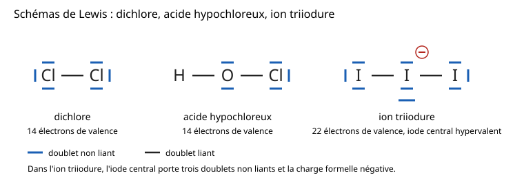
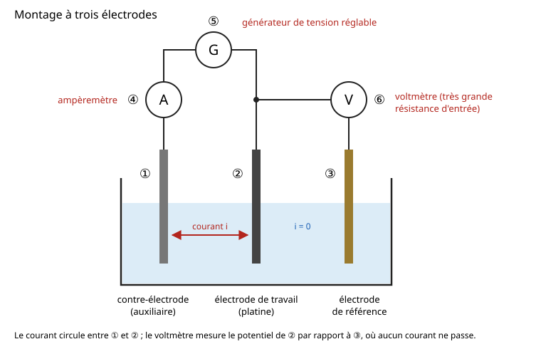
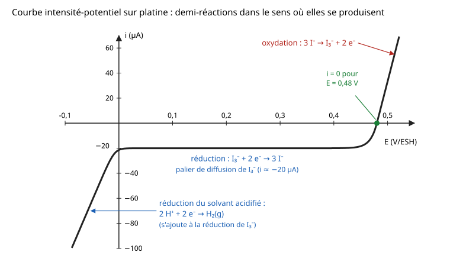
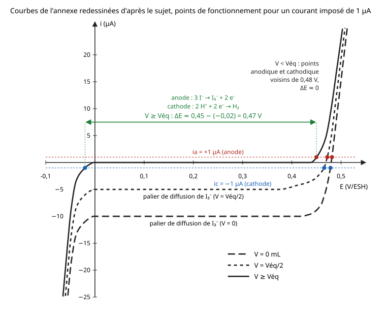
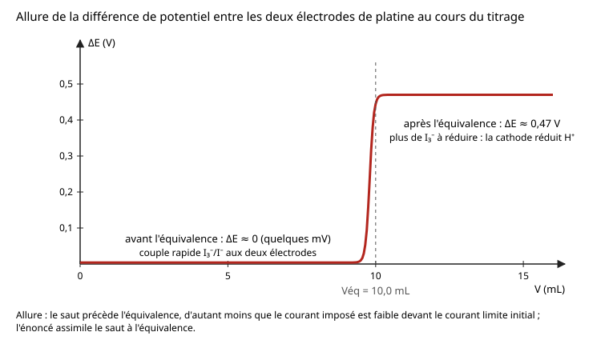

# Banque PT PT — Physique B - Chimie 2016 · Corrigé guidé

*Corrigé rédigé par IA, non officiel. Signalez toute erreur.*

**Rédaction** · modèle exact non renseigné (famille Claude) · effort non renseigné · vitesse non renseignée

## Présentation du sujet

**Thème.** Les dérivés halogénés, des dihalogènes à l'eau de Javel. L'épreuve dure 2 heures, **sans calculatrice**, et comporte 36 questions réparties en quatre parties indépendantes, avec une feuille annexe à compléter et à rendre.

- *Partie 1 (questions 1 à 5)* : configuration électronique de l'iode, pouvoir oxydant des dihalogènes, protocole expérimental qualitatif, schémas de Lewis, états physiques et forces intermoléculaires.
- *Partie 2 (questions 6 à 13)* : titrage indirect des ions hypochlorite par iodométrie, puis cinétique de la décoloration de l'érythrosine B (dégénérescence de l'ordre, méthode intégrale, ordres partiels et constante de vitesse).
- *Partie 3 (questions 14 à 28)* : thermodynamique du procédé Deacon : variance, enthalpie standard de réaction, constante d'équilibre, relation de Van't Hoff, température initiale d'un réacteur adiabatique, influence de la pression et d'un gaz inerte.
- *Partie 4 (questions 29 à 36)* : montage à trois électrodes, lecture d'une courbe intensité-potentiel, dosage potentiométrique à courant imposé des ions cuivre (II) d'une bouillie bordelaise.

**Notions mobilisées.** Classification périodique, schémas de Lewis, interactions de Van der Waals, oxydoréduction et titrages, loi de vitesse et ordres de réaction, variance, loi de Hess, relation de Van't Hoff, premier principe appliqué à la réaction chimique, quotient de réaction et déplacement d'équilibre, courbes intensité-potentiel, relation de Nernst.

**Difficulté.** Le rapport décrit un sujet qui couvre largement les programmes de première et de seconde année et qui privilégie l'évaluation de notions simples. Les calculs sont préparés pour être faits à la main (rapports numériques fournis : 116/29 = 4, 63,5/15,9 ≈ 4,00 ; valeurs de la constante d'équilibre et de la température finale données pour pouvoir continuer). Les questions qui demandent le plus de recul sont le protocole (question 3), la variance (question 14), le bilan enthalpique (question 22) et l'exploitation de l'annexe (questions 34 et 35).

**Gestion du temps.** Environ 20 minutes pour la partie 1, 30 pour la partie 2, 40 pour la partie 3 (quinze questions, dont plusieurs très courtes : 15, 21, 24) et 30 pour la partie 4. Les parties sont indépendantes et l'énoncé donne les résultats intermédiaires utiles : ne pas rester bloqué. Penser à rendre l'annexe complétée (question 34).

> [!JURY]
> Le rapport 2016 formule trois remarques générales. Le jury a souvent apprécié la qualité de la présentation (résultats numériques soulignés, expressions littérales encadrées) et de la rédaction. Seule une réponse justifiée et argumentée obtient la totalité des points d'une question. Les unités doivent impérativement être précisées pour que les points des applications numériques soient attribués, notamment pour les constantes de vitesse et les grandeurs de réaction. Il juge le niveau d'ensemble des copies plus faible que les années précédentes, tout en saluant quelques excellentes copies.

[Sujet officiel](https://www.banquept.fr/documents/2016/ph_b_ch_2016_pt.pdf) · [Rapport du jury](https://www.banquept.fr/documents/ecrit/rapport/2016/rapport_phys_b_ecrit_2016.pdf)

*Mode d'emploi* : chercher chaque question seul, lire la première indication en cas de blocage, réessayer, puis la seconde, et seulement ensuite la solution.

## Partie 1 — Quelques aspects de la chimie des halogènes

Atomistique et structure : configuration électronique, évolution du pouvoir oxydant dans la colonne, schémas de Lewis, forces intermoléculaires. La question 3 demande de l'initiative.

### Question 1

> [!INDICATION]
> Situer l'iode par rapport au brome : même colonne, une période plus bas. La période donne le nombre quantique principal de la couche de valence, la colonne donne son remplissage.

> [!INDICATION]
> Écrire le remplissage dans l'ordre habituel jusqu'à la sous-couche 5p, sans oublier les sous-couches d complètes intercalées.

#### Solution

L'iode est sous le brome (4ᵉ période) dans la 17ᵉ colonne : il appartient à la **5ᵉ période** et à l'avant-dernière colonne du bloc p. Sa couche de valence est donc $5s^2\,5p^5$, et le remplissage complet s'écrit

$$\boxed{\mathrm{I} : 1s^2\,2s^2\,2p^6\,3s^2\,3p^6\,4s^2\,3d^{10}\,4p^6\,5s^2\,4d^{10}\,5p^5}$$

soit $Z = 53$ électrons. Les **électrons de valence** sont ceux de la couche de nombre quantique principal le plus élevé, $5s^2\,5p^5$ : il y en a **sept** (la sous-couche $4d$, complète, n'en fait pas partie).

> [!JURY]
> D'après le rapport 2016, cette configuration a parfois posé problème, et de nombreuses copies ont donné celle du brome faute d'avoir lu l'énoncé avec attention. D'autres ont énoncé le principe de Pauli et la règle de Klechkowski, ce qui n'était pas demandé. Le jury recommande de prendre le temps de l'analyse, puis de répondre de façon concise, en se limitant à la question posée.

### Question 2

> [!INDICATION]
> Quelle propriété atomique mesure l'aptitude d'un atome à attirer les électrons, et comment varie-t-elle dans une colonne ?

#### Solution

Dans une colonne, l'électronégativité diminue quand on descend : $\chi(\mathrm{I}) < \chi(\mathrm{Br}) < \chi(\mathrm{Cl})$. Un halogène capte d'autant plus facilement un électron (pour former l'ion halogénure, de configuration de gaz noble) qu'il est plus électronégatif. Le pouvoir oxydant du dihalogène suit donc le même ordre :

$$\boxed{\mathrm{I_2} < \mathrm{Br_2} < \mathrm{Cl_2}\quad\text{(pouvoir oxydant croissant)}}$$

> [!PIEGE]
> L'ordre demandé est croissant : commencer par le moins oxydant. Justifier par la position dans la colonne, pas par les potentiels standard, qui ne sont pas fournis ici.

### Question 3

> [!INDICATION]
> Un oxydant plus fort déplace un oxydant plus faible de son halogénure. Que peut-on mélanger, et que regarde-t-on ?

> [!INDICATION]
> Le tableau donne une couleur par dihalogène et des halogénures tous incolores : croiser chaque dihalogène avec les halogénures des deux autres et prévoir la teinte finale.

#### Solution

**Principe.** Un dihalogène $\mathrm{X_2}$ oxyde l'ion halogénure $\mathrm{Y^-}$ d'un halogène moins oxydant selon $\mathrm{X_2} + 2\,\mathrm{Y^-} = 2\,\mathrm{X^-} + \mathrm{Y_2}$. Les ions halogénure sont incolores et les trois dihalogènes ont des couleurs différentes en solution : la réaction se repère par un changement de couleur.

**Protocole.** Sous la hotte, avec gants et lunettes (dichlore et dibrome sont toxiques), on prépare six tubes à essai. Dans chacun, on verse environ 1 mL d'une solution de dihalogène, puis 1 mL d'une solution d'halogénure de potassium d'un **autre** halogène ; on agite et on compare la teinte à celle d'un tube témoin (dihalogène + eau).

| Dihalogène versé | Halogénure ajouté | Observation | Conclusion |
|---|---|---|---|
| $\mathrm{Cl_2}$ (jaune pâle) | $\mathrm{K^+ + Br^-}$ | la solution devient orange | $\mathrm{Cl_2}$ oxyde $\mathrm{Br^-}$ en $\mathrm{Br_2}$ |
| $\mathrm{Cl_2}$ (jaune pâle) | $\mathrm{K^+ + I^-}$ | la solution devient brune | $\mathrm{Cl_2}$ oxyde $\mathrm{I^-}$ |
| $\mathrm{Br_2}$ (orange) | $\mathrm{K^+ + Cl^-}$ | reste orange | pas de réaction |
| $\mathrm{Br_2}$ (orange) | $\mathrm{K^+ + I^-}$ | la solution devient brune | $\mathrm{Br_2}$ oxyde $\mathrm{I^-}$ |
| $\mathrm{I_2}$ (brun) | $\mathrm{K^+ + Cl^-}$ | reste brune | pas de réaction |
| $\mathrm{I_2}$ (brun) | $\mathrm{K^+ + Br^-}$ | reste brune | pas de réaction |

**Exploitation.** Le dichlore oxyde les deux autres halogénures, le dibrome oxyde seulement l'iodure, le diiode n'en oxyde aucun : on retrouve $\mathrm{I_2} < \mathrm{Br_2} < \mathrm{Cl_2}$. Le critère est thermodynamique (la réaction a lieu ou non), et non cinétique : on ne compare pas des vitesses de changement de couleur.

> [!METHODE]
> Un protocole se rédige en trois temps : le principe (quelle réaction, quel signe observable), les gestes (quoi, combien, dans quoi, avec quelles précautions), puis l'exploitation (ce que chaque observation permet de conclure). Un tableau des croisements évite les oublis.

> [!JURY]
> Le rapport note que les candidats ont rarement su construire ce protocole, et que certains ont confondu des notions cinétiques (vitesse de la réaction) et thermodynamiques (caractère plus ou moins oxydant). Les copies qui ont correctement traité cette question, qui demande analyse et synthèse, ont été valorisées.

### Question 4

> [!INDICATION]
> Compter d'abord les électrons de valence de chaque édifice (sans oublier la charge), puis les répartir en doublets liants et non liants.

> [!INDICATION]
> Pour l'ion triiodure, les trois atomes sont alignés ; les onze doublets ne peuvent pas tous se placer en respectant l'octet sur l'atome central : l'iode peut dépasser l'octet.

#### Solution

Décompte des électrons de valence : 7 par halogène, 6 pour l'oxygène ($Z = 8$ : $1s^2\,2s^2\,2p^4$), 1 pour l'hydrogène.

- $\mathrm{Cl_2}$ : $2\times 7 = 14$ électrons, soit 7 doublets. Une liaison simple $\mathrm{Cl-Cl}$ et trois doublets non liants sur chaque atome ; chaque chlore vérifie la règle de l'octet.
- $\mathrm{ClOH}$ : $7 + 6 + 1 = 14$ électrons, soit 7 doublets. L'oxygène est central : $\mathrm{H-O-Cl}$, deux doublets non liants sur l'oxygène, trois sur le chlore, aucune charge formelle.
- $\mathrm{I_3^-}$ : $3\times 7 + 1 = 22$ électrons, soit 11 doublets. Enchaînement $\mathrm{I-I-I}$ : deux liaisons simples, trois doublets non liants sur chaque iode terminal et **trois doublets non liants sur l'iode central**, qui s'entoure ainsi de 10 électrons (hypervalence, possible à partir de la 3ᵉ période). La charge formelle $-1$ est portée par l'iode central : $7 - (6 + 2) = -1$.

> [!PIEGE]
> Pour l'ion triiodure, oublier l'électron supplémentaire de la charge conduit à 21 électrons, nombre impair. Une structure qui respecterait l'octet sur l'iode central ne permettrait de placer que 10 doublets : le onzième va sur l'atome central.

### Question 5

> [!INDICATION]
> Ces molécules sont-elles polaires ? En déduire le seul type d'interaction de Van der Waals qui assure la cohésion.

> [!INDICATION]
> Relier l'intensité de cette interaction à la taille du nuage électronique, puis aux températures de changement d'état.

#### Solution

Les molécules $\mathrm{Cl_2}$, $\mathrm{Br_2}$ et $\mathrm{I_2}$ sont **apolaires** (deux atomes identiques). La cohésion de leurs phases condensées n'est due qu'aux interactions de Van der Waals de type **dipôle instantané - dipôle induit** (interactions de London, ou de dispersion). Leur intensité augmente avec la **polarisabilité** de la molécule, c'est-à-dire avec la taille de son nuage électronique : $\mathrm{Cl_2} < \mathrm{Br_2} < \mathrm{I_2}$.

Plus ces interactions sont fortes, plus il faut d'énergie pour séparer les molécules, et plus les températures de fusion et d'ébullition sont élevées. À 298 K, l'agitation thermique suffit à disperser les molécules de dichlore (gaz), mais pas celles de dibrome (liquide) ni, a fortiori, celles de diiode (solide).

> [!PIEGE]
> Les liaisons covalentes internes aux molécules ne sont pas rompues lors d'un changement d'état : c'est la cohésion entre molécules qui est en jeu. Il n'y a ici ni liaison hydrogène ni interaction entre dipôles permanents.

> [!JURY]
> Le rapport indique que l'analyse des forces intermoléculaires, lorsqu'elle a été correctement menée, a été valorisée ; l'attendu est le lien qualitatif entre l'intensité de ces forces et la polarisabilité des dihalogènes.

## Partie 2 — Suivi cinétique de la décoloration de l'érythrosine B

Un titrage indirect donne la concentration de la solution d'hypochlorite, puis un suivi spectrophotométrique fournit les ordres partiels par dégénérescence de l'ordre et méthode intégrale.

**2.1. Dosage de la solution d'hypochlorite de sodium commerciale**

### Question 6

> [!INDICATION]
> Écrire d'abord chaque demi-équation électronique en milieu acide, puis combiner pour éliminer les électrons.

> [!INDICATION]
> Pour le caractère favorisé, comparer les potentiels standard du couple de l'oxydant et du couple du réducteur.

#### Solution

Demi-équations (milieu acidifié par l'acide éthanoïque) :

$$\mathrm{ClO^-_{(aq)}} + 2\,\mathrm{H^+_{(aq)}} + 2\,e^- = \mathrm{Cl^-_{(aq)}} + \mathrm{H_2O_{(\ell)}}$$

$$2\,\mathrm{I^-_{(aq)}} = \mathrm{I_{2(aq)}} + 2\,e^-$$

Bilan :

$$\boxed{\mathrm{ClO^-_{(aq)}} + 2\,\mathrm{I^-_{(aq)}} + 2\,\mathrm{H^+_{(aq)}} = \mathrm{Cl^-_{(aq)}} + \mathrm{I_{2(aq)}} + \mathrm{H_2O_{(\ell)}}}$$

Les protons sont apportés par l'acide éthanoïque ; en présence de l'excès d'ions iodure, le diiode formé se trouve sous forme d'ions triiodure.

L'oxydant $\mathrm{ClO^-}$ appartient au couple de plus haut potentiel standard ($0{,}89\ \mathrm V$) et le réducteur $\mathrm{I^-}$ au couple de plus bas potentiel standard ($0{,}54\ \mathrm V$) : la réaction est **thermodynamiquement favorisée**. L'écart de $0{,}35\ \mathrm V$ pour deux électrons échangés correspond à une constante d'équilibre de l'ordre de $10^{2\times 0{,}35/0{,}06} \approx 10^{12}$ : la réaction est quantitative.

> [!JURY]
> Le rapport rappelle que l'écriture de ces réactions demandait d'établir d'abord les demi-équations d'oxydoréduction. Il note que de nombreux candidats ont compris que des réactions servant de support à un titrage doivent être thermodynamiquement favorisées, et ont su le justifier qualitativement.

### Question 7

> [!INDICATION]
> Même démarche qu'à la question 6 : deux demi-équations, puis le bilan ; deux ions thiosulfate donnent un ion tétrathionate.

#### Solution

Demi-équations :

$$\mathrm{I_{2(aq)}} + 2\,e^- = 2\,\mathrm{I^-_{(aq)}}$$

$$2\,\mathrm{S_2O_3^{2-}{}_{(aq)}} = \mathrm{S_4O_6^{2-}{}_{(aq)}} + 2\,e^-$$

Bilan :

$$\boxed{\mathrm{I_{2(aq)}} + 2\,\mathrm{S_2O_3^{2-}{}_{(aq)}} = 2\,\mathrm{I^-_{(aq)}} + \mathrm{S_4O_6^{2-}{}_{(aq)}}}$$

L'oxydant $\mathrm{I_2}$ ($E^\circ = 0{,}54\ \mathrm V$) réagit avec le réducteur $\mathrm{S_2O_3^{2-}}$ d'un couple de potentiel standard nettement plus bas ($0{,}08\ \mathrm V$) : la réaction est **favorisée**, et même quantitative (écart de $0{,}46\ \mathrm V$ pour deux électrons, constante de l'ordre de $10^{15}$), comme il convient à une réaction de titrage.

### Question 8

> [!INDICATION]
> Titrage indirect : raisonner sur les quantités de matière. Combien de diiode une mole d'ions hypochlorite produit-elle ? Combien d'ions thiosulfate une mole de diiode consomme-t-elle ?

> [!INDICATION]
> Ne pas oublier que la prise d'essai provient d'une solution fille : calculer le facteur de dilution entre la solution commerciale et la fiole.

#### Solution

C'est un titrage indirect. Les ions iodure et l'acide étant en excès, tous les ions hypochlorite de la prise d'essai sont transformés en diiode (question 6) :

$$n(\mathrm{I_2})_{\text{formé}} = n(\mathrm{ClO^-})_{\text{prise}}$$

À l'équivalence du titrage (question 7) :

$$n(\mathrm{I_2})_{\text{formé}} = \frac{n(\mathrm{S_2O_3^{2-}})_{\text{versé}}}{2} = \frac{C\,V'}{2}$$

La concentration de la solution fille est donc

$$C_{\text{fille}} = \frac{C\,V'}{2\,V_E} = \frac{2{,}0\cdot 10^{-2}\times 16{,}0}{2\times 10{,}0} = 1{,}6\cdot 10^{-2}\ \mathrm{mol\cdot L^{-1}}$$

La solution fille est obtenue par dilution d'un facteur $V_F/V_0 = 100/2{,}00 = 50$ :

$$C_{\text{com}} = \frac{V_F}{V_0}\,\frac{C\,V'}{2\,V_E}$$

$$\boxed{C_{\text{com}} = 50\times 1{,}6\cdot 10^{-2} = 0{,}80\ \mathrm{mol\cdot L^{-1}}}$$

Vérification : la solution ① de la suite contient 3,0 mL de solution commerciale dans 30,0 mL, soit $0{,}80\times 3{,}0/30{,}0 = 0{,}080\ \mathrm{mol\cdot L^{-1}}$, valeur du tableau de l'énoncé.

> [!METHODE]
> Dans un titrage indirect, écrire une égalité de quantités de matière par réaction, dans l'ordre des opérations, puis les enchaîner. Ne convertir en concentration qu'à la fin, en tenant compte de la dilution.

> [!PIEGE]
> Deux facteurs sont souvent oubliés : le coefficient 2 du thiosulfate (une mole de diiode consomme deux moles d'ions thiosulfate) et le facteur de dilution 50 entre la solution commerciale et la solution fille. Les volumes de 10 mL d'iodure et de 5,0 mL d'acide, réactifs en excès, n'interviennent pas.

> [!JURY]
> Le rapport juge l'exploitation du volume équivalent très décevante : les candidats raisonnent rarement sur des bilans de quantité de matière.

**2.2. Suivi cinétique de la décoloration de l'érythrosine B**

### Question 9

> [!INDICATION]
> Comparer les ordres de grandeur des deux concentrations initiales. Que peut-on dire de la concentration du réactif en très large excès au cours du temps ?

#### Solution

Dans les quatre mélanges, $[\mathrm{ClO^-}]_0$ vaut de $8{,}00\cdot 10^{-2}$ à $0{,}320\ \mathrm{mol\cdot L^{-1}}$, alors que $[\mathrm{E127}]_0 = 2{,}8\cdot 10^{-6}\ \mathrm{mol\cdot L^{-1}}$ : l'ion hypochlorite est en excès d'un facteur supérieur à $10^{4}$. Sa concentration reste donc pratiquement égale à sa valeur initiale pendant toute la réaction (dégénérescence de l'ordre) :

$$\boxed{v = k_{app}\,[\mathrm{E127}]^{\alpha}\qquad\text{avec}\qquad k_{app} = k\,[\mathrm{ClO^-}]_0^{\beta}}$$

> [!METHODE]
> Dégénérescence de l'ordre : un réactif en très large excès garde une concentration quasi constante, que l'on regroupe avec la constante de vitesse dans une constante apparente. L'étude donne alors l'ordre partiel par rapport à l'autre réactif.

### Question 10

> [!INDICATION]
> Relier la vitesse à la dérivée de la concentration en érythrosine, puis reconnaître une équation différentielle linéaire du premier ordre.

#### Solution

Par définition de la vitesse volumique, $v = -\dfrac{\mathrm d[\mathrm{E127}]}{\mathrm dt}$, d'où

$$\frac{\mathrm d[\mathrm{E127}]}{\mathrm dt} + k_{app}\,[\mathrm{E127}] = 0$$

Équation linéaire du premier ordre, de solution, avec la condition initiale $[\mathrm{E127}](0) = [\mathrm{E127}]_0$ :

$$\boxed{[\mathrm{E127}](t) = [\mathrm{E127}]_0\,\exp(-k_{app}\,t)}$$

soit, sous la forme utile à l'exploitation graphique,

$$\ln\frac{[\mathrm{E127}]}{[\mathrm{E127}]_0} = -k_{app}\,t$$

$k_{app}$ s'exprime alors en $\mathrm{s^{-1}}$ ; la concentration tend vers zéro aux temps longs, comme attendu pour une réaction totale.

### Question 11

> [!INDICATION]
> L'équation n'est plus linéaire : séparer les variables (la concentration d'un côté, le temps de l'autre) avant d'intégrer.

#### Solution

$$\frac{\mathrm d[\mathrm{E127}]}{\mathrm dt} = -k_{app}\,[\mathrm{E127}]^{2}$$

On sépare les variables :

$$-\frac{\mathrm d[\mathrm{E127}]}{[\mathrm{E127}]^{2}} = k_{app}\,\mathrm dt$$

et on intègre entre $0$ et $t$ :

$$\boxed{\frac{1}{[\mathrm{E127}](t)} = \frac{1}{[\mathrm{E127}]_0} + k_{app}\,t}$$

soit

$$[\mathrm{E127}](t) = \frac{[\mathrm{E127}]_0}{1 + k_{app}\,[\mathrm{E127}]_0\,t}$$

$k_{app}$ s'exprime alors en $\mathrm{L\cdot mol^{-1}\cdot s^{-1}}$.

> [!JURY]
> Le rapport constate que l'écriture et la résolution des équations différentielles ont été inégalement réussies, de nombreux candidats ne sachant pas les résoudre. Il invite à analyser le résultat obtenu : homogénéité, conditions limites.

### Question 12

> [!INDICATION]
> Chaque hypothèse prévoit qu'une certaine fonction de la concentration est affine en fonction du temps. Laquelle des deux représentations donne réellement une droite ?

> [!INDICATION]
> Ne pas se contenter du coefficient de corrélation : regarder la répartition des points autour de la droite et l'ordonnée à l'origine. La pente de la bonne droite donne la constante apparente.

#### Solution

- Si $\alpha = 1$, $\ln([\mathrm{E127}]/[\mathrm{E127}]_0)$ est une fonction linéaire de $t$, de pente $-k_{app}$. Sur le premier graphique, les points sont alignés sur une droite passant par l'origine, avec $R^2 = 0{,}9992$.
- Si $\alpha = 2$, $1/[\mathrm{E127}]$ est une fonction affine de $t$. Sur le second graphique, les points dessinent une courbe (au-dessus de la droite aux extrémités, en dessous au milieu), le coefficient $R^2 = 0{,}9827$ est moins bon, et l'ordonnée à l'origine de la droite, $3{,}18\cdot 10^{5}\ \mathrm{L\cdot mol^{-1}}$, ne redonne pas $1/[\mathrm{E127}]_0 = 1/(2{,}8\cdot 10^{-6}) \approx 3{,}6\cdot 10^{5}\ \mathrm{L\cdot mol^{-1}}$.

L'ordre 1 est donc le seul compatible avec l'expérience :

$$\boxed{\alpha = 1}$$

La pente de la première droite donne

$$\boxed{k_{app}^{(1)} = 2{,}20\cdot 10^{-3}\ \mathrm{s^{-1}}}$$

> [!PIEGE]
> Un coefficient de corrélation de 0,98 n'est pas la preuve d'un bon modèle : ce sont des points répartis de façon systématique (en arc) autour de la droite qui trahissent le mauvais choix. Penser aussi à l'unité de la constante apparente, qui dépend de l'ordre retenu.

> [!JURY]
> D'après le rapport, dans les copies où les expressions temporelles des concentrations avaient été établies, l'analyse des résultats expérimentaux pour trouver les ordres partiels a souvent été menée à bien. Il rappelle par ailleurs que les unités sont indispensables pour obtenir les points des applications numériques, les constantes de vitesse étant citées en exemple.

### Question 13

> [!INDICATION]
> Écrire le lien entre la constante apparente et la concentration initiale en ions hypochlorite, puis chercher comment la première varie quand la seconde double.

#### Solution

$k_{app} = k\,[\mathrm{ClO^-}]_0^{\beta}$. On forme le rapport $k_{app}/[\mathrm{ClO^-}]_0$ :

| Solution | $[\mathrm{ClO^-}]_0$ ($\mathrm{mol\cdot L^{-1}}$) | $k_{app}$ ($\mathrm{s^{-1}}$) | $k_{app}/[\mathrm{ClO^-}]_0$ ($\mathrm{L\cdot mol^{-1}\cdot s^{-1}}$) |
|---|---|---|---|
| ① | 0,0800 | $2{,}20\cdot 10^{-3}$ | $2{,}75\cdot 10^{-2}$ |
| ② | 0,160 | $4{,}40\cdot 10^{-3}$ | $2{,}75\cdot 10^{-2}$ |
| ③ | 0,240 | $6{,}60\cdot 10^{-3}$ | $2{,}75\cdot 10^{-2}$ |
| ④ | 0,320 | $8{,}80\cdot 10^{-3}$ | $2{,}75\cdot 10^{-2}$ |

Quand la concentration en ions hypochlorite double, triple ou quadruple, $k_{app}$ double, triple ou quadruple : $k_{app}$ est proportionnelle à $[\mathrm{ClO^-}]_0$, donc

$$\boxed{\beta = 1}$$

et le coefficient de proportionnalité est la constante de vitesse. L'énoncé le donne directement : pour $[\mathrm{ClO^-}]_0 = 1{,}00\cdot 10^{-1}\ \mathrm{mol\cdot L^{-1}}$, $k_{app} = 2{,}75\cdot 10^{-3}\ \mathrm{s^{-1}}$, soit

$$\boxed{k = \frac{k_{app}}{[\mathrm{ClO^-}]_0} = 2{,}75\cdot 10^{-2}\ \mathrm{L\cdot mol^{-1}\cdot s^{-1}}\quad\text{à 298 K}}$$

La loi de vitesse est $v = k\,[\mathrm{E127}]\,[\mathrm{ClO^-}]$, d'ordre global 2.

> [!PIEGE]
> La constante de vitesse et la constante apparente n'ont pas la même unité : la première s'exprime ici en litre par mole et par seconde, la seconde en inverse de seconde.

## Partie 3 — Étude du procédé Deacon

Thermodynamique d'un équilibre en phase gazeuse : variance, loi de Hess, relation de Van't Hoff, bilan enthalpique d'un réacteur adiabatique, déplacements d'équilibre par comparaison du quotient de réaction et de la constante.

**3.1. Influence de la température sur l'équilibre**

### Question 14

> [!INDICATION]
> Dénombrer les paramètres intensifs qui décrivent l'équilibre, puis les relations qui les lient.

> [!INDICATION]
> Aux deux relations habituelles (somme des fractions molaires, condition d'équilibre) s'ajoutent celles qu'impose la composition initiale particulière, sur les réactifs d'une part et sur les produits d'autre part.

#### Solution

Le système comporte une seule phase gazeuse contenant quatre constituants. Son état d'équilibre est décrit par les paramètres intensifs

$$T,\quad P,\quad x_{\mathrm{HCl}},\quad x_{\mathrm{O_2}},\quad x_{\mathrm{Cl_2}},\quad x_{\mathrm{H_2O}}\qquad\text{(6 paramètres)}$$

liés par quatre relations indépendantes :

- la somme des fractions molaires : $x_{\mathrm{HCl}} + x_{\mathrm{O_2}} + x_{\mathrm{Cl_2}} + x_{\mathrm{H_2O}} = 1$ ;
- la condition d'équilibre chimique : $Q = K^\circ(T)$ ;
- les réactifs introduits en proportions stœchiométriques le restent : $n_{\mathrm{HCl}} = 4\,n_{\mathrm{O_2}}$, soit $x_{\mathrm{HCl}} = 4\,x_{\mathrm{O_2}}$ ;
- les produits, absents au départ, sont formés dans les proportions de l'équation : $n_{\mathrm{Cl_2}} = n_{\mathrm{H_2O}}$, soit $x_{\mathrm{Cl_2}} = x_{\mathrm{H_2O}}$.

$$\boxed{v = 6 - 4 = 2}$$

Le système est divariant : l'opérateur peut fixer deux paramètres intensifs, par exemple $T$ et $P$, et l'état d'équilibre (toutes les fractions molaires) est alors déterminé. C'est ce qui est fait dans la suite, où $P$ est fixée et où la donnée de $\tau$ fixe $T_f$.

> [!METHODE]
> Pour calculer une variance par dénombrement : lister les paramètres intensifs (température, pression, fractions molaires dans chaque phase), puis retrancher le nombre de relations indépendantes (une somme de fractions molaires par phase, une condition par équilibre chimique, et les relations particulières dues aux conditions initiales).

> [!JURY]
> Le rapport signale des calculs de variance souvent incertains et insuffisamment justifiés, les relations entre paramètres (le rapport parle de paramètres extensifs) n'ayant pas été comptabilisées. Il rappelle que la relation de Gibbs est hors programme.

### Question 15

> [!INDICATION]
> Revenir à la définition de la réaction de formation : de quoi part-on ?

#### Solution

$$\boxed{\Delta_f H^\circ(\mathrm{O_{2(g)}}) = 0\qquad\text{et}\qquad\Delta_f H^\circ(\mathrm{Cl_{2(g)}}) = 0}$$

L'enthalpie standard de formation est l'enthalpie standard de la réaction de formation d'une mole du composé à partir des corps simples, dans leur état standard de référence, des éléments qui le constituent. Or $\mathrm{O_{2(g)}}$ et $\mathrm{Cl_{2(g)}}$ sont précisément les états standard de référence des éléments oxygène et chlore à la température considérée : leur réaction de formation ne transforme rien.

### Question 16

> [!INDICATION]
> Loi de Hess avec les coefficients stœchiométriques algébriques. Le signe du résultat, reporté dans la relation de Van't Hoff, donne le sens de variation de la constante.

#### Solution

Loi de Hess :

$$\Delta_r H^\circ = 2\,\Delta_f H^\circ(\mathrm{Cl_{2(g)}}) + 2\,\Delta_f H^\circ(\mathrm{H_2O_{(g)}}) - 4\,\Delta_f H^\circ(\mathrm{HCl_{(g)}}) - \Delta_f H^\circ(\mathrm{O_{2(g)}})$$

$$\Delta_r H^\circ = 2\times(-242) - 4\times(-92) = -484 + 368$$

$$\boxed{\Delta_r H^\circ = -116\ \mathrm{kJ\cdot mol^{-1}}}$$

La réaction est **exothermique**. D'après la relation de Van't Hoff,

$$\frac{\mathrm d\ln K^\circ}{\mathrm dT} = \frac{\Delta_r H^\circ}{R\,T^{2}} < 0$$

la constante d'équilibre **diminue quand la température augmente** : une élévation de température défavorise la formation du dichlore.

> [!PIEGE]
> Les enthalpies standard de formation se pondèrent par les coefficients stœchiométriques : quatre fois celle du chlorure d'hydrogène, deux fois celle de l'eau. Donner le résultat avec son unité, en kilojoule par mole.

### Question 17

> [!INDICATION]
> La thermodynamique n'est pas le seul critère d'un procédé : penser à la durée nécessaire pour atteindre l'équilibre.

#### Solution

Du seul point de vue thermodynamique, une basse température serait préférable (réaction exothermique, $K^\circ$ d'autant plus grande que $T$ est basse). Mais vers 300 K la réaction est beaucoup trop lente, même en présence du catalyseur : la vitesse de réaction augmente fortement avec la température (loi d'Arrhenius), et le catalyseur n'est actif qu'à chaud. Une température de 700 à 900 K résulte d'un **compromis** : la transformation est assez rapide, et la constante d'équilibre reste suffisante pour que le taux de conversion soit acceptable (encore $\tau = 0{,}50$ à 900 K d'après la suite).

> [!METHODE]
> Pour une réaction exothermique, thermodynamique et cinétique tirent en sens opposés quand la température varie : le choix industriel est un compromis, à énoncer en citant les deux aspects.

**3.2. Choix de la température d'équilibre**

### Question 18

> [!INDICATION]
> Dresser un tableau d'avancement en quantités de matière, sans oublier la colonne de la quantité totale de gaz. Le taux d'avancement se rapporte à l'avancement maximal.

#### Solution

Tableau d'avancement (quantités en mol) :

| | $4\,\mathrm{HCl_{(g)}}$ | $\mathrm{O_{2(g)}}$ | $2\,\mathrm{Cl_{2(g)}}$ | $2\,\mathrm{H_2O_{(g)}}$ | total gaz |
|---|---|---|---|---|---|
| État initial | 4,0 | 1,0 | 0 | 0 | 5,0 |
| Avancement $\xi$ | $4{,}0 - 4\xi$ | $1{,}0 - \xi$ | $2\xi$ | $2\xi$ | $5{,}0 - \xi$ |

Le mélange est stœchiométrique : $\xi_{\max} = 1{,}0\ \mathrm{mol}$, et $\xi_{\mathrm{éq}} = \tau\,\xi_{\max} = 0{,}50\ \mathrm{mol}$. D'où

$$\boxed{n_{\mathrm{HCl}} = 2{,}0\ \mathrm{mol},\quad n_{\mathrm{O_2}} = 0{,}50\ \mathrm{mol},\quad n_{\mathrm{Cl_2}} = 1{,}0\ \mathrm{mol},\quad n_{\mathrm{H_2O}} = 1{,}0\ \mathrm{mol},\quad n_{tot} = 4{,}5\ \mathrm{mol}}$$

### Question 19

> [!INDICATION]
> Exprimer la constante avec les pressions partielles, elles-mêmes écrites avec les quantités de matière, la quantité totale de gaz et la pression totale.

#### Solution

Avec les pressions partielles $P_i = \dfrac{n_i}{n_{tot}}\,P$ (gaz parfaits) :

$$K^\circ(T_f) = \frac{P_{\mathrm{Cl_2}}^{2}\,P_{\mathrm{H_2O}}^{2}\,P^\circ}{P_{\mathrm{HCl}}^{4}\,P_{\mathrm{O_2}}} = \frac{n_{\mathrm{Cl_2}}^{2}\,n_{\mathrm{H_2O}}^{2}\,n_{tot}}{n_{\mathrm{HCl}}^{4}\,n_{\mathrm{O_2}}}\,\frac{P^\circ}{P}$$

Avec $P = P^\circ = 1{,}0\ \mathrm{bar}$ :

$$K^\circ(T_f) = \frac{1{,}0^{2}\times 1{,}0^{2}\times 4{,}5}{2{,}0^{4}\times 0{,}50} = \frac{4{,}5}{8{,}0}$$

$$\boxed{K^\circ(T_f) = \frac{9}{16} \approx 5{,}6\cdot 10^{-1}}$$

conforme à la valeur annoncée par l'énoncé.

> [!PIEGE]
> La quantité totale de gaz ne se simplifie pas : la réaction fait passer de cinq à quatre moles de gaz, il reste donc un facteur $n_{tot}$ au numérateur. L'oublier donne 1/8 au lieu de 9/16.

### Question 20

> [!INDICATION]
> Intégrer la relation de Van't Hoff entre les deux températures en considérant l'enthalpie standard de réaction constante.

> [!INDICATION]
> Isoler l'inverse de la température finale avant d'inverser ; contrôler le signe (une réaction exothermique a une constante plus faible à plus haute température).

#### Solution

Relation de Van't Hoff :

$$\frac{\mathrm d\ln K^\circ}{\mathrm dT} = \frac{\Delta_r H^\circ}{R\,T^{2}}$$

$\Delta_r H^\circ$ étant indépendante de la température, on intègre entre $T'$ et $T_f$ :

$$\ln\frac{K^\circ(T_f)}{K^\circ(T')} = -\frac{\Delta_r H^\circ}{R}\left(\frac{1}{T_f} - \frac{1}{T'}\right)$$

$$\frac{1}{T_f} = \frac{1}{T'} - \frac{R}{\Delta_r H^\circ}\,\ln\frac{K^\circ(T_f)}{K^\circ(T')}$$

$$\boxed{T_f = \left[\frac{1}{T'} - \frac{R}{\Delta_r H^\circ}\,\ln\frac{K^\circ(T_f)}{K^\circ(T')}\right]^{-1}}$$

Contrôle : $\ln\dfrac{5{,}6\cdot 10^{-1}}{3{,}2\cdot 10^{6}} \approx -15{,}6$ et $\dfrac{R}{\Delta_r H^\circ} = \dfrac{8{,}3}{-116\cdot 10^{3}} \approx -7{,}2\cdot 10^{-5}\ \mathrm{K^{-1}}$, d'où $\dfrac{1}{T_f} \approx 2{,}22\cdot 10^{-3} - 1{,}11\cdot 10^{-3} = 1{,}11\cdot 10^{-3}\ \mathrm{K^{-1}}$, soit $T_f \approx 9{,}0\cdot 10^{2}\ \mathrm K$, valeur de l'énoncé. On vérifie que $T_f > T'$ : la constante est plus petite à $T_f$, ce qui est cohérent avec une réaction exothermique.

> [!JURY]
> Le rapport indique que la relation de Van't Hoff est en général connue, mais que son intégration a trop souvent posé problème, et qu'elle est parfois confondue avec la loi de Van't Hoff, qui est hors programme.

**3.3. Choix de la température initiale**

### Question 21

> [!INDICATION]
> Quelle grandeur le premier principe relie-t-il au transfert thermique pour une transformation isobare ? Que vaut ce transfert dans un réacteur calorifugé ?

#### Solution

La transformation est **isobare** (état initial et état final à l'équilibre mécanique sous la pression extérieure constante $P$), sans autre travail que celui des forces de pression. Le premier principe donne alors $\Delta H = Q_P$. Le réacteur étant **calorifugé**, le transfert thermique est nul, $Q_P = 0$ :

$$\boxed{\Delta H = 0}$$

### Question 22

> [!INDICATION]
> L'enthalpie est une fonction d'état : décomposer la transformation réelle en deux étapes fictives dont on sait calculer la variation d'enthalpie.

> [!INDICATION]
> Les capacités fournies sont celles des réactifs : chauffer d'abord le mélange initial jusqu'à la température finale, puis faire la réaction à cette température jusqu'à l'avancement d'équilibre.

#### Solution

L'enthalpie est une fonction d'état : on calcule $\Delta H$ sur un chemin fictif menant du même état initial au même état final. Les capacités thermiques fournies étant celles des réactifs, on choisit :

- étape 1 : échauffement du mélange initial ($4{,}0\ \mathrm{mol}$ de $\mathrm{HCl}$ et $1{,}0\ \mathrm{mol}$ de $\mathrm{O_2}$) de $T_i$ à $T_f$, sans réaction ;
- étape 2 : réaction chimique à $T_f$ et $P$ constantes, jusqu'à l'avancement $\xi_{\mathrm{éq}} = \tau\,\xi_{\max}$.

En notant $n_0 = \xi_{\max} = 1{,}0\ \mathrm{mol}$ :

$$\Delta H_1 = n_0\left[4\,C^\circ_{P,m}(\mathrm{HCl}) + C^\circ_{P,m}(\mathrm{O_2})\right](T_f - T_i)$$

$$\Delta H_2 = \tau\,n_0\,\Delta_r H^\circ$$

$$\Delta H = \Delta H_1 + \Delta H_2 = 0$$

$$\boxed{T_i = T_f + \frac{\tau\,\Delta_r H^\circ}{4\,C^\circ_{P,m}(\mathrm{HCl}) + C^\circ_{P,m}(\mathrm{O_2})}}$$

Application numérique :

$$T_i = 9{,}0\cdot 10^{2} + \frac{0{,}50\times(-116\cdot 10^{3})}{5\times 29} = 9{,}0\cdot 10^{2} - \frac{0{,}50\times 4\cdot 10^{3}}{5}$$

$$\boxed{T_i = 9{,}0\cdot 10^{2} - 4{,}0\cdot 10^{2} = 5{,}0\cdot 10^{2}\ \mathrm K}$$

La réaction étant exothermique, elle échauffe le mélange de 400 K : $T_i < T_f$, comme attendu.

> [!METHODE]
> Température de fin de réaction en réacteur adiabatique isobare : écrire que la variation d'enthalpie est nulle sur un chemin fictif en deux étapes, l'une purement thermique, l'autre purement chimique. L'ordre des étapes se choisit d'après les capacités thermiques disponibles.

> [!PIEGE]
> L'avancement à l'équilibre vaut $\tau\,\xi_{\max}$ et non $\xi_{\max}$ : seule la moitié de la réaction a lieu. Attention aussi à convertir l'enthalpie de réaction en joule par mole avant de diviser par des capacités en joule par kelvin et par mole.

> [!JURY]
> Selon le rapport, l'étude de cette transformation adiabatique isobare n'a été correctement abordée que dans de rares copies, qui ont été valorisées.

**3.4. Optimisation du procédé chimique**

### Question 23

> [!INDICATION]
> L'activité d'un gaz parfait dans un mélange est sa pression partielle rapportée à la pression standard. Le diazote n'apparaît pas dans l'équation, mais il compte dans la quantité totale.

#### Solution

Avec $a_i = \dfrac{P_i}{P^\circ} = \dfrac{n_i}{n_{tot}}\,\dfrac{P}{P^\circ}$ pour chaque gaz (le diazote, inerte, n'intervient que par $n_{tot}$) :

$$Q = \frac{a_{\mathrm{Cl_2}}^{2}\,a_{\mathrm{H_2O}}^{2}}{a_{\mathrm{HCl}}^{4}\,a_{\mathrm{O_2}}}$$

$$\boxed{Q = \frac{n_3^{2}\,n_4^{2}\,n_{tot}}{n_1^{4}\,n_2}\,\frac{P^\circ}{P}}$$

### Question 24

> [!INDICATION]
> C'est la condition d'équilibre chimique.

#### Solution

Si l'équilibre thermodynamique est établi, le quotient de réaction est égal à la constante d'équilibre à la température du système :

$$\boxed{Q = K^\circ(T)}$$

### Question 25

> [!INDICATION]
> Dans l'expression de la question 23, seule la pression change. Comparer ensuite le quotient à la constante d'équilibre, qui ne dépend que de la température.

#### Solution

À composition constante, $Q$ est inversement proportionnel à $P$ : une élévation de pression **diminue** $Q$. La température étant constante, $K^\circ$ ne change pas. Juste après la perturbation, $Q < K^\circ$ : le système évolue dans le **sens direct**, celui de la formation du dichlore.

C'est cohérent avec la loi de modération : le sens direct diminue la quantité de gaz (5 moles donnent 4 moles).

> [!METHODE]
> Pour prévoir un déplacement d'équilibre : exprimer le quotient de réaction, voir comment la perturbation le modifie, puis le comparer à la constante d'équilibre. Si le quotient devient inférieur à la constante, l'évolution se fait dans le sens direct ; sinon, dans le sens indirect.

### Question 26

> [!INDICATION]
> La pression élevée est favorable d'après la question 25 : chercher les raisons pratiques (coût, matériaux, sécurité) qui s'y opposent.

#### Solution

Une pression élevée améliorerait le rendement, mais le gain est modeste ($Q$ ne varie qu'en $1/P$) et le coût est important : il faut comprimer les gaz (dépense d'énergie) et construire des installations résistant à la pression, ce qui est d'autant plus délicat que le mélange chaud de chlorure d'hydrogène, de dichlore et de vapeur d'eau est très corrosif et toxique (risque de fuite). Travailler à la pression atmosphérique est plus simple, plus sûr et moins cher.

### Question 27

> [!INDICATION]
> Quels termes de l'expression de la question 23 l'ajout de diazote modifie-t-il, à température et pression constantes ?

#### Solution

L'ajout de diazote ne modifie ni $n_1$, ni $n_2$, ni $n_3$, ni $n_4$, ni $P$, mais augmente $n_{tot}$. D'après l'expression de la question 23, $Q$ **augmente**, tandis que $K^\circ(T)$ est inchangée : $Q > K^\circ$, et le système évolue dans le **sens indirect** (consommation du dichlore). La dilution par un gaz inerte à pression constante abaisse les pressions partielles et défavorise le sens qui diminue la quantité de gaz.

> [!PIEGE]
> L'effet d'un gaz inerte dépend des conditions de l'ajout. À température et pression constantes, la quantité totale augmente et le quotient est modifié. À température et volume constants, les pressions partielles des constituants actifs ne changeraient pas, et l'équilibre ne serait pas déplacé.

### Question 28

> [!INDICATION]
> Mettre en balance l'effet du diazote trouvé à la question 27 et le coût d'obtention du dioxygène pur.

#### Solution

D'après la question 27, le diazote de l'air défavorise légèrement la formation du dichlore. Mais l'air est gratuit et disponible sans traitement, alors que le dioxygène pur doit être produit par distillation de l'air liquide, opération coûteuse en énergie et en équipement. La perte de rendement due à la dilution est jugée moins pénalisante que le coût du dioxygène pur : le choix est économique.

> [!JURY]
> Le rapport note que les réponses sur l'optimisation du procédé (pression, gaz inerte, choix industriels) ont donné assez régulièrement satisfaction.

## Partie 4 — Dosage des ions cuivre (II) dans une bouillie bordelaise par iodométrie

Courbes intensité-potentiel : montage à trois électrodes, lecture d'une courbe (couple rapide, palier de diffusion, potentiel de Nernst), puis application à un dosage potentiométrique à courant imposé et à son exploitation quantitative.

**4.1. Étude préalable au dosage : analyse d'une courbe intensité-potentiel**

### Question 29

> [!INDICATION]
> Repérer l'électrode commune aux deux circuits : c'est celle que l'on étudie. Un circuit fait passer le courant, l'autre mesure un potentiel.

> [!INDICATION]
> La branche qui contient deux appareils en série est celle du courant ; l'appareil seul, branché entre l'électrode étudiée et la troisième électrode, ne doit laisser passer aucun courant.

#### Solution

Sur le schéma de l'énoncé, les électrodes ① et ② sont reliées par deux appareils en série (④ et ⑤), et les électrodes ② et ③ par un seul appareil (⑥). L'électrode ②, commune aux deux circuits, est donc l'électrode étudiée.

- ① : **contre-électrode** (ou électrode auxiliaire), qui ferme le circuit du courant ;
- ② : **électrode de travail** (platine), siège de la réaction étudiée ;
- ③ : **électrode de référence** (par exemple au calomel saturé), de potentiel fixe, dans laquelle aucun courant ne circule ;
- ④ et ⑤, en série entre ① et ② : un **ampèremètre** (microampèremètre), qui mesure l'intensité $i$ traversant l'électrode de travail, et un **générateur de tension continue réglable** (l'ordre des deux appareils dans la branche est indifférent ; on peut prendre ④ ampèremètre et ⑤ générateur) ;
- ⑥ : **voltmètre** de très grande résistance d'entrée, qui mesure la différence de potentiel entre l'électrode de travail et l'électrode de référence.

> [!JURY]
> Le rapport regrette que le montage à trois électrodes ne soit que trop rarement connu des candidats.

### Question 30

> [!INDICATION]
> Recenser les espèces présentes qui peuvent s'oxyder ou se réduire, et placer leurs couples sur un axe de potentiels à l'aide des potentiels standard.

> [!INDICATION]
> Une branche de courant positif est une oxydation, une branche de courant négatif une réduction ; la remontée brutale vers les courants très négatifs concerne une espèce du solvant acidifié.

#### Solution

La solution contient les espèces électroactives $\mathrm{I^-}$ (réducteur, $1{,}00\ \mathrm{mol\cdot L^{-1}}$), $\mathrm{I_3^-}$ (oxydant, $1{,}00\cdot 10^{-2}\ \mathrm{mol\cdot L^{-1}}$), $\mathrm{H^+}$ (oxydant, solution acidifiée) et l'eau.

- Branche anodique ($i > 0$), au-delà de 0,48 V : **oxydation** $3\,\mathrm{I^-} \to \mathrm{I_3^-} + 2\,e^-$. L'oxydation de l'eau en dioxygène ($E^\circ = 1{,}23\ \mathrm V$) se produirait bien plus à droite, hors du domaine tracé.
- Branche cathodique ($i < 0$), entre 0,48 V et 0 V environ : **réduction** $\mathrm{I_3^-} + 2\,e^- \to 3\,\mathrm{I^-}$, avec un palier à $i \approx -20\ \mathrm{\mu A}$ (valeur lue sur la courbe).
- En dessous de 0 V : **réduction** $2\,\mathrm{H^+} + 2\,e^- \to \mathrm{H_{2(g)}}$, qui s'ajoute à celle des ions triiodure (mur du solvant).

> [!JURY]
> Le rapport relève que les candidats n'exploitent pas convenablement les valeurs des potentiels standard pour proposer les demi-équations d'oxydoréduction.

### Question 31

> [!INDICATION]
> Observer la courbe au voisinage du point de courant nul : faut-il s'écarter beaucoup du potentiel d'équilibre pour obtenir un courant ?

#### Solution

Le couple $\mathrm{I_3^-/I^-}$ est **rapide** sur le platine : la courbe coupe l'axe des potentiels en un seul point ($E \approx 0{,}48\ \mathrm V$) avec une pente importante. Dès que l'on s'écarte, même très peu, du potentiel d'équilibre, un courant notable circule, en oxydation comme en réduction : il n'y a pas de surtension à vaincre, donc pas de plage de potentiel où $i$ reste nul autour du potentiel d'équilibre.

### Question 32

> [!INDICATION]
> Sur un palier, augmenter la tension n'augmente plus le courant : ce n'est plus le transfert d'électrons qui limite. Quelle étape reste limitante, et pour quelle espèce ?

#### Solution

Le palier est un **palier de diffusion** : le courant est limité par le **transport de matière par diffusion** des ions triiodure de la solution vers la surface de l'électrode. Lorsque tout ion $\mathrm{I_3^-}$ qui atteint l'électrode est aussitôt réduit, l'intensité ne dépend plus du potentiel ; le courant limite est proportionnel à la concentration en ions triiodure de la solution.

On n'observe pas de palier en oxydation sur le domaine tracé, car les ions iodure sont cent fois plus concentrés : leur courant limite de diffusion est bien plus élevé.

> [!PIEGE]
> Ne pas confondre les deux notions : une surtension est un décalage en potentiel, lié à la lenteur du transfert d'électrons (portion horizontale à courant nul) ; un palier de diffusion est une limitation en courant, liée au transport de matière (portion horizontale à courant non nul).

> [!JURY]
> Le rapport déplore beaucoup de confusions entre couples rapides et couples lents, et entre diffusion et surtension.

### Question 33

> [!INDICATION]
> À courant nul, l'électrode prend le potentiel d'équilibre du couple présent sous ses deux formes : appliquer la relation de Nernst à la demi-équation mettant en jeu deux électrons.

#### Solution

À courant nul, l'électrode de platine prend le potentiel d'équilibre du couple $\mathrm{I_3^-/I^-}$, donné par la relation de Nernst pour $\mathrm{I_3^-} + 2\,e^- = 3\,\mathrm{I^-}$ :

$$E_{i=0} = E^\circ(\mathrm{I_3^-/I^-}) + \frac{\alpha}{2}\,\log\frac{[\mathrm{I_3^-}]\,(c^\circ)^{2}}{[\mathrm{I^-}]^{3}}$$

$$E_{i=0} = 0{,}54 + 0{,}03\,\log\frac{1{,}00\cdot 10^{-2}}{1{,}00^{3}} = 0{,}54 - 0{,}06$$

$$\boxed{E_{i=0} = 0{,}48\ \mathrm V}$$

C'est bien l'abscisse du point où la courbe coupe l'axe $i = 0$.

> [!PIEGE]
> La concentration en ions iodure intervient à la puissance trois, et le facteur devant le logarithme est 0,06/2 puisque deux électrons sont échangés. Ici la concentration en ions iodure vaut 1 mol/L, ce qui simplifie le calcul.

**4.2. Dosage potentiométrique des ions cuivre (II) dans la bouillie bordelaise**

### Question 34

> [!INDICATION]
> Les deux électrodes sont traversées par le même courant, en sens opposés, et plongent dans la même solution : placer deux points sur la même courbe, à des ordonnées opposées.

> [!INDICATION]
> Comparer le courant imposé à la hauteur du palier de diffusion : la réduction des ions triiodure suffit-elle à l'assurer ?

#### Solution

Les deux électrodes de platine sont en série dans le circuit : le même courant traverse l'anode (oxydation, $i_a > 0$) et la cathode (réduction, $i_c < 0$), d'où $i_a = -i_c \approx 1\ \mathrm{\mu A}$. Les deux électrodes plongent dans la même solution : leurs points de fonctionnement sont sur la **même** courbe, celle de $V = 0\ \mathrm{mL}$, aux ordonnées $+1\ \mathrm{\mu A}$ et $-1\ \mathrm{\mu A}$.

Sur cette courbe, le palier de diffusion des ions triiodure se situe à $-10\ \mathrm{\mu A}$ : un courant cathodique de $1\ \mathrm{\mu A}$ est atteint sur la vague du couple $\mathrm{I_3^-/I^-}$, tout près du potentiel à courant nul.

- Anode : $3\,\mathrm{I^-} \to \mathrm{I_3^-} + 2\,e^-$, à $E_a$ très légèrement supérieur à 0,48 V.
- Cathode : $\mathrm{I_3^-} + 2\,e^- \to 3\,\mathrm{I^-}$, à $E_c$ très légèrement inférieur à 0,48 V.

Le couple étant rapide, la courbe est presque verticale en ce point, et les deux potentiels sont indiscernables à l'échelle du graphique :

$$\boxed{\Delta E_{V=0} = E_a - E_c \approx 0\ \mathrm V\quad\text{(quelques millivolts)}}$$

> [!METHODE]
> Potentiométrie à courant imposé avec deux électrodes identiques : sur la courbe intensité-potentiel de la solution, tracer les horizontales d'ordonnées opposées correspondant au courant imposé ; leurs intersections avec la courbe donnent les potentiels de l'anode et de la cathode, et leur écart est la tension mesurée.

### Question 35

> [!INDICATION]
> Refaire la construction de la question 34 sur les deux autres courbes de l'annexe.

> [!INDICATION]
> Après l'équivalence, il n'y a plus d'ions triiodure : chercher quelle autre réduction peut fournir le courant imposé, et à quel potentiel.

#### Solution

**Avant l'équivalence** (courbe $V = V_{\mathrm{éq}}/2$ par exemple). Il reste des ions triiodure : le palier de diffusion ($-5\ \mathrm{\mu A}$ à la demi-équivalence) est encore supérieur, en valeur absolue, au courant imposé. Les demi-réactions sont les mêmes qu'à $V = 0$, et les deux points de fonctionnement restent de part et d'autre du potentiel à courant nul (un peu plus bas, vers 0,47 V) :

$$\boxed{\Delta E_{V \le V_{\mathrm{éq}}} \approx 0\ \mathrm V}$$

**Après l'équivalence** (courbe en trait plein). Il n'y a plus d'ions triiodure : la vague de réduction a disparu, et le courant reste nul entre 0 V et 0,44 V environ.

- Anode : toujours $3\,\mathrm{I^-} \to \mathrm{I_3^-} + 2\,e^-$ ; l'ordonnée $+1\ \mathrm{\mu A}$ est atteinte pour $E_a \approx 0{,}45\ \mathrm V$ (lecture de l'annexe).
- Cathode : faute d'ions triiodure, c'est le solvant acide qui est réduit, $2\,\mathrm{H^+} + 2\,e^- \to \mathrm{H_{2(g)}}$ ; l'ordonnée $-1\ \mathrm{\mu A}$ est atteinte pour $E_c \approx -0{,}01\ \mathrm V$ (lecture de l'annexe).

$$\boxed{\Delta E_{V \ge V_{\mathrm{éq}}} \approx 0{,}45 - (-0{,}01) \approx 0{,}46\ \mathrm V\quad\text{soit environ } 0{,}5\ \mathrm V}$$

**Allure de la courbe.** $\Delta E$ reste voisine de zéro tant qu'il y a des ions triiodure, puis augmente brutalement jusqu'à environ 0,46 V et garde ensuite cette valeur : l'équivalence est repérée par ce saut. Le saut se produit quand le courant limite de diffusion des ions triiodure devient inférieur au courant imposé, c'est-à-dire un peu avant l'équivalence ; il en est d'autant plus proche que le courant imposé est faible, d'où le choix d'un courant très faible.

> [!JURY]
> Le rapport indique que, du fait des difficultés rencontrées en électrochimie, le dosage des ions cuivre (II) par iodométrie a rarement été exploité.

### Question 36

> [!INDICATION]
> Remonter la chaîne des quantités de matière : thiosulfate versé, ions triiodure, ions cuivre (II) dans la prise d'essai, puis dans la fiole entière.

> [!INDICATION]
> Le pourcentage demandé est le rapport de la masse de cuivre contenue dans la fiole à la masse de poudre dissoute ; le rapport numérique fourni par l'énoncé simplifie le calcul.

#### Solution

À l'équivalence du titrage ($\mathrm{I_3^-} + 2\,\mathrm{S_2O_3^{2-}} = 3\,\mathrm{I^-} + \mathrm{S_4O_6^{2-}}$) :

$$n(\mathrm{I_3^-}) = \frac{C\,V_{\mathrm{éq}}}{2}$$

Les ions iodure étant en large excès ($0{,}10\ \mathrm{mol}$), tous les ions cuivre (II) de la prise d'essai ont réagi selon $2\,\mathrm{Cu^{2+}} + 5\,\mathrm{I^-} = 2\,\mathrm{CuI_{(s)}} + \mathrm{I_3^-}$ :

$$n(\mathrm{Cu^{2+}})_{V_S} = 2\,n(\mathrm{I_3^-}) = C\,V_{\mathrm{éq}} = 1{,}00\cdot 10^{-1}\times 10{,}0\cdot 10^{-3} = 1{,}00\cdot 10^{-3}\ \mathrm{mol}$$

La prise d'essai représente la fraction $V_S/V_{fiole}$ de la solution $(S)$, qui contient tout le cuivre de la masse $m$ :

$$m_{\mathrm{Cu}} = C\,V_{\mathrm{éq}}\,\frac{V_{fiole}}{V_S}\,M_{\mathrm{Cu}}$$

$$w = \frac{m_{\mathrm{Cu}}}{m} = \frac{C\,V_{\mathrm{éq}}\,V_{fiole}\,M_{\mathrm{Cu}}}{V_S\,m}$$

Application numérique :

$$w = 1{,}00\cdot 10^{-3}\times\frac{1{,}00}{20{,}0\cdot 10^{-3}}\times\frac{63{,}5}{15{,}9} = 5{,}00\cdot 10^{-2}\times 4{,}00$$

$$\boxed{w = 0{,}200 = 20{,}0\ \%}$$

soit $m_{\mathrm{Cu}} \approx 3{,}18\ \mathrm g$ de cuivre dans $15{,}9\ \mathrm g$ de poudre. Le résultat est en accord avec l'indication de l'étiquette (20 % de cuivre).

> [!PIEGE]
> Deux ions cuivre (II) donnent un ion triiodure, qui consomme deux ions thiosulfate : la quantité d'ions cuivre (II) dans la prise d'essai est donc égale à la quantité de thiosulfate versée. Ne pas oublier ensuite le rapport 1,00 L / 20,0 mL entre la fiole et la prise d'essai.

## Bilan

**Ce qu'il faut retenir.**

- *Structure* : la position dans la classification donne la configuration de valence ; le pouvoir oxydant des dihalogènes diminue en descendant la colonne ; la cohésion des dihalogènes, apolaires, est due aux interactions de London, qui croissent avec la polarisabilité.
- *Titrages* : une réaction de titrage est favorisée quand l'oxydant appartient au couple de plus haut potentiel standard ; un titrage indirect s'exploite par une chaîne d'égalités de quantités de matière, puis par le facteur de dilution.
- *Cinétique* : dégénérescence de l'ordre pour isoler un ordre partiel ; ordre 1, logarithme de la concentration affine en temps ; ordre 2, inverse de la concentration affine en temps ; la constante apparente rapportée à la concentration du réactif en excès donne le second ordre partiel et la constante de vitesse.
- *Thermodynamique* : variance par dénombrement, en comptant les relations dues aux conditions initiales ; loi de Hess ; relation de Van't Hoff intégrée à enthalpie de réaction constante ; réacteur adiabatique isobare, variation d'enthalpie nulle sur un chemin fictif ; déplacement d'équilibre par comparaison du quotient de réaction à la constante.
- *Courbes intensité-potentiel* : trois électrodes (travail, contre-électrode, référence) ; couple rapide, pas de surtension ; palier de diffusion proportionnel à la concentration ; potentiel à courant nul donné par Nernst ; à courant imposé, deux points d'ordonnées opposées sur la même courbe.

**Résultats numériques.** $C_{\text{com}} = 0{,}80\ \mathrm{mol\cdot L^{-1}}$ ; $\alpha = 1$, $k_{app}^{(1)} = 2{,}20\cdot 10^{-3}\ \mathrm{s^{-1}}$ ; $\beta = 1$, $k = 2{,}75\cdot 10^{-2}\ \mathrm{L\cdot mol^{-1}\cdot s^{-1}}$ ; variance 2 ; $\Delta_r H^\circ = -116\ \mathrm{kJ\cdot mol^{-1}}$ ; $K^\circ(T_f) = 9/16$ ; $T_i = 5{,}0\cdot 10^{2}\ \mathrm K$ ; $E_{i=0} = 0{,}48\ \mathrm V$ ; $\Delta E \approx 0$ avant l'équivalence et environ $0{,}46\ \mathrm V$ après ; $w = 20{,}0\ \%$.

**Erreurs les plus coûteuses d'après le jury.** Donner la configuration du brome au lieu de celle de l'iode ; confondre vitesse de réaction et pouvoir oxydant dans le protocole ; exploiter le volume équivalent sans bilan de quantité de matière ; ne pas savoir résoudre les équations différentielles de la cinétique ; oublier des relations dans le calcul de variance ; mal intégrer la relation de Van't Hoff ; ne pas connaître le montage à trois électrodes ; confondre couple rapide et couple lent, diffusion et surtension ; omettre les unités.

**Pour s'entraîner.** Refaire sans aide les questions 3, 8, 14 et 22, puis l'enchaînement 29 à 36 en reproduisant les constructions sur l'annexe.
