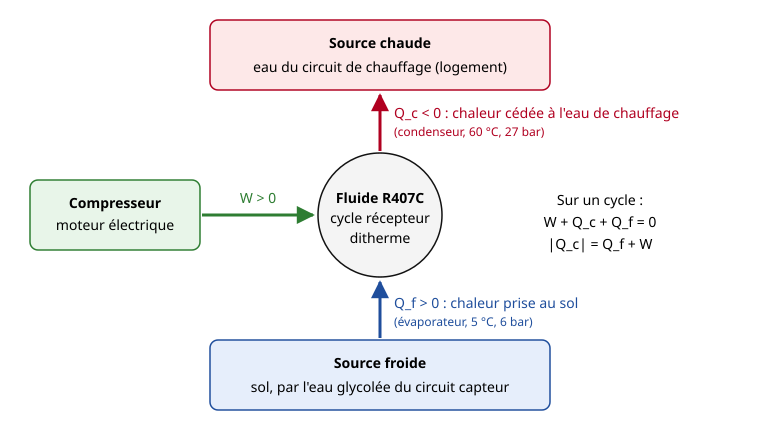
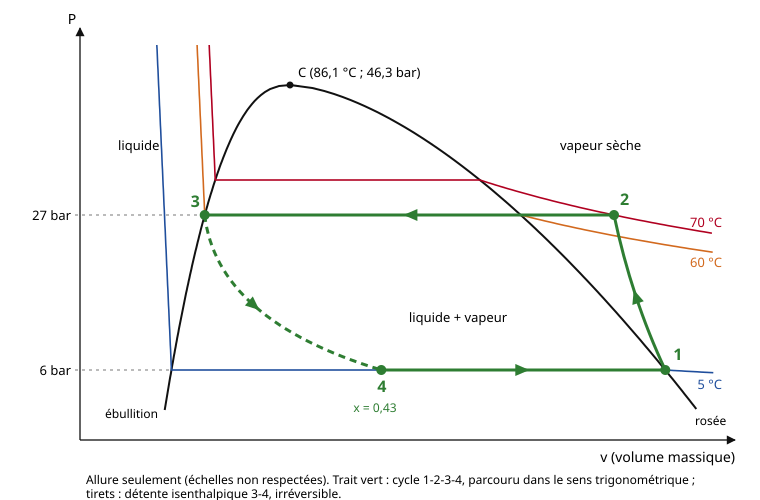

# Banque PT PT — Physique B - Thermodynamique 2016 · Corrigé guidé

*Corrigé rédigé par IA, non officiel. Signalez toute erreur.*

**Rédaction** · modèle exact non renseigné (famille Claude) · effort non renseigné · vitesse non renseignée

**Révision (tour 2)** · modèle exact non renseigné (famille Claude) · effort non renseigné · vitesse non renseignée · 28 novembre 2026

## Présentation du sujet

**Thème.** La géothermie domestique. L'épreuve dure 2 heures, **sans calculatrice**, et comporte 25 questions (numérotées 1.1 à 3.7.d) réparties en trois parties indépendantes. Trois valeurs numériques sont fournies pour les calculs à la main : $\ln 5 = 1{,}6$, $\sqrt{1/0{,}3} = 1{,}8$ et $\ln 0{,}03 = -3{,}5$. L'énoncé demande un ou deux chiffres significatifs.

- *Partie 1 (questions 1.1 à 1.7)* : onde thermique dans le sol. Équation de la diffusion thermique, solution amortie, épaisseur de peau thermique pour les variations journalières et annuelles.
- *Partie 2 (questions 2.1 à 2.6)* : puits canadien. Renouvellement de l'air, puissance économisée, profil de température de l'air dans le tuyau enterré, longueur utile, influence du débit et du rayon.
- *Partie 3 (questions 3.1 à 3.7.d)* : pompe à chaleur eau/eau au R407C. Principe, diagramme de Clapeyron, bilans enthalpiques à partir d'un tableau de valeurs, efficacité, puissance électrique, économie annuelle.

**Notions mobilisées.** Loi de Fourier et bilan d'énergie interne sur une tranche, premier principe pour un fluide en écoulement stationnaire, loi de Newton conducto-convective, changement d'état et théorème des moments, machines dithermes, efficacité de Carnot.

**Difficulté.** Le sujet est court et proche du cours. La difficulté vient de la justification des bilans (quel système, ouvert ou fermé, quelles hypothèses), des calculs à la main et du commentaire des ordres de grandeur. Le sujet ne comporte ni diagramme thermodynamique à lire ni document-réponse : toutes les enthalpies viennent du tableau de la page 6 de l'énoncé.

**Gestion du temps.** Environ 35 minutes pour la partie 1, 40 pour la partie 2 et 45 pour la partie 3. Les questions 1.2, 1.4, 1.5, 2.1, 3.1 à 3.4 et 3.5.b sont rapides et ne doivent pas être laissées de côté.

> [!JURY]
> Le rapport 2016 relève des difficultés sur la compréhension des phénomènes, sur l'énoncé des hypothèses avant d'utiliser une formule, sur les calculs numériques et sur le commentaire des résultats. Pour obtenir tous les points d'une application numérique, il faut poser le calcul, le mener et donner le résultat final avec son unité. Les résultats numériques ne sont pas commentés, alors que certains sont aberrants (une puissance de l'ordre du gigawatt pour le puits, une économie d'un million d'euros pour la pompe à chaleur). Les conditions d'emploi du premier principe sont très rarement précisées : système ouvert ou fermé, écoulement stationnaire ou non. Enfin, beaucoup de copies arrivent au résultat donné par l'énoncé à partir d'équations inadéquates, ce qui dispose mal le correcteur.

[Sujet officiel](https://www.banquept.fr/documents/2016/ph_b_th_2016_pt.pdf) · [Rapport du jury](https://www.banquept.fr/documents/ecrit/rapport/2016/rapport_phys_b_ecrit_2016.pdf)

*Mode d'emploi* : chercher chaque question seul, lire la première indication en cas de blocage, réessayer, puis la seconde, et seulement ensuite la solution.

## Partie 1 — Études préliminaires sur les ondes thermiques

Le sol est un milieu conducteur de la chaleur, dont la surface est soumise aux variations périodiques de la température de l'air. On établit l'équation de diffusion, puis on cherche jusqu'à quelle profondeur ces variations se font sentir.

### Question 1.1

> [!INDICATION]
> Choisir comme système la tranche de sol comprise entre les cotes $z$ et $z+\mathrm{d}z$, de section $S$. C'est un système fermé : quel principe lui appliquer, entre quels instants ?

> [!INDICATION]
> Écrire la variation d'énergie interne d'une phase condensée entre $t$ et $t+\mathrm{d}t$, puis la chaleur qui entre en $z$ et celle qui sort en $z+\mathrm{d}z$. La loi de Fourier relie ensuite le flux à la température.

#### Solution

*Système.* La tranche de sol de section $S$ comprise entre $z$ et $z+\mathrm{d}z$, de masse $\rho S\,\mathrm{d}z$. C'est un système fermé, immobile, formé d'une phase condensée indilatable : il ne reçoit aucun travail et son énergie interne ne dépend que de la température, avec $\mathrm{d}U = \rho S\,\mathrm{d}z\,c\,\mathrm{d}T$.

*Variation d'énergie interne entre $t$ et $t+\mathrm{d}t$.*

$$\mathrm{d}U = \rho c S\,\mathrm{d}z\,\big[T(z,t+\mathrm{d}t)-T(z,t)\big] = \rho c S\,\mathrm{d}z\,\frac{\partial T}{\partial t}\,\mathrm{d}t$$

*Transfert thermique reçu.* Le flux est vertical : on note $j(z,t)$ la composante selon $z$ du vecteur densité de flux thermique. La tranche reçoit de la chaleur par sa face en $z$ et en cède par sa face en $z+\mathrm{d}z$ :

$$\delta Q = j(z,t)\,S\,\mathrm{d}t - j(z+\mathrm{d}z,t)\,S\,\mathrm{d}t = -\frac{\partial j}{\partial z}\,S\,\mathrm{d}z\,\mathrm{d}t$$

*Premier principe* ($\mathrm{d}U = \delta Q$, sans travail) :

$$\rho c\,\frac{\partial T}{\partial t} = -\frac{\partial j}{\partial z}$$

*Loi de Fourier* : $j = -\lambda\,\dfrac{\partial T}{\partial z}$, avec $\lambda$ uniforme. On obtient

$$\boxed{\rho c\,\frac{\partial T}{\partial t} = \lambda\,\frac{\partial^2 T}{\partial z^2}}$$

> [!METHODE]
> Un bilan local se rédige toujours dans le même ordre : système, grandeur extensive et sa variation pendant $\mathrm{d}t$, échanges par les frontières, principe de conservation, loi phénoménologique.

> [!JURY]
> Le rapport 2016 demande un bilan d'énergie interne, et pas seulement un bilan de puissance thermique. Il note que l'expression de la variation d'énergie interne est très rarement justifiée par le caractère de phase condensée du sol.

### Question 1.2

> [!INDICATION]
> Convertir chaque pulsation en période : un an, un jour.

#### Solution

Les périodes associées sont $T_A = 2\pi/\omega_A = 1$ an et $T_J = 2\pi/\omega_J = 1$ jour.

- $\omega_A$ décrit l'**alternance des saisons** (variation annuelle de la température extérieure moyenne, été et hiver).
- $\omega_J$ décrit l'**alternance du jour et de la nuit** (variation journalière).

Vérification des valeurs : un an vaut $365\times 24\times 3600 \approx 3{,}2\times 10^{7}$ s, d'où $\omega_A \approx 2{,}0\times 10^{-7}\ \mathrm{rad\cdot s^{-1}}$ ; un jour vaut $86\,400$ s, d'où $\omega_J \approx 7{,}3\times 10^{-5}\ \mathrm{rad\cdot s^{-1}}$.

> [!JURY]
> D'après le rapport 2016, cette question a été bien traitée.

### Question 1.3

> [!INDICATION]
> Reporter la forme proposée dans l'équation de la question 1.1. Il faut une dérivée par rapport au temps et deux dérivées par rapport à $z$.

> [!INDICATION]
> Poser $u = \omega t + \varphi - z/\delta$ et $E = \mathrm{e}^{-z/\delta}$. La dérivée seconde par rapport à $z$ ne laisse qu'un terme en $\sin u$ : l'identifier avec celui de la dérivée temporelle.

#### Solution

On pose $u = \omega t + \varphi - z/\delta$ et $E = \mathrm{e}^{-z/\delta}$, de sorte que $T = T_0 + \alpha E\cos u$.

Dérivée temporelle :

$$\frac{\partial T}{\partial t} = -\alpha\,\omega\,E\,\sin u$$

Dérivées spatiales, avec $\dfrac{\partial E}{\partial z} = -\dfrac{E}{\delta}$ et $\dfrac{\partial u}{\partial z} = -\dfrac{1}{\delta}$ :

$$\frac{\partial T}{\partial z} = \frac{\alpha E}{\delta}\,\big(\sin u - \cos u\big)$$

$$\frac{\partial^2 T}{\partial z^2} = \frac{\alpha E}{\delta^2}\,\big[-(\sin u - \cos u) - (\cos u + \sin u)\big] = -\frac{2\,\alpha E}{\delta^2}\,\sin u$$

L'équation de diffusion s'écrit alors, pour tout $z$ et tout $t$,

$$-\rho c\,\alpha\,\omega\,E\,\sin u = -\frac{2\lambda\,\alpha E}{\delta^2}\,\sin u$$

ce qui impose $\rho c\,\omega = \dfrac{2\lambda}{\delta^2}$, soit

$$\boxed{\delta = \sqrt{\frac{2\lambda}{\rho c\,\omega}}}$$

La forme proposée vérifie en outre la condition en surface, $T(0,t) = T_0 + \alpha\cos(\omega t+\varphi)$ avec $\alpha = a$, et reste bornée quand $z \to +\infty$. Homogénéité : $\lambda/(\rho c)$ est une diffusivité en $\mathrm{m^2\cdot s^{-1}}$, donc $\delta$ est bien une longueur.

> [!METHODE]
> On peut aussi passer en notation complexe, $\underline{T} - T_0 = \alpha\,\mathrm{e}^{\mathrm{i}(\omega t+\varphi)}\,\mathrm{e}^{-(1+\mathrm{i})z/\delta}$ : l'équation donne $\mathrm{i}\,\rho c\,\omega = \lambda\,(1+\mathrm{i})^2/\delta^2 = 2\mathrm{i}\lambda/\delta^2$, soit le même résultat en deux lignes.

> [!JURY]
> D'après le rapport 2016, cette question a été assez bien traitée.

### Question 1.4

> [!INDICATION]
> Regarder séparément les deux endroits où $\delta$ apparaît : dans l'exponentielle et dans la phase.

#### Solution

$\delta$ est une longueur, appelée **épaisseur de peau thermique** ou profondeur de pénétration de l'onde thermique.

- Dans le facteur $\mathrm{e}^{-z/\delta}$, c'est la **distance caractéristique d'amortissement** : l'amplitude des oscillations de température est divisée par $\mathrm{e} \approx 2{,}7$ chaque fois que la profondeur augmente de $\delta$. Au-delà de quelques $\delta$ (amplitude réduite à 5 % en $3\delta$, à moins de 1 % en $5\delta$), le sol ne ressent plus les variations de surface et reste à $T_0$.
- Dans la phase $\omega t + \varphi - z/\delta$, c'est aussi l'échelle du **retard** : l'oscillation à la profondeur $z$ est en retard de $z/(\omega\delta)$ sur celle de la surface, et la longueur d'onde vaut $2\pi\delta$.

$\delta$ diminue quand la pulsation augmente : les variations rapides pénètrent moins que les variations lentes.

> [!JURY]
> Le rapport 2016 signale des réponses fantaisistes et précise qu'il ne suffit pas d'indiquer la grandeur.

### Question 1.5

> [!INDICATION]
> Chercher, en électromagnétisme, une onde qui s'amortit en pénétrant dans un milieu, avec une longueur en $1/\sqrt{\omega}$.

#### Solution

L'**effet de peau** en électromagnétisme : dans un conducteur ohmique de conductivité $\gamma$, le champ et le courant de pulsation $\omega$ vérifient eux aussi une équation de diffusion et ne pénètrent que sur une épaisseur

$$\delta_{\text{ém}} = \sqrt{\frac{2}{\mu_0\,\gamma\,\omega}}$$

Elle joue le même rôle que $\delta$ : amortissement exponentiel et dépendance en $1/\sqrt{\omega}$ (le courant alternatif se concentre à la surface des conducteurs à haute fréquence).

> [!JURY]
> Le rapport 2016 signale, ici encore, des réponses parfois très fantaisistes.

### Question 1.6

> [!INDICATION]
> Calculer d'abord $\rho c$, puis $2\lambda/(\rho c\,\omega)$. Pour $\omega_A$, la racine à prendre est donnée en tête d'énoncé.

> [!INDICATION]
> Pour commenter, comparer chaque valeur à une profondeur d'enfouissement réaliste (quelques dizaines de centimètres à quelques mètres).

#### Solution

On a $\rho c = 1500\times 1000 = 1{,}5\times 10^{6}\ \mathrm{J\cdot m^{-3}\cdot K^{-1}}$ et $2\lambda = 1{,}0\ \mathrm{W\cdot m^{-1}\cdot K^{-1}}$.

*Variations journalières* ($\omega_J = 7\times 10^{-5}\ \mathrm{rad\cdot s^{-1}}$) :

$$\delta_J = \sqrt{\frac{1{,}0}{1{,}5\times 10^{6}\times 7\times 10^{-5}}} = \sqrt{\frac{1}{105}}\ \mathrm{m}$$

$$\boxed{\delta_J \approx 0{,}1\ \mathrm{m} = 10\ \mathrm{cm}}$$

*Variations annuelles* ($\omega_A = 2\times 10^{-7}\ \mathrm{rad\cdot s^{-1}}$) :

$$\delta_A = \sqrt{\frac{1{,}0}{1{,}5\times 10^{6}\times 2\times 10^{-7}}} = \sqrt{\frac{1}{0{,}3}}\ \mathrm{m}$$

$$\boxed{\delta_A \approx 1{,}8\ \mathrm{m}}$$

*Commentaire.* Le rapport $\delta_A/\delta_J = \sqrt{\omega_J/\omega_A} \approx 19$ traduit la dépendance en $1/\sqrt{\omega}$. L'alternance du jour et de la nuit n'affecte que les premiers décimètres du sol : à quelques dizaines de centimètres de profondeur, elle a disparu. Les variations saisonnières pénètrent de plusieurs mètres : il faut descendre à 5 ou 10 m pour trouver une température pratiquement constante sur l'année, égale à $T_0$. C'est ce qui rend le sol intéressant comme source de chaleur en hiver (et de fraîcheur en été), à condition d'enterrer les tuyaux assez profondément.

> [!PIEGE]
> Convertir avant de diviser est inutile ici, tout est en unités SI. Ne pas oublier en revanche la racine carrée : $1/105 \approx 0{,}01\ \mathrm{m^2}$, et c'est $\delta_J^2$.

> [!JURY]
> D'après le rapport 2016, la question a été assez bien traitée, mais beaucoup de copies ont été pénalisées pour un résultat donné sans unité.

### Question 1.7

> [!INDICATION]
> L'amplitude à la profondeur $z$ vaut $\alpha\,\mathrm{e}^{-z/\delta}$. Écrire qu'elle vaut $\alpha/5$.

#### Solution

L'amplitude à la profondeur $z$ est $\alpha\,\mathrm{e}^{-z/\delta}$. Elle est divisée par 5 quand $\mathrm{e}^{-z/\delta} = 1/5$, soit

$$\boxed{z_5 = \delta\,\ln 5 \approx 1{,}6\,\delta}$$

Pour $\omega_A = 2{,}0\times 10^{-7}\ \mathrm{rad\cdot s^{-1}}$, $\delta = \delta_A = 1{,}8$ m, d'où

$$z_5 = 1{,}6\times 1{,}8 = 2{,}9\ \mathrm{m}$$

$$\boxed{z_5 \approx 3\ \mathrm{m}}$$

À 3 m de profondeur, l'écart annuel de température n'est plus que le cinquième de celui de la surface.

> [!JURY]
> D'après le rapport 2016, cette question a été assez bien traitée.

## Partie 2 — Dimensionnement d'un puits canadien

L'air neuf traverse un tuyau enterré avant d'entrer dans le logement. On évalue le gain en puissance, puis on cherche la longueur de tuyau nécessaire à partir d'un bilan enthalpique sur l'air en écoulement.

### Question 2.1

> [!INDICATION]
> Quatre questions en une : y répondre séparément. Penser à ce que rejettent les occupants, puis à la température de l'air qui entre en hiver.

> [!INDICATION]
> La durée de renouvellement est le rapport du volume du logement au débit volumique.

#### Solution

*Pourquoi renouveler l'air.* Les occupants et leurs activités consomment le dioxygène et chargent l'air en dioxyde de carbone, en vapeur d'eau (respiration, cuisine, douches) et en polluants. Il faut évacuer cet air vicié et cette humidité (risque de condensation et de moisissures) et apporter de l'air neuf.

*Inconvénient.* En hiver, l'air qui entre est à $T_{EXT} = -4\ \mathrm{°C}$ et l'air chauffé à $T_L = 19\ \mathrm{°C}$ est rejeté : il faut dépenser de l'énergie de chauffage pour amener en permanence l'air entrant à la température du logement. Le renouvellement d'air est une perte thermique.

*Durée de renouvellement.* Le volume du logement est $V = 100\times 2 = 200\ \mathrm{m^3}$ :

$$\tau = \frac{V}{D_V} = \frac{200}{50}$$

$$\boxed{\tau = 4\ \mathrm{h}}$$

*Rôle du puits canadien.* Il préchauffe l'air neuf en hiver en le faisant circuler dans le sol, dont la température $T_0 = 12\ \mathrm{°C}$ est supérieure à celle de l'air extérieur et presque constante en profondeur (partie 1). L'air entre moins froid, ce qui réduit la dépense de chauffage. En été, le même dispositif rafraîchit l'air entrant.

> [!JURY]
> Le rapport 2016 signale des réponses parfois très fantaisistes, qui ne tiennent pas compte de la nécessité de chauffer l'air entrant.

### Question 2.2

> [!INDICATION]
> Dans un tuyau très long, l'air finit à l'équilibre thermique avec ce qui l'entoure. Avec quoi est-il en contact ?

> [!INDICATION]
> Comparer la puissance de chauffage de l'air entrant sans puits (de $T_{EXT}$ à $T_L$) et avec puits (de $T_0$ à $T_L$). Le débit massique est $\rho D_V$, avec $D_V$ converti en $\mathrm{m^3\cdot s^{-1}}$.

#### Solution

*Température maximale.* L'air n'échange de la chaleur qu'avec le sol à $T_0$. Si le tuyau est assez long, il atteint l'équilibre thermique avec le sol :

$$\boxed{T_{\max} = T_0 = 12\ \mathrm{°C}}$$

Il ne peut pas la dépasser : le transfert thermique cesse quand les températures sont égales.

*Puissance gagnée.* L'air est un fluide en écoulement stationnaire, de débit massique $D_m = \rho D_V$, chauffé à pression constante sans travail utile. Le premier principe pour un système ouvert en régime stationnaire donne la puissance thermique nécessaire pour faire passer l'air d'une température d'entrée $T_e$ à $T_L$ : $P_{\text{ch}} = D_m c_P\,(T_L - T_e)$. On compare les deux situations.

$$P_{\text{sans}} = \rho D_V c_P\,(T_L - T_{EXT})$$

$$P_{\text{avec}} = \rho D_V c_P\,(T_L - T_0)$$

$$\boxed{P = P_{\text{sans}} - P_{\text{avec}} = \rho D_V c_P\,(T_0 - T_{EXT})}$$

Application numérique, avec $D_V = 50/3600 = 1{,}4\times 10^{-2}\ \mathrm{m^3\cdot s^{-1}}$ :

$$D_m = \rho D_V = \frac{1{,}275\times 50}{3600} = 1{,}8\times 10^{-2}\ \mathrm{kg\cdot s^{-1}}$$

$$P = 1{,}8\times 10^{-2}\times 1000\times \big(12-(-4)\big) = 1{,}8\times 10^{-2}\times 1000\times 16$$

$$\boxed{P \approx 2{,}8\times 10^{2}\ \mathrm{W} \approx 0{,}3\ \mathrm{kW}}$$

*Commentaire.* Sans puits, le chauffage de l'air neuf coûte $P_{\text{sans}} = 1{,}8\times 10^{-2}\times 1000\times 23 \approx 4{,}1\times 10^{2}$ W ; avec un puits idéal, $P_{\text{avec}} \approx 1{,}2\times 10^{2}$ W. Le puits supprime donc environ 70 % de la perte par renouvellement d'air, sans autre dépense que celle du ventilateur. En valeur absolue, 0,3 kW reste modeste devant la puissance de chauffage d'un logement (quelques kilowatts, 7 kW au maximum dans la partie 3) : le puits canadien est un appoint, pas un moyen de chauffage. Il ne peut pas amener l'air à 19 °C.

> [!PIEGE]
> Le débit est donné en $\mathrm{m^3\cdot h^{-1}}$ : oublier la division par 3600 donne une puissance de l'ordre du mégawatt, manifestement absurde pour un tuyau de ventilation.

> [!JURY]
> D'après le rapport 2016, certaines copies prennent pour température en fin de puits celle du logement. Une réponse correcte passe par une différence de variations d'enthalpie. Des ordres de grandeur aberrants (le gigawatt) sont donnés sans que leurs auteurs s'en inquiètent.

### Question 2.3

> [!INDICATION]
> Le système est ouvert : c'est la tranche de tuyau fixe comprise entre $x$ et $x+\mathrm{d}x$, traversée par l'air en régime permanent. Quelle forme du premier principe s'applique ?

> [!INDICATION]
> La surface d'échange de la tranche avec le sol est la paroi latérale $2\pi R\,\mathrm{d}x$. Attention au signe : en hiver, l'air est plus froid que le sol et reçoit de la chaleur.

#### Solution

*Système.* L'air contenu dans la tranche de tuyau fixe comprise entre $x$ et $x+\mathrm{d}x$ : c'est un **système ouvert**, traversé par le débit massique $D_m = \rho D_V$, en **régime permanent**.

*Premier principe pour un écoulement stationnaire.* On néglige les variations d'énergie cinétique (section et masse volumique constantes, donc vitesse constante) et d'énergie potentielle ; il n'y a aucune pièce mobile, donc aucun travail utile. En notant $h_m$ l'enthalpie massique de l'air et $\delta P_{\text{th}}$ la puissance thermique reçue par l'air à travers la paroi de la tranche :

$$D_m\,\big[h_m(x+\mathrm{d}x) - h_m(x)\big] = \delta P_{\text{th}}$$

L'air est assimilé à un gaz parfait (la pression est de plus constante) : $\mathrm{d}h_m = c_P\,\mathrm{d}T$.

*Puissance reçue.* La loi de Newton donne, à travers la paroi latérale d'aire $2\pi R\,\mathrm{d}x$, un flux dirigé du plus chaud vers le plus froid. La puissance reçue par l'air de la part du sol est

$$\delta P_{\text{th}} = h\,\big(T_0 - T(x)\big)\,2\pi R\,\mathrm{d}x = -h\,\theta(x)\,2\pi R\,\mathrm{d}x$$

*Équation différentielle.* Comme $T_0$ est uniforme, $\mathrm{d}T = \mathrm{d}\theta$ :

$$\rho D_V c_P\,\frac{\mathrm{d}\theta}{\mathrm{d}x} = -2\pi R\,h\,\theta$$

$$\boxed{\frac{\mathrm{d}\theta}{\mathrm{d}x} + K\,\theta = 0 \quad\text{avec}\quad K = \frac{2\pi h R}{\rho D_V c_P}}$$

*Solution.* C'est une équation linéaire du premier ordre à coefficient constant. Avec $\theta(0) = \theta_i = T_{EXT} - T_0$ à l'entrée du puits,

$$\boxed{\theta(x) = \theta_i\,\mathrm{e}^{-Kx}}$$

$K$ est l'inverse d'une longueur ; ici $\theta_i = -4 - 12 = -16\ \mathrm{°C}$. On retrouve $\theta \to 0$, c'est-à-dire $T \to T_0$, pour un tuyau très long (question 2.2).

*Contrôle de la valeur de $K$ donnée à la question suivante.* Avec $D_V = 1{,}39\times 10^{-2}\ \mathrm{m^3\cdot s^{-1}}$ et $R = 0{,}050$ m, l'expression de l'énoncé donne $h \approx 8{,}5\ \mathrm{W\cdot m^{-2}\cdot K^{-1}}$, puis $K = 2\pi\times 8{,}5\times 0{,}050/(1{,}275\times 1{,}39\times 10^{-2}\times 1000) \approx 0{,}15\ \mathrm{m^{-1}}$ : c'est bien la valeur fournie (ce calcul n'est pas faisable à la main et n'est pas demandé).

> [!PIEGE]
> La lettre $h$ désigne ici le coefficient de transfert conducto-convectif, et non une enthalpie massique : d'où la notation $h_m$ pour l'enthalpie dans ce corrigé.

> [!JURY]
> D'après le rapport 2016, la question a été mal traitée : seules quelques copies précisent qu'il faut un système ouvert en régime stationnaire pour appliquer le bilan d'enthalpie qui conduit au résultat.

### Question 2.4

> [!INDICATION]
> La température maximale est $T_0$ (question 2.2). Traduire le critère sur $T$, puis passer à $\theta = T - T_0$ avant d'utiliser la loi exponentielle.

> [!INDICATION]
> Le rapport $\theta(L)/\theta_i$ doit tomber sur une valeur dont le logarithme est donné en tête d'énoncé.

#### Solution

La température Celsius maximale est $T_0 = 12\ \mathrm{°C}$. On veut en sortie

$$T_{\text{FINALE}} = 0{,}96\,T_0 = 11{,}52\ \mathrm{°C}$$

soit

$$\theta(L) = T_{\text{FINALE}} - T_0 = -0{,}04\,T_0 = -0{,}48\ \mathrm{°C}$$

Avec $\theta_i = -16\ \mathrm{°C}$ :

$$\frac{\theta(L)}{\theta_i} = \frac{0{,}48}{16} = 0{,}03 = \mathrm{e}^{-KL}$$

$$\boxed{L = -\frac{\ln 0{,}03}{K} = \frac{1}{K}\,\ln\frac{\theta_i}{\theta(L)}}$$

$$L = \frac{3{,}5}{0{,}15}$$

$$\boxed{L \approx 23\ \mathrm{m}}$$

C'est une longueur réaliste pour une tranchée dans un jardin. Comme la température de sortie croît avec la longueur, toute longueur supérieure convient ; 23 m est la longueur minimale.

> [!PIEGE]
> Le critère « 96 % de la température maximale » porte sur la température Celsius $T$, pas sur $\theta$. Écrire $\mathrm{e}^{-KL} = 0{,}96$ ou $\mathrm{e}^{-KL} = 0{,}04$ est faux : c'est $\theta(L)/\theta_i = 0{,}03$ qui intervient. Un critère en pourcentage d'une température Celsius dépend de l'origine de l'échelle : il n'a de sens que parce que l'énoncé l'impose.

> [!JURY]
> D'après le rapport 2016, la question a été assez mal traitée : beaucoup de copies confondent $\theta(x)$ et $T(x)$ et ne peuvent pas conclure, alors que le résultat de la question 2.3 est donné.

### Question 2.5

> [!INDICATION]
> La longueur nécessaire est proportionnelle à $1/K$. Le débit apparaît deux fois dans $K$ : explicitement au dénominateur, et dans $h$.

> [!INDICATION]
> Identifier le phénomène physique derrière chacune des deux dépendances : la quantité d'air à réchauffer par unité de temps d'une part, l'efficacité de l'échange à la paroi d'autre part.

#### Solution

Pour un rapport $\theta(L)/\theta_i$ fixé, $L = 3{,}5/K$ est proportionnelle à $1/K$. En reportant $h = 1{,}18\,D_V^{0{,}8}/R^{1{,}8}$ dans $K$ :

$$K = \frac{2\pi\times 1{,}18}{\rho\,c_P}\,\frac{1}{D_V^{0{,}2}\,R^{0{,}8}}$$

$$\boxed{L \propto \frac{1}{K} \propto D_V^{0{,}2}\,R^{0{,}8}}$$

À rayon fixé, deux effets s'opposent quand le débit augmente.

- *Transport.* Le débit massique d'air à réchauffer augmente : chaque tranche d'air séjourne moins longtemps dans le tuyau (vitesse $v = D_V/\pi R^2$ plus grande) et dispose de moins de temps pour se réchauffer. Cet effet, seul, rendrait $L$ proportionnelle à $D_V$.
- *Échange à la paroi.* Le coefficient $h$ augmente avec le débit (en $D_V^{0{,}8}$) : un écoulement plus rapide brasse mieux l'air et amincit la couche limite thermique, le transfert conducto-convectif est plus efficace. Cet effet, seul, raccourcirait $L$.

Les deux effets se compensent presque : **la longueur nécessaire augmente avec le débit, mais très faiblement**, en $D_V^{0{,}2}$. Doubler le débit ne l'allonge que de 15 % ($2^{0{,}2} \approx 1{,}15$), soit 27 m au lieu de 23 m.

> [!JURY]
> D'après le rapport 2016, seules quelques copies utilisent l'expression de $h$ pour justifier l'effet du débit à diamètre constant. Deux phénomènes s'opposent : la durée du réchauffement et la variation du coefficient de transfert thermique.

### Question 2.6

> [!INDICATION]
> Même démarche qu'à la question 2.5, à débit fixé cette fois. Le rayon intervient dans la surface d'échange et dans $h$.

#### Solution

D'après la question 2.5, à débit fixé, $K \propto h\,R \propto R^{-0{,}8}$ et $L \propto R^{0{,}8}$. Deux effets s'opposent quand le rayon (donc le diamètre) augmente.

- *Surface d'échange.* L'aire de paroi par unité de longueur, $2\pi R$, augmente : à $h$ donné, l'échange serait meilleur et $L$ plus courte (en $1/R$).
- *Échange à la paroi.* À débit fixé, la vitesse de l'air $v = D_V/\pi R^2$ diminue fortement, et $h$ chute en $R^{-1{,}8}$ : l'air, plus lent et plus éloigné en moyenne de la paroi, échange moins bien avec elle.

Le second effet l'emporte : **la longueur nécessaire augmente avec le diamètre**, presque proportionnellement ($R^{0{,}8}$). Doubler le rayon multiplie $L$ par $2^{0{,}8} \approx 1{,}7$, soit environ 40 m. Du seul point de vue thermique, un tuyau fin est préférable ; mais un tuyau trop fin impose une vitesse élevée et une perte de charge importante, donc un ventilateur plus puissant. C'est pourquoi l'énoncé retient finalement un diamètre fixé par la perte de charge et non par la contrainte thermique.

> [!JURY]
> Le rapport 2016 attend les deux phénomènes opposés : la surface d'échange et la variation du coefficient de transfert thermique. Il note que certaines copies font des remarques pertinentes sans même recourir à l'expression de $h$.

## Partie 3 — Remplacement d'un chauffage électrique par un chauffage géothermique horizontal

Une pompe à chaleur eau/eau prélève de la chaleur dans le sol par un circuit capteur enterré et la restitue à l'eau du chauffage. Les bilans se font avec les enthalpies massiques du tableau de l'énoncé.

### Question 3.1

> [!INDICATION]
> Une pompe à chaleur est une machine ditherme réceptrice. Identifier les deux sources, puis le sens et le signe de chacun des trois échanges du fluide.

#### Solution

Une pompe à chaleur est une **machine thermique ditherme réceptrice**. Un fluide frigorigène y décrit un cycle au cours duquel :

- il reçoit un **travail** $W > 0$ de la part du compresseur (énergie électrique consommée) ;
- il **prélève** un transfert thermique $Q_f > 0$ à la **source froide** (ici le sol, par l'intermédiaire de l'eau glycolée du circuit capteur) ;
- il **cède** un transfert thermique à la **source chaude** (ici l'eau du circuit de chauffage, donc le logement) : $Q_c < 0$.

Le transfert de chaleur du froid vers le chaud n'est pas spontané (second principe) : c'est le travail fourni qui le permet. Sur un cycle, le premier principe donne $W + Q_c + Q_f = 0$, donc $|Q_c| = Q_f + W$ : le logement reçoit plus d'énergie thermique que la machine ne consomme d'énergie électrique, la différence étant puisée gratuitement dans le sol. L'intérêt se mesure par l'efficacité $e = |Q_c|/W > 1$.

> [!PIEGE]
> La source chaude est ce que l'on chauffe (l'intérieur du logement), la source froide est le milieu extérieur où l'on puise la chaleur (ici le sol). Les signes se donnent du point de vue du fluide.

> [!JURY]
> D'après le rapport 2016, trop de candidats n'ont pas compris le principe d'une pompe à chaleur ; pour une partie non négligeable d'entre eux, la source chaude est l'air extérieur.

### Question 3.2

> [!INDICATION]
> Le circuit capteur est enterré dans le jardin : à quelle source est-il relié ? Dans quel échangeur le fluide frigorigène reçoit-il de la chaleur ?

#### Solution

Le circuit capteur est enterré : l'eau glycolée qui y circule se réchauffe au contact du sol, puis transporte cette chaleur jusqu'à la pompe à chaleur. Elle joue le rôle de **source froide**. Elle doit donc être en contact thermique avec l'élément où le fluide frigorigène **reçoit** de la chaleur, c'est-à-dire l'**évaporateur** (transformation 4 → 1).

Justification : dans l'évaporateur, le fluide est à basse pression (6 bar) et se vaporise à basse température (5 °C), ce qui absorbe de la chaleur ($q_f = h_1 - h_4 > 0$). Sa température y est assez basse pour qu'il puisse recevoir de la chaleur de l'eau glycolée venue du sol. Le condenseur, à 60 °C, est au contraire en contact avec l'eau du circuit de chauffage, à laquelle le fluide cède de la chaleur en se liquéfiant.

> [!PIEGE]
> Deux fluides distincts : l'eau glycolée du circuit capteur, qui reste liquide et ne fait que transporter la chaleur, et le R407C, qui seul décrit le cycle avec changement d'état.

> [!JURY]
> D'après le rapport 2016, la réponse est souvent très mal justifiée. Beaucoup de copies placent le circuit capteur à l'intérieur de la maison, faute d'une lecture correcte de l'énoncé, et beaucoup confondent le fluide du circuit capteur avec celui qui décrit le cycle.

### Question 3.3

> [!INDICATION]
> Une puissance moyenne est une énergie divisée par une durée. Quelle énergie, et sur quelle durée en heures ?

#### Solution

Toute l'énergie annuelle de chauffage, $E = 7000$ kWh, est consommée pendant les six mois de chauffe, supposée continue (jour et nuit). Six mois représentent

$$\Delta t = \frac{365\times 24}{2} \approx 4{,}4\times 10^{3}\ \mathrm{h}$$

$$\boxed{P_{\text{moy}} = \frac{E}{\Delta t} = \frac{7000}{4{,}4\times 10^{3}} \approx 1{,}6\ \mathrm{kW}}$$

> [!PIEGE]
> Le kilowattheure est une énergie. Diviser 7000 par 2 parce que la durée est d'une demi-année n'a pas de sens : les 7000 kWh sont entièrement consommés pendant ces six mois.

> [!JURY]
> D'après le rapport 2016, des candidats confondent puissance et énergie, et beaucoup divisent par deux la consommation annuelle sans réfléchir au sens de la question ni à ses données.

### Question 3.4

> [!INDICATION]
> Comparer à la puissance moyenne de la question 3.3, puis expliquer l'écart : le besoin de chauffage est-il constant pendant l'hiver ?

#### Solution

La puissance maximale retenue, 7 kW, vaut environ **4,4 fois la puissance moyenne** de 1,6 kW (soit 70 W par mètre carré habitable).

Cet écart est justifié. Le besoin de chauffage n'est pas constant : il est proportionnel à l'écart entre la température intérieure et la température extérieure, faible en automne et au printemps, élevé lors des jours les plus froids. L'installation doit être dimensionnée pour **la pointe** (vague de froid, remise en température après une absence), et non pour la moyenne, sans quoi la température de consigne ne serait pas tenue ces jours-là. En contrepartie, la machine ne fonctionne à pleine puissance qu'une petite partie du temps : fournir 7000 kWh à 7 kW ne demande que 1000 heures, soit moins du quart de la saison de chauffe. Le reste du temps, elle fonctionne par intermittence ou à puissance réduite. Un surdimensionnement excessif serait inutile et coûteux (machine et circuit capteur plus grands).

> [!JURY]
> D'après le rapport 2016, beaucoup de candidats se contentent d'une comparaison.

### Question 3.5.a

> [!INDICATION]
> Le diagramme de Clapeyron est le diagramme $(P, v)$. Tracer d'abord la courbe de saturation et placer le point critique par rapport aux trois températures demandées.

> [!INDICATION]
> Chaque isotherme est inférieure à la température critique : elle comporte un palier de changement d'état. Classer les pressions des trois paliers à l'aide du tableau.

#### Solution

Dans le diagramme de Clapeyron (pression $P$ en ordonnée, volume massique $v$ en abscisse), on trace d'abord la **courbe de saturation** : courbe d'ébullition à gauche, courbe de rosée à droite, qui se rejoignent au **point critique C** (86,1 °C ; 46,3 bar). Le liquide est à gauche, la vapeur sèche à droite, le mélange liquide-vapeur sous la courbe.

Les trois températures (5 °C, 60 °C, 70 °C) sont **inférieures à la température critique** : chaque isotherme présente donc trois portions.

- Dans le domaine liquide, une branche presque verticale (le liquide est très peu compressible).
- Sous la courbe de saturation, un **palier horizontal** à la pression de vapeur saturante : 6 bar pour 5 °C, 27 bar pour 60 °C (tableau), et une pression plus élevée, comprise entre 27 bar et 46,3 bar, pour 70 °C (le tableau ne la donne pas).
- Dans le domaine vapeur, une branche décroissante, d'allure hyperbolique.

Les isothermes ne se coupent pas ; plus la température est élevée, plus l'isotherme est haute et plus son palier est court. L'isotherme 70 °C passe, dans le domaine vapeur, par le point de pression 27 bar : c'est l'état (2).

> [!PIEGE]
> Le R407C est un mélange : en toute rigueur sa température varie légèrement pendant un changement d'état isobare. L'énoncé attribue une température unique à chaque palier (5 °C à 6 bar, 60 °C à 27 bar) ; on trace donc des paliers horizontaux, comme pour un corps pur.

> [!JURY]
> D'après le rapport 2016, des candidats ne connaissent pas la forme des isothermes dans le diagramme $(P, v)$ et ne tiennent pas compte du caractère diphasé du cycle.

### Question 3.5.b

> [!INDICATION]
> La détente 3 → 4 est isenthalpique, et l'état (3) est du liquide saturant à 27 bar : son enthalpie est dans le tableau.

> [!INDICATION]
> L'enthalpie massique d'un mélange liquide-vapeur est la moyenne, pondérée par le titre, des enthalpies du liquide saturant et de la vapeur saturante à la même pression.

#### Solution

L'état (3) est du liquide saturant à 27 bar : $h_3 = 295\ \mathrm{kJ\cdot kg^{-1}}$ (tableau, ligne 60 °C). La détente est isenthalpique : $h_4 = h_3$.

L'état (4) est un mélange diphasé à 6 bar et 5 °C, de titre massique en vapeur $x_4$. L'enthalpie étant extensive,

$$h_4 = x_4\,h_V + (1-x_4)\,h_L$$

avec $h_L = 210\ \mathrm{kJ\cdot kg^{-1}}$ et $h_V = 410\ \mathrm{kJ\cdot kg^{-1}}$ (tableau, ligne 5 °C). D'où

$$\boxed{x_4 = \frac{h_3 - h_L}{h_V - h_L} = \frac{295-210}{410-210} = \frac{85}{200} \approx 0{,}43}$$

Environ 43 % de la masse du fluide est déjà vaporisée à la sortie du détendeur.

> [!JURY]
> D'après le rapport 2016, cette question a été assez bien traitée.

### Question 3.5.c

> [!INDICATION]
> Placer d'abord les états sur les courbes : (1) vapeur saturante à 6 bar, (3) liquide saturant à 27 bar. Les états (2) et (3) sont à la même pression, (4) et (1) aussi.

#### Solution

On place les quatre états sur le diagramme de la figure 2.

- **(1)** : vapeur saturante à 6 bar, sur la courbe de rosée, à l'extrémité droite du palier 5 °C.
- **(2)** : vapeur sèche à 27 bar et 70 °C, sur l'isobare 27 bar, à droite de la courbe de rosée, à l'intersection avec l'isotherme 70 °C.
- **(3)** : liquide saturant à 27 bar, sur la courbe d'ébullition, à l'extrémité gauche du palier 60 °C.
- **(4)** : mélange diphasé à 6 bar, sur le palier 5 °C, à la fraction $x_4 = 0{,}43$ du palier comptée depuis la courbe d'ébullition (théorème des moments).

Les transformations sont : 1 → 2 compression adiabatique (courbe montante vers les petits volumes, plus raide que les isothermes) ; 2 → 3 refroidissement de la vapeur puis liquéfaction, sur l'horizontale 27 bar ; 3 → 4 détente isenthalpique (irréversible, tracée en tirets) ; 4 → 1 vaporisation sur l'horizontale 6 bar.

**Le cycle 1-2-3-4 est parcouru dans le sens trigonométrique** : c'est un cycle récepteur ($W > 0$), comme il se doit pour une pompe à chaleur.

> [!PIEGE]
> Le segment 2 → 3 est horizontal sur toute sa longueur, y compris la portion hors de la courbe de saturation où la vapeur se refroidit de 70 °C à 60 °C.

> [!JURY]
> D'après le rapport 2016, la question a été assez bien traitée, mais certains candidats ont eu du mal à placer les points 2 et 3 sur la même isobare.

### Question 3.6

> [!INDICATION]
> Chaque organe est traversé par le fluide en régime permanent : le premier principe s'écrit avec l'enthalpie massique, $\Delta h = w_i + q$. Que valent $w_i$ dans le condenseur et $q$ dans le compresseur ?

> [!INDICATION]
> Pour la source froide, l'énoncé dit « en déduire » : utiliser le fait que l'enthalpie est une fonction d'état, donc que sa variation sur un cycle est nulle.

#### Solution

*Cadre.* Chaque organe est un système ouvert traversé par le fluide en écoulement stationnaire ; on néglige les variations d'énergie cinétique et d'énergie potentielle. Le premier principe s'écrit, pour l'unité de masse de fluide qui traverse l'organe,

$$\Delta h = w_i + q$$

où $w_i$ est le travail indiqué massique (reçu des pièces mobiles) et $q$ le transfert thermique massique reçu.

*Enthalpies massiques (tableau de l'énoncé).* $h_1 = 410\ \mathrm{kJ\cdot kg^{-1}}$ (vapeur saturante à 6 bar), $h_2 = 435\ \mathrm{kJ\cdot kg^{-1}}$ (vapeur à 70 °C et 27 bar), $h_3 = 295\ \mathrm{kJ\cdot kg^{-1}}$ (liquide saturant à 27 bar), $h_4 = h_3$.

*Source chaude (condenseur, 2 → 3).* Pas de pièce mobile, $w_i = 0$ :

$$\boxed{q_c = h_3 - h_2 = 295 - 435 = -140\ \mathrm{kJ\cdot kg^{-1}}}$$

Le fluide cède 140 kJ par kilogramme à l'eau du circuit de chauffage.

*Compresseur (1 → 2).* Compression adiabatique, $q = 0$ :

$$\boxed{w_i = h_2 - h_1 = 435 - 410 = 25\ \mathrm{kJ\cdot kg^{-1}}}$$

*Source froide (évaporateur, 4 → 1).* L'enthalpie est une fonction d'état : sur un cycle, $\Delta h_{\text{cycle}} = 0$. Le détendeur n'échange ni travail ni chaleur (détente isenthalpique). La somme des bilans sur les quatre organes donne

$$w_i + q_c + q_f = 0$$

$$\boxed{q_f = -q_c - w_i = 140 - 25 = 115\ \mathrm{kJ\cdot kg^{-1}}}$$

Vérification directe : $q_f = h_1 - h_4 = 410 - 295 = 115\ \mathrm{kJ\cdot kg^{-1}}$. Le fluide prélève 115 kJ par kilogramme à l'eau glycolée du circuit capteur.

> [!PIEGE]
> Les capacités thermiques de l'eau et de l'eau glycolée n'interviennent pas ici : les transferts demandés sont rapportés à l'unité de masse de R407C et se lisent dans son tableau d'enthalpies.

> [!JURY]
> D'après le rapport 2016, la question a été assez mal traitée. Certains candidats utilisent la capacité thermique de l'eau du circuit capteur, et peu justifient l'emploi d'une variation d'enthalpie nulle sur un cycle.

### Question 3.7.a

> [!INDICATION]
> L'efficacité est le rapport de l'énergie utile à l'énergie coûteuse. Pour une pompe à chaleur, laquelle est utile ?

> [!INDICATION]
> L'efficacité de Carnot s'obtient avec les deux principes appliqués à un cycle ditherme réversible. Les températures sont en kelvins.

#### Solution

*Efficacité.* La grandeur utile est la chaleur cédée à la source chaude, la grandeur coûteuse est le travail fourni au fluide :

$$\boxed{e = \frac{-q_c}{w_i} = \frac{140}{25} = 5{,}6}$$

*Efficacité de Carnot.* Pour un cycle ditherme, le premier principe donne $W + Q_c + Q_f = 0$ et le second $\dfrac{Q_c}{T_c} + \dfrac{Q_f}{T_f} \leqslant 0$, avec égalité pour un cycle réversible. On en tire $W \geqslant -Q_c\,(1 - T_f/T_c)$, soit $e \leqslant e_C$ avec

$$\boxed{e_C = \frac{T_c}{T_c - T_f}}$$

Avec $T_c = 60\ \mathrm{°C} = 333$ K et $T_f = 5\ \mathrm{°C} = 278$ K : $e_C = 333/55 \approx 6{,}1$, valeur donnée par l'énoncé.

*Comparaison.* On a bien $e = 5{,}6 < e_C = 6{,}1$, conformément au second principe : l'efficacité de Carnot est une borne supérieure, atteinte seulement par un cycle réversible. Le cycle étudié ne l'est pas : la détente isenthalpique dans le détendeur est irréversible, et la vapeur surchauffée à 70 °C se refroidit au contact d'une source plus froide. L'écart est faible ($e/e_C \approx 0{,}92$) avec les données de l'énoncé, qui dit seulement que la compression est adiabatique : dans une machine réelle, il faut des écarts de température entre le fluide et les sources dans les échangeurs et la compression est irréversible, de sorte que l'efficacité est nettement plus basse (de l'ordre de 3 à 4, ordre de grandeur usuel qui ne figure pas dans l'énoncé).

> [!PIEGE]
> Les températures de la formule de Carnot sont des températures absolues. Avec des degrés Celsius on trouverait $60/55 \approx 1{,}1$.

> [!JURY]
> D'après le rapport 2016, la question a été peu ou mal traitée, certains candidats ne connaissant pas le principe d'une pompe à chaleur.

### Question 3.7.b

> [!INDICATION]
> Passer par l'efficacité : elle relie la puissance thermique fournie au circuit de chauffage à la puissance mécanique reçue par le fluide.

> [!INDICATION]
> Le rendement électromécanique relie la puissance mécanique transmise au fluide à la puissance électrique consommée. Faut-il multiplier ou diviser ?

#### Solution

L'efficacité est aussi un rapport de puissances : la puissance mécanique que le compresseur doit transmettre au fluide pour fournir $P_{\text{th}} = 7000$ W au circuit de chauffage est

$$P_{\text{méca}} = \frac{P_{\text{th}}}{e} = \frac{7000}{5{,}6} = 1250\ \mathrm{W}$$

Le rendement électromécanique $\eta = 0{,}75$ est le rapport de cette puissance à la puissance électrique consommée :

$$\boxed{P_{\text{élec}} = \frac{P_{\text{th}}}{\eta\,e} = \frac{7000}{0{,}75\times 5{,}6} = \frac{7000}{4{,}2} \approx 1{,}7\ \mathrm{kW}}$$

Le compresseur consomme environ 1,7 kW électrique pour 7 kW thermiques fournis : l'efficacité globale, pertes du moteur comprises, vaut $\eta\,e = 4{,}2$. Le débit massique de R407C correspondant est $D_m = P_{\text{th}}/|q_c| = 7000/(140\times 10^{3}) = 0{,}05\ \mathrm{kg\cdot s^{-1}}$.

> [!PIEGE]
> Un rendement inférieur à 1 augmente la puissance à fournir : on divise par $\eta$. Multiplier donnerait une puissance électrique inférieure à la puissance mécanique.

> [!JURY]
> D'après le rapport 2016, la question a été assez mal traitée : les candidats n'utilisent pas l'efficacité dans leurs calculs.

### Question 3.7.c

> [!INDICATION]
> Le besoin annuel du logement est inchangé : 7000 kWh de chaleur. Appliquer aux énergies le rapport trouvé pour les puissances.

#### Solution

Le logement a toujours besoin de $E = 7000$ kWh de chaleur par an. Avec le chauffage électrique, toute cette énergie était électrique. Avec la pompe à chaleur, efficacité et rendement étant supposés constants, le rapport de la question 3.7.b s'applique aux énergies :

$$\boxed{E_{\text{élec}} = \frac{E}{\eta\,e} = \frac{7000}{4{,}2} \approx 1{,}7\times 10^{3}\ \mathrm{kWh}}$$

La consommation électrique annuelle est divisée par 4,2. Le sol fournit $E\,q_f/|q_c| = 7000\times 115/140 \approx 5{,}8\times 10^{3}$ kWh et le fluide reçoit du compresseur $E/e = 1250$ kWh de travail (total : 7000 kWh). L'économie d'électricité, environ 5300 kWh, est un peu plus faible que la chaleur prise au sol, car un quart de l'électricité consommée (environ 420 kWh sur 1667 kWh) est perdu dans le moteur.

> [!JURY]
> D'après le rapport 2016, cette question a été très peu traitée.

### Question 3.7.d

> [!INDICATION]
> Le gain est le prix de l'énergie électrique économisée. Pour commenter, comparer à l'ordre de grandeur du coût d'une telle installation.

#### Solution

L'énergie électrique économisée chaque année est $E - E_{\text{élec}} = 7000 - 1667 \approx 5{,}3\times 10^{3}$ kWh. Au prix de 0,15 euro le kilowattheure :

$$\boxed{G = (E - E_{\text{élec}})\times 0{,}15 \approx 5{,}3\times 10^{3}\times 0{,}15 \approx 8\times 10^{2}\ \text{euros par an}}$$

La facture de chauffage passe de $7000\times 0{,}15 = 1050$ euros à environ 250 euros par an.

*Commentaire.* L'ordre de grandeur est raisonnable : quelques centaines d'euros par an. Il faut le comparer au coût de l'installation (pompe à chaleur, terrassement et pose de 400 m de tuyaux enterrés), que l'énoncé ne donne pas : en le supposant de l'ordre de dix mille euros (ordre de grandeur courant, extérieur au sujet), le temps de retour sur investissement est de $10\,000/800 \approx 12$ ans au prix actuel du kilowattheure. Le gain augmente si ce prix monte, ce que l'énoncé envisage. Le calcul est par ailleurs optimiste : il suppose une efficacité de 5,6 en toutes circonstances et ignore la consommation des pompes de circulation et l'entretien. L'intérêt n'est pas seulement financier : environ 80 % de la chaleur fournie au logement ($q_f/|q_c| = 115/140 \approx 0{,}82$) proviennent du sol, source gratuite et renouvelable.

> [!JURY]
> D'après le rapport 2016, cette question a été très peu traitée. Le rapport cite, parmi les résultats aberrants non commentés, une économie d'un million d'euros obtenue en installant la pompe à chaleur.

## Bilan

**Méthodes à retenir.**

- *Bilan local de diffusion* (1.1) : tranche de phase condensée, système fermé, énergie interne, loi de Fourier.
- *Onde thermique* (1.3 à 1.7) : l'épaisseur de peau $\delta = \sqrt{2\lambda/(\rho c\,\omega)}$ fixe à la fois l'amortissement et le déphasage ; elle varie en $1/\sqrt{\omega}$, comme l'effet de peau électromagnétique.
- *Fluide en écoulement* (2.2, 2.3, 3.6) : système ouvert, régime stationnaire, premier principe en enthalpie massique, $\Delta h = w_i + q$. À énoncer avant tout calcul.
- *Loi d'échelle* (2.5, 2.6) : reporter la loi de $h$ dans le résultat, puis interpréter chaque exposant par un phénomène.
- *Machine ditherme* (3.1 à 3.7) : signes du point de vue du fluide, enthalpies lues dans une table, titre par le théorème des moments, efficacité comparée à celle de Carnot avec des températures en kelvins.

**Prérequis à revoir.** Loi de Fourier et loi de Newton ; allure des isothermes d'un corps pur dans le diagramme $(P, v)$ ; détente de Joule-Thomson ; démonstration de l'efficacité de Carnot à partir des deux principes.

**Réflexes d'épreuve.** Sans calculatrice, simplifier les expressions avant de calculer et utiliser les valeurs fournies ($\ln 5$, $\sqrt{1/0{,}3}$, $\ln 0{,}03$) : leur présence indique la forme attendue du résultat. Toujours donner l'unité, et confronter le résultat à un ordre de grandeur connu : une dizaine de centimètres ou quelques mètres pour une épaisseur de peau dans le sol, quelques centaines de watts pour un puits canadien, quelques kilowatts pour le chauffage d'un logement, quelques centaines d'euros pour une économie annuelle.

**Questions transposables.** L'onde thermique de la partie 1 se retrouve pour l'isolation d'un mur ou d'une cave. Le profil exponentiel de la partie 2 est celui de tout échangeur dont la paroi est à température uniforme. Le cycle de la partie 3, avec ses quatre organes, est le cycle type des machines frigorifiques et des pompes à chaleur.
