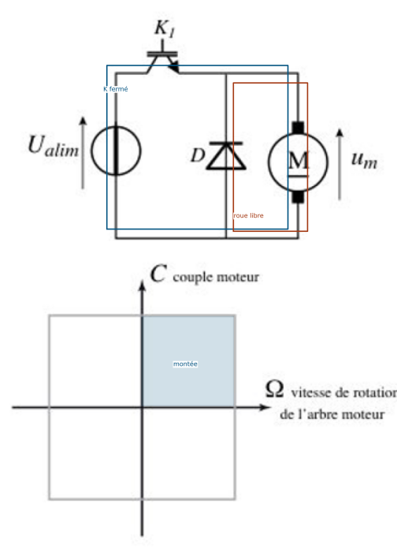
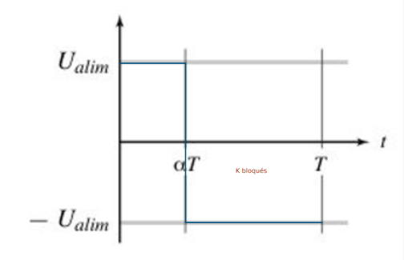
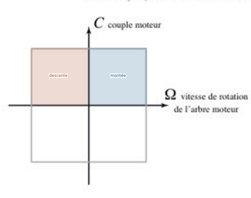
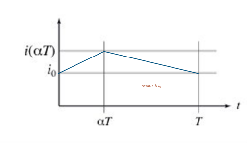
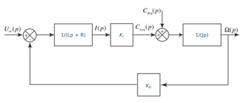
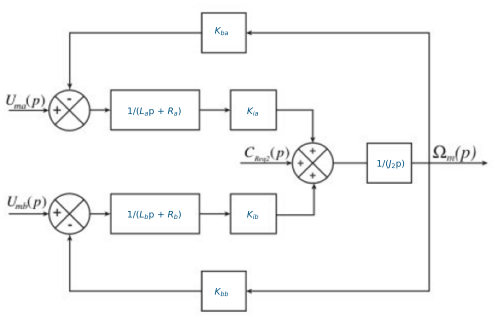
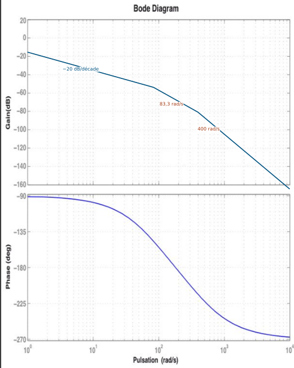
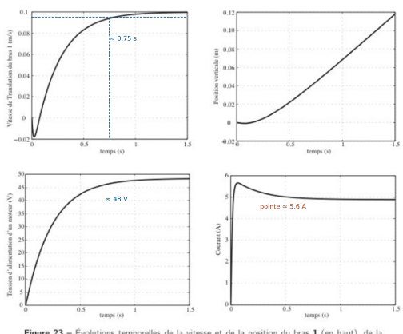
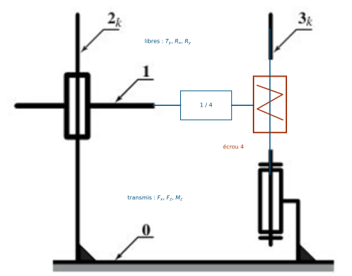
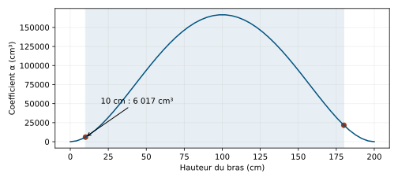

# Banque PT 2016 — Sciences industrielles A · Corrigé guidé

*Corrigé rédigé par IA, non officiel. Signalez toute erreur.*

**Rédaction** · GPT-6.2 Astra Ultra · vitesse non renseignée · 26 novembre 2026

EOS construit deux images radiographiques orthogonales pendant que le bras se déplace verticalement. Les trois moteurs entraînent le même bras par des réducteurs et des vis à billes. Les numéros de page des renvois comprennent la garde du PDF.

[Sujet et cahier officiels](https://www.banquept.fr/documents/2016/si_a_2016_pt.pdf) · [Rapport du jury](https://www.banquept.fr/documents/ecrit/rapport/2016/rapport_si_a_ecrit_2016.pdf)

Le jury relève plusieurs points précis dans les copies. Il faut intégrer la vitesse pour obtenir la distance de démarrage, ramener les énergies au même arbre avant d’additionner les inerties, puis inclure le capteur dans la boucle ouverte. La dernière partie distingue l’analyse d’une chaîne et le calcul d’hyperstatisme des trois chaînes.

## I.1 — Vitesse de scan et puissance

### Question 1 — Échantillonner la hauteur utile

> [!INDICATION]
> Convertir le pas vertical du détecteur et la hauteur dans la même unité.

#### Solution

La hauteur couverte est 1 500 mm. Au pas de 0,25 mm, il faut $1500/0,25=6000$ lignes dans chaque image.

[Sujet p. 9](https://www.banquept.fr/documents/2016/si_a_2016_pt.pdf#page=9) · [Cahier p. 30 du PDF](https://www.banquept.fr/documents/2016/si_a_2016_pt.pdf#page=30)

### Question 2 — Choisir la vitesse de dimensionnement

> [!INDICATION]
> Diviser le déplacement autorisé pendant une mesure par sa durée.

#### Solution

Pour 2,5 ms, un pixel entier donne $V_{\max}=0,25/2,5=0,10$ m/s. Un quart de pixel donne $V_{\rm optim}=0,025$ m/s. La motorisation doit entraîner la masse jusqu’à 0,10 m/s.

### Question 3 — Calculer la durée du scan

> [!INDICATION]
> La hauteur utile exclut les courses de démarrage et de freinage.

#### Solution

$t=1,5/0,025=60$ s. Une minute est envisageable pour une acquisition debout si le patient peut rester immobile durant ce temps. Tout mouvement peut affecter la reconstruction.

### Question 4 — Intégrer le démarrage du premier ordre

> [!INDICATION]
> Le premier instant à 99 % donne une durée. Pour obtenir une distance, calculer l’aire sous la courbe avant cet instant.

#### Solution

$v(t)=V_{\max}(1-e^{-t/\tau})$ et $t_{99}=\tau\ln100$. L’intégration donne $d=V_{\max}\tau(\ln100-0,99)$. La distance limite de 0,10 m donne $\tau=0,277$ s et $t_{5\%}=\tau\ln20=0,829$ s. La constante de ce système chargé vaut environ 35 fois les 8 ms mécaniques du moteur seul.

### Question 5 — Vérifier la puissance en montée

> [!INDICATION]
> Remonter de la charge vers les arbres moteurs en divisant par les rendements.

#### Solution

La puissance utile vaut $MgV_{\max}=392,4$ W. Il faut par moteur $392,4/(3\times0,85\times0,90)=171$ W. Chacun dispose de $0,80\times255=204$ W. Les trois chaînes satisfont l’exigence avec la répartition supposée.

## I.4 — Hacheurs et ondulation du courant

### Question 6 — Colorier les mailles du hacheur série

> [!INDICATION]
> La continuité du courant dans l’inductance détermine le sens de la diode lorsque le transistor s’ouvre.

#### Solution

K1 passant, le courant va du pôle positif par K1 vers le moteur, puis au pôle négatif. K1 bloqué, il remonte par la diode et redescend dans le moteur. Le courant garde le même sens, donc le couple reste positif. En fonctionnement moteur commandé par tension positive, cocher le quadrant de montée, vitesse et couple positifs.

[Sujet p. 11](https://www.banquept.fr/documents/2016/si_a_2016_pt.pdf#page=11) · [Cahier p. 32 du PDF](https://www.banquept.fr/documents/2016/si_a_2016_pt.pdf#page=32)

### Question 7 — Arrêter la montée

> [!INDICATION]
> Comparer la distance de freinage sous l’effet du poids à la réserve de course.

#### Solution

Sans couple moteur et avec la seule masse en translation, $d=V_{\max}^2/(2g)=0,51$ mm. En tenant compte de toutes les inerties idéales de Q26, $d=J_3(V_{\max}/r)^2/(2Mg)\simeq3,9$ mm, avec $r=p_v/(2\pi N)$. Ces deux distances sont inférieures à 100 mm. Le poids suffit au freinage. La commande peut réduire le couple positif et le rétablir pour soutenir le bras.

### Question 8 — Commander la descente

> [!INDICATION]
> Comparer le signe de la vitesse à celui de la tension disponible.

#### Solution

Le hacheur série fournit une tension moyenne comprise entre zéro et la tension d’alimentation. Il ne sait pas imposer une tension négative pour piloter la rotation inverse dans toute la plage voulue. Une descente entraînée par le poids est physiquement possible.

### Question 9 — Tracer la tension bipolaire

> [!INDICATION]
> Distinguer la phase où les deux transistors conduisent de celle où les deux diodes conduisent.

#### Solution

Sur $[0,\alpha T[$, $u_m=+U_{\rm alim}$. Sur $[\alpha T,T[$, $u_m=-U_{\rm alim}$ en conduction continue. La moyenne vaut $(2\alpha-1)U_{\rm alim}$ et balaie de $-U_{\rm alim}$ à $+U_{\rm alim}$ lorsque $\alpha$ passe de zéro à un. Les deux sens de vitesse deviennent commandables.

[Sujet p. 12](https://www.banquept.fr/documents/2016/si_a_2016_pt.pdf#page=12) · [Cahier p. 33 du PDF](https://www.banquept.fr/documents/2016/si_a_2016_pt.pdf#page=33)

### Question 10 — Sélectionner les quadrants utiles

> [!INDICATION]
> En descente, quel doit être le sens du couple qui retient la masse ?

#### Solution

Le courant garde son signe. Cocher les deux secteurs $C_m>0$, pour $\omega_m>0$ en montée et pour $\omega_m<0$ en descente freinée. En descente, $C_m\omega_m<0$ et le bras restitue de l’énergie. Ces deux secteurs couvrent la montée, l’arrêt aidé par la gravité et la descente sous charge, avec une source apte à recevoir l’énergie.

[Sujet p. 12](https://www.banquept.fr/documents/2016/si_a_2016_pt.pdf#page=12) · [Cahier p. 33 du PDF](https://www.banquept.fr/documents/2016/si_a_2016_pt.pdf#page=33)

### Question 11 — Évaluer le courant de régime

> [!INDICATION]
> Égaler les puissances idéales des trois arbres et du bras.

#### Solution

Avec $v=r\omega_m$, le couple d’un moteur vaut $Mgr/3$. On en déduit $i_m=Mgr/(3K_i)=3,47$ A pour $r=0,01/(2\pi\times5)$ m/rad et $K_i=0,12$ N·m/A.

### Question 12 — Écrire la loi de maille

> [!INDICATION]
> Orienter les chutes de tension dans le sens du courant sur l’intervalle passant.

#### Solution

La source impose $u_m=U_{\rm alim}$. La tension aux bornes de l’induit est $L\,di/dt+Ri+e_b$, d’où $L\,di/dt+Ri=U_{\rm alim}-e_b$.

### Question 13 — Résoudre sur la phase passante

> [!INDICATION]
> Exprimer une valeur de régime et une solution transitoire imposée par le courant initial.

#### Solution

La montée est à vitesse constante et l’inertie filtre le découpage, donc $e_b=K_b\omega_m=e_m$. Posons $i_\infty=(U_{\rm alim}-e_m)/R$ et $\tau_e=L/R$. Pour $0\le t\le\alpha T$, $i(t)=i_\infty+(i_0-i_\infty)e^{-t/\tau_e}$.

### Question 14 — Construire le chronogramme du courant

> [!INDICATION]
> Remplacer l’exponentielle par sa tangente lorsque la période est courte.

#### Solution

$i(\alpha T)\simeq i_0+(i_\infty-i_0)\alpha T/\tau_e$. Tracer un segment montant de $i_0$ à cette valeur, puis un segment descendant jusqu’à $i_0$ à $T$ en régime périodique. L’inductance impose la continuité aux commutations.

[Sujet p. 12](https://www.banquept.fr/documents/2016/si_a_2016_pt.pdf#page=12) · [Cahier p. 35 du PDF](https://www.banquept.fr/documents/2016/si_a_2016_pt.pdf#page=35)

### Question 15 — Exprimer l’ondulation crête à crête

> [!INDICATION]
> Soustraire le courant de départ de sa valeur au changement d’état.

#### Solution

$\Delta i\simeq(\alpha T/\tau_e)[(U_{\rm alim}-e_m)/R-i_0]$. C’est aussi, à ce degré d’approximation, l’opposé de la variation sur la seconde portion du cycle.

### Question 16 — Fixer l’ordre de grandeur du découpage

> [!INDICATION]
> Comparer la variation au courant initial dans l’expression précédente.

#### Solution

Pour $\Delta i/i_0\simeq0,01$, il faut $T/\tau_e\simeq i_0/[100\alpha(i_\infty-i_0)]$. Ce rapport est de l’ordre du centième si le facteur de courant est voisin de un.

## II.1 — Dynamique des moteurs en parallèle

### Question 17 — Ramener l’énergie d’une chaîne sur le moteur

> [!INDICATION]
> Écrire chaque vitesse en fonction de celle du moteur puis sommer les énergies.

#### Solution

Posons $j=J_m+J_R+J_V/N^2$ et $r=p_v/(2\pi N)$. La vis tourne à $\omega_m/N$ et le bras avance à $r\omega_m$. L’énergie est $(j+Mr^2)\omega_m^2/2$. Les puissances extérieures valent $C_m\omega_m-Mgr\omega_m$. Ainsi $J_{\rm eq}=j+Mr^2$, $C_{R\rm eq}=-Mgr$ et $C_{m\rm eq}=C_m$. La dérivée de l’énergie donne l’équation (II.2).

[Sujet p. 15](https://www.banquept.fr/documents/2016/si_a_2016_pt.pdf#page=15) · [Cahier p. 36 du PDF](https://www.banquept.fr/documents/2016/si_a_2016_pt.pdf#page=36)

### Question 18 — Compléter les blocs du moteur unique

> [!INDICATION]
> L’induit voit la tension d’alimentation diminuée de la force contre-électromotrice.

#### Solution

De gauche à droite, sommateur $U_m-K_b\Omega_m$, bloc $1/(Lp+R)$, courant, bloc $K_i$, sommateur $C_m+C_{R\rm eq}$, bloc $1/(J_{\rm eq}p)$, sortie $\Omega_m$. Retour par $K_b$. En éliminant le courant, $D_1=J_{\rm eq}p(Lp+R)+K_iK_b$, $H_m=K_i/D_1$ et $H_C=(Lp+R)/D_1$.

[Sujet p. 15](https://www.banquept.fr/documents/2016/si_a_2016_pt.pdf#page=15) · [Cahier p. 36 du PDF](https://www.banquept.fr/documents/2016/si_a_2016_pt.pdf#page=36)

### Question 19 — Rapporter les deux entraînements au même arbre

> [!INDICATION]
> La masse en translation est commune aux deux branches.

#### Solution

$E_c=(2j+Mr^2)\omega_m^2/2$, $J_{\rm eq2}=2j+Mr^2$ et $C_{R\rm eq2}=-Mgr$. Les deux puissances motrices s’additionnent, d’où $J_{\rm eq2}\dot\omega_m=C_{ma}+C_{mb}-Mgr$.

### Question 20 — Compléter les deux branches du schéma-bloc

> [!INDICATION]
> La même vitesse sert aux deux retours électriques. Le couple résistant agit une fois sur la masse commune.

#### Solution

Pour chaque branche $k=a,b$, la différence $U_{mk}-K_{bk}\Omega_m$ traverse $1/(L_kp+R_k)$, puis $K_{ik}$. Additionner $C_{ma}$, $C_{mb}$ et $C_{R\rm eq2}$, puis appliquer $1/(J_{\rm eq2}p)$. Chacune des boucles de force contre-électromotrice est soustractive.

[Sujet p. 16](https://www.banquept.fr/documents/2016/si_a_2016_pt.pdf#page=16) · [Cahier p. 37 du PDF](https://www.banquept.fr/documents/2016/si_a_2016_pt.pdf#page=37)

### Question 21 — Trouver les trois transferts du modèle double

> [!INDICATION]
> Multiplier l’équation mécanique par l’impédance d’un moteur afin de remplacer les deux courants.

#### Solution

Avec $Z=Lp+R$, $J_{\rm eq2}pZ\Omega_m=K_i(U_{ma}+U_{mb}-2K_b\Omega_m)+Z C_{R\rm eq2}$. Le dénominateur est $D_2=J_{\rm eq2}pZ+2K_iK_b$. Par lecture, $H_{ma}=H_{mb}=K_i/D_2$ et $H_{C2}=Z/D_2$.

### Question 22 — Remplacer deux moteurs par un moteur équivalent

> [!INDICATION]
> Prendre pour courant équivalent la somme des courants réels.

#### Solution

À tensions égales, le transfert en tension est $2K_i/D_2$, celui en couple $Z/D_2$. Comme $i_{\rm eq}=i_a+i_b$, les constantes de couple et de force contre-électromotrice restent $K_i,K_b$, la résistance et l’inductance deviennent $R/2,L/2$, l’inertie vaut $J_{\rm eq2}$.

### Question 23 — Étendre l’équivalence aux trois chaînes

> [!INDICATION]
> Les impédances identiques se trouvent en parallèle et le bras est commun.

#### Solution

$K_{i3}=K_i$, $K_{b3}=K_b$, $R_3=R/3$, $L_3=L/3$, $J_3=3j+Mr^2$. Le courant équivalent est la somme des trois courants. Le couple résistant reste $-Mgr$.

### Question 24 — Mettre les deux fonctions sous forme canonique

> [!INDICATION]
> Normaliser par le terme constant du dénominateur.

#### Solution

Écrivons $D=1+bp+ap^2$ avec $a=J_3L_3/(K_iK_b)$ et $b=J_3R_3/(K_iK_b)$. Alors $H_{\rm eq3m}=K_m/D$, $K_m=1/K_b$, et $H_{C\rm eq3m}=K_C(1+\tau_Cp)/D$, $K_C=R_3/(K_iK_b)$, $\tau_C=L_3/R_3=L/R$.

### Question 25 — Convertir la constante électrique

> [!INDICATION]
> Mille tours par minute correspondent à une vitesse angulaire, en rad/s.

#### Solution

$K_{b3}=12/(1000\times2\pi/60)=0,11459$ V·s/rad.

### Question 26 — Calculer l’inertie équivalente

> [!INDICATION]
> Un gramme-centimètre carré vaut un dix-millionième de kilogramme-mètre carré.

#### Solution

$J_3=3(800+80+600/25)10^{-7}+400[0,01/(10\pi)]^2=3,117\times10^{-4}$ kg·m². En déduisant les trois rotors, la fraction des réducteurs, des vis et du bras vaut $1-3(800\times10^{-7})/J_3=23,0$ %.

### Question 27 — Séparer les deux constantes de temps

> [!INDICATION]
> Identifier somme et produit des deux constantes, puis examiner le discriminant.

#### Solution

$\tau_1+\tau_2=b$, $\tau_1\tau_2=a$, soit $\tau_{1,2}=(b\mp\sqrt{b^2-4a})/2$. Avec les données du tableau, $a\simeq3,48\,10^{-5}$ s² et $b\simeq0,0151$ s. Le discriminant est positif. On trouve environ 2,83 et 12,3 ms. Pour la suite, adopter les valeurs imposées 2,5 et 12 ms.

## II.2 — Asservissement et validation

### Question 28 — Compléter les conversions de vitesse

> [!INDICATION]
> Le capteur est monté sur la vis, après le réducteur.

#### Solution

$R_e=1/N=0,2$, $H_v=p_v/(2\pi)=1,592\times10^{-3}$ m/rad. Leur produit donne la vitesse linéaire par radian par seconde moteur.

[Sujet p. 18](https://www.banquept.fr/documents/2016/si_a_2016_pt.pdf#page=18) · [Cahier p. 42 du PDF](https://www.banquept.fr/documents/2016/si_a_2016_pt.pdf#page=42)

### Question 29 — Adapter la consigne

> [!INDICATION]
> Remonter de la vitesse linéaire à la vitesse mesurée sur la vis.

#### Solution

À l’équilibre recherché, $A_C v=G_t\Omega_v=G_tv/H_v$. Ainsi $A_C=G_t/H_v=62,83$ V·s/m.

### Question 30 — Évaluer un correcteur proportionnel

> [!INDICATION]
> Examiner le gain continu de la boucle et l’effet d’une perturbation constante.

#### Solution

Avec un correcteur proportionnel fini, la boucle ouverte possède un gain fini à fréquence nulle. Un couple résistant constant nécessite un courant puis une tension de commande permanents. Un simple gain réclame donc un écart permanent pour les produire. Le rejet statique exact demandé est impossible.

### Question 31 — Ouvrir la boucle sur l’écart en tension

> [!INDICATION]
> Parcourir les blocs de l’écart jusqu’à la mesure. La conversion vis–bras se trouve hors de ce chemin.

#### Solution

Pour la perturbation nulle, $M/\varepsilon=(K_{\rm Cor}/p)H_{\rm eq3m}R_eG_t=0,16K_{\rm Cor}/[p(1+0,0025p)(1+0,012p)]$, avec le gain $K_m=8$ imposé.

### Question 32 — Tracer le gain asymptotique

> [!INDICATION]
> Commencer avec l’intégrateur, puis diminuer la pente de 20 dB par décade à chaque pôle.

#### Solution

Pour $K_{\rm Cor}=1$, la première droite vaut $20\log_{10}(0,16/\omega)$, soit $-15,9$ dB à 1 rad/s. Les cassures sont $1/0,012=83,3$ et $1/0,0025=400$ rad/s. Les pentes successives valent $-20,-40,-60$ dB/décade. La phase donnée tend de $-90^\circ$ à $-270^\circ$.

[Sujet p. 18](https://www.banquept.fr/documents/2016/si_a_2016_pt.pdf#page=18) · [Cahier p. 43 du PDF](https://www.banquept.fr/documents/2016/si_a_2016_pt.pdf#page=43)

### Question 33 — Régler le gain et vérifier les marges

> [!INDICATION]
> Choisir la traversée proche de trois sur le temps de réponse, puis lire le gain à la phase de moins 180 degrés.

#### Solution

$\omega_c\simeq3/0,75=4$ rad/s. Le gain minimal approché est $4/0,16=25$, ou 25,03 avec les deux pôles. La phase y vaut $-90^\circ-\arctan(0,01)-\arctan(0,048)$, soit une marge de $86,7^\circ$. À $\omega_\pi=1/\sqrt{0,0025\times0,012}=182,6$ rad/s, la marge de gain est 41,6 dB. Les exigences de 65° et 8 dB sont satisfaites.

### Question 34 — Chiffrer le couple résistant commun

> [!INDICATION]
> Choisir la montée comme sens positif.

#### Solution

$C_{R\rm eq3}=-400\times9,81\times0,01/(2\pi\times5)=-1,249$ N·m. Cette valeur concerne les trois entraînements réunis.

### Question 35 — Lire les quatre courbes de validation

> [!INDICATION]
> Tracer la limite basse de la bande à 5 % de 0,10 m/s et relever les maxima sur les autres axes.

#### Solution

Figure 23, le bras rejoint 0,10 m/s, soit un écart statique nul à la précision du tracé. Il franchit 0,095 m/s vers 0,75 s et y reste, au voisinage immédiat de la limite. Les marges sont celles de Q33. La rotation finale est 3 000 tr/min, inférieure à 3 400. Le courant présente une pointe d’environ 5,6 A, sous 20 A. La tension se stabilise vers 48 V, à la limite nominale à la précision graphique.

[Sujet p. 19](https://www.banquept.fr/documents/2016/si_a_2016_pt.pdf#page=19) · [Cahier p. 45 du PDF](https://www.banquept.fr/documents/2016/si_a_2016_pt.pdf#page=45)

### Question 36 — Expliquer le recul initial

> [!INDICATION]
> Comparer le poids et le couple électromagnétique immédiatement après l’application de la consigne.

#### Solution

Le poids agit dès le départ, alors que l’inductance retarde la montée du courant. Le bras descend brièvement, puis remonte dès que le couple devient suffisant. Un frein de maintien à déblocage commandé retient le bras jusqu’à l’établissement du couple de soutien.

## III.1 — Structure spatiale et guidage

### Question 37 — Écrire les quatre torseurs de liaison

> [!INDICATION]
> Au point indiqué, écrire les couples de vecteurs rotation–vitesse et force–moment. Leur puissance réciproque est nulle.

#### Solution

Convention $(\Omega;V)$ et $(F;M)$ en composantes $x,y,z$. Pour $0/2_k$ encastrement de la colonne, torseur cinématique nul, six composantes d’effort libres en tout point. Pour $1/2_k$ pivot glissant en $A_k$ d’axe $z$, $[(0,0,\omega);(0,0,v)]$ et $[(X,Y,0);(L,M,0)]$. Pour $1/3_k$ hélicoïdale en $B_k$ d’axe $z$ et pas algébrique $2\pi s$, $[(0,0,\omega);(0,0,s\omega)]$ et $[(X,Y,Z);(L,M,-sZ)]$. Pour $0/3_k$ pivot d’axe $(B_k,z)$, $[(0,0,\omega);(0,0,0)]$ et $[(X,Y,Z);(L,M,0)]$ sur cet axe.

[Sujet p. 20](https://www.banquept.fr/documents/2016/si_a_2016_pt.pdf#page=20) · [Cahier p. 46 du PDF](https://www.banquept.fr/documents/2016/si_a_2016_pt.pdf#page=46)

### Question 38 — Compter les mobilités des trois branches

> [!INDICATION]
> Utiliser les trois branches du système complet et fusionner éventuellement les colonnes avec le bâti.

#### Solution

Une seule mobilité utile, la translation commune, impose les trois vitesses de vis et aucune mobilité interne ne subsiste. Il y a sept solides mobiles si l’on conserve les trois colonnes. Les contraintes valent $3(6+4+5+5)=60$, d’où $h=60-6\times7+1=19$. Colonnes fusionnées, on trouve aussi $42-24+1=19$.

### Question 39 — Compenser les défauts d’alignement

> [!INDICATION]
> Distinguer la chaîne dessinée sur le cahier et la répétition de ses trois guides dans l’appareil complet.

#### Solution

Sur la chaîne dessinée, ajouter entre le bras et la vis un écrou flottant 4, portant l’hélicoïdale. Une liaison 1–4 à trois libertés autorise la translation radiale $T_y$ et les basculements $R_x,R_y$ au centre $B_k$. Elle transmet $F_x,F_z,M_z$, ce qui assure l’anti-rotation, la poussée axiale et le maintien latéral. Par exemple, un axe transversal $y$ dans un alésage sphérique coulissant, avec doigt antirotation convenablement orienté, réalise la combinaison des libertés. Le bilan pour une chaîne, colonne fusionnée au bâti, est $4+5+5+3-6\times3+1=0$.

[Sujet p. 20](https://www.banquept.fr/documents/2016/si_a_2016_pt.pdf#page=20) · [Cahier p. 47 du PDF](https://www.banquept.fr/documents/2016/si_a_2016_pt.pdf#page=47)

### Question 40 — Équilibrer le bras aux contacts

> [!INDICATION]
> Prendre les moments en A. Les décalages horizontaux valent plus et moins un demi-diamètre.

#### Solution

Avec $I=(d/2,-\ell/2)$ et $J=(-d/2,\ell/2)$ en $(y,z)$, l’équilibre donne $Y_I+Y_J=0$, $Z_I+Z_J=F$, et $\ell(Y_I-Y_J)/2+d(Z_I-Z_J)/2-eF=0$.

### Question 41 — Appliquer le frottement de Coulomb

> [!INDICATION]
> Les normales repoussent le bras et les frottements s’opposent à sa tendance à descendre.

#### Solution

On pose $Y_I=-Y_J=N>0$. À la limite de la descente, $Z_I,Z_J\ge0$. En adhérence avec cette tendance, $0\le Z_I\le fN$ et $0\le Z_J\le fN$. L’égalité caractérise un contact sur le bord de son cône.

### Question 42 — Écarter le risque d’arc-boutement

> [!INDICATION]
> Comparer l’effort tangentiel disponible avec les deux normales que le moment excentré crée.

#### Solution

Avec $u=Z_I/N$ et $v=Z_J/N$, les deux équations donnent $\ell=(e-d/2)u+(e+d/2)v$. Ici $e>d/2$, et $0\le u,v\le f$ imposent $\ell\le2ef$ à tout équilibre bloqué. La frontière correspond aux deux contacts sur leur limite. La condition de non-arc-boutement est donc $\ell>2ef$. On a 0,20 m contre $2\times0,20\times0,2=0,08$ m, condition satisfaite.

## III.2 — Flexion des colonnes et précision des images

### Question 43 — Déterminer les réactions et les efforts intérieurs

> [!INDICATION]
> Choisir le tronçon inférieur et appliquer la convention de cohésion aval sur amont.

#### Solution

$Y_C=R(H-h)/H$, $Z_C=0$, $Y_D=Rh/H$. L’effort normal est nul. Pour $0<z<h$, $T=-Y_C$ et $M=-Y_Cz$. Pour $h<z<H$, $T=Y_D$ et $M=-Y_Cz+R(z-h)=-Y_D(H-z)$. La section subit flexion simple et cisaillement. Le moment est continu en $h$, l’effort tranchant y saute de $R$.

[Sujet p. 23](https://www.banquept.fr/documents/2016/si_a_2016_pt.pdf#page=23) · [Cahier p. 48 du PDF](https://www.banquept.fr/documents/2016/si_a_2016_pt.pdf#page=48)

### Question 44 — Établir les équations de la déformée

> [!INDICATION]
> Le déplacement est suivant y alors que la coordonnée longitudinale est z. Retrouver le signe avec un déplacement vers moins y.

#### Solution

$\theta_x=-V'(z)$, donc $EI V''=-M$. Ainsi $EI V''=Y_Cz$ en dessous de la charge et $EI V''=Y_D(H-z)$ au-dessus. Aux deux appuis, $V(0)=V(H)=0$. Au droit de $h$, $V$ et sa pente sont continues. Ces quatre conditions fixent les quatre constantes des deux intégrations.

### Question 45 — Transposer le résultat à la vis

> [!INDICATION]
> Inverser la charge et remplacer la rigidité de la première poutre par celle de la seconde.

#### Solution

Les appuis et les longueurs sont identiques. Donc $\alpha'=\alpha$ et $V'(h)=R\alpha(h,H)/(E'I')$ pour la vis. La notation $V'$ désigne ici sa flèche. Pour contrôler la lecture graphique, $\alpha=h^2(H-h)^2/(3H)$ en unités de longueur au cube.

### Question 46 — Calculer les moments quadratiques

> [!INDICATION]
> Le moment quadratique de flexion transversal d’un disque est la moitié de son moment polaire.

#### Solution

$I=\pi d^4/64=4,909\times10^{-6}$ m⁴, $I'=\pi d'^4/64=3,068\times10^{-7}$ m⁴. Diviser le diamètre par deux divise la rigidité de section par seize à module identique.

### Question 47 — Écrire la compatibilité du défaut

> [!INDICATION]
> Le bras rigide impose un entraxe supérieur de epsilon à l’entraxe initial.

#### Solution

La colonne s’écarte vers $-y$ et la vis vers $+y$. Ainsi $\varepsilon=V'(h)-V(h)=R\alpha[1/(EI)+1/(E'I')]$. L’effort parasite vaut $\varepsilon/\{\alpha[1/(EI)+1/(E'I')]\}$.

### Question 48 — Repérer la position la plus chargée

> [!INDICATION]
> La flèche relative est imposée. L’effort croît là où la souplesse est la plus faible.

#### Solution

Sur $[0,10;1,80]$ m avec $H=2$ m, $\alpha$ est minimale à $h_{\max}=0,10$ m, extrémité inférieure la plus proche d’un appui. La figure 31 donne environ $6,0\,10^3$ cm³, soit $0,0060$ m³. Alors $\lambda_{\max}=1/\{\alpha[1/(EI)+1/(E'I')]\}\simeq9,6\,10^6$ N/m et $R_{\max}=\lambda_{\max}\varepsilon$.

[Sujet p. 25](https://www.banquept.fr/documents/2016/si_a_2016_pt.pdf#page=25) · [Cahier p. 50 du PDF](https://www.banquept.fr/documents/2016/si_a_2016_pt.pdf#page=50)

### Question 49 — Borner la contrainte de flexion

> [!INDICATION]
> Le moment maximal vaut la réaction multipliée par la distance au point chargé. Borner son bras de levier sur toute la portée.

#### Solution

Pour une hauteur donnée, le moment maximal en module vaut $R(h)h(H-h)/H$. Comme $h(H-h)/H\le H/4$, la majoration demandée vaut $\sigma_{\max}\le\lambda_{\max}\varepsilon H d'/(8I')\simeq39$ MPa. Cette valeur reste très inférieure aux 500 MPa de limite élastique.

### Question 50 — Relier le frottement parasite à l’image

> [!INDICATION]
> Une seule chaîne comporte un défaut. Comparer son effort axial au poids total.

#### Solution

$T_{\max}=fR_{\max}\simeq0,2\times960=192$ N, soit environ 4,9 % de $Mg=3924$ N. Ce frottement dépend de la hauteur et s’oppose au déplacement. Une compensation imparfaite modifie la vitesse locale et l’écartement vertical réel des lignes acquises à cadence fixe. Déformation géométrique et défauts de recalage entre projections peuvent alors dégrader l’image reconstruite.
