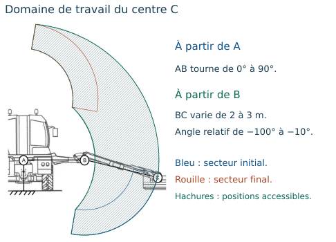
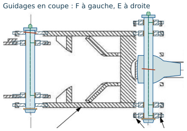
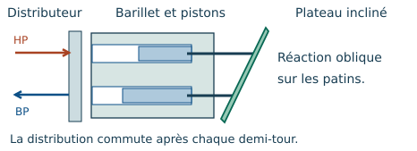
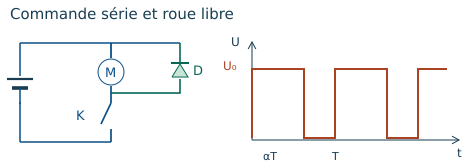
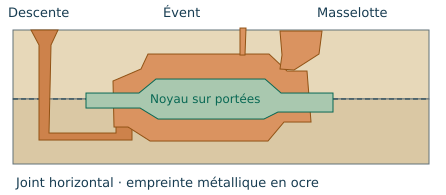

# Banque PT 2016 — Sciences industrielles C · Corrigé brut

*Corrigé rédigé par IA, non officiel. Signalez toute erreur.*

**Rédaction** · GPT-6.2 Astra Ultra · vitesse non renseignée · 27 novembre 2026

**Révision (tour 1)** · GPT-6.2 Astra Ultra · vitesse non renseignée · 27 novembre 2026

**Véhicule d’accoroutage VSV.** Épreuve de six heures. Le jury attribue 25 %, 20 %, 25 % et 30 % aux quatre parties. Le barème détaillé de chaque question n’est pas publié.

[Sujet et planches](https://www.banquept.fr/documents/2016/si_c_2016_pt.pdf) · [Rapport du jury](https://www.banquept.fr/documents/ecrit/rapport/2016/rapport_si_c_ecrit_2016.pdf)

## I · Fonctionnement du véhicule

### Q1 · Différentiel et blocage

En virage, la roue extérieure parcourt plus de chemin. Le différentiel transmet le couple aux deux demi-arbres tout en laissant varier leurs vitesses autour de celle du porte-satellites. En terrain peu adhérent, le blocage solidarise les deux roues et permet à la roue qui adhère de contribuer à la traction même si l’autre patine. En virage sur sol adhérent, cette égalité des vitesses provoquerait du ripage.

### Q2 · Essieu oscillant

L’essieu peut basculer autour d’un axe longitudinal du véhicule. Sur une chaussée déformée, les deux pneus gardent ainsi un contact avec le sol sans imposer au châssis la torsion correspondant au dénivelé. Cette adaptation favorise la motricité.

### Q3 · Implantation du moteur

Le moteur placé du côté opposé au bras déployé diminue le moment de renversement latéral autour des appuis du véhicule. Le déport libère également le volume nécessaire au repli du bras et à ses débattements. L’implantation doit conserver le champ de vision depuis le poste de conduite.

### Q4 · Puissance aux essieux

À vitesse constante en montée, en négligeant les efforts de roulement et la traînée, la somme des forces de traction vaut $Mg\sin\theta$. À la masse maximale de 12 500 kg, cela représente 12 500 N. Avec la valeur arrondie de travail de la ressource 2, $v=5$ m/s, les deux essieux réunis doivent fournir 62,5 kW. La conversion exacte de 20 km/h donne 69,4 kW. Les 6 800 kg correspondent au véhicule à vide.

### Q5 · Puissance du module

Les sorties mécaniques des trois vérins et du groupe totalisent $3\times5+3=18$ kW. Il faut 22,5 kW hydrauliques en entrée des actionneurs, puis $22{,}5/0{,}8=28{,}125$ kW mécaniques à l’arbre de la pompe qui alimente le module. Ces valeurs correspondent à trois sections distinctes de la chaîne.

### Q6 · Puissance du moteur thermique

Sur la branche de traction, la pompe et le moteur hydraulique ont chacun un rendement de 0,8. L’arbre commun fournit donc $62{,}5/0{,}8^2+28{,}125=125{,}78$ kW. Avec 20 km/h convertis sans arrondi, le résultat devient 136,63 kW. Les puissances des deux branches s’additionnent à l’arbre moteur.

### Q7 · Possibilités du véhicule

Les 106 kW ne suffisent pas à cumuler à pleine charge la pente de 10 %, la vitesse maximale et toutes les puissances du module. Avec le module à pleine puissance, les essieux disposent de $(106-28{,}125)\,0{,}8^2=49{,}84$ kW. La vitesse en montée vaut alors au plus 3,99 m/s, soit environ 14,35 km/h. Une masse ou une pente plus faible, ou des actionneurs sollicités séparément, desserrent cette contrainte.

### Q8 · Protection du vérin

Le composant c comporte un limiteur de pression à ressort et un clapet de réalimentation en parallèle. Le limiteur décharge la chambre protégée vers le retour lorsque sa pression dépasse le tarage. En sens inverse, le clapet peut admettre de l’huile depuis le retour si la chambre tend à passer en dépression.

### Q9 · Cheminement de l’huile

Pour faire sortir la tige vers la gauche du dessin, alimenter la grande chambre à droite du piston. Le trajet de pression va de la flèche d’alimentation à l’orifice de grande chambre via la case active du distributeur. L’huile de la chambre annulaire repart par l’autre voie vers le réservoir. Le dessin utilise le rouge pour l’alimentation et le bleu pour l’échappement. En régime normal les soupapes restent fermées.

### Q10 · Électrocommande

La case attenante à la commande a réalise ces deux communications. Une fois cette case amenée en face des orifices fixes, la voie de pression débouche sur la conduite du fond de vérin.

### Q11 · Distributeur et choix des positions

C’est un distributeur 5/3 à deux commandes électriques et rappel au centre par ressorts. La position centrale ferme les voies. Les deux échappements vont au même retour. Un 4/2 permet d’inverser le mouvement avec un seul retour mais ses deux positions actives suppriment l’arrêt par recentrage. Un 4/3 à centre fermé conserve cette troisième fonction.

### Q12 · Rappel au centre

Sans excitation, les ressorts ramènent le tiroir à la position médiane. Les deux chambres y sont isolées. Dans le modèle sans fuite, le vérin conserve sa position.

### Q13 · Vitesse de tige

À section utile donnée, $v=Q/S$. Ici la commande tout ou rien sélectionne un sens et ouvre une section fixe. Elle ne donne aucune consigne continue de débit. Les aires différentes du fond et du côté tige peuvent donner deux vitesses différentes à débit identique.

### Q14 · Commande proportionnelle

Remplacer la commande tout ou rien par un distributeur proportionnel centré, commandé par le manipulateur. Le déplacement du tiroir règle la section de passage et donc le débit. Une compensation de pression permet de le stabiliser lorsque la charge varie. Les protections des chambres restent raccordées.

## II · Géométrie et paliers du bras

### Q15 · Domaine accessible

Dans le plan de travail, $C=A+L_2\mathbf u(\alpha_2)+x\mathbf u(\alpha_2+\alpha_3)$ avec $\mathbf u(t)=(\cos t,\sin t)$. Pour une flèche horizontale, tracer autour de B le secteur compris entre les rayons 2 et 3 m et les directions −100° et −10°. Faire ensuite tourner ce secteur tout entier autour de A de 0° à 90°. L’union des positions est la zone hachurée. La longueur AB est relevée sur le dessin et l’échelle est étalonnée par BC en extension maximale. La rotation du groupe autour de C ne déplace pas C.

### Q16 · Restrictions réelles

La cabine, les pneus, la tourelle ou le sol peuvent heurter le groupe avant que le centre C atteigne une position théorique. La course réelle des vérins, les encombrements des tuyaux et le risque de basculement sous charge réduisent aussi le domaine exploitable.

### Q17 · Montage initial

Le balancier tourne autour de B, si bien que E reste sur le cercle de centre B et de rayon BE. Tourner BE d’un quart de tour dans le sens d’ouverture indiqué par le bras replié, horaire sur la feuille. On obtient E′ à droite de B. D reste fixe, la nouvelle longueur entre axes du vérin est DE′.

### Q18 · Montage à biellettes

Tourner BF de 90° autour de B pour obtenir F′. E′ appartient à la fois au cercle de centre F′ et de rayon FE et au cercle de centre G et de rayon GE. Retenir l’intersection prolongeant l’assemblage initial sans inversion de la biellette. On peut vérifier ce choix par une position intermédiaire. Relier D à E′ pour mesurer la nouvelle longueur.

### Q19 · Courses comparées

La course est la différence absolue des longueurs entre axes, $|DE'-DE|$, mesurée séparément sur chaque dessin. À l’échelle 0,06, 1 mm sur le document représente 16,7 mm réels. La lecture donne environ 0,50 m pour le montage initial et 0,44 m avec les biellettes. Les lectures peuvent varier d’environ un centimètre selon le pointage des centres. Le vérin se rétracte dans les deux cas. Les biellettes économisent environ 6 cm de course sur ce quart de tour.

### Q20 · Dimensionnement des coussinets

Évaluer la charge radiale par palier et la vitesse de glissement $v=\pi d n/60$ pour $n$ en tr/min. Choisir un matériau et des dimensions compatibles avec l’alésage disponible. Vérifier la pression projetée $p=F/(dB)$, la vitesse admissible et le produit $pv$ admissible pour le matériau et la lubrification retenus. Pour un pivot oscillant, examiner la répartition de graisse et l’usure aux inversions.

### Q21 · Choix dans le catalogue

On peut employer la bague CSB 800 de diamètre intérieur 26 mm, extérieur 30 mm et longueur 15 mm, avec des bossages locaux de longueur suffisante. Même en imputant les 5 000 N à une seule bague, $p=5000/(26\times15)=12{,}82$ MPa, sous les 250 MPa de la ressource 6. Deux joues partageant également la charge ramènent cette valeur à 6,41 MPa par portée. Une limite numérique de $pv$ et la vitesse réelle seraient nécessaires pour chiffrer la tenue en service.

### Q22 · Coupe des guidages

En F, solidariser l’axe avec la fourche b1 et emmancher deux coussinets dans les bossages du balancier. En E, solidariser l’axe avec l’œil de la tige et prévoir une paire de coussinets pour b1 et une autre pour b2. Le serrage de la bague se fait par son diamètre extérieur dans son propre logement. Chaque diamètre intérieur tourne sur une portée lisse de l’axe. Les axes démontables disposent d’une tête, de retenues en bout et de jeux axiaux contrôlés. La goupille de l’œil en E et l’arrêt en rotation en F évitent que l’axe tourne dans la pièce de référence. Les canaux issus d’un graisseur en bout débouchent en regard des différentes portées. Les bagues courtes sont supportées par des bossages rapportés, visibles sur la coupe.

## III · Réponse du bras à un obstacle

### Q23 · Moment quadratique

Retrancher au carré extérieur de côté $a$ le carré intérieur concentrique de côté $b$. Leurs axes centroidaux coïncident. On trouve $I_{Gy}=(a^4-b^4)/12$. Avec 0,20 m et 0,18 m, la valeur est $4{,}585\times10^{-5}\ \mathrm{m^4}$.

### Q24 · Répartition de matière

À masse, matériau et longueur identiques, déplacer de la matière loin de la fibre neutre augmente $I$ et donc la rigidité de flexion $EI$. La section creuse occupe une enveloppe extérieure plus grande. À chargement égal, sa flèche est moindre.

### Q25 · Section critique

À l’abscisse $x$ depuis l’encastrement, l’intensité du moment fléchissant est $F(L-x)$. Elle atteint $FL$ en $x=0$. Les fibres extrêmes de cette section sont les plus sollicitées en flexion.

### Q26 · Formule de flexion

À la distance $z$ de la fibre neutre, la contrainte normale est de module $|M_y z|/I_{Gy}$. Aux deux faces extrêmes, $|z|=a/2$, donc $\sigma_{\max}=|M_y|a/(2I_{Gy})$. Une face travaille en traction, l’autre en compression.

### Q27 · Effet de la charge en bout

À l’encastrement, on obtient $\sigma_{\max}=FLa/(2I_{Gy})=6FLa/(a^4-b^4)$. Cette relation suppose la flexion élastique d’une poutre encastrée et une force perpendiculaire à son axe.

### Q28 · Vérification de résistance

Avec la valeur arrondie imposée $I=5\times10^{-5}\ \mathrm{m^4}$, $F=10\,000$ N et $L=6$ m, le moment vaut 60 kN·m et la contrainte 120 MPa. La limite élastique de 235 MPa donne un rapport d’environ 1,96. Avec le moment quadratique géométrique, on trouve environ 131 MPa, également admissibles dans ce modèle. Le déplacement de 0,7 m indiqué dans le sujet illustre la différence entre résistance et rigidité.

### Q29 · Équilibre du dashpot

Isoler 6, rigide et articulé sans frottement en D et E. Les deux résultantes sont opposées et portées par DE. Dans la convention du dessin, $\mathbf x_6=\cos\alpha_6\,\mathbf x_0-\sin\alpha_6\,\mathbf z_0$. Par projection, $X_{S6}=-Z_{S6}/\tan\alpha_6$.

### Q30 · Équilibre du bras

Le moment en A élimine la réaction du pivot. La force en C apporte $FL$ suivant $\mathbf y_0$ et celle en D apporte $0{,}2X_{6S}-0{,}2Z_{6S}$. Leur somme nulle et la direction trouvée à la question précédente donnent $Z_{6S}=FL/[0{,}2(1+1/\tan\alpha_6)]$. Cette composante est positive dans le repère du sujet.

### Q31 · Compression transmise

Avec le facteur géométrique 15, $Z_{6S}=60\,000/(0{,}2\times15)=20\,000$ N. L’action réciproque sur 6, l’équilibre de 6 puis celui de 8 transmettent cette composante. La liaison parfaite de direction $\mathbf z_0$ entre 8 et le châssis ne reprend aucun effort axial. La tige agit sur le ressort suivant $-\mathbf z_0$, soit $Z_{87}=-20\,000$ N.

### Q32 · Raideur

Pour une loi linéaire sans précharge, $F=k\delta$. Il faut $k\geq20\,000/0{,}05=400\,000$ N/m, soit 400 N/mm. Le déplacement choisi est une borne supérieure, donc la raideur est bornée inférieurement.

### Q33 · Ressort de catalogue

Les trois ressorts Naams ont des charges admissibles inférieures à 20 kN. Parmi les élastomères, le Hasco T4202/50×80 admet 21,7 kN pour une déformation maximale de 20 mm. Il accepte l’effort et sa course admissible est inférieure aux 50 mm autorisés. La référence donnée à 14,5 kN est insuffisante et celle donnée à 60 kN est plus encombrante. Pour un élastomère, le rapport charge/course est une raideur sécante.

### Q34 · Marche arrière

Les réductions 18 puis 2 donnent $720/(18\times2)=20$ tr/min à la roue. Avec un diamètre de 1 m, $v=20\pi/60=1{,}05$ m/s, soit environ 3,77 km/h. Cette vitesse est sensiblement inférieure aux 20 km/h de marche avant en travail.

### Q35 · Temps d’escamotage

Le recul permis par le modèle géométrique vaut $L\tan(\Delta\alpha_1)=6/12=0{,}50$ m. À vitesse maximale constante, $t=0{,}50/1{,}047=0{,}477$ s, soit environ une demi-seconde. C’est un délai bref pour le conducteur. Même un système annoncé à moins de 0,5 s ne présente une marge certaine que si son temps réel de réaction et d’arrêt reste inférieur au temps disponible.

## IV · Groupe de broyage et fabrication

### Q36 · Moteur hydraulique axial

Le distributeur met successivement les chambres du barillet en relation avec les lumières haute et basse pression. Sur le demi-tour alimenté, les pistons poussent sur le plateau incliné. Sa réaction comporte une composante tangentielle qui entraîne le barillet et l’arbre. Sur le demi-tour de retour, les pistons refoulent l’huile. L’inclinaison fixe la course et la cylindrée par tour.

### Q37 · Courroie crantée

L’engrènement des dents impose le rapport des nombres de dents sans glissement relatif en régime normal. Les deux poulies égales donnent un rapport unité dans les deux sens. L’entraxe sépare le moteur du rotor et la souplesse de la transmission atténue une partie des à-coups.

### Q38 · Masse du rotor

Assimilé au seul tube d’acier, son volume est $\pi(0{,}20^2-0{,}18^2)\,1{,}30/4=7{,}76\times10^{-3}\ \mathrm{m^3}$. Avec 7 800 kg/m³, la masse vaut environ 60,5 kg. L’estimation omet les extrémités, les couteaux et leurs supports.

### Q39 · Pièce à déplacer

Déplacer le petit bloc motorisé évite de translater les deux paliers et le rotor d’environ 60 kg. Le rotor garde sa position par rapport au carter et au rouleau palpeur. La glissière du moteur règle l’entraxe des poulies avec un seul ensemble mobile.

### Q40 · Liaison équivalente

L’appui plan normal à $z$ impose $V_{Az}=\omega_x=\omega_y=0$. Le premier contact ponctuel normal à $y$ impose $V_{Ay}=0$. Pour le contact en B décalé en $x$, $V_{By}=V_{Ay}+\omega_z AB_x=0$, donc $\omega_z=0$. Seule subsiste $V_{Ax}$, ce qui définit une glissière de direction $x$.

### Q41 · Schéma de réglage

Le groupe moteur coulisse selon $x$ par rapport au châssis. La vis est solidaire du groupe, l’écrou est retenu axialement et pivote dans le châssis. Entre écrou et vis, la liaison hélicoïdale de même axe convertit un tour relatif en un pas de déplacement. Les fixations de blocage maintiennent le réglage en service.

### Q42 · Sens de rotation

Avec le pas à droite, un écrou tournant positivement autour de $+x$ tend à avancer suivant $+x$ relativement à la vis. L’écrou étant retenu axialement, la vis et le bloc avancent alors suivant $-x$, ce qui réduit $c$. Pour tendre, il faut tourner dans le sens négatif, de $z$ vers $y$.

### Q43 · Écartement

Si $U_\theta$ est algébrique autour de $+x$, $U_c=-pU_\theta/(2\pi)$, avec $p=0{,}001$ m. En notant $q=-U_\theta$ la rotation positive dans le sens de tension, la même relation s’écrit $U_c=pq/(2\pi)$.

### Q44 · Allongement d’un brin

Les deux poulies égales ont des brins rectilignes de longueur égale à la distance entre centres. Le déport $d$ reste constant. L’allongement exact d’un seul brin vaut $U_L=\sqrt{(c+U_c)^2+d^2}-\sqrt{c^2+d^2}$. Les arcs d’enroulement ne changent pas.

### Q45 · Tension et rotation

Avec $q$ positif en tension, l’élasticité donne $U_T=k[\sqrt{(c+pq/(2\pi))^2+d^2}-\sqrt{c^2+d^2}]$. Au premier ordre, $U_T\simeq kcpq/(2\pi\sqrt{c^2+d^2})$. Pour une rotation algébrique orientée selon le repère du sujet, remplacer $q$ par $-U_\theta$.

### Q46 · Nombre de tours

La donnée linéarisée 60 N/rad porte sur l’amplitude dans le sens de tension. À partir d’un brin détendu, $q=5000/60=83{,}33$ rad, soit $83{,}33/(2\pi)=13{,}26$ tours. Avec une précharge initiale connue, seule la différence jusqu’à 5 000 N serait à appliquer.

### Q47 · Choix d’un moteur à courant continu

Une source continue embarquée alimente le moteur par un hacheur. À flux fixé, la tension moyenne règle la vitesse et le courant règle le couple. Une alimentation alternative à fréquence variable demanderait un onduleur approprié.

### Q48 · Alimentation réglable

Le schéma du cahier est celui d’un hacheur série. Fermer l’interrupteur électronique entre la borne basse du moteur et le retour de la source pour appliquer la tension $U_0$. Une diode de roue libre est montée en antiparallèle sur le moteur, cathode à sa borne positive. Elle referme le courant inductif pendant le blocage de l’interrupteur.

### Q49 · Modulation de largeur d’impulsion

À période $T$ fixe, l’interrupteur conduit pendant $\alpha T$. La tension du moteur vaut alors $U_0$, puis environ zéro pendant la roue libre, pour une moyenne $\bar U=\alpha U_0$. En régime permanent et à flux fixé, $\omega\simeq(\bar U-RI)/K_e$. Une augmentation de la fraction passante augmente donc la vitesse à charge comparable.

### Q50 · Moulage au sable

Serrer le sable autour des deux parties du modèle dans leurs châssis, séparer les châssis et retirer le modèle avec ses dépouilles. Poser le noyau du volume intérieur sur ses portées, puis refermer. Le métal emprunte la descente, le canal et l’attaque. La masselotte alimente la contraction, les évents évacuent les gaz. Après solidification, le décochage détruit le moule et libère le brut, qui est ébarbé puis usiné.

### Q51 · Impression du modèle

La fabrication additive part du modèle CAO. Elle évite un outillage spécifique de fabrication du modèle et permet de modifier rapidement ses formes, dépouilles, surépaisseurs et portées de noyau. L’état de surface, la précision et la résistance du modèle aux serrages successifs doivent rester compatibles avec la série.

### Q52 · Pertinence du procédé

Le corps est creux, nervuré et muni de brides inclinées. Le sable et un noyau permettent de former cette géométrie, avec un outillage initial relativement économique pour des volumes limités. Les faces de joint, centrages et alésages demandent une reprise d’usinage. Pour une grande série, le coût par pièce, le temps de remoulage et la dispersion du brut justifieraient de comparer un moule permanent approprié à l’alliage.

### Q53 · Localisation et orientation

Pour chacun des quatre perçages de diamètre 14,3 ± 0,2 mm, la ligne médiane extraite doit être contenue dans un cylindre de diamètre 0,1 mm. Son axe théorique est normal à la face primaire A. Le centrage cylindrique B et le méplat C situent le motif en translation et en orientation angulaire. Les axes théoriques sont sur le cercle de rayon 63,5 mm, orientés selon la cote de 45° et le motif du dessin. La tolérance de taille se vérifie séparément. Pour l’inclinaison, tous les points de la face spécifiée doivent tenir entre deux plans parallèles distants de 0,05 mm, orientés à 40° du plan associé à la référence A. La zone peut se translater dans sa normale.

### Q54 · Orientation sur centre horizontal

Orienter verticalement la direction commune aux deux plans de bride. L’axe vertical Y du plateau est parallèle à cette direction. Z est l’axe horizontal de broche, X complète la base dans le plan de table. Présenter la première face normalement à la broche, effectuer le surfaçage et l’alésage coaxial, puis indexer B pour présenter la seconde. Les plans font 40°. Pour attaquer leurs faces extérieures opposées, le changement de normale orientée est le supplémentaire, 140°, dans le sens d’accès choisi. Les deux positions sont comprises dans la course de ±180°.

### Q55 · Opérations et outils

Surfacer P1 et P2 à la fraise à surfacer, avec une avance dans le plan de chaque face. Aléser C1 et C2 à la tête à aléser ou à la barre d’alésage, avec avance axiale suivant Z après indexation. Les avant-trous viennent du brut ou d’une première ébauche. L’alésage de finition établit le diamètre et la coaxialité demandés dans chaque prise.
