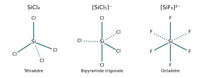
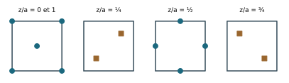
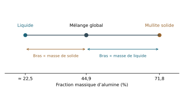
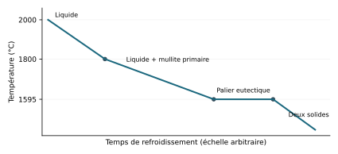
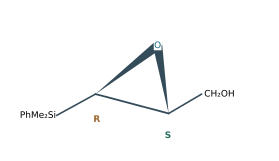

# ENS de Lyon — Second concours, Chimie 2016 · Corrigé brut

*Corrigé rédigé par IA, non officiel.*

**Rédaction (tour 1)** · GPT-6.2 Astra Ultra · vitesse non renseignée

Ces éditions traitent 35 des 45 questions. Les parties A et C sont entières. En B, les détails de procédé B.5 à B.7 sont hors couverture. En D, les questions D.6 à D.8, D.10, D.11, D.17 et D.18 portant sur des séquences réactionnelles sont hors couverture. La géométrie, la lecture des groupes, la stéréochimie et les propriétés spectroscopiques sont traitées. Le rapport écrit décrit les thèmes et les attendus généraux. La coquille de l’annexe sur la masse molaire de l’aluminium est explicitée en C.4.

## A. Atome, molécules et cristal

### Question A.1 — Électrons du silicium

L’atome neutre comporte quatorze électrons. Le remplissage par énergie croissante (règle de Klechkowski pour construire la configuration), le principe d’exclusion de Pauli (deux électrons au plus par orbitale et spins opposés) et la règle de Hund (occupation séparée à spins parallèles avant appariement) donnent **$1s^2\,2s^2\,2p^6\,3s^2\,3p^2$**. Les deux électrons $3p$ occupent deux orbitales différentes. Le silicium possède quatre électrons de valence.

### Question A.2 — Lewis et géométries

Dans l’orthosilicate $\mathrm{[SiO_4]^{4-}}$, Si porte quatre liaisons simples Si–O dans un tétraèdre. Chaque O terminal porte trois doublets libres et une charge formelle $-1$. Dans les silicates condensés, deux tétraèdres peuvent partager un oxygène pontant, muni de deux doublets. Dans la silice solide, les quatre sommets de chaque tétraèdre sont partagés. Le décompte donne $\mathrm{SiO_{4/2}=SiO_2}$. Pour la molécule isolée de silice, le modèle formel $\mathrm{O=Si=O}$ est linéaire, avec deux doublets sur chaque O.

Le métasilicate de sodium associe deux $\mathrm{Na^+}$ à un motif $\mathrm{SiO_3^{2-}}$. Dans une chaîne de tétraèdres, deux O pontants sont partagés et deux O terminaux portent chacun $-1$. Le bilan par Si donne $2+2/2=3$ oxygènes. Une représentation scolaire isolée est $\mathrm{[O{=}Si(O^-)_{2}]^{2-}}$, avec trois formes mésomères et une géométrie trigonale plane dans ce modèle moléculaire. La chaîne solide conserve les tétraèdres.

Dans $\mathrm{SiCl_4}$, quatre liaisons et aucun doublet sur Si donnent un tétraèdre. Pour $\mathrm{[SiCl_5]^-}$, les cinq liaisons donnent une bipyramide trigonale (deux positions axiales, trois équatoriales). Pour $\mathrm{[SiF_6]^{2-}}$, les six liaisons donnent un octaèdre. Chaque halogène terminal porte trois doublets. Si toutes les liaisons sont écrites simples, les charges formelles sur Si valent respectivement 0, $-1$ et $-2$. Ces charges comptables diffèrent du degré d’oxydation $+\mathrm{IV}$ du silicium dans les trois espèces.

### Question A.3 — Maille diamant

Prendre les sommets et centres des six faces d’un cube, puis ajouter une copie de ce réseau CFC translatée de $(1/4,1/4,1/4)$ en unités du paramètre $a$. Les quatre positions intérieures dans la maille sont $(1/4,1/4,1/4)$, $(1/4,3/4,3/4)$, $(3/4,1/4,3/4)$ et $(3/4,3/4,1/4)$. Les quatre plans distincts de la figure fixent la maille sans ambiguïté.

### Question A.4 — Coordinence et appartenance

La maille conventionnelle contient $8/8+6/2+4=8$ atomes de silicium. Chacun possède **quatre plus proches voisins** disposés en tétraèdre. Huit est la population totale de la maille, quatre est la coordinence locale.

### Question A.5 — Longueur de la liaison et paramètre

La liaison $(0,0,0)$–$(1/4,1/4,1/4)$ mesure $\sqrt3\,a/4$. Le modèle du contact impose $2r=\sqrt3\,a/4$. Avec $r=118\,\mathrm{pm}$, $a=8r/\sqrt3\simeq545\,\mathrm{pm}$. La valeur annoncée $543\,\mathrm{pm}$ correspond à $r=117{,}6\,\mathrm{pm}$, compatible avec l’arrondi de la donnée. On conserve $543\,\mathrm{pm}$ pour la masse volumique.

### Question A.6 — Compacité

Avec huit sphères dans le cube, $C=8(4\pi r^3/3)/a^3$. En substituant $r=\sqrt3\,a/8$, on trouve **$C=\pi\sqrt3/16\simeq0{,}340$**. Environ un tiers du volume est occupé dans ce modèle géométrique.

### Question A.7 — Masse volumique

Avec $a=5{,}43\times10^{-8}\,\mathrm{cm}$ et $M=28\,\mathrm{g\,mol^{-1}}$, $\rho=8M/(N_Aa^3)\simeq2{,}32\,\mathrm{g\,cm^{-3}}$ pour $N_A\simeq6{,}02\times10^{23}\,\mathrm{mol^{-1}}$. En SI cela représente environ **$2{,}3\times10^3\,\mathrm{kg\,m^{-3}}$**.

## B. Thermodynamique et cristallisation

### Question B.1 — Conservation des éléments

Le bilan stœchiométrique est $\mathrm{SiO_2+2C\longrightarrow Si+2CO}$. Le silicium passe de $+\mathrm{IV}$ à zéro et deux carbones passent chacun de zéro à $+\mathrm{II}$. Les quatre électrons échangés vérifient le bilan redox.

### Question B.2 — Deux grandeurs standard

$\Delta_f H^\circ$ est la variation d’enthalpie associée à la formation d’une mole d’espèce dans son état standard à partir des éléments dans leurs états de référence, à la température considérée. Elle s’exprime en $\mathrm{kJ\,mol^{-1}}$. Les valeurs positives tabulées pour les corps simples montrent que la seconde colonne numérique fournit **les entropies molaires standard $S_m^\circ$**, en $\mathrm{J\,K^{-1}\,mol^{-1}}$, malgré l’indice $f$ imprimé. Une entropie de formation, elle, serait une différence avec les entropies des éléments.

### Question B.3 — Interprétation physique

À pression constante et pour un système fermé qui ne fournit que du travail de pression, la chaleur reçue égale la variation d’enthalpie. Une enthalpie de formation négative caractérise une formation exothermique suivant cette convention. L’entropie traduit le nombre d’états microscopiques compatibles avec l’état macroscopique et la répartition de l’énergie. L’entropie standard d’un élément à température ambiante peut être positive alors que son enthalpie standard de formation vaut zéro par convention.

### Question B.4 — Modèle d’Ellingham

À pression standard on représente $\Delta_rG^\circ(T)$ de l’oxydation, généralement rapporté à une mole de dioxygène. Si, dans un intervalle sans changement d’état, $\Delta_rH^\circ$ et $\Delta_rS^\circ$ sont supposées constantes, $\Delta_rG^\circ(T)\simeq\Delta_rH^\circ-T\Delta_rS^\circ$. La pente vaut $-\Delta_rS^\circ$. Lors d’un changement de phase, la pente change et $\Delta_rG^\circ$ demeure continue à la température de transition. La comparaison des ordonnées de deux oxydations renseigne sur la réaction entre les deux couples.

*Question B.5 hors couverture.*

*Question B.6 hors couverture.*

*Question B.7 hors couverture.*

### Question B.8 — Identifier des chlorures

Les formules des chlorures usuels sont $\mathrm{AlCl_3}$, $\mathrm{TiCl_4}$ et $\mathrm{CaCl_2}$. Pour le fer, $\mathrm{FeCl_2}$ correspond à Fe(II) et $\mathrm{FeCl_3}$ à Fe(III). En milieu chlorhydrique non oxydant, Fe(II) est le choix naturel pour le fer métallique. Le sujet ne décrit ni la spéciation détaillée ni l’état d’oxydation effectif de chaque impureté.

### Question B.9 — Nature du dépôt

Il s’agit d’un dépôt chimique en phase vapeur, dit **CVD**. Le précurseur présent dans la phase gazeuse conduit à un solide qui croît sur une surface. Dans le bilan idéal où le silicium du trichlorosilane passe à l’état élémentaire, il est réduit.

### Question B.10 — Croissance d’un monocristal

Le germe monocristallin fournit une interface ordonnée et une orientation cristallographique. Quand la croissance se poursuit sur ce germe sans nucléation concurrente, le nouveau solide prolonge cette orientation. On obtient ainsi un domaine cristallin continu.

### Question B.11 — Séparation des impuretés

Le coefficient de partage $k=C_{\rm solide}/C_{\rm liquide}$ peut être inférieur à un. Dans ce cas, le solide nouvellement formé incorpore moins d’impureté que le liquide, qui s’enrichit progressivement. Le début du cristal est alors plus pur en cette impureté que le matériau initial. Pour $k$ proche de un, la séparation est faible, et elle dépend de l’espèce considérée.

## C. Phases du système silice–alumine

### Question C.1 — Obtenir un diagramme binaire

À pression fixée, on compare les courbes de refroidissement ou de chauffage de plusieurs mélanges de composition connue. Une rupture de pente ou un signal calorimétrique indique l’apparition ou la disparition d’une phase. Un équilibre invariant produit un palier lors du changement des quantités de phases. En reportant les températures suivant la composition et en identifiant les phases solides, on reconstitue les frontières d’équilibre.

### Question C.2 — Frontières du diagramme

Le **liquidus** sépare le liquide homogène des domaines liquide + solide. Le **solidus** marque la disparition du dernier liquide. Dans le dessin, des segments horizontaux correspondent aux équilibres eutectiques à environ $1595$ et $1840\,^{\circ}\mathrm C$. Près de $72\,\%$ d’alumine, le maximum vers $1850\,^{\circ}\mathrm C$ correspond à la fusion congruente de la mullite de composition définie dans le diagramme fourni. Les limites du petit domaine « mullite s.s. » bornent une solution solide.

### Question C.3 — Composé défini et solution solide

Un composé chimiquement défini possède un rapport stœchiométrique fixe et correspond à une composition précise dans ce binaire. Une solution solide est une phase cristalline unique susceptible de contenir des proportions variables des constituants sur un intervalle de composition. Un mélange de deux phases solides donnerait deux structures ou deux populations en équilibre.

### Question C.4 — Composition de la mullite

La verticale du composé défini est proche de 72 % massiques d’alumine et 28 % de silice. Les masses molaires usuelles sont $M(\mathrm{Al_2O_3})\simeq102$ et $M(\mathrm{SiO_2})\simeq60\,\mathrm{g\,mol^{-1}}$. Le rapport $(72/102)/(28/60)\simeq1{,}51$ conduit à **$3\mathrm{Al_2O_3}\cdot2\mathrm{SiO_2}$**, soit $\mathrm{Al_6Si_2O_{13}}$. La fraction théorique d’alumine est $306/426=71{,}83\,\%$. L’annexe imprime 13 comme masse molaire de l’aluminium, qui est son numéro atomique. Le calcul emploie sa masse molaire d’environ $27\,\mathrm{g\,mol^{-1}}$ et le signale expressément.

### Question C.5 — Eutectique du côté silice

Vers 10 % massiques d’alumine à $1595\,^{\circ}\mathrm C$, le liquide eutectique est en équilibre avec la silice solide et la mullite de composition définie. En refroidissant à la composition eutectique, le liquide se transforme à température constante en ces deux phases solides.

### Question C.6 — Variance au point eutectique

La règle de Gibbs donne $v=C-\varphi+2$. Avec deux composants et trois phases, $v=1$ lorsque la pression peut varier. Sur le diagramme isobare, $v_P=C-\varphi+1=2-3+1=\mathbf 0$. La température et les compositions des phases sont imposées tant que les trois phases coexistent.

### Question C.7 — Mélange global

Un kilogramme de mullite définie contient $0{,}7183\,\mathrm{kg}$ d’alumine et $0{,}2817\,\mathrm{kg}$ de silice sur la base des deux oxydes. Dix moles de silice ajoutent $0{,}600\,\mathrm{kg}$. Dans $1{,}600\,\mathrm{kg}$ de mélange, on a donc **44,9 % d’alumine** et **55,1 % de silice** en masse.

### Question C.8 — Phases à 1700 °C

À $1700\,^{\circ}\mathrm C$ et $w_M=44{,}9\,\%$ d’alumine, on lit **liquide + mullite définie**. La lecture de la courbe donne environ $w_L=22$ à $23\,\%$ d’alumine dans le liquide (77 à 78 % de silice) et $w_S=71{,}8\,\%$ dans le solide (28,2 % de silice). Le bilan $w_M=f_Sw_S+(1-f_S)w_L$ donne $f_S=(w_M-w_L)/(w_S-w_L)\simeq0{,}45$, $f_L\simeq0{,}55$. Il y a environ **0,72 kg de mullite solide et 0,88 kg de liquide**, à la précision du graphe. Les constituants chimiques servant à exprimer les compositions restent la silice et l’alumine.

### Question C.9 — Refroidissement du mélange

Depuis $2000\,^{\circ}\mathrm C$, la température baisse dans le liquide homogène. Vers $1800\,^{\circ}\mathrm C$ d’après le tracé à 44,9 %, de la mullite primaire apparaît. La solidification dégage de la chaleur et la pente de refroidissement change sans palier à cette première frontière. Le liquide résiduel s’enrichit en silice. À $1595\,^{\circ}\mathrm C$, il cristallise en silice et mullite au cours d’un palier. Une fois le liquide épuisé, les deux solides refroidissent. Les durées dépendent des échanges thermiques et ne se lisent pas sur le diagramme.

## D. Structures et spectroscopie

### Question D.1 — Première transformation

La double liaison de l’alcool allylique est transformée en époxyde. Il s’agit d’une **époxydation asymétrique de Sharpless**. L’oxygène se lie aux deux carbones de la double liaison sur une même face.

### Question D.2 — Configurations de l’époxyde

Les liaisons vers l’oxygène de l’époxyde sont dessinées en avant et les H implicites en arrière. Au carbone lié au silicium, l’ordre CIP est $\mathrm{Si>O>C>H}$ et la lecture donne **R**. Au carbone voisin du groupe $\mathrm{CH_2OH}$, O est premier. Parmi les deux carbones, le carbone du cycle, lié à Si, O et H (en excluant le centre étudié), l’emporte sur $\mathrm{CH_2OH}$, lié à O, H et H. L’ordre lu avec H en arrière donne **S**. Ces désignations sont attachées aux positions indiquées, sans renuméroter la molécule.

### Question D.3 — Sélection d’une face

Le tartrate énantiopur rend l’environnement du complexe de titane chiral. Les approches des deux faces conduisent à des états de transition diastéréoisomères de barrières différentes. La voie la plus favorable donne l’énantiomère représenté majoritaire. Le dessin ne chiffre pas l’excès énantiomérique et ne permet pas d’affirmer qu’il est exactement de 100 %.

### Question D.4 — Identifier A

A est l’époxyde dessiné dont le groupe terminal $\mathrm{{-}CH_2OH}$ devient $\mathrm{{-}CH_2O{-}Si(CH_3)_3}$. L’autre substituant est toujours $\mathrm{Si(CH_3)_2Ph}$ attaché directement au carbone de l’époxyde. La connectivité du cycle et les configurations géométriques aux deux carbones sont conservées.

### Question D.5 — Classe du mécanisme

C’est une substitution nucléophile au **silicium**, qui convertit l’alcool en éther silylé. Le nucléophile oxygéné remplace le groupe partant au centre silylé. Une description associative, avec un silicium susceptible d’être temporairement pentacoordonné, est cohérente avec cette réactivité.

*Question D.6 hors couverture.*

*Question D.7 hors couverture.*

*Question D.8 hors couverture.*

### Question D.9 — Distinguer B et C en IR

B présente un OH libre au sens fonctionnel. En milieu condensé, les liaisons hydrogène lui donnent généralement une absorption large vers $3200$ à $3500\,\mathrm{cm^{-1}}$. Dans C, cet OH est silylé et cette bande doit disparaître, à humidité comparable. Les autres bandes communes ne permettent pas aussi simplement de départager les deux structures.

*Question D.10 hors couverture.*

*Question D.11 hors couverture.*

### Question D.12 — Comparer les liaisons

Le sujet fournit $D(\mathrm{Si{-}F})=610\,\mathrm{kJ\,mol^{-1}}$. Une liaison simple C–C est typiquement voisine de $350\,\mathrm{kJ\,mol^{-1}}$ et une liaison Si–O de $450\,\mathrm{kJ\,mol^{-1}}$ environ. L’ordre est donc $D(\mathrm{Si{-}F})>D(\mathrm{Si{-}O})>D(\mathrm{C{-}C})$. Ces valeurs comptent des énergies par mole de liaisons et varient avec l’environnement.

### Question D.13 — Rôle du fluorure

Le fluorure a une forte affinité pour le silicium. Le rôle du TBAF dans le schéma est la déprotection du groupe O–TMS, qui restitue la fonction alcool dans le produit représenté après protonation. Le squelette carboné demeure celui de D.

### Question D.14 — Rôle du contre-ion

Le cation tétrabutylammonium est volumineux et porte quatre chaînes organiques. Il rend le sel davantage compatible avec un milieu organique, où une petite paire d’ions minérale serait souvent peu soluble. Le fluorure est l’espèce qui interagit avec le silicium.

### Question D.15 — Structure et nom de E

E a pour formule semi-développée $\mathrm{CH_3COCH_2C(CH_3){=}CHCH(OH)CH_2OH}$. Le nom est **(4E,6S)-6,7-dihydroxy-4-méthylhept-4-én-2-one** pour le dessin imprimé. Les substituants de plus haute priorité sont opposés sur la double liaison. En C6, OH est premier, $\mathrm{CH_2OH}$ précède le carbone vinylique, et H est vers l’observateur sur ce dessin. On inverse donc le sens de lecture apparent.

### Question D.16 — Spectre infrarouge de E

On attend une bande C=O de cétone non conjuguée vers $1705$ à $1725\,\mathrm{cm^{-1}}$ et une large bande O–H des alcools vers $3200$ à $3500\,\mathrm{cm^{-1}}$. La double liaison peut donner une bande C=C vers $1620$ à $1680\,\mathrm{cm^{-1}}$ et un signal C–H vinylique vers $3010$ à $3100\,\mathrm{cm^{-1}}$. Les étirements C–H aliphatiques vers $2850$ à $2960\,\mathrm{cm^{-1}}$ et C–O dans la zone $1000$ à $1300\,\mathrm{cm^{-1}}$ complètent la lecture. Deux OH ne donnent pas nécessairement deux bandes O–H résolues.

*Question D.17 hors couverture.*

*Question D.18 hors couverture.*
