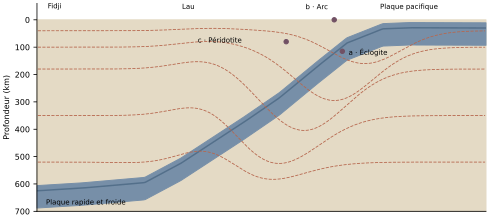
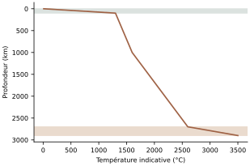
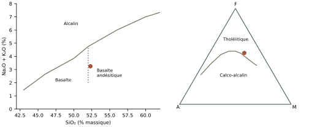
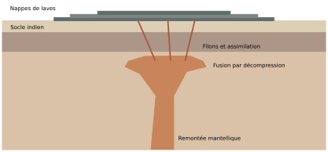
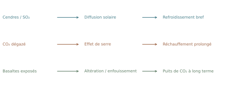

# ENS de Lyon, second concours 2016 — Géosciences · Corrigé guidé

*Corrigé rédigé par IA, non officiel. Signalez toute erreur.*

**Rédaction** · GPT-6.2 Astra Ultra · vitesse non renseignée

Le jury demande de relier les anomalies de vitesse aux structures, le géotherme au transport de chaleur et le signal isotopique à la contamination crustale. Les schémas accompagnent ces trois raisonnements.

## 1 — Subduction océanique

### Question 1a — Tomographie sismique des Tonga

> [!INDICATION]
> Séparer ce qui est mesuré, la grandeur reconstruite et l’interprétation géologique.

#### Solution

On compare les temps d’arrivée des ondes P émises par de nombreux séismes et enregistrées par des stations distinctes aux temps prévus dans un modèle de référence. Un résidu de temps est une intégrale d’anomalie de lenteur le long d’un trajet. L’inversion de nombreux trajets qui se croisent, avec régularisation et contrôles de résolution, localise des volumes plus rapides ou plus lents. Sur la carte de Zhao, le bleu va jusqu’à +6 % de vitesse P et le rouge jusqu’à −6 %. Une anomalie de vitesse positive correspond à une arrivée précoce si toutes les autres conditions sont identiques.
La vitesse des ondes P vérifie $v_P=\sqrt{(K+4\mu/3)/\rho}$ dans un solide isotrope. Température, pression, composition, phases minérales, fluides et fusion modifient densité et modules élastiques. À profondeur comparable, du manteau froid présente généralement des vitesses élevées. La tomographie ne donne pas directement une température ou un taux de fusion.

### Question 1b — Coupe interprétée

> [!INDICATION]
> Commencer par la bande de vitesse élevée et suivre son pendage depuis la plaque entrante.

#### Solution

À droite, côté Pacifique, une bande bleue superficielle devient plongeante vers la gauche sous l’arc des Tonga, jusqu’à environ 600–650 km où sa pente diminue. Cette anomalie rapide correspond à la lithosphère pacifique froide subduite vers l’ouest. Le domaine plus lent dans le coin mantellique sus-jacent et sous le centre d’expansion de Lau est compatible avec des températures élevées, des fluides et localement de la fusion partielle. La limite en surface se situe près de la fosse, à l’est de l’arc. Le bassin arrière-arc de Lau sépare l’arc des Tonga de la région de Fidji. La géométrie d’un réflecteur ou de la chambre d’un volcan individuel n’est pas résolue par cette tomographie.

### Question 1c — Trois échantillons et leurs positions

> [!INDICATION]
> Pour chaque photo lier une observation de couleur ou de grain à une texture, un assemblage et une position sur la coupe.

#### Solution

**a. Éclogite.** Des cristaux brun rouge de grenat se détachent sur une matrice de pyroxène vert, l’omphacite. La texture est cristalline, grenue à granoblastique. L’assemblage correspond à un ancien matériau basaltique ou gabbroïque recristallisé en profondeur dans la croûte de la plaque plongeante.

**b. Andésite d’arc probable.** L’échantillon gris présente des phénocristaux clairs, compatibles avec des plagioclases, dans une pâte fine ponctuée de minéraux sombres. La texture volcanique porphyrique indique une cristallisation d’abord lente puis rapide. Une lave intermédiaire de l’arc des Tonga explique cet aspect. Les seuls clichés ne fixent ni une teneur en silice ni la composition de chaque cristal sombre.

**c. Péridotite.** La roche grenue, verte et presque entièrement cristallisée est compatible avec une abondance d’olivine et des pyroxènes, de teintes plus sombres. C’est une roche du manteau, que l’on peut placer dans le coin mantellique au-dessus du slab ou dans le manteau lithosphérique de la plaque. Le schéma utilise la première possibilité.

### Question 1d — Description de la lame mince

> [!INDICATION]
> Comparer les mêmes plages en LPNA et en LPA. Fonder le faciès sur l’amphibole diagnostique et exprimer la limite de lecture pour les autres phases.

#### Solution

En LPNA, les plages allongées à nuance bleue ou violacée de la moitié droite évoquent le glaucophane, amphibole sodique caractéristique. La LPA montre des cristaux aux orientations et teintes distinctes, des plages sombres et une matrice recristallisée. L’ensemble contient également des phases plus claires et des reliques aux limites irrégulières. Selon la composition et l’avancement de la réaction, glaucophane, épidote, lawsonite ou phases feldspathiques et reliques de pyroxène peuvent être associés. Une rotation de la platine, les clivages et les extinctions aideraient à préciser les phases secondaires. Le diagnostic est un métabasite à glaucophane du faciès des schistes bleus, compatible avec un métagabbro de la croûte océanique. Les plages allongées et localement orientées témoignent de la recristallisation métamorphique, tandis que des reliques peuvent préserver une texture du protolithe mafique.

### Question 1e — Pression, température et gradient

> [!INDICATION]
> Choisir un point dans un champ de faciès. Ce cliché ne fournit pas un couple pression–température unique.

#### Solution

Le domaine des schistes bleus de la figure 4 relève du métamorphisme de haute pression et basse température. Un point représentatif à 10 kbar et 350 °C correspond à $P=10^9$ Pa. Pour $\rho\simeq3000$ kg/m³ et $g\simeq10$ m/s², $z=P/(\rho g)\simeq33$ km. Le gradient moyen depuis une surface froide vaut alors environ **10–11 °C/km**. D’autres points compatibles donnent le même ordre de grandeur, bien inférieur à un gradient continental ordinaire de 25–30 °C/km. La plaque océanique froide se réchauffe lentement par conduction pendant son enfouissement rapide en subduction.

## 2 — Chaleur interne

### Question 2a — Sources de chaleur interne

> [!INDICATION]
> Distinguer une réserve qui se refroidit et une production de chaleur interne actuelle.

#### Solution

La Terre conserve de la chaleur issue de l’accrétion, des impacts, de la compression et de sa différenciation gravitaire au cours de sa formation. Son refroidissement séculaire libère cette réserve. La désintégration d’isotopes à longue période de l’uranium, du thorium et du potassium alimente encore la production de chaleur dans la Terre silicatée. La cristallisation du noyau interne libère aussi de la chaleur latente et la séparation d’éléments légers libère de l’énergie gravitationnelle. L’énergie solaire chauffe surtout la surface.

### Question 2b — Isothermes au-dessus de la plaque plongeante

> [!INDICATION]
> Pour fixer le sens de la déflexion, se demander dans quelle direction déplacer un thermomètre de la zone froide pour retrouver la température de référence.

#### Solution

Près de la surface, les isothermes suivent grossièrement la lithosphère. Dans la plaque froide immergée, il faut descendre davantage pour atteindre une même température. Les lignes s’infléchissent donc vers le bas le long du slab. Le manteau du coin et l’arrière-arc plus chauds font remonter les isothermes. Elles se poursuivent en profondeur vers le profil de référence, la plaque conservant une anomalie froide jusqu’à plusieurs centaines de kilomètres. La coupe associe ces tendances aux anomalies de vitesse. Elle ne convertit pas un pourcentage de vitesse en température absolue.

### Question 2c — Conduction dans la lithosphère

> [!INDICATION]
> Indiquer les hypothèses qui permettent de parler d’une droite.

#### Solution

Dans une lithosphère rigide le transfert vertical de chaleur est surtout conductif. Avec une profondeur $z$ croissante, le flux vers la surface a pour module $k\,\mathrm dT/\mathrm dz$. En régime stationnaire, sans sources et à conductivité constante, le flux est uniforme et le profil approximativement linéaire. Une production radiogénique, une variation de conductivité ou le refroidissement transitoire d’une plaque océanique peuvent courber ce géotherme. Le gradient de la couche limite lithosphérique est élevé par rapport à celui du manteau convectif.

### Question 2d — Dimension du nombre de Rayleigh

> [!INDICATION]
> La viscosité fournie est cinématique et a la même dimension que la diffusivité thermique.

#### Solution

Dans $Ra=\alpha\Delta T\,g d^3/(\kappa\nu)$, $\alpha\Delta T$ est sans dimension. Le numérateur restant a la dimension $\mathrm{m^4\,s^{-2}}$, comme $\kappa\nu$. Le nombre de Rayleigh est donc sans dimension.

### Question 2e — Convection mantellique

> [!INDICATION]
> La hauteur intervient au cube. Une erreur de conversion du kilomètre change fortement le résultat.

#### Solution

Prendre $d=3\times10^6$ m et $g\simeq10$ m/s². Alors
$$Ra=\frac{3\times10^{-5}\times1000\times10\times(3\times10^6)^3}{10^{-6}\times3\times10^{17}}\simeq2{,}7\times10^7.$$
Cette valeur est très supérieure au seuil de l’ordre de $10^3$ indiqué. La poussée thermique l’emporte sur la stabilisation par diffusion thermique et viscosité, et la convection est possible. Le manteau demeure majoritairement solide. Sa déformation très lente sur les temps géologiques permet ce transport de matière.

### Question 2f — Géotherme dans le manteau

> [!INDICATION]
> Convection efficace n’implique pas température constante en profondeur dans un milieu compressible.

#### Solution

Dans le manteau bien brassé, une parcelle se déplace presque adiabatiquement. Le gradient s’écrit approximativement $\mathrm dT/\mathrm dz=\alpha gT/c_p>0$ pour une profondeur croissante. À titre indicatif $\alpha=3\times10^{-5}$ K⁻¹, $T=1600$ K, $g=10$ m/s² et $c_p=1200$ J/(kg K) donnent 0,4 K/km, bien plus faible que le gradient conductif superficiel. Le géotherme augmente donc rapidement dans la couche limite supérieure, plus faiblement dans le manteau convectif puis plus rapidement dans la couche limite thermique proche du noyau.

## 3 — Trapps du Deccan

### Question 3a — Le point du Deccan dans les diagrammes

> [!INDICATION]
> Le graphique binaire reçoit les pourcentages massiques fournis. Le triangle exige une normalisation sur les trois seuls pôles.

#### Solution

La teneur en silice est 52,31 % massiques et la somme $A=\mathrm{Na_2O+K_2O}$ vaut $2{,}18+1{,}07=3{,}25$ %. Sur la figure 6 le point tombe dans le domaine subalcalin, à la limite des basaltes et des basaltes andésitiques, tout près et du côté riche en silice du seuil usuel à 52 %. On peut le décrire comme un **basalte andésitique de série tholéiitique**, voisin des basaltes du plateau. La valeur de perte au feu est un renseignement distinct de la somme des alcalins.
Pour l’AFM, prendre les valeurs indiquées par le sujet, $F=11{,}43$ de fer exprimé dans la colonne des oxydes et $M=6{,}66$. La somme est 21,34 et les coordonnées normalisées sont **A 15,23 %, F 53,56 %, M 31,21 %**. Le point est du côté enrichi en fer, proche de la limite entre lignées. Son positionnement est compatible avec la lignée tholéiitique des trapps. Une lignée au sens d’un ensemble évolutif se démontre mieux sur une suite de roches que sur un seul échantillon.

### Question 3b — Mesure des rapports isotopiques

> [!INDICATION]
> Donner une méthode adaptée à de faibles différences de rapport entre isotopes d’un même élément.

#### Solution

Après dissolution d’un échantillon propre et séparation chimique du Sr et du Nd, mesurer les rapports par spectrométrie de masse à ionisation thermique (TIMS) ou à plasma avec multicollecteur (MC-ICP-MS). Corriger le fractionnement instrumental, les interférences isobariques et les blancs. La fluorescence X de la question précédente mesure des éléments majeurs. Elle ne fournit pas directement les rapports isotopiques demandés.

### Question 3c — Séparation puis croissance radiogénique

> [!INDICATION]
> Séparer le partage chimique au moment où se forme le liquide et la désintégration nucléaire pendant le temps écoulé ensuite.

#### Solution

Pendant la fusion partielle, le liquide s’enrichit davantage en Rb qu’en Sr, car Rb est plus incompatible. Son $^{87}\mathrm{Rb}/^{86}\mathrm{Sr}$ augmente par rapport au résidu. Au contraire Nd entre plus volontiers dans le liquide que Sm, donc son $^{147}\mathrm{Sm}/^{144}\mathrm{Nd}$ diminue et celui du résidu augmente. La fusion d’une source isotopiquement homogène ne change presque pas instantanément les rapports d’isotopes d’un même élément. Les rapports père/fille différents gouvernent **l’évolution ultérieure** des deux réservoirs isolés.
Ainsi, après un temps suffisant, le liquide cristallisé à fort Rb/Sr développe un $^{87}\mathrm{Sr}/^{86}\mathrm{Sr}$ supérieur à celui du résidu. Le résidu, à fort Sm/Nd, développe un $^{143}\mathrm{Nd}/^{144}\mathrm{Nd}$ supérieur à celui de la roche issue du liquide. Dans chacun des réservoirs, la fille radiogénique croît d’une quantité proportionnelle au rapport père/fille et à $e^{\lambda t}-1$ exprimé avec le rapport parent actuel. Un rapport de Nd dit « plus faible » signifie ici une croissance **relativement moins rapide**.

### Question 3d — Source des magmas

> [!INDICATION]
> Localiser l’ellipse jaune par rapport aux MORB, OIB et à la croûte continentale, puis indiquer la direction du décalage.

#### Solution

Le domaine jaune des laves du Deccan s’étend depuis le voisinage des compositions mantelliques enrichies/OIB vers des rapports de Sr plus élevés et des rapports de Nd plus faibles. Il est décalé par rapport aux MORB les plus appauvris. Cette tendance soutient une origine mantellique des magmas, avec contribution d’un réservoir enrichi et contamination possible par le vieux socle continental traversé. Dans le diagramme, la direction générale de cette contamination va vers la croûte supérieure granitique. Les concentrations en Sr et Nd dans les deux termes du mélange gouvernent sa courbure. Deux rapports ne déterminent pas de manière unique les proportions de mélange ou la profondeur de la source.

### Question 3e — Mise en place des trapps

> [!INDICATION]
> Relier source mantellique, fusion, contamination et morphologie des coulées.

#### Solution

Il y a environ 65 Ma, une remontée de manteau chaud sous la plaque indienne en déplacement permet une fusion partielle par décompression. Dans le modèle classique de point chaud, cette tête de panache est associée au système de La Réunion. Les liquides mantelliques remontent par des filons et fractures de la lithosphère. Ils peuvent séjourner dans des réservoirs, cristalliser en partie et assimiler du matériel continental, conformément au signal Sr–Nd. Des éruptions fissurales répétées épanchent alors de vastes nappes de lave. Leur empilement forme les gradins des trapps. Le volume annoncé, environ deux millions de kilomètres cubes, résulte de nombreuses émissions successives.

## 4 — Volcanisme et climat

### Question 4a — Gaz émis

> [!INDICATION]
> Distinguer les gaz à l’évent des particules formées dans le panache.

#### Solution

La vapeur d’eau, le dioxyde de carbone et le dioxyde de soufre dominent les espèces à considérer. Selon le magma et les conditions de dégazage peuvent s’ajouter H₂S, HCl, HF, CO et d’autres espèces en traces. Les cendres sont des particules solides émises avec les gaz, et les aérosols sulfatés se forment surtout après oxydation atmosphérique du soufre.

### Question 4b — Plusieurs réponses climatiques

> [!INDICATION]
> Associer pour chaque espèce son devenir atmosphérique, son temps de résidence et le signe de son effet radiatif.

#### Solution

À court terme, les cendres diminuent l’ensoleillement près du panache et retombent généralement en quelques jours à semaines. Si le SO₂ atteint la stratosphère, son oxydation forme des aérosols sulfatés qui diffusent la lumière solaire, augmentent l’albédo planétaire et peuvent refroidir la surface pendant plusieurs saisons à quelques années. La baisse de lumière et de température peut réduire temporairement la productivité primaire et perturber les précipitations. Des dépôts acides associés aux composés soufrés et halogénés affectent aussi les écosystèmes régionaux. L’altitude d’injection et la répétition des épisodes commandent la portée du signal.
À moyen et plus long terme, des émissions cumulées de CO₂ renforcent l’effet de serre. Après disparition des particules, cet effet persiste davantage et peut favoriser réchauffement, modifications du cycle hydrologique et acidification de l’océan. La solubilité de l’oxygène baisse dans des eaux plus chaudes, avec un risque de désoxygénation selon la circulation. La vapeur d’eau émise dans la basse atmosphère se condense rapidement. Les émissions répétées font alterner ou coexister des effets de signes différents. Le seul volume de laves ne chiffre pas une température globale ni une extinction biologique précise.

### Question 4c — Le bilan du carbone à long terme

> [!INDICATION]
> Ajouter la précipitation marine aux réactions de dissolution avant de comparer les deux bilans nets.

#### Solution

En conservant la forme de silice proposée par le sujet,
$$\mathrm{CaSiO_3+2CO_2+H_2O\longrightarrow SiO_2+Ca^{2+}+2HCO_3^-}.$$
La dissolution consomme deux molécules de CO₂ et le calcium et les bicarbonates peuvent être transportés vers l’océan. La précipitation marine $\mathrm{Ca^{2+}+2HCO_3^-\to CaCO_3+CO_2+H_2O}$ restitue une molécule. Le bilan durable est donc $\mathrm{CaSiO_3+CO_2\to CaCO_3+SiO_2}$. Il consomme **une** molécule de CO₂ par calcium enfoui, si le carbonate est effectivement préservé. Une intensification de l’altération des basaltes frais peut abaisser le CO₂ atmosphérique et exercer une rétroaction refroidissante sur les longs temps géologiques.
Pour un carbonate préexistant, $\mathrm{CaCO_3+CO_2+H_2O\to Ca^{2+}+2HCO_3^-}$. La précipitation inverse restitue le CO₂ pris à la dissolution, donnant un bilan long terme nul pour ce cycle idéal. Les différences de durée, d’exposition des roches, de climat et d’enfouissement expliquent la distinction entre l’effet de serre du dégazage et ce puits lent de CO₂.

[Sujet officiel](https://banques-ecoles.fr/cms/wp-content/uploads/2013/02/16_2c_Geologie.pdf) · [Rapport du jury](https://banques-ecoles.fr/cms/wp-content/uploads/2016/10/16_2c_rap_eST.pdf)
