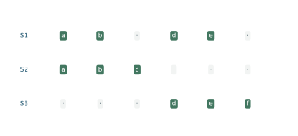
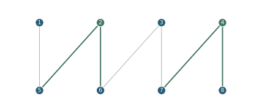

# ENS de Lyon · Second concours · Informatique 2016 · Corrigé brut

*Corrigé rédigé par IA, non officiel. Signalez toute erreur.*

**Rédaction** · GPT-6.2 Astra Ultra · vitesse non renseignée · 24 novembre 2026

## 1 · Exemples et algorithmes d’énumération

### Question 1 · Trois maxima élémentaires

**1.** Le cardinal est au plus $n$, atteint par $[n]$. **2.** Un entier pair apporte $+1$, un impair $-1$. L'ensemble des pairs atteint le maximum $\lfloor n/2\rfloor$. **3.** La formule exige $|E|\ge2$. Les termes diagonaux sont nuls et il y a $|E|(|E|-1)$ couples ordonnés d'éléments distincts. Chaque carré de différence vaut au plus $(4-1)^2=9$. En prenant $E=\{1,4\}$, les deux couples distincts valent 9, donc le maximum est **9**. Les ensembles vide et singletons nécessiteraient une définition supplémentaire de la fonction ; une extension par zéro conserve le maximum.

### Question 2 · Fonction additive à cardinal fixé

Trier les poids par ordre décroissant et additionner les $k$ premiers. Un ensemble optimal peut toujours être transformé en cette sélection par échanges de poids égaux ou croissants. Cela reste vrai si tous les poids sont négatifs car le cardinal est imposé. Le tri coûte $O(n\log n)$, la somme $O(k)$, soit $O(n\log n+k)$ et $O(n)$ espace pour la copie triée. Les programmes sont en Python, avec la case d'indice $i$ pour le sommet ou l'élément $i+1$.

```python
def maximum_additif(n, k, valeurs):
    if len(valeurs) != n or not 0 <= k <= n:
        raise ValueError("dimensions incompatibles")
    return sum(sorted(valeurs, reverse=True)[:k])
```

### Question 3 · Énumération des parties

Après l'initialisation, les $n$ bits utiles codent zéro. Chaque incrément remet à zéro les 1 terminaux puis met à 1 le premier 0. Le bit supplémentaire $E[0]$ est la sentinelle du dernier report. Ainsi les $2^n$ configurations sont évaluées une fois chacune, dans l'ordre de leurs entiers binaires. La variable maximum conserve la plus grande valeur déjà lue. Pour $n=2$, la trace est $00,01,10,11$ et les cardinaux valent $0,1,1,2$. Au report suivant, $j=0$ et l'algorithme rend 2. En général il rend $\max_{E\subseteq[n]} f(E)$.

### Question 4 · Comptage des reports

**1.** L'instruction (a) est exécutée exactement $2^n$ fois. **2.** Le bit de poids $2^r$, $0\le r<n$, passe de 1 à 0 exactement $2^{n-r-1}$ fois. Chacune des deux instructions (b) est donc exécutée $\sum_{r=0}^{n-1}2^{n-r-1}=2^n-1$ fois, soit $2(2^n-1)$ exécutions si on les additionne. **3.** Le coût total vaut $\Theta(n+2^n)=\Theta(2^n)$ pour un oracle de coût unitaire. Un incrément particulier peut néanmoins propager $n$ retenues.

### Question 5 · Énumération des ensembles de taille k

La récursion choisit les indices dans l'ordre strictement croissant. La borne de boucle réserve les $restant-1$ places qui devront encore être choisies. Chaque feuille est donc un ensemble de taille $k$ et chaque tel ensemble donne une unique feuille. L'indicatrice est restaurée au retour. L'oracle doit simplement lire le tableau transmis. Il est interrogé exactement $\binom nk$ fois. L'arbre a profondeur $k$ et chacun de ses nœuds appartient à au moins un chemin complet, donc au plus $(k+1)\binom nk$ nœuds. Le temps est $O(n+(k+1)\binom nk)$ et l'espace auxiliaire $O(n+k)$. Pour $k$ fixé, cette borne est polynomiale en $n$.

```python
def maximum_fixe(n, k, f):
    if not 0 <= k <= n:
        raise ValueError("taille impossible")
    indicatrice = [0] * n
    meilleur = None

    def visiter(debut, restant):
        nonlocal meilleur
        if restant == 0:
            score = f(indicatrice)
            if meilleur is None or score > meilleur:
                meilleur = score
            return
        for i in range(debut, n - restant + 1):
            indicatrice[i] = 1
            visiter(i + 1, restant - 1)
            indicatrice[i] = 0

    visiter(0, k)
    return meilleur
```

### Question 6 · Nombre optimal d'appels à l'oracle

Si une exécution interroge moins de $\binom nk$ sous-ensembles de taille $k$, il en reste un, $E^*$, jamais interrogé. Les fonctions identiquement nulle et nulle sauf en $E^*$ où elle vaut 1 produisent le même transcript. Même si l'algorithme choisit ses questions d'après les réponses passées, il doit alors rendre la même valeur pour deux maxima différents. Il faut donc au moins $\binom nk$ appels dans le pire cas. Q5 atteint cette borne.

## 2 · Algorithmes d’approximation

### Question 7 · Additivité et sous-modularité

Pour chaque $x$, $\mathbf 1_{E\cup F}(x)+\mathbf 1_{E\cap F}(x)=\mathbf 1_E(x)+\mathbf 1_F(x)$. Multiplier par $v_x$, éventuellement négatif, puis sommer. On obtient $f(E\cup F)+f(E\cap F)=f(E)+f(F)$. Pour $v_x=1$ on retrouve la relation sur les cardinaux.

### Question 8 · Caractérisation par gains marginaux

Supposons (3). Appliquer l'inégalité aux ensembles $E\cup\{x\}$ et $F$ pour $E\subseteq F$, $x\notin F$. Leur intersection est $E$ et leur union $F\cup\{x\}$, ce qui donne (4).

Réciproquement, soient $A,B$ quelconques et $A\setminus B=\{x_1,\ldots,x_s\}$. Partir de $U_0=A\cap B$, $V_0=B$. Ajouter les mêmes $x_j$ dans le même ordre aux deux chaînes. À chaque étape $U_{j-1}\subseteq V_{j-1}$ et (4) donne un gain au moins aussi grand dans $U$ que dans $V$. Par sommation, $f(A)-f(A\cap B)\ge f(A\cup B)-f(B)$, soit (3). Une différence vide donne directement l'égalité.

### Question 9 · Glouton à k étapes

À l'étape $i$ tous les candidats ajoutent exactement un élément distinct à l'ensemble déjà retenu. Comparer leurs valeurs donne aussi le meilleur gain marginal puisque l'ancienne valeur est commune. Les égalités sont départagées par le premier indice. Il y a $\sum_{i=0}^{k-1}(n-i)=kn-k(k-1)/2$ appels à $f$. En comptant les balayages et l'initialisation, le temps est $O(n+kn)$ et l'espace auxiliaire est $O(n)$ indicatrice comprise.

```python
def Glouton(n, k, f):
    if not 0 <= k <= n:
        raise ValueError("taille impossible")
    e = [0] * n
    for _ in range(k):
        meilleur = None
        indice = None
        for i in range(n):
            if not e[i]:
                e[i] = 1
                score = f(e)
                e[i] = 0
                if meilleur is None or score > meilleur:
                    meilleur, indice = score, i
        e[indice] = 1
    return e
```

### Question 10 · Exactitude et échec sur trois éléments

Pour $n=3$, $k=2$, la fonction $f(E)=|E|$ est positive, croissante et sous-modulaire. Toute sélection gloutonne de deux éléments est optimale.

Pour un échec sans dépendance au départage du premier choix, associer aux éléments 1, 2, 3 les familles $S_1=\{a,b,d,e\}$, $S_2=\{a,b,c\}$, $S_3=\{d,e,f\}$, puis poser $f(E)=|\bigcup_{i\in E}S_i|$. Cette couverture est croissante et sous-modulaire car les nouveaux objets apportés se raréfient. Le premier choix est obligatoirement 1, de valeur 4. Ajouter 2 ou 3 porte le score à 5, tandis que $\{2,3\}$ couvre les six objets.



### Question 11 · Encadrement de la perte gloutonne

Posons $\delta_i=f(E_{i+1})-f(E_i)$. Par croissance, $f(E_{opt})\le f(E_i\cup E_{opt})$. Ajouter les éléments de $E_{opt}\setminus E_i$ successivement à $E_i$. Par Q8, le gain de chacun est au plus son gain initial sur $E_i$, lui-même au plus $\delta_i$ par le choix glouton. Il y a au plus $k$ ajouts et les gains sont positifs ou nuls, donc $f(E_{opt})\le f(E_i)+k\delta_i$. Avec $D_i=f(E_{opt})-f(E_i)$ on obtient $D_{i+1}=D_i-\delta_i\le(1-1/k)D_i$.

### Question 12 · Garantie d'approximation

$D_k\le(1-1/k)^kD_0\le(1-1/k)^k f(E_{opt})$, car $f(\varnothing)\ge0$. Donc $f(E_k)\ge[1-(1-1/k)^k]f(E_{opt})$. L'inégalité $1-u\le e^{-u}$ avec $u=1/k$ donne $(1-1/k)^k\le e^{-1}$ et la garantie $1-1/e$. Pour $k=1$, le glouton est exact. La preuve ne nécessite pas de diviser par la valeur optimale, qui peut être nulle.

## 3 · Applications aux graphes

### Question 13 · Couverture d'un graphe biparti

Pour $n=4$, les voisinages sont $N(1)=\{5\}$, $N(2)=\{5,6\}$, $N(3)=\{6,7\}$ et $N(4)=\{7,8\}$. Les sommets 2 et 4 couvrent $\{5,6,7,8\}$ ; aucun ensemble ne peut couvrir plus que les quatre sommets de droite. Le maximum demandé est 4.



### Question 14 · Couverture gloutonne efficace

La fonction $f(E)=|N(E)|$ est positive et croissante. Sa marge pour ajouter $v$ est $|N(v)\setminus N(E)|$, qui décroît avec $E$. Elle est donc sous-modulaire d'après Q8. Le code construit les listes d'incidence dans les deux sens, puis maintient pour chaque sommet gauche son nombre de voisins encore découverts. Chaque sélection maximise exactement cette marge. Q12 garantit le facteur $1-1/e$.

Lire la matrice coûte $O(|L||R|)$. Les $k$ choix de maximum coûtent $O(k|L|)$. Un sommet gauche n'est choisi qu'une fois et un sommet droit ne devient couvert qu'une fois, donc les deux types de parcours d'arêtes coûtent $O(|A|)$ en tout. Le temps total est $O(|L||R|+k|L|+|A|+|L|+|R|)$, l'espace supplémentaire $O(|L|+|R|+|A|)$.

```python
def couverture(g, k):
    n = len(g)
    if not 0 <= k <= n:
        raise ValueError("taille impossible")
    m = len(g[0]) if n else 0
    voisins = [[] for _ in range(n)]
    incidents = [[] for _ in range(m)]
    for i, ligne in enumerate(g):
        for j, arete in enumerate(ligne):
            if arete:
                voisins[i].append(j)
                incidents[j].append(i)
    gains = [len(liste) for liste in voisins]
    e = [0] * n
    couvert = [False] * m
    for _ in range(k):
        i = max((v for v in range(n) if not e[v]), key=gains.__getitem__)
        e[i] = 1
        for j in voisins[i]:
            if not couvert[j]:
                couvert[j] = True
                for v in incidents[j]:
                    gains[v] -= 1
    return e
```

### Question 15 · Sous-modularité de la coupe

Pour un graphe non orienté, $f_{coupe}(E)=\sum_{\{u,v\}\in A}|\mathbf1_E(u)-\mathbf1_E(v)|$. Le problème est $\max_{E\subseteq V} f_{coupe}(E)$. Si $x\notin E$, son ajout crée une arête traversante pour chaque voisin extérieur et en annule une pour chaque voisin intérieur. La marge vaut $\deg(x)-2|N(x)\cap E|$ (une boucle éventuelle peut simplement être ignorée). Cette marge décroît par inclusion, donc Q8 donne la sous-modularité. Sur un graphe constitué d'une arête $uv$, $f(\{u\})=1$ mais $f(\{u,v\})=0$ ; la croissance échoue en général.

### Question 16 · Demi-approximation d'une coupe maximale

Traiter les sommets dans l'ordre. Si un sommet a $a$ voisins déjà du côté 0 et $b$ voisins du côté 1, le placer du côté qui coupe $\max(a,b)$ arêtes supplémentaires. Cela vaut au moins $(a+b)/2$. Chaque arête est comptée au seul instant où est placé son deuxième sommet, donc la valeur finale est au moins $|A|/2\ge f(E_{opt})/2$ pour un graphe simple. Les sommets de valeur 1 dans le tableau résultat forment $E$. Le code lit le triangle inférieur de la matrice en $O(|V|^2)$ et utilise $O(|V|)$ mémoire.

```python
def coupe(g):
    cote = [-1] * len(g)
    for v in range(len(g)):
        voisins = [0, 0]
        for u in range(v):
            if g[v][u]:
                voisins[cote[u]] += 1
        cote[v] = 0 if voisins[1] >= voisins[0] else 1
    return cote
```
