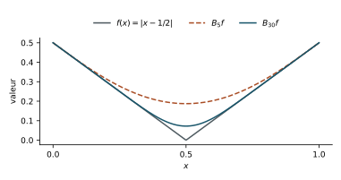

# ENS de Lyon · Second concours · Mathématiques 2016 · Corrigé guidé

*Corrigé rédigé par IA, non officiel. Signalez toute erreur.*

**Rédaction** · GPT-6.2 Astra Ultra · vitesse non renseignée

La composition et le rapport de Denis Serre étudient les polynômes de Bernstein par deux voies, l’action sur les polynômes de degré borné puis l’approximation probabiliste. Dans toutes les formules contenant un échantillon de taille n, on prend n au moins égal à un.

## Une intégrale

### Question 1

> [!INDICATION]
> Intégrer par parties en dérivant la puissance de $1-x$, puis sommer les poids.

#### Solution

Pour $0\le k<n$, intégrer $x^k$ et dériver $(1-x)^{n-k}$ donne, avec des bords nuls, $\int_0^1x^k(1-x)^{n-k}dx=\frac{n-k}{k+1}\int_0^1x^{k+1}(1-x)^{n-k-1}dx$. Comme $\binom nk(n-k)/(k+1)=\binom n{k+1}$, on a $I_{n,k}=I_{n,k+1}$. La somme des $n+1$ poids binomiaux vaut $(x+1-x)^n=1$. Après intégration, $(n+1)I_{n,k}=1$, donc $I_{n,k}=1/(n+1)$.

### Question 2

> [!INDICATION]
> Appliquer le résultat à chaque poids positif dans la formule de Bernstein.

#### Solution

Par inégalité triangulaire sous l’intégrale et positivité des poids, $\int_0^1|B_nf(x)|dx\le\frac1{n+1}\sum_{k=0}^n|f(k/n)|\le\|f\|_\infty$. La première borne tient compte des valeurs effectivement échantillonnées.

## Polynômes, combinatoire, valeurs propres

### Question 3

> [!INDICATION]
> Remarquer que pour chaque $x$ on obtient une moyenne pondérée.

#### Solution

La formule est une somme de polynômes de degrés au plus $n$, linéaire en les valeurs $f(k/n)$, donc $B_n$ est linéaire de $C[0,1]$ vers $\mathcal P_n$. Pour chaque $x\in[0,1]$, les poids positifs ou nuls ont somme un. Ainsi $|B_nf(x)|\le\|f\|_\infty$. C’est un opérateur continu et contractant au sens large pour la norme uniforme. Sa norme d’opérateur vaut exactement un car $B_n1=1$.

### Question 4

> [!INDICATION]
> Développer le monôme dominant et vérifier le rôle du pas.

#### Solution

Si $Q$ est de degré $d\ge1$ et de coefficient dominant $a_d$, le terme de degré $d$ s’annule dans $Q(X+h)-Q(X)$ et celui de degré $d-1$ vaut $a_ddh$. Les monômes de degré inférieur donnent une différence de degré au plus $d-2$. Le degré demandé est donc $d-1$ pour $h\ne0$. Si $h=0$, cas que l’énoncé n’exclut pas explicitement, la différence est le polynôme nul.

### Question 5

> [!INDICATION]
> Répéter la variation du coefficient dominant en abaissant le degré à chaque fois.

#### Solution

Pour $h\ne0$ et $d=\deg Q\ge\ell$, le coefficient dominant de $\Delta_h^{(\ell)}Q$ vaut $a_d h^\ell d(d-1)\cdots(d-\ell+1)$ au degré $d-\ell$. Si $d<\ell$, les différences finies ont déjà annulé la constante résultant de la $d$-ième différence et donnent zéro. Pour $h=0$ toute différence d’ordre positif est nulle, et pour $\ell=0$ on retrouve $Q$.

### Question 6

> [!INDICATION]
> Identifier la différence comme écart entre une translation et l’identité.

#### Solution

Si $T_hQ(x)=Q(x+h)$, alors $\Delta_h=T_h-I$. La translation et l’identité commutent, donc la formule binomiale donne $(T_h-I)^\ell=\sum_{i=0}^\ell(-1)^{\ell-i}\binom\ell iT_h^i$. En l’appliquant à $Q$ puis en évaluant en $x$, on obtient la somme des $Q(x+ih)$ demandée.

### Question 7

> [!INDICATION]
> Développer la puissance de $1-x$, puis réunir les termes de même degré en $x$.

#### Solution

Dans $B_nQ$, le coefficient de $x^j$ vaut $\sum_{k=0}^j(-1)^{j-k}\binom nk\binom{n-k}{j-k}Q(k/n)$. Les deux binomiaux ont pour produit $\binom nj\binom jk$, par les factorielles. La formule 6 donne donc le coefficient $\binom nj\Delta_{1/n}^{(j)}Q(0)$. Il suffit de sommer pour $0\le j\le n$.

### Question 8

> [!INDICATION]
> Regarder quels ordres de différence peuvent rester non nuls.

#### Solution

Si $d=\deg Q$, les termes de la formule 7 avec $j>d$ sont nuls par 5. Ainsi $\deg L_nQ\le d$ (et le polynôme nul a une image nulle). La colonne d’indice $k$ dans la base $(1,X,\ldots,X^n)$ a donc des coefficients nuls aux degrés strictement supérieurs à $k$. La matrice est triangulaire supérieure.

### Question 9

> [!INDICATION]
> Calculer son coefficient diagonal en appliquant la formule au monôme $X^k$.

#### Solution

Pour $0\le k\le n$, le coefficient de $X^k$ dans $B_nX^k$ vaut $\lambda_k=\binom nk k!/n^k=n!/((n-k)!n^k)$ par 5 et 7. Ce sont toutes les valeurs propres avec leur multiplicité diagonale. En particulier $\lambda_0=\lambda_1=1$, puis $\lambda_{k+1}/\lambda_k=1-k/n<1$ pour $1\le k<n$.

### Question 10

> [!INDICATION]
> Examiner séparément la seule valeur propre dont la multiplicité peut dépasser un.

#### Solution

Les $\lambda_k$, $k\ge2$, sont simples. La valeur un a multiplicité algébrique deux et $B_n1=1$, $B_nX=X$ par 7, ce qui donne deux vecteurs propres indépendants. Les espaces propres associés aux valeurs distinctes sont en somme directe et leurs dimensions totalisent $n+1$. Ainsi $L_n$ est diagonalisable, également si $n=1$ où il est l’identité sur $\mathcal P_1$.

### Question 11

> [!INDICATION]
> Travailler dans la filtration par degré et exclure l’étage inférieur.

#### Solution

Pour $k=0,1$, prenons $p_{n,0}=1$ et $p_{n,1}=X$. Pour $2\le k\le n$, la restriction de $L_n$ à l’espace stable $\mathcal P_k$ a pour valeur propre $\lambda_k$ par sa diagonale. Cette valeur n’est pas sur la diagonale de la restriction à $\mathcal P_{k-1}$. Un vecteur propre non nul correspondant dans $\mathcal P_k$ est donc de degré exactement $k$. La valeur propre associée reste $\lambda_k=n!/((n-k)!n^k)$.

## Approximation uniforme et probabilités

### Question 12

> [!INDICATION]
> Remarquer que le carré d’une indicatrice lui est égal.

#### Solution

Pour chaque $X_i$, $\mathbb E X_i=p$ et $\mathbb E X_i^2=p$. On a donc $\operatorname{Var}(X_i)=p-p^2=p(1-p)$.

### Question 13

> [!INDICATION]
> Compter les configurations indépendantes comptant exactement $m$ succès.

#### Solution

Par indépendance, chaque réalisation avec $m$ succès a probabilité $p^m(1-p)^{n-m}$. Il y a $\binom nm$ manières de placer les succès. Ainsi $S_n$ est binomiale de paramètres $n,p$, avec ces masses multipliées par $\binom nm$ pour $0\le m\le n$, et masse nulle ailleurs. Pour $p=0$ ou $1$ on obtient les masses certaines en $0$ ou $n$.

### Question 14

> [!INDICATION]
> Calculer la variance de la moyenne puis lui appliquer Bienaymé–Tchebychev.

#### Solution

On a $\mathbb E(S_n/n)=p$ et $\operatorname{Var}(S_n/n)=p(1-p)/n$ par indépendance. Donc $\mathbb P(|S_n/n-p|>\delta)\le p(1-p)/(n\delta^2)\le1/(4n\delta^2)$ pour tout $\delta>0$.

### Question 15

> [!INDICATION]
> Écrire l’espérance en regroupant selon la valeur de la somme binomiale.

#### Solution

On a $\mathbb E[f(S_n/n)]=\sum_{m=0}^nf(m/n)\binom nm p^m(1-p)^{n-m}=B_nf(p)$.

### Question 16

> [!INDICATION]
> Sur un segment compact, choisir un même rayon de continuité pour tous les points.

#### Solution

Par le théorème de Heine, $f$ est uniformément continue sur $[0,1]$. Pour tout $\varepsilon>0$, il existe $\delta_0>0$ tel que $|x-y|<\delta_0$ implique $|f(x)-f(y)|\le\varepsilon$. Dès que $0<\delta\le\delta_0$, $0\le\omega_f(\delta)\le\varepsilon$, d’où la limite zéro.

### Question 17

> [!INDICATION]
> Séparer l’événement de petite déviation du complément.

#### Solution

L’écart absolu des espérances est au plus $\mathbb E|f(S_n/n)-f(p)|$. Si $|S_n/n-p|\le\delta$, l’écart est au plus $\omega_f(\delta)$. À l’égalité, la même borne vaut par continuité en approchant la paire par des paires de distance strictement inférieure à $\delta$, conformément à la définition imprimée. Sur le complément la borne $2\|f\|_\infty$ suffit. En sommant les deux contributions on obtient l’inégalité demandée.

### Question 18

> [!INDICATION]
> Fixer le rayon de continuité avant de prendre la limite sur le nombre de tirages.

#### Solution

Par 14–17, pour tout $\delta>0$ et tout $p\in[0,1]$,
$$|B_nf(p)-f(p)|\le\omega_f(\delta)+\frac{\|f\|_\infty}{2n\delta^2}.$$
Le majorant ne dépend pas de $p$. Pour une tolérance donnée, choisissons $\delta$ afin de rendre le premier terme inférieur à la moitié de cette tolérance par 16, puis $n$ assez grand pour le second. Cela donne la convergence uniforme et donc la convergence ponctuelle demandée.

### Question 19

> [!INDICATION]
> Relier l’erreur de Lipschitz à la dispersion moyenne de la variable binomiale.

#### Solution

Si $f$ est $L$-lipschitzienne, 15 puis Cauchy–Schwarz donnent $|B_nf(p)-f(p)|\le L\mathbb E|S_n/n-p|\le L\sqrt{p(1-p)/n}\le L/(2\sqrt n)$. Pour $n\ge1$, $n^{-1/2}\le n^{-1/3}$. La constante $C=L/2$ convient donc uniformément en $p$.
