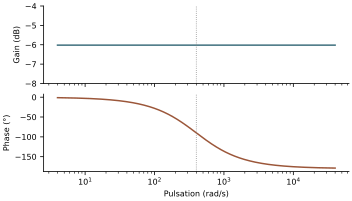
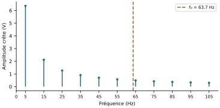
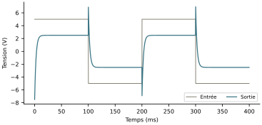
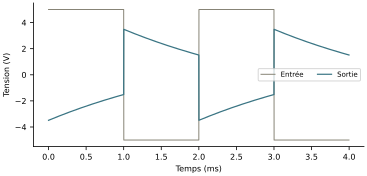
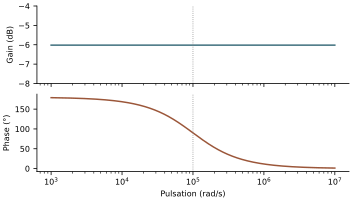
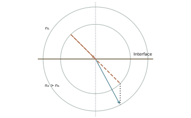
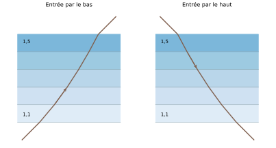
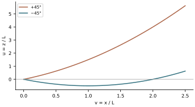
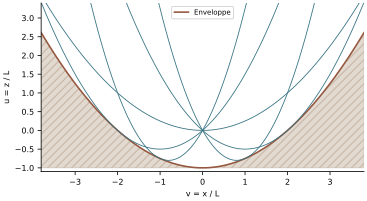

# ENS de Lyon, second concours 2016 — Physique · Corrigé guidé

*Corrigé rédigé par IA, non officiel. Signalez toute erreur.*

**Rédaction** · GPT-6.2 Astra Ultra · vitesse non renseignée

Le jury relève que le problème d’optique a été davantage traité que le pont électrique. Écrire les deux tensions de point milieu et conserver les orientations permet de reprendre le premier exercice.

## I — Filtrage électrique

### Question I.1 — Deux pulsations caractéristiques

> [!INDICATION]
> Convertir les microfarads et les millihenrys avant de former les constantes de temps.

#### Solution

$RC=2{,}5\times10^{-3}$ s et $L/R=10^{-5}$ s. Les inverses sont $1/(RC)=400$ rad/s et $R/L=10^5$ rad/s. À ces pulsations, le module de l’impédance réactive égale $R$. Elles caractérisent la transition de phase des deux ponts.

### Question I.2 — Les deux points milieux

> [!INDICATION]
> Le potentiel d’un point milieu est la tension de l’impédance située entre ce point et O.

#### Solution

Choisir $V_O=0$ et $V_E=V_e$. Sans courant de sortie, les branches sont deux diviseurs indépendants. Donc $V_A=V_e r/(r+r)=V_e/2$ et $V_B=V_e Z_C/(R+Z_C)$ avec $Z_C=1/(j\omega C)$.

### Question I.3 — Tension orientée entre A et B

> [!INDICATION]
> Lire le sens de la flèche de tension sur le schéma.

#### Solution

La flèche de sortie pointe vers B. Ainsi $V_s=V_B-V_A$ et
$$H=\frac{V_s}{V_e}=\frac{Z_C}{R+Z_C}-\frac12=\frac{Z_C-R}{2(Z_C+R)}.$$
La résistance $r$ disparaît parce que les deux bras de gauche sont égaux et que la sortie est à vide.

### Question I.4 — Forme réduite

> [!INDICATION]
> Vérifier le gain à fréquence nulle en remplaçant le condensateur par un circuit ouvert.

#### Solution

En multipliant numérateur et dénominateur par $j\omega C$, on obtient $H=(1-j\omega RC)/[2(1+j\omega RC)]$. Donc $H_0=1/2$, $\omega_0=1/(RC)$ et $x=\omega/\omega_0$.

### Question I.5a — Gain

> [!INDICATION]
> Les facteurs complexes du quotient sont conjugués.

#### Solution

$|1-jx|=|1+jx|$, donc $|H|=1/2$ à toute fréquence et $H_{\rm dB}=20\log_{10}(1/2)=-6{,}02$ dB.

### Question I.5b — Phase et quadrant

> [!INDICATION]
> Soustraire les arguments du dénominateur et du numérateur dans le bon ordre.

#### Solution

Pour $\omega\ge0$, une phase continue vaut $\varphi=-2\arctan x$. Sa tangente est $-2x/(1-x^2)$ pour $x\ne1$. Au point $x=1$, la phase vaut $-\pi/2$. La seule tangente ne distingue pas la phase du quadrant suivant.

### Question I.5c — Diagrammes de Bode

> [!INDICATION]
> Placer les asymptotes et le point médian avant d’esquisser la phase.

#### Solution

Sur une abscisse logarithmique le gain est horizontal à −6,02 dB. La phase passe continûment de 0° à −180° et vaut −90° à $\omega_0=400$ rad/s. Le croisement en phase est la fréquence caractéristique.

### Question I.6 — Exemple d’utilisation

> [!INDICATION]
> Donner une utilisation où la phase est une grandeur pertinente.

#### Solution

Le montage permet de régler le déphasage d’une sinusoïde de référence sans changer l’atténuation de ses composantes. À $\omega=\omega_0$, la sortie et l’entrée sont en quadrature. On peut employer ce signal pour comparer des phases dans un dispositif de mesure.

### Question I.7 — Effet de la charge

> [!INDICATION]
> Quand on relie les points milieux par une charge, les deux diviseurs ne sont plus indépendants.

#### Solution

Si une impédance est branchée entre A et B, la même intensité ne traverse plus les deux dipôles de chaque branche. Leurs potentiels deviennent couplés. Avec une source de tension idéale, l’impédance de Thévenin vue de la sortie, source court-circuitée, est $Z_{\rm th}=r/2+(R\parallel Z_C)$. Une charge $Z_u$ multiplie la tension à vide par $Z_u/(Z_u+Z_{\rm th})$. Ce facteur dépend en général de la fréquence.

### Question I.8 — Amplitude des harmoniques

> [!INDICATION]
> La demi-période positive fixe le signe de la série choisie.

#### Solution

Calculer le coefficient sinus $b_n=(2/T)\int_0^T V_e(t)\sin(n\omega t)\,\mathrm dt$ en séparant les deux demi-périodes. Si le créneau vaut $+A$ juste après $t=0$, $b_n=4A/(n\pi)$ pour $n$ impair et 0 pour $n$ pair. Ainsi $K=4A/\pi=20/\pi$ V. Décaler l’origine de phase peut inverser le signe des coefficients.

### Question I.9 — Spectre à 5 Hz

> [!INDICATION]
> Ne pas confondre la fréquence d’une raie avec son rang impair.

#### Solution

Les raies positives sont à 5, 15, 25, 35, 45, 55, 65 Hz, etc., avec amplitudes crête $20/(n\pi)$ V pour $n=1,3,5,\ldots$. Les trois premières valent 6,37, 2,12 et 1,27 V. La composante continue et les harmoniques paires sont nulles. Le spectre représenté est unilatéral.

### Question I.10a — Fréquence caractéristique

> [!INDICATION]
> Passer des radians par seconde aux cycles par seconde.

#### Solution

$f_0=\omega_0/(2\pi)=400/(2\pi)\simeq63{,}66$ Hz.

### Question I.10b — Position parmi les harmoniques

> [!INDICATION]
> La douzième harmonique à 60 Hz a une amplitude nulle.

#### Solution

$f_0$ est entre 55 Hz (rang 11) et 65 Hz (rang 13), près de la treizième harmonique. La figure de I.9 montre la verticale correspondante.

### Question I.10c — Effet sur le créneau à 5 Hz

> [!INDICATION]
> Un créneau de faible fréquence fondamentale contient toujours des harmoniques rapides.

#### Solution

Toutes les amplitudes sont divisées par deux. Les premières harmoniques ont une faible rotation de phase comparée aux harmoniques les plus élevées. Le spectre d’amplitude garde sa forme, mais les phases différentes déforment les fronts. Pendant un demi-plateau de 100 ms, très supérieur à $RC=2{,}5$ ms, la sortie revient à environ $+2{,}5$ ou $-2{,}5$ V. Au front montant, la tension du condensateur est continue, tandis que $V_A$ saute de $-2{,}5$ à $+2{,}5$ V. La sortie présente donc d’abord un saut de signe opposé à celui de l’entrée.

### Question I.10d — Tracé temporel à 5 Hz

> [!INDICATION]
> Relier la valeur de la réponse au début d’un demi-plateau à sa valeur à la fin de l’autre.

#### Solution

Le condensateur suit $\tau\dot V_B+V_B=V_e$, avec $\tau=RC$, puis $V_s=V_B-V_e/2$. Dans le régime périodique symétrique, posons $a=\exp[-T/(2\tau)]$. En prenant le front montant à $t=0$, sur le plateau positif
$$V_s(t)=\frac A2-\frac{2A}{1+a}e^{-t/\tau},\qquad 0<t<T/2.$$
Sur le plateau négatif, $V_s(t+T/2)=-V_s(t)$. À 5 Hz, $a=e^{-40}$, donc $V_s(0^+)\simeq-7{,}5$ V avant la remontée vers $+2{,}5$ V. Cette pointe transitoire est compatible avec un gain sinusoïdal constant.

### Question I.11a — Effet à 500 Hz

> [!INDICATION]
> Examiner la limite haute fréquence puis la distance de la fondamentale à la transition.

#### Solution

La fondamentale et toutes les harmoniques sont au-dessus de $f_0$. Pour $f\gg f_0$, $H\simeq-1/2$ et la sortie est presque un créneau inversé. À 500 Hz, la phase de la fondamentale vaut $-2\arctan(500/63{,}66)\simeq-165{,}5°$. Le condensateur alterne des charges et décharges incomplètes, responsables d’une variation résiduelle pendant les plateaux.

### Question I.11b — Tracé temporel à 500 Hz

> [!INDICATION]
> Les côtés arrondis restent visibles à 500 Hz, et leur amplitude se réduit encore si la fréquence augmente.

#### Solution

Dans I.10d, $T=2$ ms et $a=e^{-0{,}4}\simeq0{,}6703$. Sur un plateau d’entrée à $+5$ V, la sortie passe d’environ $-3{,}49$ V à $-1{,}51$ V, puis le front descendant crée un saut positif de 5 V. La demi-période suivante est symétrique. Les deux courbes ont une moyenne nulle.

### Question I.12 — Pont à inductance

> [!INDICATION]
> Comparer les circuits limites et le caractère imaginaire opposé des deux réactances.

#### Solution

À basse fréquence la bobine tend vers un court-circuit, $V_B\to0$ et $V_s\to-V_e/2$. À haute fréquence elle tend vers un circuit ouvert, $V_B\to V_e$ et $V_s\to+V_e/2$. Dans le diviseur, le remplacement de l’impédance capacitive par l’impédance inductive inverse les rôles des deux limites. Pour $x_L=\omega L/R$, la forme réduite est l’opposé de celle du premier pont, $H_L=(jx_L-1)/[2(1+jx_L)]$. Le gain reste −6,02 dB et la phase continue décroît de +180° à 0° en passant par +90° à $R/L=10^5$ rad/s, soit environ 15,9 kHz.

## II — Optique dans un milieu inhomogène

### Question II.1 — Indice de réfraction

> [!INDICATION]
> La vitesse du signal peut différer de la vitesse de phase dans un milieu dispersif.

#### Solution

À la fréquence considérée, l’indice de phase est $n=c/v_\varphi$ avec $c$ la vitesse de la lumière dans le vide et $v_\varphi$ la vitesse de phase dans le milieu.

### Question II.2 — Permittivité

> [!INDICATION]
> Comparer la célérité du milieu à celle du vide.

#### Solution

Dans un diélectrique isotrope transparent, $v_\varphi=1/\sqrt{\mu\varepsilon}$ et $n^2=\varepsilon_r\mu_r$. Ici $\mu_r=1$, donc $n=\sqrt{\varepsilon_r}$.

### Question II.3 — Ordres de grandeur

> [!INDICATION]
> Préciser un domaine spectral pour les valeurs proposées.

#### Solution

Pour la lumière visible, l’eau liquide a un indice voisin de 1,33 et un verre courant un indice voisin de 1,5. La valeur dépend de la longueur d’onde et de la composition du verre.

### Question II.4 — Loi et construction de Snell-Descartes

> [!INDICATION]
> Représenter la conservation de la projection sur l’interface.

#### Solution

Le rayon réfracté appartient au plan d’incidence et $n_1\sin i_1=n_2\sin i_2$, avec les angles mesurés à la normale. Tracer au point d’incidence deux cercles de rayons proportionnels à $n_1,n_2$. Prolonger la direction du rayon incident dans le second demi-espace jusqu’au cercle de rayon $n_1$. Par ce point, mener la parallèle à la normale jusqu’au cercle de rayon $n_2$ du côté transmis. Joindre ce dernier point à l’incidence. La composante tangentielle commune vaut $n_1\sin i_1$. Si la seconde intersection n’existe pas, il y a réflexion totale.

### Question II.5 — Principe de la démonstration

> [!INDICATION]
> Préciser quelle quantité varie et quelle coordonnée on fait varier.

#### Solution

Entre deux points imposés de part et d’autre du dioptre, le principe de Fermat rend stationnaire le chemin optique $n_1\ell_1+n_2\ell_2$. Déplacer le point d’incidence le long de l’interface modifie les deux longueurs avec des signes opposés. La dérivée tangentielle nulle donne $n_1\sin i_1=n_2\sin i_2$. La variation dans l’autre direction tangentielle fixe la coplanarité.

### Question II.6 — Entrée par la plaque inférieure

> [!INDICATION]
> Conserver le même invariant à toutes les interfaces, y compris la dernière.

#### Solution

Le rayon monte en allant vers la droite. Dans la plaque $k$, $n_k\sin i_k=\sin45°$, car les interfaces sont parallèles. Comme $n_k$ augmente vers le haut, $i_k$ diminue à chaque franchissement et le rayon se rapproche de la verticale. À la sortie dans l’air, il reprend l’angle de 45° et reste parallèle au rayon entrant.

### Question II.7 — Entrée par la plaque supérieure

> [!INDICATION]
> L’ordre des changements d’indice est inversé.

#### Solution

Pour le rayon descendant vers la droite, l’entrée de l’air dans la plaque d’indice 1,5 rapproche fortement le rayon de la normale. En descendant dans les plaques d’indice de plus en plus faible, il s’en écarte progressivement. La même constante garantit qu’il ressort dans l’air à 45° sans réflexion totale.

### Question II.8 — Comparaison géométrique

> [!INDICATION]
> Le sujet dessine les deux rayons allant vers la droite, ce qui impose de tenir compte de la réflexion géométrique en comparant leurs tracés.

#### Solution

À chaque altitude les deux tracés ont la même inclinaison en valeur absolue, mais leurs pentes sont de signes contraires. La traversée d’une épaisseur $e$ donne dans les deux sens un déplacement horizontal de module $e\tan i_k$. Les polylignes se déduisent l’une de l’autre par réflexion autour d’une verticale et translation convenable. Si l’on lançait exactement le rayon à rebours depuis sa sortie, il retracerait le même chemin. Cette réversibilité et l’invariance par translation horizontale expliquent la construction.

### Question II.9 — Invariant dans le milieu continu

> [!INDICATION]
> Identifier la direction selon laquelle le milieu est invariant.

#### Solution

Subdiviser horizontalement le milieu en lames minces. À chaque interface $n\sin i$ est continu. L’angle $\theta$ du rayon avec l’horizontale est complémentaire de l’angle à la normale, donc $n\sin i=n\cos\theta$. En prenant la limite des petites épaisseurs, ce produit est constant le long du rayon orienté vers les $x$ croissants.

### Question II.10 — Valeur de la constante

> [!INDICATION]
> Évaluer l’invariant en un point connu de la trajectoire.

#### Solution

À la source, $Z(0)=0$ et $\theta(0)=\theta_0$, donc $n(Z)\cos\theta=n_0\cos\theta_0$.

### Question II.11 — Équation de la trajectoire

> [!INDICATION]
> Le passage au carré ne suffit pas à choisir entre un rayon ascendant et un rayon descendant.

#### Solution

Comme $Z'=\tan\theta$, $\cos^2\theta=1/(1+Z'^2)$. Le carré de l’invariant donne
$$n_0^2\cos^2\theta_0(1+Z'^2)=n^2(Z).$$
La condition initiale $Z'(0)=\tan\theta_0$ conserve le signe du départ.

### Question II.12 — Portée du profil affine

> [!INDICATION]
> Relier le modèle local à la dérivée du vrai profil.

#### Solution

Au voisinage d’un niveau choisi, un profil différentiable se développe en $\varepsilon_r(z)=\varepsilon_r(0)+z\varepsilon_r'(0)+O(z^2)$. Le modèle affine saisit la première variation si la pente locale est non nulle et les termes suivants négligeables sur l’étendue du rayon. Loin du niveau choisi, ou pour un profil à pente initiale nulle, il peut échouer. Le modèle diélectrique transparent suppose ici $1+z/L>0$.

### Question II.13 — Indice à l’origine

> [!INDICATION]
> Utiliser la permittivité à altitude nulle.

#### Solution

$n_0=\sqrt{\varepsilon_*}=\sqrt{1{,}44}=1{,}20$.

### Question II.14 — Indice à l’altitude z

> [!INDICATION]
> C’est le carré de l’indice qui est affine.

#### Solution

$n^2(z)=\varepsilon_*(1+z/L)=n_0^2(1+z/L)$ puisque $\mu_r=1$.

### Question II.15 — Équation réduite

> [!INDICATION]
> Vérifier que les deux changements d’échelle utilisent la même longueur.

#### Solution

Avec $U=Z/L$ et $v=x/L$, la pente $\mathrm dU/\mathrm dv$ vaut $\mathrm dZ/\mathrm dx$. La substitution dans II.11, suivie d’une division par $n_0^2$, donne $1+U=\lambda^2(1+U'^2)$ pour $\lambda=\cos\theta_0$.

### Question II.16 — Solution issue de la source

> [!INDICATION]
> La division par la pente demande une vérification aux points de tangente horizontale.

#### Solution

Pour un rayon non vertical, dériver donne $U'=2\lambda^2 U'U''$, donc $U''=1/(2\lambda^2)$ sur les portions de pente non nulle, avec prolongement au sommet par continuité. Les conditions $U(0)=0$, $U'(0)=\tan\theta_0$ fixent
$$U(v)=v\tan\theta_0+\frac{v^2}{4\cos^2\theta_0}.$$
Le rayon physique initialement horizontal suit aussi cette parabole, obtenue par continuité ou par l’équation des rayons. Dans l’équation du premier ordre portée au carré, une branche horizontale artificielle pourrait autrement subsister. La courbure est tournée vers les indices croissants.

### Question II.17 — Angles opposés

> [!INDICATION]
> Identifier sommet et pente à la source pour chacun des deux tracés.

#### Solution

Pour $\theta_0=+\pi/4$, $U=v+v^2/2$. Pour $\theta_0=-\pi/4$, $U=-v+v^2/2$. Dans la direction $v\ge0$, le premier monte dès l’origine. Le second descend jusqu’au minimum $(1,-1/2)$ puis revient au niveau initial à $v=2$.

### Question II.18 — Rayons atteignant un point

> [!INDICATION]
> L’inconnue est ici la pente initiale, la position du point est donnée.

#### Solution

Poser $p=\tan\theta_0$ et $1/\cos^2\theta_0=1+p^2$. Atteindre $(v_1,u_1)$ exige $v_1^2p^2+4v_1p+v_1^2-4u_1=0$. Pour $v_1\ne0$, le discriminant est $4v_1^2[4(1+u_1)-v_1^2]$. Il existe deux directions géométriques si $u_1>v_1^2/4-1$, une au contact si égalité, aucune en dessous. Choisir le sens de propagation vers la demi-droite contenant $v_1$. À $v_1=0$, le rayon vertical est à traiter directement, car la représentation $u=U(v)$ l’exclut. Il atteint les altitudes physiquement permises sur l’axe.

### Question II.19 — Zone d’ombre

> [!INDICATION]
> La racine double de l’équation en pente correspond à une tangence de la famille de rayons.

#### Solution

La zone d’ombre géométrique est $u<v^2/4-1$. La parabole $u=v^2/4-1$ est l’enveloppe des rayons et la limite éclairée. Dans le milieu transparent il faut aussi restreindre le dessin à $u>-1$. Au sommet $(0,-1)$, l’indice du modèle s’annule et l’optique géométrique demande une interprétation en limite.

### Question II.20 — Famille et enveloppe

> [!INDICATION]
> Rechercher une différence qui s’écrit comme un carré.

#### Solution

Tracer d’abord la frontière de sommet $(0,-1)$ puis hachurer le domaine inférieur. Des rayons émis de l’origine, par exemple pour $p=0,\pm1,\pm2$, restent au-dessus de la frontière. L’identité
$$U(v)-\left(\frac{v^2}4-1\right)=\left(1+\frac{pv}{2}\right)^2$$
vérifie la position relative et situe leur tangence en $v=-2/p$ pour $p\ne0$. Chaque rayon représenté des deux côtés de la source est compris comme la réunion de ses demi-trajectoires suivant l’orientation d’émission.

[Sujet officiel](https://banques-ecoles.fr/cms/wp-content/uploads/2013/02/16_2c_physique.pdf) · [Rapport du jury](https://banques-ecoles.fr/cms/wp-content/uploads/2016/10/16_2c_rap_ePhy.pdf)
