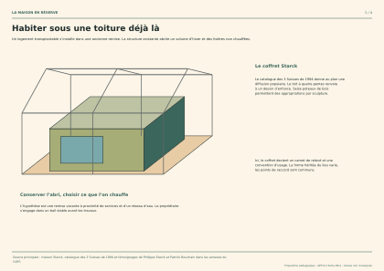
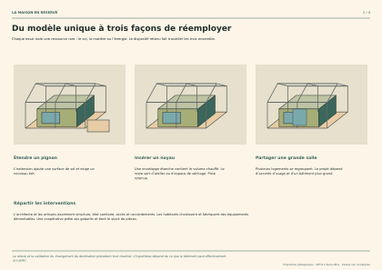
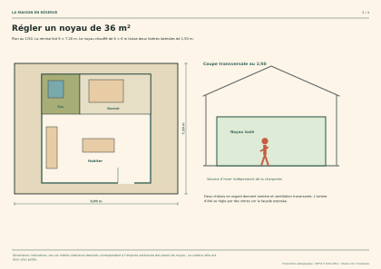
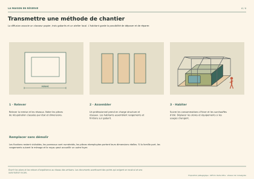

# ENS Paris-Saclay — Design d'espace 2016 · Corrigé brut

*Corrigé rédigé par IA, non officiel.*

**Rédaction** · GPT-6.2 Astra Ultra · vitesse non renseignée

La maison en réserve transforme une dépendance vacante en habitat individuel évolutif, en construisant une enveloppe d’hiver indépendante. Les 4 planches numérotées et anonymes sont au format 420 × 297 mm. Les échelles indiquées valent pour une planche seule imprimée sur A3 à 100 %.

## Planche 1 — Habiter sous une toiture déjà là

La boîte numérotée de Starck réunissait plans, notice, carnet et cassette. Les annexes nomment Patrick Bouchain, Loïc Julienne et Jean-Marie Mandon pour la finalisation. Le dessin familier de l’habitat et la personnalisation des troncs rapprochent standard et travail manuel. Acheter des documents ne résout cependant ni le foncier ni le coût de construire. La maison en réserve part d’un volume déjà couvert et d’un accord d’occupation. Elle vise par exemple un jeune ménage ou une personne âgée qui souhaite habiter près d’un bourg.

## Planche 2 — Du modèle unique à trois façons de réemployer

Un lieu trop humide, inaccessible, structurellement déficient ou trop éloigné des services ne convient pas. L’enquête porte donc sur plusieurs bâtiments disponibles. L’enveloppe intérieure limite la dépense de chauffage, l’enveloppe existante protège la phase de chantier et accompagne les usages d’été. Le coût s’établit en trois lots, préparation du site, enveloppe et réseaux, finitions démontables, auxquels s’ajoute le coût d’occupation.

## Planche 3 — Régler un noyau de 36 m²

Le plan répartit couchage et pièce d’eau au nord, cuisine et séjour au sud. La ventilation, les possibilités d’évacuation, l’accès pour l’entretien, l’éclairage naturel et la stabilité de l’ensemble sont étudiés pour chaque site avec les professionnels compétents. L’ouverture extérieure vers le jardin prolonge la pièce commune l’été. Le projet évite que l’espace non chauffé devienne un passage obligé entre lit et salle d’eau.

## Planche 4 — Transmettre une méthode de chantier

Le classeur circule par les maisons associatives et les réseaux artisanaux. Il comporte le relevé vierge de la remise, un carnet de matière et une méthode de choix des pièces. La coopérative garde un échantillonnage de joints et panneaux et rémunère les permanences. Une visite après un été et un hiver documente ce que les occupants ont changé. Le standard porte sur la lisibilité et la réparabilité des raccords, tandis que la maison présente l’histoire matérielle du lieu.

[Énoncé et annexes du concours](https://ens-paris-saclay.fr/sites/default/files/CONCOURS/ANNALES_1C/1C_Design/2016_Sujet_1A_Design_Espace.pdf)
