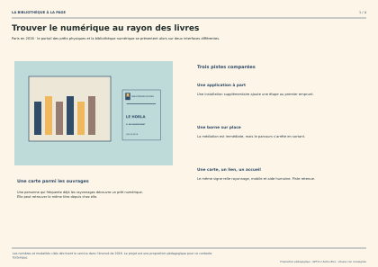
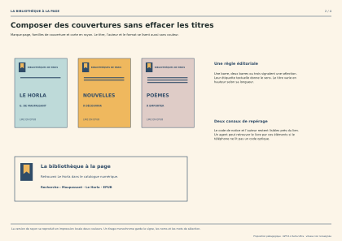
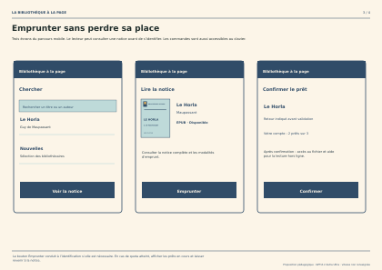
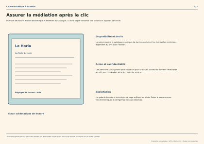

# ENS Paris-Saclay — Design graphique 2016 · Corrigé guidé

*Corrigé rédigé par IA, non officiel.*

**Rédaction** · GPT-6.2 Astra Ultra · vitesse non renseignée

La bibliothèque à la page invite à découvrir les prêts numériques depuis les rayonnages physiques des bibliothèques parisiennes décrites en 2016. Les 4 planches numérotées et anonymes sont au format 420 × 297 mm. Les échelles indiquées valent pour une planche seule imprimée sur A3 à 100 %.

## Planche 1 — Trouver le numérique au rayon des livres

> [!INDICATION]
> Identifier un premier emprunteur et l’endroit où il découvre l’existence du service.

Dans le contexte du sujet, la Ville dispose de 58 bibliothèques de prêt et de 11 bibliothèques spécialisées. L’offre numérique depuis octobre 2015 comprend plus de 2 000 titres. Un lecteur peut alors emprunter jusqu’à trois livres simultanément pour un mois au plus. Les deux portails montrés dans l’annexe de mars 2016 ne rendent pas évident le passage du catalogue d’ouvrages à l’emprunt d’un EPUB. Le projet organise une continuité de lecture à travers cette frontière.

## Planche 2 — Composer des couvertures sans effacer les titres

> [!INDICATION]
> Choisir quels éléments restent fixes pour que le lecteur reconnaisse un livre sur tous les supports.

Les couvertures génératives de Coraline Mas-Prévost et Louis Eveillard présentées en annexe utilisent les métadonnées. Notre système emprunte la régularité de cette méthode et conserve le titre comme élément dominant. La série graphique sert de couverture de remplacement uniquement quand les droits et les métadonnées le permettent. L’auteur, l’édition, le statut de disponibilité et le format restent des champs éditoriaux à contrôler indépendamment.

## Planche 3 — Emprunter sans perdre sa place

> [!INDICATION]
> Séparer découverte du livre et authentification puis afficher la disponibilité et les conditions avant l’engagement.

Sur téléphone le champ unique cherche par auteur ou titre. La notice utilise les mêmes libellés que la carte imprimée. Emprunter déclenche au besoin l’identification du service municipal puis revient à la notice choisie. Avant confirmation l’usager voit la date de retour, le quota et les conditions de ce titre selon sa licence. Si le quota est atteint, le système affiche les prêts actifs. Si l’accès échoue, il conserve auteur et titre à l’écran pour permettre une demande d’aide. Les commandes ont des libellés explicites et un ordre de navigation stable.

## Planche 4 — Assurer la médiation après le clic

> [!INDICATION]
> Tester aussi le retour au livre, l’absence de smartphone et la lecture agrandie.

Les fichiers EPUB autorisent une restitution adaptée aux réglages du lecteur selon l’ouvrage et l’application. Le site conserve les notices en HTML lisible et référence les fichiers et droits existants. Les couvertures originales ne sont reproduites que si l’autorisation correspondante est disponible. Le domaine public d’un texte ne suffit pas à libérer toutes les illustrations d’une édition. La Ville peut produire les cartes avec ses moyens de reprographie, former des agents et recueillir des observations anonymisées sur les étapes où les personnes demandent de l’aide.

[Énoncé et annexes du concours](https://ens-paris-saclay.fr/sites/default/files/CONCOURS/ANNALES_1C/1C_Design/2016_Sujet_1A_Design_Graphique.pdf)
