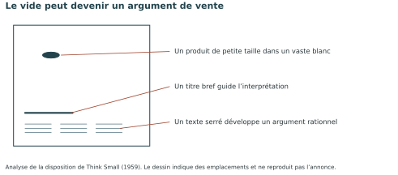

# Gui Bonsiepe, publicité et contrôle social · Cachan 2016 · Corrigé guidé

*Corrigé rédigé par IA, non officiel. Signalez toute erreur.*

**Rédaction** · GPT-6.2 Astra Ultra · vitesse non renseignée

**Relecture du corrigé** · GPT-6.2 Astra Ultra · vitesse non renseignée

Le texte proposé est publié par Gui Bonsiepe dans la revue Ulm en 1965. Le sujet renvoie à sa traduction française dans le catalogue L’école d’Ulm : textes et manifestes (1988). Il faut discuter sa thèse sur le programme 1953–2000.

## Introduction

> [!INDICATION]
> Distinguer la quantité d’objets produits, le statut professionnel du graphiste et le comportement prêté aux publics.

#### Proposition de réponse

Un appareil de radio a besoin que l’usager comprenne ses commandes. Sa vente réclame aussi que l’acheteur potentiel ait quelque raison de le préférer à un autre. Les qualités que le designer rend visibles sont ainsi à la fois susceptibles de servir un geste et d’orienter une préférence. En 1965, le passage de la « pénurie » à l’« abondance » désigne chez Bonsiepe une expérience historiquement située, celle des économies occidentales de consommation dans l’après-guerre. Les inégalités d’équipement n’y ont pas disparu, et la formule ne décrit pas au même moment toutes les économies du monde.

Parler de « contrôle social » donne à la publicité une portée supérieure à celle d’une simple affiche. Elle contribue à produire des habitudes, des normes d’équipement et des façons de se représenter soi-même. Dans quelle mesure cette action procède-t-elle du design, et la compréhension des signes laisse-t-elle une place à autre chose qu’à la prescription marchande ? L’organisation des produits, la rhétorique des annonces et la réappropriation des outils graphiques permettent de mettre l’affirmation à l’épreuve.

## I. La cohérence du produit permet simultanément de l’utiliser et d’identifier son fabricant

> [!INDICATION]
> Décrire un détail matériel avant d’en déduire une signification commerciale.

#### Proposition de réponse

En Allemagne de l’Ouest, l’école d’Ulm et l’entreprise Braun renouvellent dans les années 1950 la conception de l’appareil domestique. Le combiné radio-électrophone SK 4 de Hans Gugelot et Dieter Rams, conçu en 1956, substitue au meuble de salon massif un caisson clair aux flancs de bois et un couvercle transparent. La disposition supérieure de la platine et des commandes montre où poser le disque et comment intervenir. La transparence permet à l’utilisateur de voir l’objet sans confondre son fonctionnement avec la décoration du mobilier. Elle est aussi un signe immédiatement reconnaissable dans un magasin ou une annonce.

Dans le travail du groupe de développement dirigé par Otl Aicher pour Lufthansa au début des années 1960, couleurs, typographie et emblème doivent pouvoir se décliner sur de multiples supports. Une identité d’entreprise se lit dans la succession des contacts avec le voyageur, du document imprimé aux lieux de service. Cette cohérence réduit l’effort d’identification. Elle transforme en même temps chaque point d’information en rappel de marque. La publicité devient centrale au sens où elle n’est plus confinée à un message isolé. Elle peut s’incorporer aux objets et à leur environnement perceptif. Pourtant, une inscription qui permet réellement de s’orienter garde une utilité même lorsque l’on a déjà acheté son billet.

Le schéma de l’annonce distingue trois temps. Le regard mesure d’abord la disproportion entre la voiture et la page, trouve ensuite un mot pour cette proportion dans le titre, puis rencontre des raisons de juger l’achat avantageux. La mise en page fait ainsi participer le lecteur à la fabrication de l’argument. Un lecteur peut cependant juger la voiture trop petite. La même disproportion fournit alors le motif de son refus. L’institution d’une norme de lecture n’équivaut donc pas à la maîtrise de tous ses effets.

> [!INDICATION]
> Sur l’annonce schématisée, masquer le titre puis le rétablir. Sans lui, la petite échelle pourrait suggérer faiblesse ou éloignement. Comment le titre fait-il de cette observation une valeur ? Le raisonnement porte sur ce retournement et peut dès lors qualifier le contrôle réellement exercé.

## II. La persuasion moderne fonctionne aussi par l’ironie et l’apparence de la retenue

> [!INDICATION]
> Observer taille, blanc, hiérarchie et placement dans une annonce déterminée.

#### Proposition de réponse

Aux États-Unis en 1959, l’agence Doyle Dane Bernbach lance pour Volkswagen la campagne Think Small. Une petite automobile apparaît dans un vaste espace blanc, au-dessus d’un titre bref et de colonnes de texte. Le contraste de taille joue sur la modestie d’un modèle vendu sur un marché où la puissance et l’ampleur des carrosseries ont souvent servi d’arguments. Le blanc ne signifie pas absence de persuasion. Il organise l’attention, ralentit la lecture puis lui donne une direction. Le titre invite le lecteur à se reconnaître dans une attitude raisonnable ou indépendante avant de détailler les qualités du produit.

L’acheteur est ainsi sollicité par son désir de s’écarter de ce qu’il pense être la publicité ordinaire. L’adhésion est plus subtile qu’une injonction à consommer. Elle associe économie de moyens, discernement et possession d’une voiture déterminée. Ce cas donne sa force à l’intuition de Bonsiepe. Les signes du refus de l’ostentation peuvent eux-mêmes devenir des signes marchands. Mais la précision du dispositif graphique ne révèle pas la réponse de chaque lecteur. Il faudrait des données de réception pour établir quels publics ont cru, refusé ou détourné cette invitation.

## III. Les mêmes techniques graphiques peuvent mettre la norme à distance

> [!INDICATION]
> Examiner comment la sérigraphie ou la diffusion multiple changent de sens avec la commande.

#### Proposition de réponse

En mai et juin 1968, l’Atelier populaire issu de l’École des beaux-arts de Paris produit collectivement des affiches destinées à circuler dans les rues et les lieux de grève. La simplification du dessin, l’emploi de peu de couleurs, la rencontre d’une image frappante et d’une formule brève reprennent des moyens familiers à la communication de masse. Dans La lutte continue, un poing prolonge la cheminée d’une usine. Le bâtiment n’illustre pas un produit en vente. Il devient le support d’un sujet collectif. La sérigraphie et la relative économie de fabrication permettent la multiplication et l’affichage rapide.

Ce contre-exemple ne prouve pas que toute communication collective soit libre de contrainte. Il montre que la commande, les lieux d’affichage, la possibilité de répondre et la nature du bien proposé comptent autant que le style. Une composition dépouillée peut informer, distinguer une marque ou contester une autorité. Plus tard dans le siècle, la collection de telles affiches par des institutions en modifie encore le public et le statut. La même feuille peut passer du mur militant à une exposition d’histoire du graphisme.

La publicité acquiert donc bien une place institutionnelle dans la définition des besoins et des identités de consommateur. Bonsiepe permet de la repérer jusqu’au cœur d’objets réputés discrets et fonctionnels. Son diagnostic devient excessif s’il transforme ce pouvoir de structurer le champ des choix en détermination automatique des usages ou si l’abondance marchande tient lieu de description de toutes les conditions sociales.
