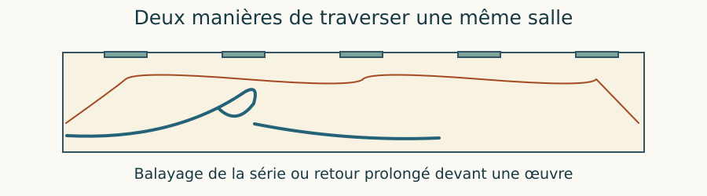

# Le « mal du musée » chez Maurice Blanchot · 2016 · Corrigé guidé

*Corrigé rédigé par IA, non officiel. Signalez toute erreur.*

**Rédaction** · GPT-6.2 Astra Ultra · vitesse non renseignée · 25 novembre 2026

**Révision** · GPT-6.2 Astra Ultra · vitesse non renseignée · 26 novembre 2026

École normale supérieure de Cachan · concours Design de première année · écrit de quatre heures · C16102.

Dans « Le mal des musées », repris dans *L’Amitié*, Blanchot parle d’un « mal du musée, analogue au mal de la montagne ».

[Sujet officiel, p. 1](https://ens-paris-saclay.fr/sites/default/files/CONCOURS/ANNALES_1C/1C_Design/2016_Sujet_1A_Design_Philo_art.pdf)

## Entrer dans le sujet

Pourquoi se sentir étouffé là où tant de directions s’ouvrent au regard ? Suivez les deux trajets du schéma. Sur le premier, quel panneau quittez-vous trop vite ? Sur le second, quel rapprochement vous fait revenir ? Le retable d’Issenheim permet de comparer ces choix au rythme ancien de l’ouverture de ses volets.

## Introduction

> [!INDICATION]
> Prendre au sérieux le verbe « entrer », qui place le problème au seuil du musée.

Le guide du musée promet qu’en quelques salles nous rencontrerons plusieurs siècles de peinture. La promesse peut susciter de l’enthousiasme avant la visite et du découragement dès la première salle. Dans « Le mal des musées », repris dans *L’Amitié*, Maurice Blanchot compare ce trouble au mal de la montagne. Le rapprochement surprend. Ni l’altitude ni un effort physique excessif ne sont nécessaires au malaise. Le visiteur en fait l’épreuve en entrant. Comment l’institution qui rend les œuvres accessibles peut-elle aussi compromettre la possibilité de les rencontrer ? La question demande de distinguer la réunion matérielle des œuvres, la comparaison que cette réunion rend possible et la liberté de regard qu’elle laisse au visiteur.

## I. Rendre visible une collection peut rendre chaque œuvre difficile à voir

> [!INDICATION]
> Décrire précisément ce que le visiteur doit abandonner lorsqu’il passe au tableau suivant.

Une peinture de chevalet, le fragment d’un retable et une sculpture funéraire peuvent partager une salle. Les rapprochements sont matériellement possibles parce que chaque objet a été séparé d’un emplacement, d’un éclairage ou d’un usage. Lorsqu’un retable ponctuait une cérémonie, le moment où l’on ouvrait ses volets gouvernait ce qui pouvait être vu. En présentant les panneaux pour eux-mêmes, le musée offre des détails autrefois difficiles d’accès, mais la durée de l’observation ne dépend plus de ce rythme. Le visiteur doit la régler au milieu de beaucoup d’autres demandes d’attention.

Le retable d’Issenheim, aujourd’hui au musée Unterlinden de Colmar, permet de préciser l’exemple. Ses volets peints par Grünewald modifiaient la composition offerte à la vue selon leur ouverture. Dans le contexte des Antonins, le fidèle ou le malade regardait les images à une place déterminée dans une vie religieuse et hospitalière. Au musée, un visiteur peut comparer plusieurs états du retable, puis revenir de l’un à l’autre. Il gagne cette liberté au prix d’une difficulté nouvelle. Comment donner une durée et un ordre à des images dont l’apparition dépendait autrefois d’un temps commun ?

Le schéma permet de refaire deux fois la visite. Si je veux acquitter envers chaque œuvre la même dette de regard, j’aperçois bientôt la suivante comme une injonction à quitter celle qui me retient. Voilà l’étouffement. Si je commence à imaginer toutes les relations possibles entre elles, le nombre de parcours déborde mes forces. Voilà le vertige. Un simple repos physique ne résout pas entièrement ce conflit. Le nombre des œuvres devient accablant en raison de la valeur singulière que l’institution demande de reconnaître à chacune.

## II. Le déracinement qui trouble la visite autorise aussi des découvertes

> [!INDICATION]
> Construire une objection au constat de malaise à partir d’un bénéfice précis de la comparaison.

Comparer deux représentations de l’Annonciation, l’une à fond d’or, l’autre construite en profondeur par la perspective, peut rendre sensible une différence que l’identité du récit masquait. Où l’espace du spectateur s’arrête-t-il ? Quelle place le peintre accorde-t-il à la chambre, au seuil, au déplacement du messager ? C’est parce que les deux œuvres ne me sont plus présentées à part dans deux lieux de culte éloignés que je peux leur poser ensemble cette question. Le retrait de certains liens fait apparaître d’autres relations. Condamner toute comparaison au nom de l’origine reviendrait aussi à réserver l’expérience de chaque œuvre aux personnes capables d’atteindre son ancien site.

À l’entrée, aucun décompte des salles n’a encore été fait. La formule de Blanchot suggère donc un malaise qui peut précéder la fatigue. Le vertige ouvre trop de directions possibles à partir d’une œuvre. L’étouffement contracte le temps et l’attention que je peux effectivement lui donner. L’analogie de la montagne fait sentir ensemble ces deux effets d’une même situation. Elle laisse aussi place à une objection. La liberté de choisir une seule comparaison peut convertir une première désorientation en curiosité.

Dans *Le Musée imaginaire*, André Malraux étend cette possibilité aux reproductions photographiques. Un détail agrandi peut être rapproché d’un autre en dépit de l’éloignement des originaux. L’opération a son prix. Une vignette imprimée met sur la même page des objets dont les échelles réelles, les matières et les usages sont très différents. Comprendre ce qui a été cadré, réduit ou rapproché est une condition pour que la comparaison produise un savoir. Le vertige cesse alors d’être un simple symptôme à supprimer. Il avertit que l’œil passe d’un monde à un autre grâce à des médiations dont il peut prendre conscience.

## III. Concevoir la visite comme une liberté de s’attarder

> [!INDICATION]
> Changer un détail de la salle et suivre son effet, puis mettre une limite à la solution.

Reprenons la salle du schéma et installons un banc d’où l’on peut voir une seule toile de face. Le nombre des œuvres et leur voisinage restent identiques. Le corps peut toutefois renoncer au parcours cursif, s’asseoir, se relever pour examiner un détail, puis retrouver la première vue. La relation prend une durée qui lui est propre. Une notice indiquant la fonction première du retable peut également rendre pensable son ancien contexte sans prétendre rétablir la cérémonie. Le travail du musée porte jusque sur le droit de ne pas tout voir. Il suppose aussi que le visiteur puisse comprendre où mène le parcours et comment y revenir.

Un banc, pourtant, peut devenir un point d’où l’institution dicte une vue prétendument idéale. Un récit historique continu peut aider à s’orienter ou absorber toute œuvre dans son statut d’exemple d’époque. Aucune scénographie ne garantit une rencontre. On peut plutôt juger son effet en demandant si elle permet de contester l’ordre qu’elle propose. Puis-je revenir à une œuvre dont le cartel m’avait détourné ? Puis-je éprouver qu’un rapprochement savant échoue devant la matière de deux tableaux ? L’expérience gagne alors en liberté, sans que soit abolie l’étrangeté de leur coexistence.

## Conclusion

Le malaise décrit par Blanchot vient de la forme même que prend l’accès aux œuvres lorsqu’on les rassemble. Le musée rend le singulier disponible parmi des voisins qui sollicitent avec la même force. Sa valeur apparaît lorsqu’il rend cette situation sensible et réversible dans la visite, par la comparaison choisie, la possibilité du retour et le temps laissé à une seule œuvre. Une bonne visite peut donc être une visite délibérément incomplète.

## Reprendre le raisonnement

Imaginer deux visiteurs qui quittent la même galerie après dix minutes. L’un a suivi toutes les notices, l’autre a regardé deux fois le même tableau. Avant de juger leur visite, indiquer ce que chacun peut effectivement décrire. L’opposition entre fréquentation et attention devient ainsi un argument vérifiable.
