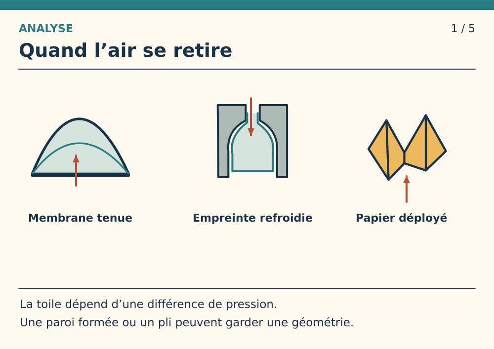
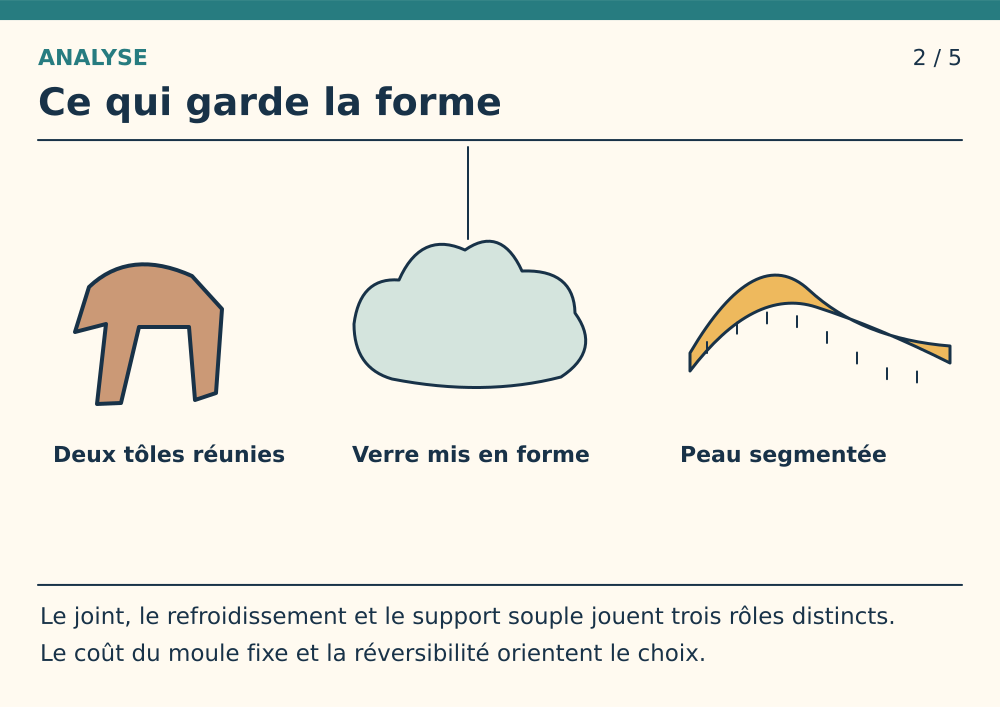
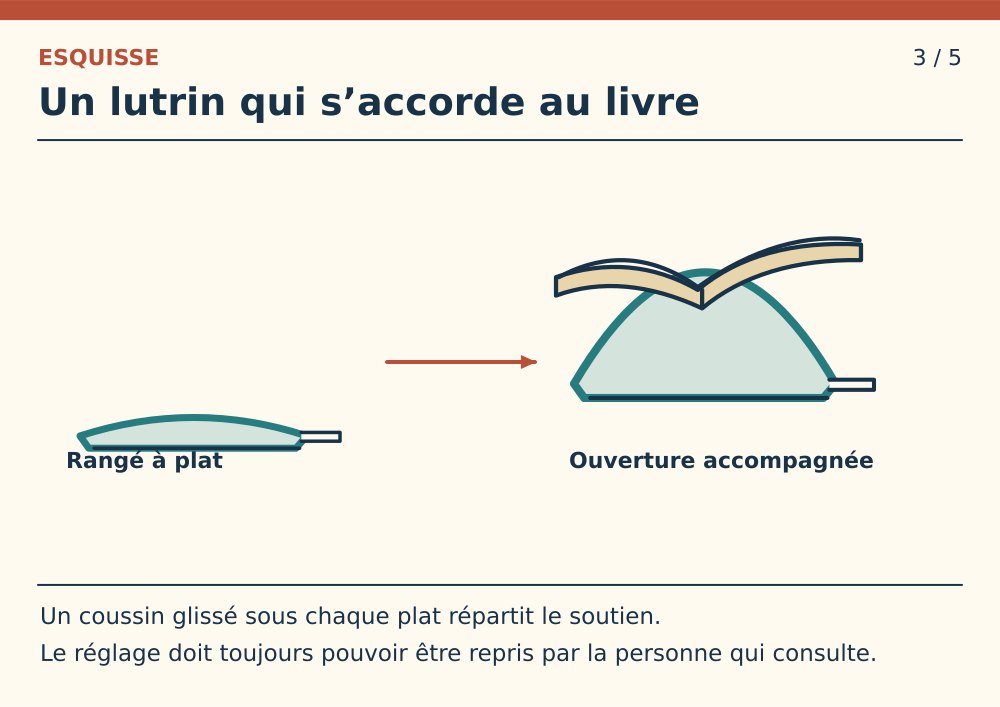
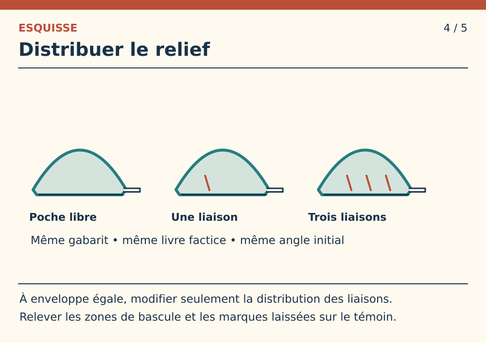
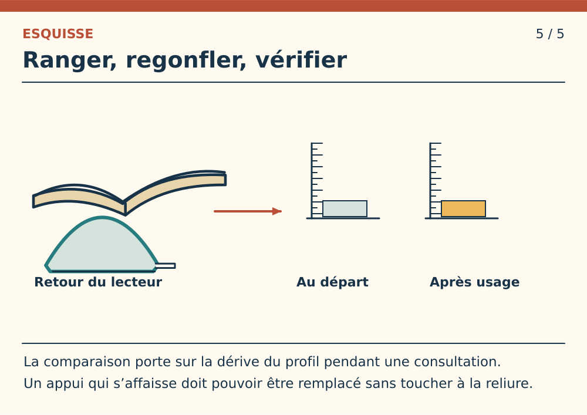

# ENS de Cachan · Design 2016 · Techno-design · Corrigé brut

*Corrigé rédigé par IA, non officiel.*

**Rédaction** · GPT-6.2 Astra Ultra · vitesse non renseignée

**Révision (tour 1)** · GPT-6.2 Astra Ultra · vitesse non renseignée

## La mécanique de l’air

Six documents mettent l’air au travail. La question qui relie ces pièces est celle de la persistance du volume. Je transpose cette distinction à un support de consultation que la bibliothèque doit pouvoir adapter puis ranger. Deux A3 d’analyse et trois A3 d’esquisse composent le dossier.

### Analyse 1 · Quand l’air se retire

Dans *Leviathan* de Kapoor, l’enveloppe en PVC déployée dans la nef du Grand Palais en 2011 devient un intérieur rouge à l’échelle du visiteur. La séquence photographique confronte la toile affaissée à son volume tenu. Dans le flacon, une préforme obtenue par injection est soufflée contre un moule. Après refroidissement et démoulage, la paroi conserve la forme du contenant. Le poisson japonais en papier mobilise un troisième régime, l’ouverture d’un réseau de plis. Son faible poids favorise le transport à plat, mais le papier tolère mal les reprises et l’humidité.

### Analyse 2 · Ce qui garde la forme

Le tabouret *Plopp* d’Oskar Zieta associe des feuilles métalliques réunies en périphérie puis mises en volume. Le procédé FiDU autorise des variations de galbe à partir d’une même découpe. Le verre soufflé de *Cloudy* de Mathieu Lehanneur, 2013, fige après refroidissement une silhouette de nuage. L’air employé pour la fabriquer ne porte plus la suspension en service. Chez ARCA, l’image montre un parement de bois fractionné solidaire d’une membrane, dont la souplesse permet la courbure d’ensemble. On ne déduit pas du cliché la composition exacte du support. Par comparaison, un soufflet d’accordéon exploite durablement sa mobilité. Une surface réglable peut-elle épouser un objet fragile puis repartir à plat ?

### Esquisse 3 · Un lutrin qui s’accorde au livre

Dans une bibliothèque de quartier, des ouvrages de formats irréguliers sont présentés sur une table temporaire. Deux enveloppes indépendantes, habillées d’une housse textile lavable, accompagnent les plats sans presser le dos. La personne règle d’abord l’ouverture admise par l’ouvrage, puis place les coussins en appui. La première hypothèse est que deux appuis indépendants conviennent mieux à une reliure dissymétrique qu’une seule poche large. Des volumes factices précèdent tout essai avec un livre.

### Esquisse 4 · Distribuer le relief

La seconde hypothèse porte sur le cloisonnement. Une poche libre arrondit le dessous du livre et peut le faire basculer. Une ou trois liaisons intérieures contrarient ce bombement. Une liaison trop marquée crée cependant une arête sensible. Je compare trois coussins de même encombrement sous un livre factice dont les plats sont recouverts d’un papier témoin. Après manipulation, je relève stabilité latérale et empreintes. Un modèle qui marque le témoin sort de l’essai.

### Esquisse 5 · Ranger, regonfler, vérifier

Une troisième piste sépare l’enveloppe remplaçable de sa housse durable. Un repère visuel sur le côté permet de comparer la hauteur au début et à la fin d’une lecture. Pendant l’essai, une personne tourne les pages d’un volume factice. Je relève le temps de réglage, la variation de hauteur et le déplacement du dos. Si un coussin perd progressivement sa tenue, une cale textile souple assure le retour à la table. L’essai compare ensuite l’encombrement de rangement et le nombre de pièces à laver à ceux d’un lutrin fixe.

## Sources

Les six pages du fascicule sont disponibles, avec les six références illustrées. L’index de la session 2016 ne fournit pas de rapport propre à cette épreuve.

[Fascicule officiel](https://ens-paris-saclay.fr/sites/default/files/CONCOURS/ANNALES_1C/1C_Design/2016_Sujet_1A_Design_Techno_Design.pdf)
