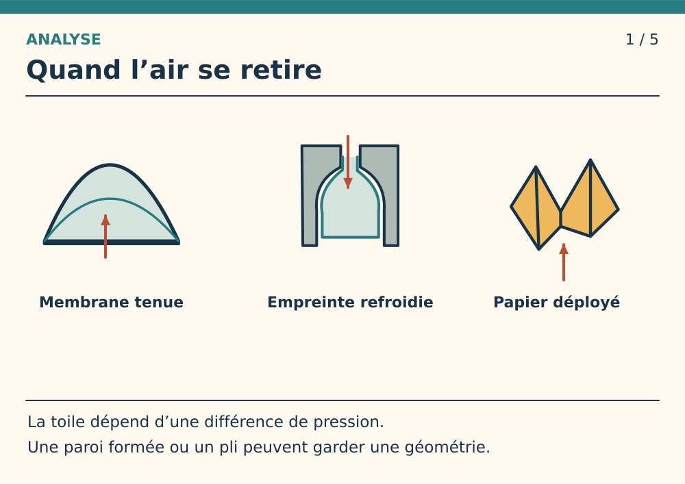
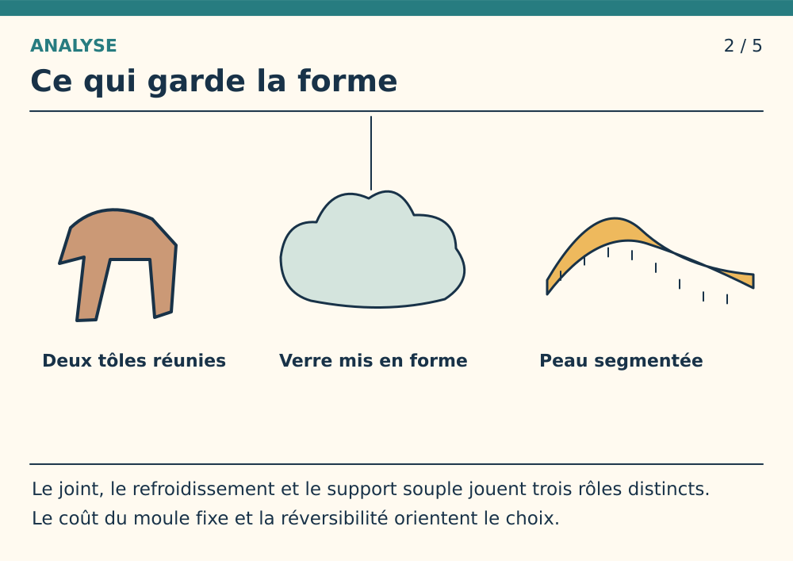
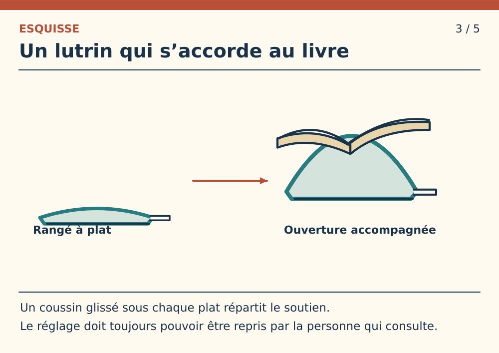
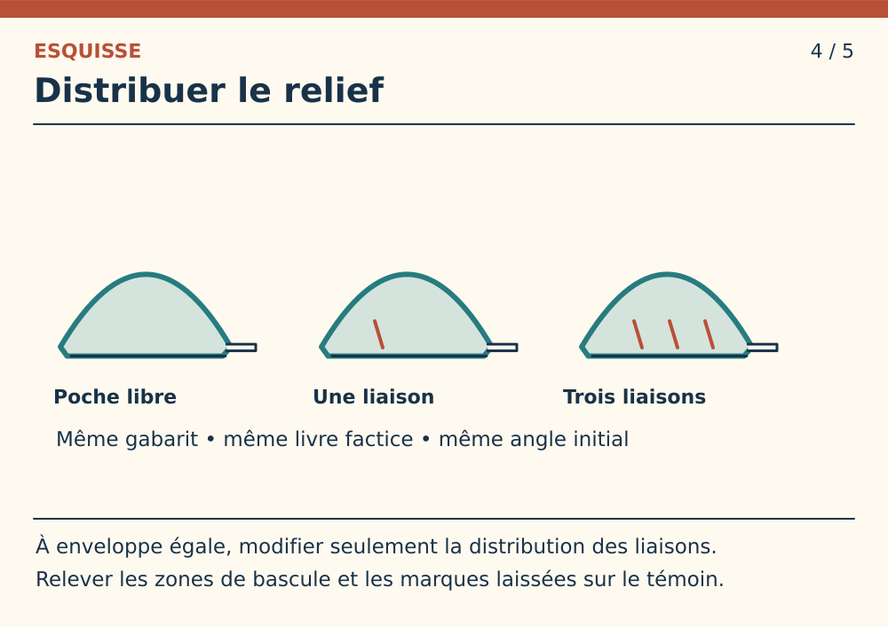
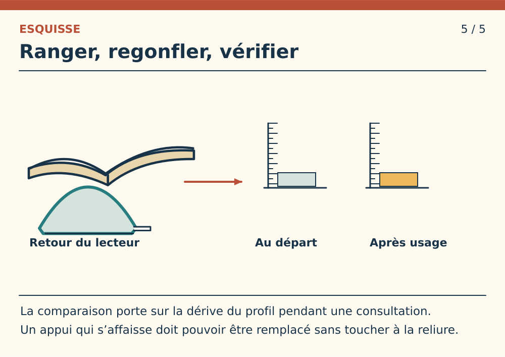

# ENS de Cachan · Design 2016 · Techno-design · Corrigé guidé

*Corrigé rédigé par IA, non officiel.*

**Rédaction** · GPT-6.2 Astra Ultra · vitesse non renseignée

**Révision (tour 1)** · GPT-6.2 Astra Ultra · vitesse non renseignée

## La mécanique de l’air

L’épreuve répartit huit heures entre analyse et esquisse, avec quatre puis six A3 au maximum. Les cinq planches sont paginées et portent l’intitulé de leur phase. Refaire chaque coupe en distinguant la matière, la cavité et le dispositif extérieur, avant de choisir une application.

### Analyse 1 · Quand l’air se retire

Que devient la forme lorsque l’apport d’air cesse ? Dessiner une coupe de chacun des trois objets au même moment du cycle.

Suivre la frontière entre l’air et la paroi. La couleur rouge du pavillon renseigne sur l’expérience de la lumière. Elle ne renseigne ni sur une pression chiffrée ni sur la composition exacte d’une soudure. Pour le flacon, placer le moule à l’extérieur de la préforme et expliquer le rôle du refroidissement.

### Analyse 2 · Ce qui garde la forme

Pourquoi un dispositif gonflé sert-il parfois d’outillage de fabrication et parfois de mécanisme pendant l’usage ?

Mettre sur une même frise l’état de départ, l’action de l’air et l’état de service. Chez Zieta et Lehanneur, le retrait du moyen de formage n’efface pas la géométrie. Pour le bois sur membrane, isoler ce que l’image autorise à conclure sur les éléments rigides et les joints.

### Esquisse 3 · Un lutrin qui s’accorde au livre

À qui revient le réglage et dans quel ordre les gestes sont-ils effectués ?

Représenter un même livre fermé, puis ouvert avec son angle naturel, et installer le soutien sous les plats. L’essai doit révéler si les deux coussins glissent vers l’extérieur. Prévoir une base textile commune qui les retient, sans rien fixer sur le livre.

### Esquisse 4 · Distribuer le relief

Comment attribuer une variation à la distribution des liaisons ?

Garder l’enveloppe, la housse et le livre d’essai constants. Ouvrir à la même position et relever le profil sous la même charge. Si le meilleur maintien s’accompagne d’une marque nette, l’appui doit être élargi ou déplacé.

### Esquisse 5 · Ranger, regonfler, vérifier

Quel événement ferait abandonner l’hypothèse gonflable ?

Une perte d’appui répétée ou un réglage si long qu’il décourage l’usage justifierait une cale pliée indépendante de l’air. La proposition garde ainsi un critère d’arbitrage lié au service rendu.

## Sources

Les six pages du fascicule sont disponibles, avec les six références illustrées. L’index de la session 2016 ne fournit pas de rapport propre à cette épreuve.

[Fascicule officiel](https://ens-paris-saclay.fr/sites/default/files/CONCOURS/ANNALES_1C/1C_Design/2016_Sujet_1A_Design_Techno_Design.pdf)
