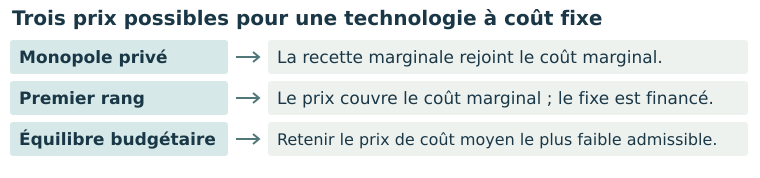
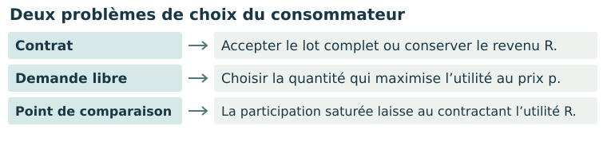

# ENS Paris-Saclay · Analyse économique générale 2016 — Corrigé brut

*Corrigé rédigé par IA, non officiel. Signalez toute erreur.*

**Rédaction** · GPT-6.2 Astra Ultra · vitesse non renseignée

Banque ENS Cachan et ENSAI, option économique et de gestion, quatre heures. Les numéros suivent le sujet de la session. Aucun rapport distinct de cet écrit n’est identifié sur la page d’annales de la session.

## 1. Trois entreprises de type 1

**1.1. Technologie.** Pour $q>0$, le coût marginal est $q$ et le coût moyen $q/2+C/q$. Si $C>0$, ce dernier décroît jusqu’à $q=\sqrt{2C}$ puis croît. Il y a économies d’échelle en dessous de ce seuil et déséconomies au-dessus. Le coût variable seul est strictement convexe. Faute de fonction de production physique, ces rendements se lisent au sens des coûts à prix des facteurs donnés. Si $C=0$, le coût moyen croît partout.

**1.2. Concurrence.** Aux prix donnés, chaque entreprise active fournit $q=p$ et la demande vaut $\alpha-p$. Avec trois entreprises, $p=q=\alpha/4$ et $Q=3\alpha/4$. Le surplus des consommateurs est l’aire du triangle $SC=Q^2/2=9\alpha^2/32$. L’excédent d’exploitation de chaque firme avant coût fixe est $pq-q^2/2=\alpha^2/32$. Son profit vaut donc $\alpha^2/32-C$. Le bien-être collectif net vaut $W_c=3\alpha^2/8-3C$. On suppose ici les trois entreprises en activité.

**1.3. Cournot.** À productions rivales données, la dérivée du profit en $q_i$ est $\alpha-Q_{-i}-3q_i$. La dérivée seconde vaut $-3$. La meilleure réponse intérieure est $q_i=(\alpha-Q_{-i})/3$. La solution symétrique donne $q=\alpha/5$, $Q=3\alpha/5$, $p=2\alpha/5$. On obtient $SC=9\alpha^2/50$, un profit individuel $3\alpha^2/50-C$ et $W_K=9\alpha^2/25-3C$.

**1.4. Perte sèche.** $W_c-W_K=3\alpha^2/200$. En répartissant $Q$ également, le coût marginal de branche est $Q/3$ et la demande inverse $\alpha-Q$. L’aire perdue entre $3\alpha/5$ et $3\alpha/4$ est un triangle de base $3\alpha/20$ et de hauteur $\alpha/5$.

**1.5. Trois chefs de file présumés.** Pour une entreprise qui envisage de produire $x$ la première, les deux suiveuses de Cournot résolvent chacune $3y=\alpha-x-y$, d’où $y=(\alpha-x)/4$. Le prix anticipé est $(\alpha-x)/2$ et le profit anticipé $\alpha x/2-x^2-C$. Chaque chef de file projette donc $x=\alpha/4$. Si les trois plans sont réalisés, $Q=3\alpha/4$ et $p=\alpha/4$. Les surplus et profits réalisés sont ceux de 1.2. Chacune avait prévu que les deux autres produiraient $3\alpha/16$, et surestimait donc le prix.

**1.6. Interprétation.** La perte sèche de cette confrontation des trois plans est nulle. On obtient les bonnes quantités par des prévisions mutuellement incompatibles. Ce résultat ne constitue pas un équilibre de Stackelberg avec un chef de file effectivement observé par deux suiveuses. Dans ce dernier jeu, les productions seraient $\alpha/4,3\alpha/16,3\alpha/16$, soit $5\alpha/8$ au total.

**1.7. Couverture des coûts.** Au prix concurrentiel, $\pi_c=\alpha^2/32-C$. Le seuil est $\widehat C=\alpha^2/32$. Au seuil, le profit est exactement nul. Au-delà, la tarification marginale ne permet plus aux trois entreprises de couvrir leurs coûts totaux sans transfert, bien qu’elles puissent encore préférer produire à court terme si le coût fixe est irrécupérable.

**1.8. Compenser ou accepter le pouvoir de marché ?** Pour maintenir les trois entreprises, une compensation individuelle minimale $C-\widehat C$ couvre leur déficit concurrentiel. Si le financement public est forfaitaire et sans coût réel, le transfert disparaît du bien-être collectif. La production concurrentielle apporte un gain $3\alpha^2/200$ sur Cournot. Avec une perte sociale de financement de $\lambda$ par euro transféré, le gain net devient $3\alpha^2/200-3\lambda(C-\widehat C)$, à comparer à zéro. La viabilité même de trois entreprises en Cournot sans aide exige $C\leq3\alpha^2/50$ si la sortie évite le coût fixe.

**1.9. Nombre de firmes.** Pour $n$ entreprises actives identiques, $p=q=\alpha/(n+1)$, $Q=n\alpha/(n+1)$ et $W_n=\alpha^2 n/[2(n+1)]-nC$, avec $W_0=0$. L’entreprise supplémentaire améliore le bien-être de $\alpha^2/[2(n+1)(n+2)]-C$. Pour $n\ge1$, un entier optimal vérifie donc

$$
\frac{\alpha^2}{2(n+1)(n+2)}\le C\le\frac{\alpha^2}{2n(n+1)}.
$$

Deux entiers adjacents conviennent en cas d’égalité. L’absence de production est optimale dès $C\ge\alpha^2/4$ (égalité avec une firme au seuil). Si le nombre de firmes est traité comme continu, on obtient $n=\max(0,\alpha/\sqrt{2C}-1)$. Cela correspond aussi au calcul usuel de libre entrée en négligeant les indivisibilités, $p=\min CM=\sqrt{2C}$. Pour un nombre entier de preneurs de prix, profit non négatif à $n$ et absence de profit strict à $n+1$ donnent séparément $\alpha^2/[2(n+2)^2]\le C\le\alpha^2/[2(n+1)^2]$. Si $C=0$ et si le nombre de firmes est libre, le bien-être augmente vers une borne et n’atteint pas de maximum fini.

## 2. Subvention aux entreprises de Cournot

**2.1. Deux instruments.** La subvention nette $S_i=sq_i-\widetilde T_i$ ajoute $s$ à la recette marginale. Le prélèvement forfaitaire $\widetilde T_i$ modifie le profit et la décision d’entrer, mais laisse inchangée la quantité optimale d’une entreprise déjà active.

**2.2. Niveau incitatif.** La nouvelle condition intérieure est $3q_i=\alpha+s-Q_{-i}$. Par symétrie $q=(\alpha+s)/5$. Imposer $q=\alpha/4$ donne $s=\alpha/4$. À la quantité visée, la subvention marginale compense la perte de recette sur les unités déjà vendues lorsque la firme augmente sa production.

**2.3. Bilan sans prélèvement.** Les trois firmes produisent la quantité efficace avec les mêmes coûts réels. La perte sèche est nulle sous financement forfaitaire sans distorsion. La dépense budgétaire brute est néanmoins $3s q=3\alpha^2/16$. Chaque firme reçoit $\alpha^2/16$ en plus de son profit concurrentiel, soit $3\alpha^2/32-C$ au total par firme. Les consommateurs gardent $9\alpha^2/32$. Retrancher la dépense publique du surplus des consommateurs plus les profits redonne $3\alpha^2/8-3C$. Une perte marginale de financement changerait ce diagnostic.

**2.4. Neutralité pour les firmes.** L’égalité demandée est $3\alpha^2/32-C-\widetilde T_i=3\alpha^2/50-C$. Il en résulte $\widetilde T_i=27\alpha^2/800$. La subvention nette reste positive, $23\alpha^2/800$ par entreprise. Les firmes conservent leur profit initial, les consommateurs gagnent et l’État conserve une dépense nette. La neutralité définie dans le sujet concerne les entreprises. Elle ne garantit pas que chaque contribuable soit individuellement indemne.

## 3. Entrée d’une entreprise de type 2

**3.1. Technologie.** Le coût marginal vaut $\beta$ et le coût moyen $\beta+\gamma C/q$. Si $C>0$, ce dernier décroît strictement. Répartir une même quantité entre deux firmes de type 2 double le coût fixe et conserve le même coût variable. Cette économie de duplication concerne la technologie de type 2. Elle ne démontre pas à elle seule que toutes les firmes de type 1 disparaissent.

**3.2. Éviction et prix.** Posons $a=\alpha-\beta$. Si $a>0$, le monopole privé sans menace d’entrée choisit $Q_m=a/2$, $p_m=(\alpha+\beta)/2$ et reçoit $\pi_m=a^2/4-\gamma C$. Il faut $a^2/4\ge\gamma C$ pour couvrir son coût total. Pour $a\le0$, même la première unité coûte au moins autant que la disposition maximale à payer.

Le cahier ne précise pas si les coûts sont évitables, ni le jeu d’entrée. Une interprétation de long terme donne une condition explicite. Un type 1 preneur d’un prix $p$ obtient au mieux $p^2/2-C$ en produisant $q=p$. Un prix inférieur à $\sqrt{2C}$ l’écarte. Si $p_m\le\sqrt{2C}$ et $\pi_m\ge0$, le monopole peut donc pratiquer son prix privé tout en dissuadant l’entrée (indifférence au seuil). Plus généralement, en présence d’entrants potentiels capables de servir au prix du marché, le meilleur prix dissuasif est $p_L=\min\{p_m,\sqrt{2C}\}$. Il permet une éviction durable si $p_L>\beta$ et $(p_L-\beta)(\alpha-p_L)\ge\gamma C$. Lorsqu’une stricte sous-cotation est nécessaire, on raisonne à la limite du seuil. En revanche, si les coûts fixes des trois firmes sont déjà irrécupérables et qu’elles restent dans un jeu de quantités simultané, toute firme de type 1 à production nulle gagnerait à produire un peu dès que $p>0$. La seule comparaison des coûts fixes n’établit alors aucune éviction.

**3.3. Comparaison sociale.** Pour une seule firme de type 2 en activité, $W_2(Q)=aQ-Q^2/2-\gamma C$. Au monopole non contraint, le surplus du consommateur est $a^2/8$ et $W_m=3a^2/8-\gamma C$. Le monopole améliore strictement le bien-être relativement aux trois firmes de Cournot si

$$
\frac{3}{8}(\alpha-\beta)^2-\gamma C >\frac{9\alpha^2}{25}-3C.
$$

On compare ici les coûts totaux évitables de long terme et des solutions viables. Un gain technologique ou l’économie de coûts fixes peut l’emporter sur la marge de monopole. Avec un prix limite contraignant, remplacer $Q_m$ par $\alpha-p_L$ dans $W_2$ avant de comparer.

**3.4. Tarification concurrentielle.** La condition $p=\beta$ conduit à $Q^*=a$ si $a>0$. Le gain collectif net est $W_2^*=a^2/2-\gamma C$ et le monopole perd $\gamma C$. L’égalisation du prix et du coût marginal est efficace une fois l’entreprise ouverte. La décision même d’ouvrir exige que le gain couvre le fixe et qu’il l’emporte sur la meilleure autre organisation. Une concurrence qui dupliquerait les installations de type 2 ferait supporter plusieurs fois ce fixe.

**3.5. Gestion publique.** Avec financement forfaitaire, le gestionnaire peut fixer $p=\beta$, subventionner le fixe $\gamma C$ et atteindre le premier rang décrit en 3.4. Si l’entreprise doit équilibrer son budget par les seules recettes de vente, il faut $(p-\beta)(\alpha-p)=\gamma C$. Pour $a>0$ et $a^2\ge4\gamma C$, deux racines existent. Celle qui donne le plus de surplus est

$$
p_{BB}=\frac{\alpha+\beta-\sqrt{a^2-4\gamma C}}{2},
\qquad Q_{BB}=\frac{a+\sqrt{a^2-4\gamma C}}{2}.
$$

Elle donne la quantité la plus proche de $a$. Le bien-être est $Q_{BB}^2/2$ puisque le profit est nul. Si $a^2<4\gamma C$, aucun prix uniforme ne couvre le fixe. Entre $a^2/4$ et $a^2/2$ de coût fixe, la production peut demeurer collectivement souhaitable malgré cette impossibilité budgétaire.

## 4. Demande libre et contrat imposé par un monopole

**4.1. Interpréter $\theta$.** La disposition marginale à payer pour $q$ unités est $\theta/(2\sqrt q)$. Un $\theta$ plus élevé accroît la valeur accordée au bien pour chaque quantité donnée. Le prix du bien composite est unitaire et son utilité marginale vaut un.

**4.2. Demandes marshalliennes.** Pour $p>0$, la contrainte $pq+x=R$ est saturée. Maximiser $\theta\sqrt q-pq+R$ sur $[0,R/p]$ donne

$$
q(p,R)=\min\!\left\{\frac{\theta^2}{4p^2},\frac Rp\right\},
\qquad x(p,R)=R-pq(p,R).
$$

La concavité stricte donne l’unicité. Lorsque $R\ge\theta^2/(4p)$, la solution non contrainte par $x\ge0$ s’applique. Au-dessous, tout le revenu est consacré au bien $q$.

**4.3. Utilité indirecte.** À l’intérieur, $V(p,R)=R+\theta^2/(4p)$. Dans le coin $x=0$, $V(p,R)=\theta\sqrt{R/p}$. Les expressions coïncident à la frontière.

**4.4.1. Contrat de type 1.** Écrivons $t=pq$ le paiement total. Avec extraction intégrale, le monopole choisit $t=\theta\sqrt q$. Le consommateur peut refuser et conserver $R$. À revenu suffisant, maximiser $\theta\sqrt q-q^2/2-C$ donne $\theta/(2\sqrt q)=q$. Si $k=(\theta/2)^{2/3}$, on obtient $q_1=k$, $p_1=2k$, $t_1=2k^2$ et $\pi_1=3k^2/2-C$. La concavité stricte assure le maximum. Si l’on impose aussi la faisabilité $t\le R$, la formule valable pour tout revenu est $q_1=\min\{k,(R/\theta)^2\}$, $p_1=\theta/\sqrt{q_1}$ et $\pi_1=\theta\sqrt{q_1}-q_1^2/2-C$.

**4.4.2. Intérêt d’un type élevé.** Dans le régime à revenu suffisant, le gain d’exploitation $3(\theta/2)^{4/3}/2$ est strictement croissant avec $\theta$. Lorsque la contrainte budgétaire lie, le paiement est égal à $R$ et la quantité nécessaire pour obtenir ce paiement diminue avec $\theta$. À revenu donné, le coût variable baisse alors également.

**4.4.3. Viabilité.** Pour $R\ge2k^2$, l’ouverture est rentable au sens large si $C\le3k^2/2$, soit $\theta\ge 2(2C/3)^{3/4}$. Lorsque $R<2k^2$, la borne de coût fixe est $R-(R/\theta)^4/2$. Un fixe irrécupérable compte pour la viabilité de long terme, même s’il ne change pas le lot choisi conditionnellement à l’ouverture.

**4.4.4. Bien-être du consommateur.** Avec le lot réellement imposé, l’utilité est exactement $\theta\sqrt{q_1}+R-t_1=R$ pour tout $\theta$ servi. Le surplus additionnel est entièrement capté. Le calcul demandé à partir de 4.3 correspond à une autre possibilité de choix. Au même prix unitaire $p_1$, un consommateur libre de choisir achèterait $q_1/4$, paierait $t_1/4$ et obtiendrait $V(p_1,R)=R+t_1/4$. Cette valeur croît avec $\theta$ dans le régime intérieur et plafonne à $R+R/4$ si le paiement du lot atteint $R$. Elle ne mesure pas le bien-être du client effectivement contraint d’acheter le lot entier.

**4.5.1. Type 2, $\beta=1$, $\gamma=2$.** À revenu suffisant, maximiser $\theta\sqrt q-q-2C$ donne $q_2=\theta^2/4$, $p_2=2$, $t_2=\theta^2/2$ et $\pi_2=\theta^2/4-2C$. Pour tous $R>0$, poser $q_2=\min\{\theta^2/4,(R/\theta)^2\}$, $p_2=\theta/\sqrt{q_2}$ et $\pi_2=\theta\sqrt{q_2}-q_2-2C$.

**4.5.2. Utilité comparée.** Le contrat laisse encore $R$ au consommateur servi. En achat libre au même prix, $V(p_2,R)=R+t_2/4$, soit $R+\theta^2/8$ si le revenu autorise le lot intérieur. Comparer $q_2$ et $q_1$ revient alors à comparer $\theta$ à 2. Pour $\theta>2$, le prix unitaire du type 2 est plus bas et l’utilité libre supérieure. Pour $\theta<2$, les inégalités s’inversent. Elles deviennent des égalités à $\theta=2$. Un revenu contraignant peut plafonner l’un ou les deux paiements. La comparaison générale des utilités libres est celle de $t_2$ et $t_1$.

**4.6.1. Classement des profits.** À revenu suffisant, $\pi_1-\pi_2=C+3(\theta/2)^{4/3}/2-\theta^2/4$. Le type 1 est plus profitable pour $C>\theta^2/4-3(\theta/2)^{4/3}/2$, le type 2 pour l’inégalité inverse, avec indifférence à l’égalité. Le coût fixe étant doublé pour le type 2, une augmentation de $C$ avantage relativement le type 1. Pour un revenu contraignant, les profits généraux ci-dessus donnent la même comparaison en remplaçant les gains bruts par leurs valeurs calculées aux quantités plafonnées.

**4.6.2. Seuils de rentabilité.** En régime intérieur, $C$ doit rester inférieur ou égal à $3(\theta/2)^{4/3}/2$ pour le type 1 et à $\theta^2/8$ pour le type 2. Pour un lot plafonné par $R$, les bornes générales sont respectivement $t_1-q_1^2/2$ et $(t_2-q_2)/2$. Au-delà de la borne pertinente, une entreprise qui peut éviter le fixe préfère ne pas entrer. Aux seuils, le profit est nul.

[Sujet officiel](https://ens-paris-saclay.fr/sites/default/files/CONCOURS/ANNALES_1C/1C_D2_1/2016_Sujet_1A_D2-1_Analyse-Eco.pdf)
