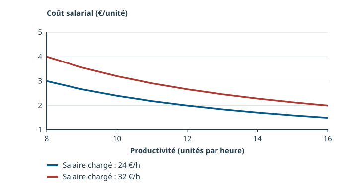

# ENS de Cachan · Analyse monétaire et/ou politique économique 2016 — corrigé brut

*Corrigé rédigé par IA, non officiel. Signalez toute erreur.*

**Rédaction** · GPT-6.2 Astra Ultra · vitesse non renseignée · 26 novembre 2026

## Sujet

Les politiques de l’emploi peuvent-elles nuire à l’attractivité des territoires ?

## Dissertation

Une entreprise qui s’implante dans un bassin d’emploi peut rechercher des exonérations de cotisations ; elle peut aussi chercher précisément les ouvriers qualifiés dont la formation a été financée par des prélèvements. Le même territoire apparaît ainsi comme un lieu où des obligations sont imposées et comme un milieu productif dont les entreprises tirent parti. Les politiques de l’emploi comprennent l’indemnisation du chômage, l’accompagnement des demandeurs, les aides à l’embauche, la formation et les règles qui organisent les relations de travail. L’attractivité est la capacité d’un territoire à attirer et retenir des activités, des investissements et des travailleurs. Elle ne se confond ni avec le seul nombre d’emplois existants ni avec le bien-être de ses habitants. Dans quelles conditions une mesure destinée à protéger ou à créer des emplois peut-elle détourner les implantations, et quand peut-elle au contraire rendre une localisation plus productive ?

### I. Une mesure favorable à des travailleurs en place peut décourager une implantation

Pour une entreprise dont les produits s’échangent à un prix international, une augmentation durable du coût employeur peut réduire la marge espérée sur un nouvel établissement. Si la productivité et l’infrastructure sont comparables entre deux sites et si la production peut aisément être transférée, une hausse de cotisations non compensée peut déplacer le projet. L’incidence réelle dépend toutefois de l’ajustement du salaire négocié, des prix et des marges. Un prélèvement juridiquement payé par l’entreprise ne se traduit pas toujours par la même hausse de son coût à long terme. Les services qui doivent être produits auprès de la clientèle sont aussi moins mobiles qu’un équipement industriel destiné à exporter.

La réglementation peut agir par le risque associé à l’embauche. Pour une entreprise confrontée à une demande incertaine, des coûts de séparation mal prévisibles rendent une implantation avec de nombreux salariés plus difficile à engager. Elle peut choisir de sous-traiter, d’automatiser ou de limiter son effectif, sans pour autant déménager. Des protections très différentes entre contrats stables et temporaires peuvent concentrer les ajustements sur les nouveaux entrants et compromettre la formation de certains jeunes. Mais une règle claire peut aussi réduire l’incertitude par rapport à une situation où les conflits sont plus fréquents et leur issue opaque. Il faut donc distinguer le niveau de protection, sa prévisibilité et la capacité à la mettre effectivement en œuvre.

Une politique passive d’indemnisation peut relever le salaire de réservation et prolonger certaines recherches. Une entreprise qui ne parvient pas à recruter localement à son salaire proposé peut préférer un autre bassin. Toutefois, une recherche plus longue peut éviter une embauche très vite rompue : le nombre de sorties immédiates du chômage ne mesure pas la qualité de l’appariement. Les difficultés d’embauche observées dans un secteur peuvent aussi venir de ses horaires ou d’un manque de logements accessibles. Il serait hasardeux d’attribuer toute vacance de poste au montant de l’allocation.

### II. Les politiques de l’emploi peuvent augmenter la productivité et réduire les risques de localisation

Une société qui choisit entre sites compare ce qu’il lui en coûte de produire une unité répondant à ses normes. Le coût horaire ne règle pas cette question à lui seul. Dans l’exemple de la figure, un territoire où le coût horaire atteint 32 € peut demeurer compétitif si les compétences et l’organisation permettent de réaliser seize unités par heure. Au coût de 24 € dans un site qui n’en réalise que huit, chaque unité demande davantage de dépenses de travail. L’écart de productivité est une hypothèse illustrative ; sa réalisation dépend de la formation et de son adaptation aux postes.

La formation peut corriger un défaut de coordination. Une entreprise hésite à financer une qualification transférable si un concurrent peut recruter le salarié une fois formé ; un travailleur hésite à investir dans une compétence très spécialisée lorsque l’emploi local paraît incertain. Un programme d’apprentissage associant entreprises, établissements d’enseignement et employeurs locaux peut rendre ces investissements complémentaires. La disponibilité d’une main-d’œuvre formée attire alors des activités voisines. Un service de placement qui connaît les spécialités locales, évalue les compétences et réduit le temps de vacance facilite aussi les changements d’emploi. Encore faut-il que les qualifications acquises restent utilisables au-delà d’un employeur particulier, sous peine d’enfermer le bassin dans une spécialisation fragile.

Le territoire doit également attirer les personnes qui peuvent y travailler. Une assurance chômage qui couvre une partie du revenu pendant une transition, des droits transférables et une offre de reconversion réduisent le risque individuel d’accepter un poste dans une industrie nouvelle. Le modèle danois souvent désigné par flexicurité associe précisément facilité d’ajustement, protection du revenu et politiques actives. Sa cohérence repose sur le financement et le fonctionnement de ces institutions ensemble ; importer un seul dispositif ne reproduirait pas les mêmes arbitrages. En récession, l’activité partielle peut aussi préserver des relations productives coûteuses à reconstruire. Si la baisse de commandes est temporaire, l’entreprise peut redémarrer rapidement avec une équipe opérationnelle. Si la demande disparaît durablement, le maintien prolongé de cette aide retarde la reconversion.

### III. Le verdict change selon l’échelle retenue et la manière de mesurer le gain

Une exonération ciblée dans un quartier peut attirer un établissement en abaissant le coût initial d’embauche. Elle peut aussi bénéficier à une entreprise qui aurait choisi le site de toute façon, ou déplacer une activité depuis la rue située de l’autre côté de la frontière du zonage. Les zones franches urbaines françaises illustrent la nécessité de distinguer implantation dans la zone et emploi supplémentaire pour les résidents : des travailleurs peuvent habiter ailleurs et venir travailler dans la zone. Les propriétaires fonciers peuvent aussi capter une partie de l’avantage si les loyers augmentent. Pour juger la politique il faut identifier les bénéficiaires ultimes et compter les pertes éventuelles chez les voisins.

À l’échelle nationale, une compétition généralisée entre collectivités par les subventions peut redistribuer les implantations sans augmenter sensiblement leur nombre. Les ressources fiscales qu’elle mobilise auraient pu financer transports, écoles techniques ou accompagnement des chômeurs. Une politique qui assure l’accès de plusieurs zones au même pôle d’emploi par les transports peut au contraire élargir le marché du travail et profiter à tous les employeurs du pôle. Comparer les effets nets implique de mesurer les solutions disponibles si les fonds n’avaient pas été affectés au dispositif observé.

Les politiques de l’emploi peuvent donc nuire à l’attractivité lorsqu’elles imposent un coût ou une incertitude sans améliorer l’utilisation du travail, ou lorsqu’elles cherchent à retenir durablement une activité qui n’a plus de débouchés. Elles peuvent aussi créer les compétences, les mobilités et la sécurité qui rendent l’investissement possible. Le bon critère est la capacité durable d’un tissu productif à offrir des emplois aux habitants et à accueillir de nouvelles activités, compte tenu des effets sur les territoires proches et du coût des ressources publiques mobilisées.

## Sources

[Sujet officiel](https://ens-paris-saclay.fr/sites/default/files/CONCOURS/ANNALES_1C/1C_D2_1/2016_Sujet_1A_D2-1_Analyse-Monetaire.pdf)
