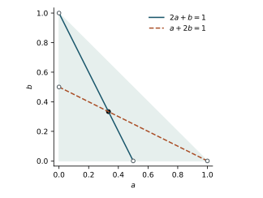

# ENS Cachan–ENSAI · Économie et gestion D2 · Mathématiques et statistiques 2016 · Corrigé guidé

*Corrigé rédigé par IA, non officiel. Signalez toute erreur.*

**Rédaction** · GPT-6.2 Astra Ultra · vitesse non renseignée

**Révision (tour 1)** · GPT-6.2 Astra Ultra · vitesse non renseignée

Le sujet C1692 comporte trois problèmes indépendants. La notation des probabilités avec une barre oblique dans le fascicule est transcrite par une barre conditionnelle. Le graphique demandé en III.4 superpose les deux familles de paramètres admissibles.

## Problème 1 · Composition de deux applications linéaires

### Question I.1

> [!INDICATION]
> Lire sur les deux coordonnées les coefficients de chaque variable d’entrée.

#### Solution

Les trois colonnes de $H$ sont les images des trois vecteurs de la base canonique par $u$. Elles donnent $H=\begin{pmatrix}2&0&-1\\3&1&2\end{pmatrix}$.

### Question I.2

> [!INDICATION]
> Chaque colonne est cette fois un vecteur de dimension trois.

#### Solution

Les images par $v$ de $(1,0)$ et $(0,1)$ sont respectivement $(1,0,2)$ et $(1,-1,-1)$. Donc $K=\begin{pmatrix}1&1\\0&-1\\2&-1\end{pmatrix}$.

### Question I.3

> [!INDICATION]
> Résoudre les deux équations en laissant la première coordonnée libre.

#### Solution

De $2z_1-z_3=0$ puis $3z_1+z_2+2z_3=0$ on tire $z_3=2z_1$ et $z_2=-7z_1$. Ainsi $\ker u=\mathbb R(1,-7,2)$ est une droite et $u$ n’est pas injective.

### Question I.4

> [!INDICATION]
> Déterminer le rang après le calcul du noyau.

#### Solution

Le théorème du rang donne $\dim\operatorname{Im}u=3-1=2$. Comme l’espace d’arrivée est $\mathbb R^2$, l’image est tout cet espace. L’application est surjective.

### Question I.5

> [!INDICATION]
> Respecter l’ordre de composition et la taille finale du produit.

#### Solution

Le produit représentant $u\circ v$ est $HK=\begin{pmatrix}2-2&2+1\\3+4&3-1-2\end{pmatrix}=\begin{pmatrix}0&3\\7&0\end{pmatrix}$.

### Question I.6

> [!INDICATION]
> Observer où envoie deux fois la matrice chacun des deux vecteurs canoniques.

#### Solution

On calcule $(HK)^2=\begin{pmatrix}21&0\\0&21\end{pmatrix}=21I_2$. Le scalaire demandé est $\lambda=21$.

### Question I.7

> [!INDICATION]
> Déduire directement un inverse bilatère de la relation quadratique.

#### Solution

Puisque $21\ne0$, $HK$ multiplié par $(HK)/21$ donne $I_2$ dans les deux ordres. Ainsi $HK$ est inversible avec cet inverse.

### Question I.8

> [!INDICATION]
> Traduire la matrice obtenue dans le langage des applications.

#### Solution

La matrice de $(u\circ v)^2$ est $(HK)^2$. C’est donc l’homothétie de rapport $21$ sur $\mathbb R^2$, qui envoie $(x,y)$ sur $(21x,21y)$.

## Problème 2 · Extrema sur le cercle unité

### Question II.1

> [!INDICATION]
> Choisir un signe du multiplicateur et le garder dans tout le problème.

#### Solution

Avec $g(x,y)=x^2+y^2-1$, prenons $L(x,y,\mu)=x^3+y^3-\mu(x^2+y^2-1)$. Le programme cherche les extrema de $f=x^3+y^3$ sous $g=0$.

### Question II.2

> [!INDICATION]
> Vérifier que la contrainte a un gradient non nul sur son ensemble de niveau.

#### Solution

La qualification demande $\nabla g=(2x,2y)\ne(0,0)$ en tout point admissible. C’est le cas car $x^2+y^2=1$.

### Question II.3

> [!INDICATION]
> Factoriser les deux premières équations pour conserver les cas de coordonnées nulles.

#### Solution

Le gradient dans l’ordre $(x,y,\mu)$ est $(x(3x-2\mu),y(3y-2\mu),1-x^2-y^2)$. On impose sa nullité pour obtenir les points critiques contraints.

### Question II.4

> [!INDICATION]
> Chercher les coordonnées possibles pour un multiplicateur positif de valeur $3/2$.

#### Solution

Pour $\mu=3/2$, chaque coordonnée vaut zéro ou un. La contrainte impose exactement une coordonnée égale à un. D’où $(1,0)$ et $(0,1)$.

### Question II.5

> [!INDICATION]
> Reprendre le même argument avec un multiplicateur opposé.

#### Solution

Pour $\mu=-3/2$, chaque coordonnée vaut zéro ou moins un. On obtient $(-1,0)$ et $(0,-1)$.

### Question II.6

> [!INDICATION]
> Lorsque les deux coordonnées sont non nulles elles coïncident.

#### Solution

Avec $xy\ne0$, les équations donnent $x=y=2\mu/3$. En posant $a=1/\sqrt2$, la contrainte impose $(a,a)$ et $(-a,-a)$, de multiplicateurs respectifs $3a/2$ et $-3a/2$. Les points des deux axes ont déjà tous été traités.

### Question II.7

> [!INDICATION]
> Border la Hessienne en $(x,y)$ par les dérivées de la contrainte.

#### Solution

Dans l’ordre $(\mu,x,y)$, la Hessienne de $L$ est
$$H_b=\begin{pmatrix}0&-2x&-2y\\-2x&6x-2\mu&0\\-2y&0&6y-2\mu\end{pmatrix}.$$
La convention consistant à border par $+\nabla g$ change le signe de la première ligne et de la première colonne, sans changer le déterminant.

### Question II.8

> [!INDICATION]
> Évaluer le second ordre sur la droite tangente au cercle.

#### Solution

En un point critique, le vecteur tangent unitaire $v=(-y,x)$ donne la dérivée seconde le long du cercle, $D=(6x-2\mu)y^2+(6y-2\mu)x^2$. En effet, en dérivant deux fois $f$ le long d’une paramétrisation du cercle, la relation $\nabla f=\mu\nabla g$ élimine la dérivée seconde de la paramétrisation et donne cette Hessienne restreinte. Aux points $(-1,0)$ et $(0,-1)$, $D=3>0$. Au point $(a,a)$, $D=3a>0$. Ce sont trois minima locaux stricts. Les deux premiers ont valeur $-1$ et le dernier valeur $a$.

### Question II.9

> [!INDICATION]
> Examiner les trois points opposés aux minima.

#### Solution

Aux points $(1,0)$ et $(0,1)$, $D=-3<0$. Au point $(-a,-a)$, $D=-3a<0$. Ce sont trois maxima locaux stricts, de valeurs $1,1,-a$. La qualification et la liste complète de II.4–6 excluent tout autre extremum local.

## Problème 3 · Variables indicatrices et estimateurs

### Question III.1

> [!INDICATION]
> Multiplier chaque valeur de $X$ par la masse correspondante.

#### Solution

La loi donne $\mathbb E X=a-b$. Le paramètre restant $1-a-b$ est la probabilité de la valeur zéro.

### Question III.2a

> [!INDICATION]
> Le carré ne conserve que le fait d’être non nul.

#### Solution

La variable $Y=X^2$ vaut un avec probabilité $a+b$ et zéro avec probabilité $1-a-b$. C’est une loi de Bernoulli de paramètre $a+b$.

### Question III.2b

> [!INDICATION]
> Utiliser directement la loi de Bernoulli.

#### Solution

On obtient $\mathbb E Y=1(a+b)+0(1-a-b)=a+b$.

### Question III.2c

> [!INDICATION]
> Exprimer le second moment de $X$ par la variable précédente.

#### Solution

Par $Y=X^2$, $\operatorname{Var}(X)=\mathbb E Y-(\mathbb E X)^2=a+b-(a-b)^2$.

### Question III.2d

> [!INDICATION]
> Exploiter le fait que $Y^2=Y$.

#### Solution

On obtient $\operatorname{Var}(Y)=a+b-(a+b)^2=(a+b)(1-a-b)$.

### Question III.2e

> [!INDICATION]
> Évaluer le demi-somme pour les trois valeurs possibles de $X$.

#### Solution

On a $P=(X^2+X)/2=\mathbf1_{\{X=1\}}$, de loi de Bernoulli de paramètre $a$.

### Question III.2f

> [!INDICATION]
> Faire de même avec la demi-différence.

#### Solution

De $M=(X^2-X)/2=\mathbf1_{\{X=-1\}}$ il résulte que $M$ a la loi de Bernoulli de paramètre $b$.

### Question III.3a

> [!INDICATION]
> Diviser la masse de l’intersection par celle du conditionnement.

#### Solution

L’événement $X=1$ est inclus dans $Y=1$, qui a probabilité $a+b>0$. Donc $\mathbb P(X=1\mid Y=1)=a/(a+b)$.

### Question III.3b

> [!INDICATION]
> Inverser le conditionnement change le dénominateur.

#### Solution

Puisque $X=1$ impose $Y=1$ et que $a>0$, $\mathbb P(Y=1\mid X=1)=1$.

### Question III.3c

> [!INDICATION]
> Les deux indicatrices ne peuvent valoir un simultanément.

#### Solution

Elles sont égales exactement lorsqu’elles sont toutes deux nulles, soit lorsque $X=0$. On obtient $\mathbb P(P=M)=1-a-b$.

### Question III.3d

> [!INDICATION]
> Examiner le produit des deux indicatrices complémentaires de signe.

#### Solution

Les variables $P$ et $M$ sont les indicatrices des événements $X=1$ et $X=-1$, qui sont incompatibles. Ainsi $PM=0$ à chaque issue et la probabilité demandée vaut un.

### Question III.4a

> [!INDICATION]
> Écrire les deux probabilités comme fractions avant de résoudre dans le triangle admissible.

#### Solution

Comme $P=0$ signifie $X\ne1$, $\mathbb P(X=0\mid P=0)=(1-a-b)/(1-a)$. La première équation devient $a(1-a)=(a+b)(1-a-b)$, soit $b(1-2a-b)=0$. Avec $b>0$, la solution est $b=1-2a$, $0<a<1/2$. Cette portion de droite est représentée avec l’autre famille en III.4b.

### Question III.4b

> [!INDICATION]
> Échanger les rôles des deux signes.

#### Solution

L’équation est $b/(a+b)=(1-a-b)/(1-b)$, équivalente à $a(1-a-2b)=0$. Comme $a>0$, ses solutions sont $a=1-2b$, $0<b<1/2$. Les extrémités des deux segments sont exclues par les hypothèses.

### Question III.4c

> [!INDICATION]
> Résoudre simultanément les deux équations affines.

#### Solution

Le système $2a+b=1$, $a+2b=1$ donne en soustrayant $a=b$, puis $a=b=1/3$. Ce point vérifie $a+b=2/3<1$. C’est l’unique solution commune.

### Question III.5a

> [!INDICATION]
> Réécrire la somme sous la forme d’un comptage.

#### Solution

Par III.2e, $S_P=\sum_{i=1}^n\mathbf1_{\{X_i=1\}}$. Chaque tirage égal à un ajoute exactement une unité, les autres n’en ajoutent aucune.

### Question III.5b

> [!INDICATION]
> Préciser l’origine de l’indépendance des indicatrices.

#### Solution

Les $P_i$ sont les images respectives des $X_i$ indépendantes par une même fonction. Elles sont indépendantes et de loi de Bernoulli de paramètre $a$. Donc $S_P\sim\mathcal B(n,a)$.

### Question III.5c

> [!INDICATION]
> Diviser une somme binomiale par la taille de l’échantillon.

#### Solution

De $\mathbb E S_P=na$ et $\operatorname{Var}(S_P)=na(1-a)$, on tire $\mathbb E\widehat a_1=a$ et $\operatorname{Var}(\widehat a_1)=a(1-a)/n$.

### Question III.6a

> [!INDICATION]
> Imposer l’hypothèse supplémentaire dans l’inégalité initiale.

#### Solution

Si $a=b$, la condition $a+b<1$ devient $2a<1$. Ainsi $0<a<1/2$.

### Question III.6b.i

> [!INDICATION]
> Interpréter l’autre fréquence observée à l’aide de $b=a$.

#### Solution

Le compteur $S_M$ enregistre les occurrences de $X_i=-1$, chacune de probabilité $b=a$. Leur fréquence empirique $\widehat a_0=S_M/n$ estime donc le même paramètre et converge vers lui par la loi des grands nombres.

### Question III.6b.ii

> [!INDICATION]
> Appliquer à $S_M$ la même loi qu’à $S_P$.

#### Solution

Comme $S_M\sim\mathcal B(n,a)$, $\mathbb E\widehat a_0=a$ et $\operatorname{Var}(\widehat a_0)=a(1-a)/n$.

### Question III.6c.i

> [!INDICATION]
> Tenir compte de la dépendance des deux fréquences sur le même échantillon.

#### Solution

Par linéarité, $\mathbb E\widehat a_t=a$. Pour un même indice, $P_iM_i=0$, donc $\operatorname{Cov}(P_i,M_i)=-a^2$. Pour des indices différents la covariance est nulle par indépendance. Ainsi $\operatorname{Cov}(\widehat a_1,\widehat a_0)=-a^2/n$ et
$$\operatorname{Var}(\widehat a_t)=\frac{a(1-a)(t^2+(1-t)^2)-2a^2t(1-t)}{n}=\frac{a(1-a)-2at(1-t)}{n}.$$

### Question III.6c.ii

> [!INDICATION]
> Maximiser le produit $t(1-t)$ sur l’intervalle ouvert.

#### Solution

Puisque $a>0$, la variance est minimale au maximum de $t(1-t)=1/4-(t-1/2)^2$. L’unique optimum est $t^*=1/2$.

### Question III.6d

> [!INDICATION]
> Comparer les variances de ces estimateurs sans biais.

#### Solution

La variance de $\widehat a_{1/2}$ vaut $a(1-2a)/(2n)$, inférieure de $a/(2n)>0$ à celle des deux fréquences seules. Tous sont sans biais, donc $\widehat a_{1/2}$ a la plus petite erreur quadratique moyenne des trois.

### Question III.6e

> [!INDICATION]
> Additionner les indicatrices des deux signes pour chaque tirage.

#### Solution

On a $P_i+M_i=Y_i$. Par suite $\widehat a_{t^*}=(S_P+S_M)/(2n)=(2n)^{-1}\sum_{i=1}^nY_i$. La variable $\sum_iY_i$ compte les observations non nulles. Elle suit $\mathcal B(n,2a)$ lorsque $a=b$. Cette loi donne directement $\operatorname{Var}(\widehat a_{t^*})=n(2a)(1-2a)/(4n^2)=a(1-2a)/(2n)$, conformément au calcul par covariance.
