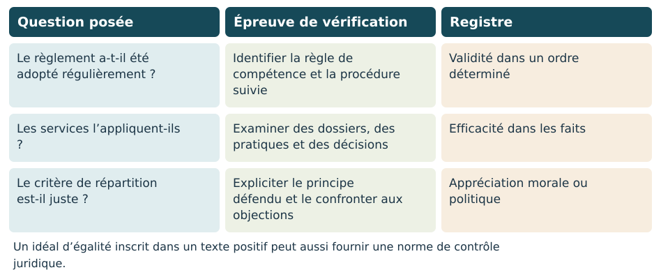

# ENS-PSL · Sélection internationale Lettres — Droit — Kelsen et l’État (oral) 2016 · Corrigé brut

*Corrigé rédigé par IA, non officiel. Signalez toute erreur.*

**Lecture du rapport du jury** · GPT-6.2 Astra Ultra · vitesse non renseignée

**Rédaction** · GPT-6.2 Astra Ultra · vitesse non renseignée

**Autocontrôle** · GPT-6.2 Astra Ultra · vitesse non renseignée

## Commentaire oral proposé

Deux personnes peuvent parfaitement s’accorder sur le contenu d’un règlement et s’opposer sur sa justice. Comment expliquer la possibilité de ce double jugement ? Dans l’extrait de la *Théorie générale du droit et de l’État* publié en 1945, Kelsen délimite le travail du juriste. Il part de l’unité du droit positif valable pour un territoire, distingue les opérations qui établissent des valeurs juridiques ou des valeurs de justice, puis tire une conclusion sur les propositions recevables dans une science du droit. Cette conclusion porte sur la connaissance que l’on peut produire, sans résoudre à la place des citoyens la question du juste.

### 1. Déterminer de quel ordre dépend le jugement

La première phrase anticipe une objection. Comment parler d’un droit positif alors que plusieurs États ont des règles différentes ? Kelsen précise immédiatement le champ de validité territorial. Deux ordres peuvent qualifier différemment le même type d’acte. Dès lors que la question posée concerne un ordre déterminé, on peut rechercher la règle qui y vaut. Cette unité est un principe de reconstruction. Dans un État fédéral, plusieurs législateurs interviennent sur un même territoire, mais leurs compétences et les procédures de résolution de leurs conflits peuvent être rapportées à des règles communes.

Que signifie alors « méthode objective » ? Supposons qu’un conseil décide d’attribuer une aide aux résidents d’une commune. Pour établir la portée juridique de cette décision, il faut retrouver sa délibération, le texte qui confère au conseil sa compétence, les règles de procédure et les formalités requises pour que l’acte puisse produire effet. L’événement matériel qu’est un vote prend le sens d’une création de droit dans un cadre déjà normatif. Une assemblée privée pourrait prononcer exactement les mêmes mots. Le simple enregistrement sonore ne suffirait pas à établir la même obligation. L’observabilité de faits intervient dans le raisonnement juridique sans permettre de déduire une prescription d’un fait brut.

### 2. Comparer deux opérations de jugement

Pour dire qu’une demande d’aide satisfait à une condition de résidence établie par le règlement, on dispose d’un critère déterminé et l’on peut confronter les pièces du dossier à ce critère. On formule un jugement de valeur juridique relatif à une norme. Il reste possible de contester l’interprétation de « résidence » ou la pertinence de telle preuve. Le caractère objectif revendiqué tient à la possibilité de discuter les raisons à partir de règles et d’actes identifiables.

Pour dire que réserver l’aide aux résidents est juste, un pas supplémentaire est nécessaire. Quel principe doit prévaloir entre proximité, égalité entre demandeurs et priorité aux plus démunis ? Une enquête peut établir que neuf habitants sur dix approuvent la préférence locale. Elle vérifie alors un fait sur les opinions des habitants. Elle ne transforme pas leur préférence en étalon universel de justice. Le caractère « subjectif » du jugement vise ce défaut de vérification objective de la valeur ultime. Il laisse entière la possibilité d’expliciter une valeur, d’en discuter les conséquences et de montrer des contradictions chez ceux qui prétendent la suivre.

### 3. Où passe la frontière quand le droit lui-même fait appel à la justice ?

Kelsen conclut que la science du droit admet les jugements dont la vérification repose sur la réalité positive de l’ordre étudié. Décrire l’obligation que le règlement impose ne signifie ni la prescrire soi-même ni l’approuver. Inversement, qu’un service applique habituellement un règlement donne une information sur son efficacité. Cette pratique, considérée isolément, laisse ouverte la question de sa validité. L’efficacité générale de l’ordre et la conformité de chaque acte à ses conditions juridiques relèvent de niveaux différents.

L’objection la plus forte surgit quand une norme supérieure positive exige l’égalité. Le juge doit alors examiner une différence de traitement, le but poursuivi et le rapport entre les deux. En contrôlant le règlement communal au regard de cette norme, il examine bien une question de droit positif, même si le mot « égalité » appartient aussi au vocabulaire moral. Le texte et les précédents peuvent laisser plusieurs interprétations défendables. Le juriste peut en décrire les raisons et observer la solution retenue par l’organe compétent. Prétendre démontrer par les mêmes pièces que cette solution réalise la seule justice véritable irait au-delà de ce qu’elles établissent. L’objection précise ainsi la portée de la frontière et la difficulté concrète de son tracé.

L’extrait explique comment on peut constater la validité d’une règle tout en en demandant la réforme. Il protège simultanément l’exactitude de la description et la responsabilité de celui qui critique. Pour contester une décision, il faut donc annoncer à quel titre on le fait, en alléguant une incompétence, en constatant un défaut d’application ou en défendant un autre principe de justice.
