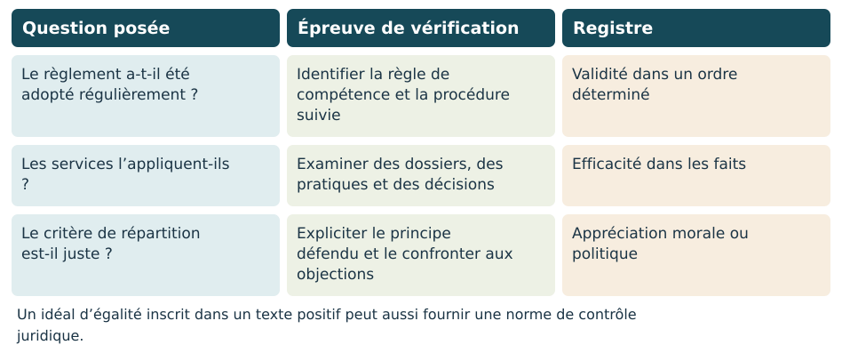

# ENS-PSL · Sélection internationale Lettres — Droit — Kelsen et l’État (oral) 2016 · Corrigé guidé

*Corrigé rédigé par IA, non officiel. Signalez toute erreur.*

**Lecture du rapport du jury** · GPT-6.2 Astra Ultra · vitesse non renseignée

**Rédaction** · GPT-6.2 Astra Ultra · vitesse non renseignée

**Autocontrôle** · GPT-6.2 Astra Ultra · vitesse non renseignée

## Préparer un commentaire de l’extrait de 1945

Sur la feuille, le titre de l’ouvrage nomme le droit et l’État. La question précise est donnée par la dernière phrase du passage, qui exclut certains jugements du domaine de la science du droit. Remonter de cette phrase aux raisons que l’auteur vient de donner. Le rapport disciplinaire de 2016 décrit l’oral comme un commentaire de texte et recommande la fréquentation des classiques de la pensée juridique. Son développement sur la justice administrative concerne l’écrit de la même session.

### Lire les articulations à voix haute

« Pour chaque territoire » corrige d’abord l’impression d’unicité absolue. Une disposition vaut dans un ordre auquel elle appartient. On peut demander à qui revient une compétence en droit français ou en droit allemand et comparer ensuite les réponses. La comparaison présuppose que l’on a identifié les deux droits. La formule ne suffit pas à résoudre tous les conflits de compétence et d’application dans l’espace. On peut la commenter en prenant l’exemple fédéral et en cherchant ce qui relie les normes de niveaux différents.

Relever ensuite le passage des « faits objectivement vérifiables » aux deux espèces de valeur. Imaginons qu’un écriteau indique une interdiction de stationner. Un agent municipal a pu exécuter une décision régulièrement prise ou un particulier peut avoir placé un panneau pour dégager sa porte. Dans les deux cas, l’automobiliste aperçoit les mêmes mots. Le juriste vérifie l’existence et le contenu de l’acte ainsi que l’habilitation de son auteur. Cette comparaison rend visible le présupposé normatif du raisonnement. La règle qui confère une compétence permet d’interpréter des événements observables comme créateurs de droit.

L’exemple des « nombreuses personnes » permet de construire le troisième moment. Un sondage unanime sur la justice d’une sanction serait un résultat objectif sur des opinions. Pour conclure que la sanction est juste, il faudrait adopter le principe supplémentaire selon lequel l’accord collectif définit la justice. Le sondage ne peut justifier lui-même ce principe. C’est ce déplacement entre deux questions que la conclusion méthodologique de Kelsen rend explicite.

### Transformer un cas difficile en discussion

Un règlement communal réserve une aide aux résidents. Préparer successivement trois réponses. Pour sa validité, examiner la compétence, la procédure et les normes supérieures applicables. Pour son efficacité, examiner les décisions d’attribution, y compris les écarts éventuels à la règle. Pour sa justice, expliquer quel poids on donne à l’urgence du besoin ou à l’appartenance locale. Un règlement peut avoir été pris régulièrement, être rarement appliqué et paraître injuste aux demandeurs exclus. Les réponses sont compatibles car elles n’ont pas le même objet.

Supposons maintenant que la Constitution garantisse l’égalité. La critique d’une différence de traitement reçoit alors un fondement positif. Il reste à rechercher comment le juge interprète l’exigence, quelles différences de situation il retient et quelle marge il laisse à l’autorité locale. Une controverse d’interprétation rend la connaissance plus difficile, mais ses parties disposent de raisons juridiques discutables publiquement. Le fait qu’un tribunal tranche confère à sa décision la portée prévue par l’ordre en cause. Il ne démontre aucune supériorité morale absolue de sa conception du juste.

### Relances possibles et réponses courtes

**Une règle très injuste oblige-t-elle moralement à obéir ?** La question déborde celle de la validité. Dire qu’une règle appartient à l’ordre étudié ne tranche pas le devoir moral de lui obéir. Un citoyen peut contester son contenu, demander son abrogation ou, si une norme supérieure le permet, sa censure.

**Une règle que personne ne respecte disparaît-elle ?** Distinguer efficacité d’une norme, conditions positives de son abrogation ou de sa désuétude, et efficacité globale de l’ordre. Un cas de désobéissance établit un fait. Il ne suffit pas à ôter sa validité à la règle transgressée.

**Le juriste peut-il prendre parti ?** Il peut défendre une réforme et indiquer les valeurs qu’il privilégie. Quand il décrit le droit applicable, il doit justifier cette autre opération par ses sources. Conclure en reprenant le mouvement de l’extrait, depuis la détermination de l’ordre de référence jusqu’à la délimitation des énoncés de la science du droit.
