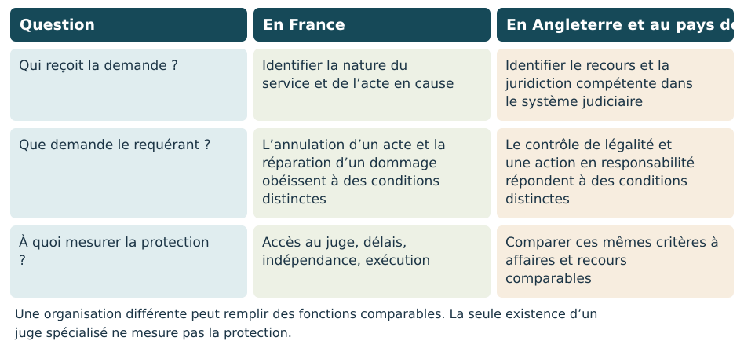

# ENS-PSL · Sélection internationale Lettres — Droit — la justice administrative 2016 · Corrigé brut

*Corrigé rédigé par IA, non officiel. Signalez toute erreur.*

**Lecture du rapport du jury** · GPT-6.2 Astra Ultra · vitesse non renseignée

**Rédaction** · GPT-6.2 Astra Ultra · vitesse non renseignée

**Autocontrôle** · GPT-6.2 Astra Ultra · vitesse non renseignée

## Question 1 — Comment une justice administrative séparée apparaît-elle ?

La France révolutionnaire a d’abord séparé fonctions administratives et judiciaires pour garantir l’action de la nouvelle administration contre l’intervention des tribunaux. Les lois des 16 et 24 août 1790 interdisent aux juges de troubler les opérations des corps administratifs. Le souvenir de l’intervention des parlements d’Ancien Régime compte ici autant qu’une théorie abstraite de la séparation des pouvoirs. Écarter le juge ordinaire ne revient toutefois pas encore à donner au citoyen un juge administratif indépendant. Pendant une phase décisive, l’administration tranche elle-même les réclamations qui la visent.

Le Conseil d’État institué en 1799 et les conseils de préfecture créés en 1800 participent à la spécialisation du contentieux. La loi du 24 mai 1872 donne au Conseil d’État le pouvoir de statuer souverainement en matière contentieuse, en son propre nom juridictionnel, là où la justice était auparavant retenue par le chef de l’État. En 1889, l’arrêt *Cadot* marque l’abandon de la théorie du ministre-juge. La trajectoire se comprend ainsi comme la juridictionnalisation progressive de mécanismes initialement installés pour tenir à distance le juge judiciaire. La croissance des services publics et la technicité de leurs actes donnent à cette justice un domaine et des savoir-faire durables. Ailleurs, une administration puissante peut également appeler un contrôle spécialisé, sans reproduire la même organisation ni la même chronologie.

## Question 2 — Que vaut la distinction entre les deux familles de systèmes ?

Il faut séparer trois critères. Existe-t-il des règles propres à l’action publique ? Les contentieux sont-ils traités par des juges spécialisés ? Ces juges forment-ils un ordre distinct jusqu’au sommet ? La France répond largement oui aux trois questions, avec des frontières parfois délicates. En Angleterre et au pays de Galles, l’Administrative Court appartient à la High Court et traite notamment des recours de *judicial review*. On peut donc organiser un contrôle juridictionnel spécialisé de l’administration à l’intérieur du système judiciaire. En sens inverse, en France, le juge judiciaire connaît de certains litiges intéressant l’administration, notamment ceux qui opposent en principe un service public industriel et commercial à ses usagers.

Opposer « droit civil » et « common law » confondrait des traditions de production et de raisonnement juridiques avec l’architecture des voies de recours. Le développement jurisprudentiel du droit administratif français suffit déjà à rendre trompeuse l’image d’un système entièrement déductible des codes. La comparaison institutionnelle renseigne davantage sur la construction des États. Le rôle attribué à l’exécutif, l’histoire des relations entre juges et gouvernement, puis l’extension des garanties accessibles aux administrés expliquent pourquoi un même besoin de contrôle a emprunté des voies différentes.

## Question 3 — Quels bénéfices et quels coûts, et comment les mesurer ?

La spécialisation peut rendre le contrôle des procédures et des obligations de service public plus précis. La continuité d’une jurisprudence facilite l’orientation des autorités et des requérants. Mais la détermination du bon ordre juridictionnel a un coût. Un justiciable peut perdre du temps après une erreur d’aiguillage. Le Tribunal des conflits aide à prévenir ou résoudre les conflits de compétence. La proximité historique entre juridiction et administration suscite aussi une question d’indépendance, à examiner à travers le statut du juge, la composition de la formation et les règles d’impartialité effectivement appliquées.

Pour évaluer ces effets, on comparerait, dans des litiges analogues, le délai complet entre contestation et exécution, le coût relatif du recours pour le requérant, la fréquence des renvois pour incompétence et l’effectivité des mesures d’urgence. Un taux d’annulation élevé peut traduire des administrations mal préparées, une sélection des requêtes les plus solides ou un contrôle exigeant. Il ne classe pas à lui seul les systèmes. On gagnerait à observer une réforme à contentieux comparable et à examiner les dossiers abandonnés avant jugement.

## Question 4 — Quelle relation avec la responsabilité de l’État ?

L’autonomie du droit de la responsabilité et celle du juge se sont historiquement consolidées l’une l’autre en France. Dans *Blanco* (Tribunal des conflits, 1873), une enfant est blessée par un wagonnet d’une manufacture publique. Le conflit de compétence conduit à reconnaître que la responsabilité de l’État du fait des agents employés dans un service public répond à des règles spéciales. La décision attribue le litige à la juridiction administrative et affirme que cette responsabilité varie suivant les besoins du service. Elle ne fixe pas elle-même une indemnité et n’ouvre pas un droit général à réparation de tout dommage.

L’État personne morale peut ainsi devoir réparation indépendamment d’une action personnelle contre un agent déterminé. Selon le régime applicable, il faut établir une faute ou satisfaire aux conditions d’une responsabilité sans faute, par exemple une rupture d’égalité devant les charges publiques. Même dans ce dernier cas, un préjudice indemnisable et un lien causal restent nécessaires. La faute de la victime peut réduire la réparation. Réciproquement, l’absence de deux ordres n’implique aucune immunité générale. Le *Crown Proceedings Act* de 1947 a facilité les actions civiles contre la Couronne au Royaume-Uni, sous des conditions et réserves propres. Le droit à réparation dépend des normes de fond et des garanties du recours, tout autant que de l’identité du juge.
