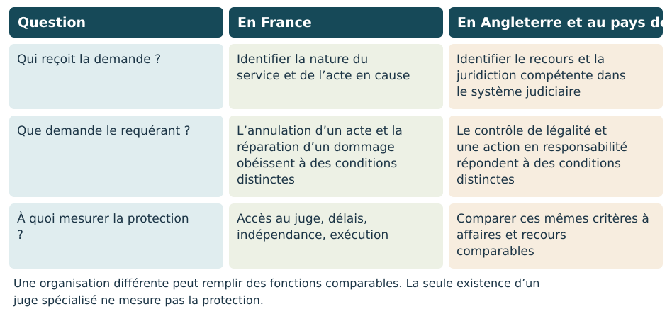

# ENS-PSL · Sélection internationale Lettres — Droit — la justice administrative 2016 · Corrigé guidé

*Corrigé rédigé par IA, non officiel. Signalez toute erreur.*

**Lecture du rapport du jury** · GPT-6.2 Astra Ultra · vitesse non renseignée

**Rédaction** · GPT-6.2 Astra Ultra · vitesse non renseignée

**Autocontrôle** · GPT-6.2 Astra Ultra · vitesse non renseignée

## Question 1 — Construire une explication historique en trois temps

Prendre la place d’un administré en 1790. L’interdiction faite aux tribunaux de perturber l’exercice des fonctions administratives lui indique devant quel juge il ne peut aller. Elle ne lui donne pas, à elle seule, une juridiction indépendante où porter son litige. Ce premier paradoxe explique l’évolution française mieux qu’une liste de dates. Rattacher la séparation à la défiance révolutionnaire envers les anciens parlements et à la protection des opérations administratives.

Demander ensuite qui instruit les affaires et qui signe la décision. Sous la justice retenue, une instance spécialisée peut préparer la solution tandis que la décision demeure formellement celle du chef de l’État. Le Conseil d’État apparaît en 1799, les conseils de préfecture l’année suivante. En 1872, la justice déléguée donne au Conseil d’État le pouvoir de trancher. Avec *Cadot* en 1889, il peut être saisi sans faire du ministre le juge ordinaire de premier ressort. Conclure en distinguant le motif initial d’éloignement du juge judiciaire et la garantie de recours finalement développée.

## Question 2 — Construire une comparaison qui puisse être réfutée

La proposition « les pays de common law ignorent le droit administratif » est facile à mettre à l’épreuve. Une personne conteste la légalité de l’acte d’une autorité en Angleterre et au pays de Galles. Il existe une procédure de *judicial review* et une Administrative Court intégrée à la High Court. Cette seule observation suffit à distinguer droit spécial, formation spécialisée et ordre juridictionnel autonome. La proposition inverse, selon laquelle toute action contre une personne publique en France va devant le juge administratif, échoue elle aussi. Les litiges entre usagers et services publics industriels et commerciaux relèvent en principe du juge judiciaire.

Rédiger la conséquence historique. Pour comprendre un État, suivre l’évolution des rapports entre administration et tribunaux, la manière dont les administrés accèdent au juge et l’étendue de ses pouvoirs. L’étiquette de la tradition juridique fournit du contexte, mais ne prédit pas chacune des réponses. Un candidat peut substituer un exemple qu’il connaît de première main à condition de préciser la juridiction, le recours et l’objet du contrôle.

## Question 3 — Passer des arguments à une enquête comparative

Associer à chaque affirmation une observation possible. « Un juge spécialisé est plus rapide » conduit à comparer la durée entre le recours et la solution effective pour des affaires de même complexité. « Deux ordres découragent les requérants » conduit à compter les réorientations, le coût de la seconde saisine et les abandons. « Le système protège mieux les libertés » appelle l’examen d’urgences concrètes, du délai d’intervention, des pouvoirs d’injonction et de l’exécution.

Un taux brut d’affaires gagnées ne suffit pas. Si un système autorise davantage de recours peu coûteux, des requêtes plus fragiles pourront y être déposées. Son taux de succès pourrait diminuer alors que l’accès s’améliore. Ajouter à la compétence technique du juge les garanties d’impartialité et les règles prévenant un conflit lié à une intervention consultative antérieure dans la même affaire.

## Question 4 — Reconstituer le raisonnement de responsabilité

Prendre l’accident de la manufacture publique examiné dans *Blanco*. Première opération, identifier l’ordre compétent. Deuxième opération, déterminer les règles applicables à la responsabilité du service. Troisième opération, que ne réalise pas le Tribunal des conflits dans cette décision, juger au fond les conditions de la réparation. Cette décomposition évite de transformer un règlement de compétence en attribution automatique de dommages-intérêts.

Introduire ensuite un régime de responsabilité sans faute. Une mesure légalement prise dans l’intérêt général peut, sous des conditions particulières, imposer à une personne une charge spéciale et anormale. Une indemnisation peut tenir à la rupture de l’égalité devant les charges publiques. L’exigence d’un dommage certain et d’un lien causal subsiste et le choix du régime importe. Opposer à l’idée d’une condition nécessaire l’exemple britannique du *Crown Proceedings Act* de 1947. Il illustre une évolution de la responsabilité publique au sein d’un autre système de juridictions. La conclusion répond ainsi aux deux volets de la question, l’histoire d’un lien et ses limites logiques.
