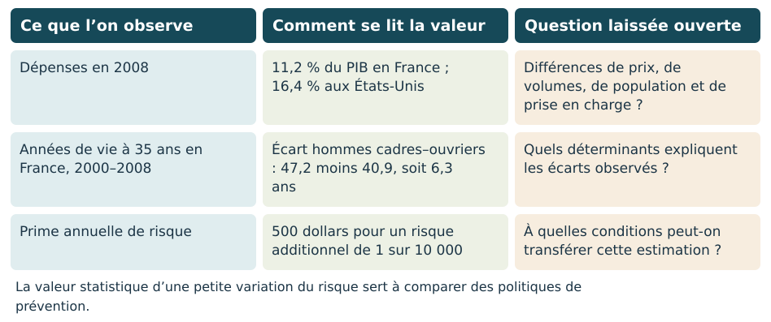

# ENS-PSL · Sélection internationale Lettres — Économie — la santé a-t-elle un prix (oral) 2016 · Corrigé brut

*Corrigé rédigé par IA, non officiel. Signalez toute erreur.*

**Lecture du rapport du jury** · GPT-6.2 Astra Ultra · vitesse non renseignée

**Rédaction** · GPT-6.2 Astra Ultra · vitesse non renseignée

**Autocontrôle** · GPT-6.2 Astra Ultra · vitesse non renseignée

**Révision (tour 2)** · GPT-6.2 Astra Ultra · vitesse non renseignée · 26 novembre 2026

## Exposé proposé — La santé a-t-elle un prix ?

En 2008, d’après le document 1, la dépense de santé représentait 11,2 % du PIB en France et 16,4 % aux États-Unis. Il serait aventureux de déduire de ce rapport que les Américains étaient mieux soignés ou qu’ils accordaient mécaniquement davantage de valeur à la vie. Une dépense additionne prix et quantités, alors que la santé désigne un état dont les soins ne sont qu’un déterminant. Je distinguerai le prix auquel on accède à un soin, la valeur que l’on attribue à une amélioration de santé et les règles qui président à son financement collectif.

### Du prix des soins à la demande de santé

Une consultation mobilise le temps d’un professionnel, un local et du matériel. Son coût de production, le tarif réglé au professionnel et la somme qui reste au patient peuvent différer. Une consultation intégralement remboursée a un coût pour l’assureur, et le patient doit encore y consacrer du temps ou se déplacer. Abaisser son reste à charge peut augmenter le recours aux soins. La réponse dépend de l’urgence, du revenu, de la présence de professionnels et de la qualité de l’information. Une file d’attente peut rationner une prestation même si le prix payé au guichet est nul.

Dans le modèle de capital santé de Grossman, on peut considérer la santé comme un stock qui tend à se déprécier et que des soins, du temps ou des conditions de vie peuvent contribuer à entretenir. Une meilleure santé procure directement du bien-être et rend possibles des journées d’activité. La demande de soins est ainsi en partie dérivée des gains de santé attendus. La personne malade ne choisit ni parfaitement son état initial ni l’efficacité d’un traitement. Les contraintes d’exposition, de logement, de travail et d’accès aux services doivent compléter ce raisonnement individuel.

Le document 2 en donne une illustration. En France, sur la période 2000–2008, les hommes cadres de 35 ans avaient une espérance de vie restante de 47,2 ans, contre 40,9 pour les ouvriers. Cet écart de 6,3 ans concerne des groupes et une période. Il peut faire intervenir des expositions professionnelles, des ressources ou des sélections sociales diverses. Le graphique ne permet pas d’attribuer cet écart à une différence de prix des soins.

### Évaluer une réduction du risque

Un pouvoir public doit parfois choisir entre deux projets de prévention. Dans le document 3, Murphy et Topel illustrent l’estimation d’une valeur statistique de la vie à partir d’une compensation pour une petite variation de risque. Si un travailleur exige 500 dollars supplémentaires par an pour accepter un risque annuel accru de 1 sur 10 000, la compensation agrégée pour 10 000 travailleurs également exposés est de 5 millions de dollars, pour un décès supplémentaire en espérance. Cette valeur marginale éclaire un arbitrage collectif entre coût de prévention et réduction statistique du risque. Elle ne donne aucun droit à fixer une indemnité ou un tarif d’accès à la vie d’une personne identifiée.

L’interprétation suppose que le risque est connu et que l’arbitrage observé peut réellement être choisi. Un travailleur qui a peu d’alternatives ou ignore une exposition risque de recevoir une prime faible sans attacher peu d’importance à sa santé. Les dispositions à payer dépendent du revenu. Les utiliser telles quelles dans un classement de politiques pourrait favoriser les populations les plus aisées. Le profil par âge reproduit au document 3 relève d’une estimation modélisée de la valeur de la vie restante. Une règle d’accès aux soins exige des principes collectifs supplémentaires.

### Qui finance et comment arbitrer ?

L’incertitude sur la maladie rend l’assurance précieuse. Des contributions régulières remplacent pour chacun une dépense rare et potentiellement insupportable. Une mutualisation large limite le risque que les personnes les plus coûteuses soient exclues. La couverture réduit le prix au point d’usage, ce qui peut ouvrir un accès jusque-là empêché mais aussi favoriser des actes de faible bénéfice. Le patient s’en remet en outre à un professionnel mieux informé, dont le mode de rémunération influe sur les actes proposés. Les infections transmissibles fournissent un autre motif d’action collective puisque la prévention d’une personne peut réduire le risque pour les autres.

La collectivité peut évaluer le coût d’une intervention par année de vie en bonne santé gagnée, tout en prenant en compte l’urgence et l’accès équitable. Le prix monétaire des soins, le coût d’opportunité des ressources et la valeur sociale de leur résultat se rencontrent au moment de décider, mais répondent à des questions distinctes. C’est la possibilité d’exposer ces arbitrages, leurs hypothèses et leur répartition qui donne son sens à l’évaluation économique.

## Vérification sur le sujet

Les trois documents ont été relus dans leur version graphique. Les montants et parts de PIB du tableau, les écarts entre catégories à 35 ans et la prime de 500 dollars pour un risque de 1 sur 10 000 concordent avec l’exposé.

Sur le graphique de Murphy et Topel, exprimé en milliers de dollars, les deux profils atteignent leur maximum vers 30 ans puis diminuent. Une ordonnée voisine de 7 000 à cet âge représente environ 7 millions de dollars dans la convention du graphique. Cette estimation de la valeur de la vie restante est distincte de l’exemple de prime salariale qui donne 5 millions. Ce profil modélisé n’établit aucune règle de priorité entre patients.
