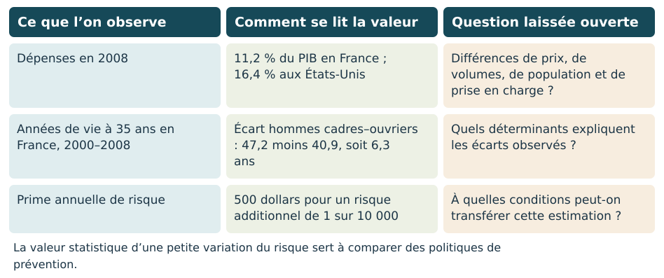

# ENS-PSL · Sélection internationale Lettres — Économie — la santé a-t-elle un prix (oral) 2016 · Corrigé guidé

*Corrigé rédigé par IA, non officiel. Signalez toute erreur.*

**Lecture du rapport du jury** · GPT-6.2 Astra Ultra · vitesse non renseignée

**Rédaction** · GPT-6.2 Astra Ultra · vitesse non renseignée

**Autocontrôle** · GPT-6.2 Astra Ultra · vitesse non renseignée

**Révision (tour 2)** · GPT-6.2 Astra Ultra · vitesse non renseignée · 26 novembre 2026

## Préparer trois phrases d’ouverture avec les documents

**Document 1.** En 2008, la France dépensait 3 371 euros par habitant et les États-Unis 5 227 euros selon le tableau fourni. La somme moyenne par habitant répond à une question différente de la part du PIB. Pour attribuer une dépense élevée à des soins plus nombreux, il faudrait isoler les prix, les besoins selon l’âge et le périmètre des services. Présenter les valeurs comme celles du dossier historique.

**Document 2.** En 2000–2008, les femmes cadres de 35 ans avaient une espérance de vie restante de 51,7 ans, contre 48,7 ans pour les ouvrières. Chez les hommes, les valeurs sont 47,2 et 40,9 ans. Il s’agit d’années à vivre après 35 ans. Ces observations suggèrent des conditions d’accès et d’exposition inégales, sans identifier leur cause. Le jury de 2016 conseille d’en tirer un argument tout en maintenant l’exposé sur le prix et la valeur de la santé.

**Document 3.** Le calcul de Murphy et Topel transforme une compensation observée pour un petit risque en un indicateur de valeur statistique. Donner d’abord l’unité du risque, puis l’unité monétaire. Une prime annuelle de 500 dollars pour une probabilité supplémentaire de 0,0001 donne $500/0{,}0001 = 5\,000\,000$ dollars par décès statistique supplémentaire. Dans l’hypothèse inverse de la prévention, la même logique marginale aide à valoriser une petite réduction du risque. Les dispositions à accepter et à payer peuvent différer en pratique.

### Relier les observations à un mécanisme

Pour expliquer le capital santé, utiliser un exemple quotidien. Si un trajet long ou un horaire incompatible rend une consultation difficile, la suppression du ticket modérateur ne supprime pas le temps qu’il faut y consacrer. Une amélioration de santé accroît en revanche le temps disponible pour apprendre, travailler ou accomplir des activités choisies. Poser la question « Qu’est-ce que l’individu cherche à produire avec des soins et du temps ? » permet de passer de la demande d’actes à celle de santé. L’état de santé dépend aussi de facteurs sur lesquels la personne a peu de prise.

### Préparer les relances de l’oral

**Pourquoi une assurance est-elle utile si son coût moyen inclut des frais ?** Une personne qui redoute une perte rare et importante peut préférer une contribution certaine. Un régime mutualisé partage les risques. Si l’adhésion est facultative et si les personnes à haut risque sont plus susceptibles de souscrire, le prix moyen peut monter et décourager une partie des autres personnes. Une couverture large et des règles d’affiliation modifient ce mécanisme.

**Un prix nul peut-il conduire à trop de soins ?** Certains actes de faible bénéfice deviennent plus attractifs, mais d’autres deviennent enfin accessibles. Pour départager les situations, observer le type d’acte, les gains de santé, les inégalités d’accès et les alternatives disponibles. Un reste à charge uniforme peut décourager une consultation utile chez un ménage modeste.

**Comment choisir entre deux programmes de prévention ?** Construire un scénario de référence pour chacun, calculer les coûts supplémentaires et les diminutions de risques attendues, puis rendre explicite l’incertitude et la population concernée. Une valorisation monétaire ou un rapport coût-efficacité informe ce choix. Une décision sur la priorité aux plus vulnérables demande aussi un critère de justice. Conclure en distinguant le tarif réglé, les ressources sacrifiées et le bénéfice de santé attendu.

## Vérification sur le sujet

Les trois documents ont été relus dans leur version graphique. Les montants et parts de PIB du tableau, les écarts entre catégories à 35 ans et la prime de 500 dollars pour un risque de 1 sur 10 000 concordent avec l’exposé.

Sur le graphique de Murphy et Topel, exprimé en milliers de dollars, les deux profils atteignent leur maximum vers 30 ans puis diminuent. Une ordonnée voisine de 7 000 à cet âge représente environ 7 millions de dollars dans la convention du graphique. Cette estimation de la valeur de la vie restante est distincte de l’exemple de prime salariale qui donne 5 millions. Ce profil modélisé n’établit aucune règle de priorité entre patients.
