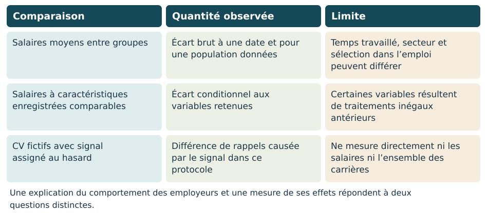

# ENS-PSL · Sélection internationale Lettres — Économie — les discriminations 2016 · Corrigé brut

*Corrigé rédigé par IA, non officiel. Signalez toute erreur.*

**Lecture du rapport du jury** · GPT-6.2 Astra Ultra · vitesse non renseignée

**Rédaction** · GPT-6.2 Astra Ultra · vitesse non renseignée

**Autocontrôle** · GPT-6.2 Astra Ultra · vitesse non renseignée

**Révision (tour 2)** · GPT-6.2 Astra Ultra · vitesse non renseignée · 26 novembre 2026

## Les discriminations

Deux candidatures présentent les mêmes expériences et les mêmes diplômes. Le changement du nom affiché suffit-il à modifier la probabilité d’un entretien ? Cette question porte sur un traitement différentiel. Elle est distincte de la mesure d’une inégalité globale de salaires, qui résulte d’une succession de sélections, d’affectations et de décisions de rémunération. L’économie cherche à établir dans quelles conditions l’appartenance réelle ou supposée à un groupe modifie l’accès aux ressources, pourquoi des décideurs adoptent de tels comportements et quelles interventions peuvent en réduire les effets.

### I. De l’inégalité constatée au traitement mis en évidence

Un écart salarial moyen entre femmes et hommes décrit correctement une différence pour une population et une unité données. Le salaire mensuel inclut les différences de temps de travail. Le salaire horaire les écarte, mais reste sensible aux métiers, à l’ancienneté et à la sélection dans l’emploi. Une comparaison à métier et ancienneté identiques resserre la question. Elle peut néanmoins effacer des effets de discriminations déjà intervenues dans l’accès au métier ou à la promotion. Inversement, le résidu inexpliqué peut englober des caractéristiques qui n’ont pas été observées. Ni l’écart brut ni son résidu ne mesurent seuls un mécanisme causal unique.

Bertrand et Mullainathan ont répondu à des annonces de Boston et de Chicago avec des CV fictifs en faisant varier aléatoirement des noms perçus comme signalant des origines différentes. Dans leur expérience, les candidatures munies de noms perçus comme blancs obtiennent environ 50 % de rappels de plus que celles munies de noms perçus comme afro-américains. Le tirage aléatoire permet d’attribuer la différence au signal dans ce protocole. La mesure concerne l’accès au rappel, dans les emplois et les villes étudiés. Elle ne renseigne directement ni sur le salaire à l’embauche ni sur ce qu’un recruteur particulier croyait déduire du nom.

### II. Pourquoi une différence de traitement peut-elle persister ?

Dans le modèle de discrimination par les préférences associé à Becker, un employeur peut accepter un coût pour éviter d’embaucher des membres d’un groupe. À productivité égale, il se comporte comme si leur recrutement était plus coûteux. La concurrence peut pénaliser un employeur qui renonce à des salariés productifs. Mais le coût de recherche d’un autre emploi, une clientèle qui partage ces préférences ou un marché concentré peuvent permettre à la discrimination de durer. Son coût social inclut des talents sous-employés et des appariements moins productifs.

La discrimination statistique intervient lorsque l’employeur ignore une caractéristique individuelle pertinente et se sert d’une information supposée sur un groupe pour former une prévision. Des individus aux capacités identiques peuvent alors être traités différemment. Si les membres d’un groupe anticipent qu’une qualification leur rapportera moins, certains investiront moins dans sa préparation. Les résultats observés ensuite pourront sembler confirmer la croyance initiale alors qu’ils proviennent en partie des anticipations et des obstacles passés. Des rappels inégaux sont compatibles avec plusieurs motifs. Départager les mécanismes appelle d’autres observations, par exemple les effets d’un signal individuel de compétence rendu plus précis.

### III. Adapter l’instrument à l’étape où intervient la discrimination

Anonymiser les candidatures empêche le tri sur certains signaux au premier stade, sous réserve que les autres rubriques ne les révèlent pas. Une différence peut réapparaître en entretien ou un employeur peut perdre une information dont il tenait compte pour apprécier un parcours rendu difficile par des obstacles antérieurs. Une épreuve professionnelle commune et des critères d’évaluation définis avant de rencontrer les personnes rendent les comparaisons plus explicites. Des audits répétés et des sanctions effectives modifient le coût du comportement discriminatoire. Leurs effets dépendent de la probabilité du contrôle et des voies de recours accessibles aux candidats.

Des mesures visant l’accès à la formation ou aux postes peuvent corriger des barrières accumulées en amont. Il faut préciser leur objectif, les conditions d’éligibilité et les effets éventuels sur d’autres groupes. L’évaluation suivra les rappels, les recrutements puis les rémunérations et promotions, en comparant des établissements ou des périodes où les règles diffèrent de façon exploitable. Une hausse des rappels avec un écart de promotion intact signale que l’intervention n’a traité qu’une étape de la trajectoire. Mettre au jour un traitement différentiel, en expliquer l’origine et évaluer une politique constituent trois résultats distincts, chacun exigeant ses propres preuves.

## Vérification sur le sujet

Le rapport de 2016 attend des faits d’emploi, une discussion de leur mesure, des mécanismes économiques et des politiques correctives. Les deux éditions traitent le test de correspondance, son champ et ses limites, la discrimination par préférence et la discrimination statistique.

On peut prolonger la comparaison du testing jusqu’à l’inefficacité économique. Si un employeur choisit un candidat dont la productivité anticipée sur des critères professionnels est de 90 plutôt qu’un candidat à 100 en raison d’un signal d’origine, la production attendue perd 10 unités à poste et salaire donnés. Ce calcul illustratif décrit le coût pour l’employeur. Le coût social dépend aussi du poste que la personne écartée pourra trouver.
