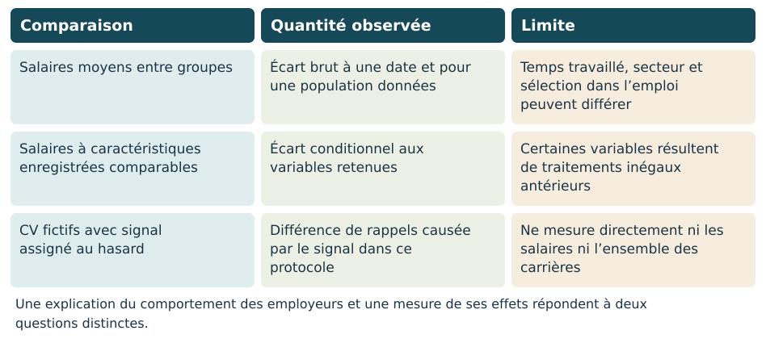

# ENS-PSL · Sélection internationale Lettres — Économie — les discriminations 2016 · Corrigé guidé

*Corrigé rédigé par IA, non officiel. Signalez toute erreur.*

**Lecture du rapport du jury** · GPT-6.2 Astra Ultra · vitesse non renseignée

**Rédaction** · GPT-6.2 Astra Ultra · vitesse non renseignée

**Autocontrôle** · GPT-6.2 Astra Ultra · vitesse non renseignée

**Révision (tour 2)** · GPT-6.2 Astra Ultra · vitesse non renseignée · 26 novembre 2026

## Définir le résultat qu’on cherche à expliquer

Commencer par une phrase dont chaque terme pourra être mesuré. « Parmi les candidatures répondant à la même offre, à compétences présentées identiques, le prénom affiché modifie-t-il les rappels ? » Fixer aussi les personnes absentes de ce champ. Celles qui n’ont pas eu accès à la formation requise ne figurent pas dans la comparaison. Le devoir doit pouvoir passer de ce test local aux étapes antérieures et postérieures de la carrière. Le rapport de 2016 invite précisément à croiser les mécanismes économiques, les difficultés de mesure, les faits et les politiques.

### Mettre deux méthodes de mesure en regard

Une entreprise paie en moyenne ses cadres davantage que ses employés. Si le groupe A accède moins souvent aux postes de cadre, il percevra un salaire moyen plus faible même en l’absence d’écart de paie au sein de chaque poste. Contrôler le poste permet de poser la question « à emploi comparable ». Cela soustrait également du calcul un éventuel obstacle à la promotion. Le choix des variables est donc une décision sur la question posée.

Passer ensuite à une expérience de correspondance. Pour chaque annonce éligible, préparer des CV de qualité comparable, attribuer les signaux par tirage au sort et relever les rappels. Bertrand et Mullainathan ont utilisé cette méthode dans deux villes américaines. Pour interpréter leur ordre de grandeur, imaginer deux taux de rappel de 10 % et de 6,7 %. L’écart est d’environ 3,3 points et de près de 50 % relativement au taux le plus faible. Ces nombres arrondis illustrent la différence entre points et taux relatif. Le testing identifie l’effet du nom tel que perçu dans les offres considérées. Il ne permet pas de connaître directement les intentions d’un recruteur, ni les effets sur les personnes déjà en poste.

### Faire prédire quelque chose à chaque théorie

Imaginons un responsable qui accepte un surcoût pour éviter le contact avec certaines personnes. Rendre leur productivité plus visible peut laisser son comportement intact. Si un concurrent moins discriminant peut embaucher ces personnes et attirer les mêmes clients, il bénéficie d’un avantage de coût. Expliquer pourquoi cet arbitrage peut être affaibli par une clientèle elle-même discriminante ou par un nombre restreint d’employeurs dans la zone.

Imaginons maintenant un responsable qui utilise un stéréotype de groupe faute d’information précise sur chaque candidature. Un test professionnel pertinent et fiable peut réduire sa dépendance à ce signal. Les résultats de ce test peuvent eux-mêmes refléter des inégalités d’accès à la préparation. La discrimination statistique explique le passage d’une croyance sur un groupe à un traitement individuel. Elle ne rend pas ce traitement équitable ou nécessaire. Si les rendements attendus de la formation diffèrent, un cercle de rétroaction peut entretenir les différences observées.

### Écrire un paragraphe de politique publique qui se laisse vérifier

Prenons le CV anonyme. Il supprime certains signaux lors du premier tri. Son effet prévu se mesure donc d’abord sur les convocations. Si une photo est supprimée mais que l’adresse constitue un signal de substitution, l’effet peut être limité. Si la décision se déplace vers l’entretien, l’écart final de recrutement peut rester identique. Comparer des établissements ayant introduit le dispositif à des établissements comparables et suivre plusieurs étapes permet de départager ces cas. Si l’adoption est volontaire, les établissements réformateurs peuvent différer des autres dès le départ. Une introduction tirée au sort, lorsqu’elle est possible, améliore l’interprétation causale.

Conclure sur un arbitrage empirique précis. Un recrutement réussi peut améliorer l’affectation des compétences et l’accès aux revenus. Une intervention sur le tri des CV ne corrige pas à elle seule les inégalités de formation ou les décisions de carrière. Le périmètre auquel l’on mesure l’efficacité doit correspondre au mécanisme avancé.

## Vérification sur le sujet

Le rapport de 2016 attend des faits d’emploi, une discussion de leur mesure, des mécanismes économiques et des politiques correctives. Les deux éditions traitent le test de correspondance, son champ et ses limites, la discrimination par préférence et la discrimination statistique.

On peut prolonger la comparaison du testing jusqu’à l’inefficacité économique. Si un employeur choisit un candidat dont la productivité anticipée sur des critères professionnels est de 90 plutôt qu’un candidat à 100 en raison d’un signal d’origine, la production attendue perd 10 unités à poste et salaire donnés. Ce calcul illustratif décrit le coût pour l’employeur. Le coût social dépend aussi du poste que la personne écartée pourra trouver.
