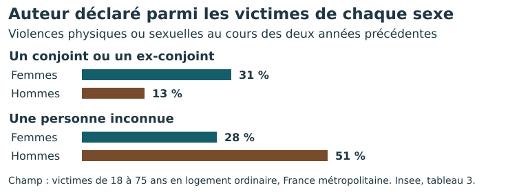

# La violence · ENS-PSL 2016 · Corrigé brut

*Corrigé rédigé par IA, non officiel. Signalez toute erreur.*

**Rédaction** · GPT-6.2 Astra Ultra · vitesse non renseignée

## Introduction

Dans *Daily*, Annette Messager fait reconnaître des cintres parmi des formes humaines en tissu. Le titre anglais invite à regarder cet assemblage comme quelque chose de quotidien. Or rien, dans le mot « quotidien », ne garantit qu’une situation ordinaire soit acceptable. L’enquête de l’Insee déplace pareillement le regard. Pour beaucoup de femmes interrogées, la personne à l’origine des violences appartient au cercle de leurs proches. Reconnaître ce fait demande un travail que le récit d’un événement exceptionnel ne suffit pas à faire. Inversement, les spectateurs de *Polyeucte* voient une autorité prononcer une condamnation en public, mais les personnages divergent jusque sur le nom de ce qu’ils voient. À quelles conditions peut-on reconnaître et juger une violence quand un lien familial, une croyance ou une institution lui donne le visage du devoir ou de l’habitude ?

## Qui a le pouvoir de nommer l’acte ?

Chez Corneille, Pauline demande où l’on conduit son mari. « À la mort », répond son père Félix. « À la gloire », répond Polyeucte. Le même vers fait entendre les deux réponses. On sait parfaitement qui a donné l’ordre aux soldats. Ce qui se joue entre les voix, c’est la signification de la condamnation. Gouverneur romain chargé de poursuivre les chrétiens, Félix présente sa colère comme « juste ». Il invoque la piété envers les dieux de l’Empire. Polyeucte revendique son geste contre leurs autels et professe sa foi en un Dieu qui s’est offert par amour. La répétition de « Je suis chrétien » lui permet de parler encore en son propre nom sous la contrainte. Elle ne transfère aucun pouvoir de décision au prisonnier. Félix finit pourtant par présenter sa sentence comme un assentiment au désir de son gendre. Pauline fait entendre le coût de cette bataille des mots. Elle voudrait suivre celui qu’elle aime, et celui-ci lui demande à son tour d’abandonner ses croyances.

Que devient le jugement si l’ordre de rendre justice s’adresse au parent même de la victime ? Dans le récit des Atrides repris par Robert Graves, les signes de bienvenue adressés à Agamemnon dissimulent l’hostilité de Clytemnestre et d’Égisthe. Cassandre pressent le drame. Sa parole de captive et de prophétesse ne peut l’empêcher. Une génération plus tard, Oreste consulte l’oracle au sujet de la mort de son père. Se soustraire à la vengeance lui fermerait les temples et l’exclurait de la communauté. L’extrait le laisse sur le chemin du retour, désormais résolu. Le lien de fils qui fonde sa dette envers Agamemnon l’unit aussi à Clytemnestre, sa mère. L’autorité divine tranche en faveur de la vengeance sans effacer cette contradiction. Corneille et Graves donnent ainsi deux places presque inverses au devoir religieux. Une foi donne au prisonnier des mots pour récuser le verdict, une autre parole sacrée impose au fils une obligation redoutable.

Pierre Bourdieu choisit justement Oreste pour faire sentir ce que l’existence de tribunaux publics nous fait oublier. Qui distingue le justicier du criminel quand aucune instance spécialisée ne s’est vu déléguer le jugement ? À la formule de Max Weber sur le monopole de l’usage légitime de la force physique, Bourdieu ajoute une dimension « symbolique ». L’État concentre des ressources matérielles, économiques et informationnelles. Ses catégories de pensée acquièrent aussi une autorité auprès de ceux qu’il gouverne. Un verdict peut alors être reconnu comme un jugement qui oblige chacun. Cette reconnaissance s’explique historiquement. Sa seule existence ne décide pas de la justice de chaque verdict. Le spectateur de Corneille peut comprendre à quel titre Félix commande et continuer à lui demander de répondre de sa décision.

## À quelle échelle chercher une explication ?

René Girard introduit un doute au cœur du récit qu’une personne donne de sa propre colère. Pourquoi l’explication par un tort initial deviendrait-elle suspecte ? Parce que le désir de violence peut durer après la disparition de sa cause et changer d’objet. La personne qui en subit les effets peut être étrangère au différend. Cette idée éclaire le décalage entre l’ampleur des raisons exposées à Oreste et l’absence de toute issue pour ceux qui subiront la vengeance. L’analogie a pourtant une limite. Dans le mythe, la généalogie détermine précisément de qui le fils se juge débiteur. Dans l’hypothèse de Girard, la vulnérabilité d’une victime peut suffire à expliquer qu’elle se trouve impliquée. L’auteur passe ensuite d’une comparaison avec des observations animales à une question sur le sacrifice rituel. Une communauté chercherait-elle à protéger certaines vies en acceptant qu’une autre paie le prix ? Le passage formule une hypothèse qui engage aussi un jugement sur la valeur accordée aux vies.

Frantz Fanon emploie lui aussi le mot « substitution ». Le changement dont il parle concerne des places au sein d’une société entière. Dans *Les Damnés de la terre*, paru en 1961, pendant la guerre d’Algérie, il examine la décolonisation au moment où l’ordre colonial vacille. Le nom d’un club sportif, la composition d’une réception, les postes dans la police et dans les banques prennent place dans la même énumération. L’autorité coloniale organise les carrières et les rencontres jusque dans leurs détails ordinaires. Les guillemets autour d’« espèce » donnent à lire la séparation que cet ordre impose aux êtres humains. Fanon présente la rupture violente comme nécessaire à son renversement. La répétition des termes absolus donne à la formule la force d’une prise de position. Il précise lui-même qu’une autre enquête pourrait porter sur les institutions de la nation nouvelle. Son choix de s’arrêter au commencement laisse ouverte la question de leur devenir.

Girard demande ce qui fait changer la violence d’objet. Fanon demande ce qui, dans l’histoire des colonisés, donne un objet déterminé à leur lutte. Rapporter cette histoire à une disposition individuelle ferait perdre la durée des interdictions qui la précèdent. Bourdieu aide à penser cette différence d’échelle. Il distingue, dans la formation de l’État, la concurrence extérieure entre princes et la résistance intérieure à leur autorité. Armée et police se spécialisent progressivement. L’ordre que l’on croit établi depuis toujours a donc une histoire. Fanon fait entendre ce que cet ordre représente pour ceux à qui il assigne une place inférieure. Ainsi, chacun des trois auteurs oblige à préciser ce que l’on prétend expliquer, le choix d’une victime, la formation d’une institution ou la contestation d’un régime.

## Que rendent visibles l’enquête et l’œuvre d’art ?

Dans les deux dernières colonnes du tableau de l’Insee, parmi les victimes de violences physiques ou sexuelles déclarées, 31 % des femmes et 13 % des hommes indiquent un conjoint ou un ancien conjoint. Une personne inconnue est désignée par 28 % des femmes victimes et 51 % des hommes victimes. Les deux comparaisons dessinent des expériences différentes de la proximité. Elles portent sur des personnes de 18 à 75 ans vivant en logement ordinaire en France métropolitaine, interrogées sur les deux années précédentes. Le mot « victimes » au sommet des colonnes commande toute la lecture. Pour estimer la proportion de toutes les personnes exposées, il faudrait rapporter le nombre de victimes à la population correspondante. En interrogeant les personnes sur ce qu’elles ont vécu, l’enquête permet aussi de connaître des faits qui peuvent rester en dehors des plaintes. Elle établit une répartition des réponses. L’histoire de chacun des foyers reste hors de portée de ces pourcentages.

Les œuvres de Messager placent le spectateur devant une difficulté complémentaire. Dans *Les Chimères* (1982), une grande forme ailée domine deux silhouettes de ciseaux. Des fragments de visages ou de bouches apparaissent dans ces formes, qui semblent à leur tour douées de vie. On reconnaît les éléments avant de pouvoir nommer l’être qu’ils composent. Le titre fait de cette hésitation une part de l’œuvre. Avec *Daily* (2016), l’installation réunit des objets agrandis, des formes textiles et des cintres suspendus. Les différences de taille renversent le rapport familier entre la main et l’objet qu’elle tient. Le titre ramène cet étrange spectacle vers l’espace domestique. Dans l’aquarelle *Pole Dance A* (2015), des traits rouges traversent la feuille et rythment les silhouettes sombres, placées à différentes hauteurs. Le titre oriente le regard vers une danse offerte au spectacle. L’instabilité des contours rend le plaisir de regarder moins assuré. Le spectateur a le temps de se demander ce qu’il attendait de voir en lisant le titre.

Ces trois œuvres d’une artiste qui interroge la présentation des corps donnent une portée publique à des rapports souvent tenus pour privés. On ne saurait attribuer une identité de victime ou une histoire précise à chacune des silhouettes. L’enquête fait un travail différent en recueillant des déclarations comparables. Elle oblige à reconnaître une régularité là où l’on pourrait croire à des histoires isolées. L’installation dérange une habitude de perception là où l’on aurait cru reconnaître de simples objets ménagers. Les travaux se rejoignent en ce point précis. La proximité peut rendre une violence plus difficile à nommer pour quiconque accorde spontanément aux objets de la maison, à l’ordre public ou à l’autorité familiale la valeur d’une protection.

## Conclusion

De la réponse de l’oracle à celle du gouverneur, une parole autorisée peut distribuer les rôles et qualifier la contrainte. Girard interroge la fragilité des raisons qu’on lui prête, Fanon la durée d’un ordre qui la précède, Bourdieu les institutions qui en fixent le sens public. Mais la question de Pauline conserve sa force. Que se passe-t-il pour la personne que les autres désignent, classent ou conduisent ? L’enquête restitue à de telles expériences une place dans le savoir collectif. L’art permet au spectateur de surprendre ses propres habitudes de regard. Juger demande de tenir ensemble la situation de ceux qui subissent la violence et l’examen des pouvoirs qui prétendent déjà avoir dit ce qu’elle signifie.
