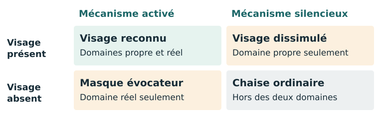
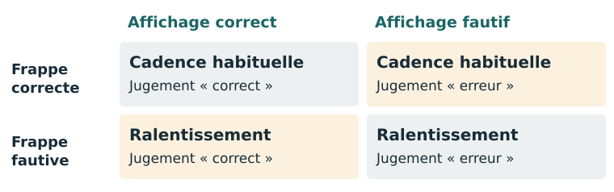

# ENS-PSL · Sélection internationale Lettres — Études cognitives 2016 · Corrigé brut

*Corrigé rédigé par IA, non officiel. Signalez toute erreur.*

**Rédaction** · GPT-6.2 Astra Ultra · vitesse non renseignée

## Sperber et Hirschfeld · La stabilité et la diversité culturelles

### 1. Pourquoi certaines représentations durent-elles ?

Une histoire change quand on la raconte de mémoire. Comment expliquer, dès lors, que des populations reconnaissent le même rituel, le même personnage ou la même classification après de nombreuses transmissions ? Comment rendre compte en même temps de la variété de ces traditions ? Dans cet article de synthèse, les auteurs cherchent ce que l’étude du développement et de l’architecture de l’esprit peut apporter à ces deux questions anthropologiques.

### 2. L’hypothèse de dispositions spécialisées

Reconnaître un visage, attribuer une intention à quelqu’un et classer les êtres vivants mobiliseraient des dispositions en partie distinctes, façonnées au cours de l’évolution. Elles orientent l’attention, la mémoire et les inférences. Si plusieurs personnes comblent les lacunes d’un récit dans des directions voisines, leurs versions peuvent converger jusque dans leurs transformations. La sélection de certains contenus et leur reconstruction orientée contribueraient ainsi à leur stabilité. Les matériaux, les relations et les institutions propres à chaque groupe font varier ce qui se stabilise.

### 3. Définir la culture et discuter la définition

Les auteurs appellent culture l’information largement distribuée dans un groupe, telle qu’elle est représentée dans l’esprit de ses membres et exprimée dans leurs conduites et leurs interactions. Une conversation sur un incident local relève d’un flux d’information. Si l’histoire sert ensuite d’exemple lors de réunions successives, sa circulation et ses usages peuvent en faire un élément de culture.

Je retiendrais cette définition pour suivre une transmission sans supposer que chacun possède la même copie de l’histoire. Je lui apporterais une précision sur la répartition des savoirs. Très peu de personnes savent construire un instrument traditionnel, tandis que beaucoup reconnaissent le son, le rôle des artisans et les occasions de jeu. La distribution de ces connaissances complémentaires, ainsi que l’accès aux instruments et à l’apprentissage, fait partie de ce que l’enquête doit expliquer.

### 4. Domaine propre, domaine réel

Le domaine propre réunit les types d’entrées pour lesquels le mécanisme a acquis sa fonction. Le domaine réel, ou effectif, réunit les stimuli qui satisfont effectivement ses conditions de déclenchement. Un vrai visage bien visible appartient aux deux. Un masque assez évocateur peut être traité comme un visage. Inversement, un vrai visage dissimulé peut échapper au mécanisme. L’invention de masques peut donc étendre durablement le domaine réel. Une même disposition rend intelligibles l’attention portée à de nombreux masques et la diversité des conventions qui donnent sa forme à chacun.

### 5. Peser les observations

La biologie intuitive m’offre l’argument le plus convaincant. Dans les histoires de petits animaux élevés par une autre espèce, des enfants attribuent certains traits adultes à l’espèce de naissance malgré le changement de milieu. Ce jugement distingue la filiation de l’apparence ou de l’entourage immédiat. Il donne un contenu précis à l’hypothèse d’attentes propres au vivant. Un apprentissage précoce des mots d’espèces et de leurs propriétés demeure cependant une explication concurrente.

Je suis plus réservé sur le surnaturel. Un arbre auquel on prête des intentions conserve assez de propriétés ordinaires pour être compris, tout en enfreignant une attente qui le rend mémorable. Cette explication indique pourquoi le récit pourrait attirer l’attention. Pour expliquer sa persistance comme croyance, il faudrait encore suivre qui le transmet, avec quelle autorité et dans quelles pratiques. Le classement des groupes sociaux fournit un cas voisin où les institutions contribuent à faire exister les catégories étudiées.

### 6. Une conséquence pour la théorie de la culture

Une tradition pourrait être stable même quand les transmissions individuelles sont peu fidèles. Si un conte est raccourci différemment par chaque narrateur, mais que tous rétablissent un personnage qui agit pour une raison compréhensible, les intentions peuvent rester au centre du récit. Une théorie de la culture doit donc décrire les transformations entre versions et les circonstances qui ramènent des versions différentes vers la même forme. Une comparaison de chaînes de transmission permettrait de chercher cette convergence.

### 7. Jusqu’où s’étend l’explication ?

L’existence de portraits dans de nombreuses sociétés établit mal, à elle seule, l’origine évolutive d’un module. Il faut des prédictions indépendantes sur les stimuli qui retiennent l’attention et sur les erreurs commises. Une disposition commune explique encore moins pourquoi tel portrait devient un emblème politique à une date précise. Une enquête devrait comparer des variantes également accessibles, mesurer séparément leur mémorisation et leur transmission, puis examiner le rôle des institutions et des supports matériels. Les auteurs eux-mêmes reconnaissent ces autres causes. L’enjeu est d’estimer leur contribution relative.

## Logan et Crump · Qui a fait la faute de frappe ?

### 1. L’objectif de l’étude

Chez des dactylographes expérimentés, la personne qui juge un mot correctement écrit a-t-elle accès au signal par lequel ses doigts ont déjà réagi à une faute ? Les auteurs dissocient le geste et son effet visible pour identifier ce qui commande l’ajustement de la frappe et ce qui fonde l’attribution explicite d’une erreur.

### 2. Deux prédictions concurrentes

Si un signal commun détermine les deux réponses, un ralentissement consécutif à une faute devrait aller de pair avec son signalement. Le modèle hiérarchique prévoit une dissociation. La boucle externe fixe le mot à produire et en évalue le résultat visible. La boucle interne traduit ce mot en frappes et serait sensible aux retours du mouvement des doigts et du clavier. Une frappe fausse rectifiée par l’ordinateur devrait ainsi entraîner un ralentissement, alors que le mot affiché paraît réussi.

### 3. Créer et mesurer le désaccord

Les sujets recopient des mots. Le programme peut afficher une lettre erronée après une frappe juste ou corriger une lettre mal tapée. Les essais ordinaires fournissent les deux combinaisons concordantes. Les chercheurs chronomètrent l’intervalle entre la frappe critique et la suivante. Ils interrogent aussi les sujets, rétrospectivement en expérience 1, mot par mot avec deux réponses en expérience 2, puis, après avertissement, avec quatre catégories en expérience 3. Le temps entre deux touches sonde une adaptation en cours d’exécution. Le jugement renseigne sur le résultat auquel le sujet croit avoir contribué. Avec une seule mesure, leur désaccord serait invisible.

### 4. L’hypothèse retenue

Au niveau du groupe, la frappe suivante ralentit après les fautes réellement tapées, y compris celles que le programme a corrigées. Les fautes ajoutées seulement à l’écran ne produisent pas ce ralentissement. En expérience 2, les erreurs ajoutées tendent pourtant à être déclarées fautives et les erreurs corrigées à être jugées correctes. Les deux situations discordantes favorisent ainsi le modèle de signaux distincts au sein d’un contrôle hiérarchique.

### 5. Comment les deux boucles peuvent-elles diverger ?

Une commande portant sur un mot laisse au système moteur la sélection rapide des touches. Une discordance locale entre la touche attendue et le mouvement effectué peut modifier la cadence dès la frappe suivante. À l’échelle du mot, l’écran donne un indice habituellement fiable de l’atteinte du but. Le système qui évalue le mot peut donc tirer une autre conclusion avec une information différente. Cette autonomie relative rend la dissociation intelligible. L’étude ne localise pas anatomiquement les boucles et ne sépare pas tous les signaux sensoriels possibles de la main.

### 6. L’asymétrie des attributions en expérience 3

Avertis de la manipulation, les sujets distinguent assez bien une faute réellement tapée d’une faute insérée par le logiciel. Une frappe fausse corrigée à l’écran est en revanche classée à peu près aussi souvent comme « correcte » que comme « corrigée ». Le ralentissement moteur persiste. Une faute visible donne une raison de chercher une cause externe. Un mot conforme au but fournit peu de raisons de soupçonner une intervention favorable. C’est une interprétation compatible avec les résultats, sans preuve d’une volonté de se donner le beau rôle.

La responsabilité ressentie peut donc dépendre de la connaissance du système et de la visibilité de son intervention. Pour attribuer causalement une faute dans un outil de saisie assistée, on comparera le journal des touches à celui des corrections. La responsabilité morale engage de surcroît les intentions et les possibilités de contrôle, dimensions que cette expérience ne mesure pas.

### 7. Ce que le résultat suggère pour la cognition

Une habileté peut être surveillée à plusieurs échelles. Un pianiste peut garder le fil d’une phrase musicale pendant que ses mains ajustent les gestes qui la composent. Une performance bien réglée peut ainsi s’accompagner d’une connaissance explicite imparfaite de ses détails. La frappe experte établit la possibilité de cette organisation. Généraliser à la musique demanderait d’y dissocier, à son tour, le mouvement effectué, le son entendu et le jugement d’exécution.

## Documents de l’épreuve

[Questionnaire bilingue de l’ENS-PSL](https://www.ens.psl.eu/IMG/file/admission/SI_2016/sujet%20e%CC%81crits%20SIL%202016.pdf) · [Sperber et Hirschfeld (2004)](https://www.ens.psl.eu/IMG/file/admission/SI_2016/Sperber_Hirschfel_2004.pdf) · [Logan et Crump (2010)](https://www.ens.psl.eu/IMG/file/admission/SI_2016/CrumpLoganScience2010.pdf)
