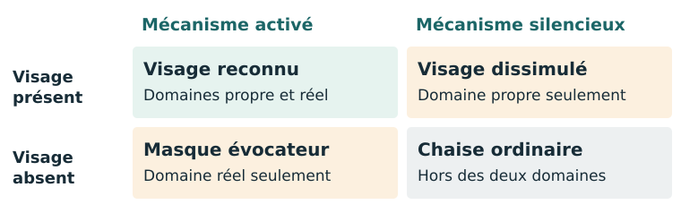
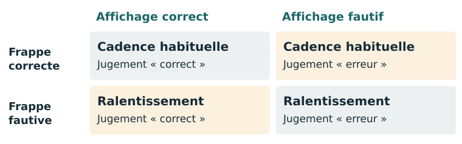

# ENS-PSL · Sélection internationale Lettres — Études cognitives 2016 · Corrigé guidé

*Corrigé rédigé par IA, non officiel. Signalez toute erreur.*

**Rédaction** · GPT-6.2 Astra Ultra · vitesse non renseignée

## Sperber et Hirschfeld · Suivre un contenu d’un esprit à l’autre

### 1. Partir de l’énigme

Racontez à deux amis, le lendemain, un récit entendu une seule fois. Les versions pourront différer tout en restant reconnaissables. Faites de ce petit problème une question d’anthropologie. Comment quelque chose de commun dure-t-il à l’échelle d’un groupe et de plusieurs générations ? Comment des esprits aux capacités semblables produisent-ils des traditions variées ? L’article rapproche psychologie du développement, psychologie de l’évolution et anthropologie pour expliquer ensemble stabilité et diversité.

### 2. Donner le mécanisme proposé

Suivez trois moments dans votre exemple. Un détail attire l’attention, un auditeur le retient, puis le restitue en faisant des inférences. Si le détail concerne les intentions d’un agent, les attentes ordinaires sur les personnes peuvent guider chacune de ces opérations. Les auteurs proposent que des dispositions spécialisées et partagées rendent certaines versions plus faciles à reconstruire ou à transmettre. De nouveaux contenus produits localement peuvent exploiter ces mêmes dispositions. Vous disposez alors de deux explications compatibles, l’une pour les régularités, l’autre pour la diversité.

### 3. Construire puis éprouver la définition

Demandez ce qui, dans une chanson, circule entre les personnes. Un air est mémorisé, fredonné et reconnu en contexte. L’information largement distribuée, ses représentations mentales et ses expressions dans les conduites et les échanges forment la culture au sens de l’article. Pour donner un avis, testez le cas d’un chant connu par quelques officiants seulement. Les autres peuvent en connaître l’usage sans en connaître tous les mots. J’accepterais la définition en y explicitant cette répartition inégale des compétences et le rôle matériel de l’apprentissage.

### 4. Appliquer deux critères à la même image

Constituez d’abord le domaine propre d’un dispositif de reconnaissance des visages en vous demandant à quel type d’objet répond sa fonction évolutive. Pour le domaine réel, demandez ce qui le déclenche dans les circonstances présentes. Un masque visible et un vrai visage caché mettent les réponses en désaccord dans des directions opposées. Un maquillage, lui, peut stimuler la reconnaissance sur un vrai visage. Le domaine culturel peut donc recouper le domaine propre aussi bien que s’en écarter.

### 5. Choisir une preuve et une difficulté

Prenez l’histoire d’un veau élevé par des cochons. Si l’enfant utilise l’ascendance pour prévoir certaines propriétés du veau adulte, on peut opposer son raisonnement à une hypothèse qui ferait tout dépendre de la ressemblance avec les animaux familiers. Cet avantage rend la biologie intuitive particulièrement instructive, bien qu’un apprentissage par les mots reste possible. Pour le surnaturel, un arbre doué de volonté combine une exception surprenante avec des attentes ordinaires sur les intentions. Ce modèle éclaire la mémorisation de certaines histoires. Il faudrait encore comparer leurs contextes rituels pour expliquer pourquoi telle histoire devient une croyance collective durable.

### 6. Changer d’échelle dans la conclusion

Imaginez que des personnes entendent des variantes différentes d’un même conte, puis ramènent chacune le motif étrange à une trame intelligible. La transmission peut produire de la convergence à partir d’altérations. C’est une implication théorique forte. Pour l’éprouver, on pourrait relever, sur des chaînes indépendantes, aussi bien les détails qui réapparaissent que ceux qui disparaissent. On distinguerait ainsi conservation littérale et stabilité d’une forme reconstruite.

### 7. Nommer la preuve qui manque

Une régularité commune à plusieurs populations peut provenir d’un apprentissage dans des environnements similaires. Pour établir la spécialisation supposée, cherchez des prédictions propres au domaine et des contre-exemples possibles. Pour passer à la diffusion historique, demandez qui dispose d’une tribune, d’une école ou d’un support de conservation. Le succès mnésique d’une forme et son succès institutionnel sont deux événements observables, susceptibles ou non de coïncider. Cette limite situe le rôle cognitif parmi les facteurs que les auteurs reconnaissent.

## Logan et Crump · Raisonner sur deux signaux d’erreur

### 1. Isoler le problème

Vous tapez une lettre voisine, le logiciel corrige l’écran et vous vous déclarez satisfait du mot. Votre geste suivant peut-il porter la trace de la faute ? L’objectif est de déterminer si la surveillance motrice de la frappe et le jugement conscient de réussite reposent sur le même signal, chez des personnes sachant taper couramment.

### 2. Faire deux prédictions avant de lire les résultats

Sous l’hypothèse d’un détecteur commun, les essais suscitant une réaction motrice à la faute devraient aussi être jugés fautifs. Dans le modèle hiérarchique, le niveau externe commande un mot et examine l’écran, le niveau interne commande les touches et reçoit des informations sur le geste. Prédisez ce qui arrive en cas de correction silencieuse. Les doigts devraient ralentir, mais le sujet peut juger le mot correct. Une fausse lettre insérée par le logiciel inverse la prédiction.

### 3. Reconstruire les conditions et les mesures

Écrivez d’abord ce que la personne a tapé, puis ce que le logiciel montre. Il y a quatre combinaisons. Pour chacune, mesurez le délai entre la touche critique et la suivante. Interrogez ensuite le sujet. Dans la première expérience, il répond après la séance. Dans la deuxième, il évalue chaque mot comme juste ou faux. Dans la troisième, il connaît le trucage et peut préciser « insérée » ou « corrigée ». Le chronométrage rend visible une adaptation locale même quand le sujet ne la verbalise pas. La réponse verbale indique comment il évalue le mot.

### 4. Lire les deux cases décisives

Regardez le cas d’une frappe fausse corrigée. Elle s’accompagne d’un ralentissement, alors que le jugement binaire suit souvent l’affichage correct. Regardez ensuite la faute insérée après une frappe juste. Le ralentissement caractéristique manque, mais le mot est souvent déclaré fautif. Ces deux inversions constituent l’argument pour des mécanismes distincts et hiérarchisés. Les essais sans intervention, où les deux signaux s’accordent, n’auraient pas permis de trancher.

### 5. Expliquer la dissociation

À chaque niveau, énoncez un but et un retour d’information. Au niveau du mot, la boucle externe peut comparer intention et résultat visible. Au niveau de la touche, le système interne peut détecter un écart moteur assez tôt pour retarder le geste suivant. La boucle qui délègue la succession des gestes n’en reçoit pas nécessairement le détail. Le même essai a donc deux propriétés réelles, réussite du mot affiché et faute d’exécution de la touche, que les deux mesures saisissent séparément.

### 6. Comparer deux erreurs connues du sujet

Les quatre réponses de l’expérience 3 permettent une attribution jusque-là impossible. Les sujets savent reconnaître nombre d’erreurs insérées. Devant une frappe fausse corrigée, ils hésitent entre leur propre réussite et l’intervention du logiciel, avec des fréquences comparables. Le mot fautif visible incite à vérifier son origine, alors que le mot attendu peut clore le contrôle. L’explication relève d’une hypothèse sur la saillance du résultat. L’observation porte sur les réponses et les temps. En tirer une leçon sur la responsabilité demande de distinguer le sentiment d’avoir produit un résultat, la contribution causale de chaque agent et la responsabilité morale.

### 7. Transposer le raisonnement avec une prédiction

Prenez un musicien exécutant une phrase apprise. Le but d’ensemble laisse aux gestes entraînés une part de surveillance locale. S’il en va comme dans la frappe, un geste incorrect dont le son a été rectifié pourrait influer sur le geste suivant, même si le musicien juge correcte la phrase entendue. C’est la possibilité d’une expertise hiérarchique, avec accès explicite limité aux détails, que montre l’étude. La réalisation d’une telle expérience musicale resterait nécessaire pour appuyer la transposition.

## Documents de l’épreuve

[Questionnaire bilingue de l’ENS-PSL](https://www.ens.psl.eu/IMG/file/admission/SI_2016/sujet%20e%CC%81crits%20SIL%202016.pdf) · [Sperber et Hirschfeld (2004)](https://www.ens.psl.eu/IMG/file/admission/SI_2016/Sperber_Hirschfel_2004.pdf) · [Logan et Crump (2010)](https://www.ens.psl.eu/IMG/file/admission/SI_2016/CrumpLoganScience2010.pdf)
